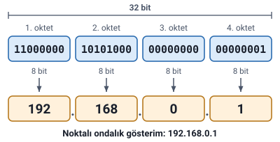

### Temel fikir: ağda herkesin bir adresi olmalı

Ağdaki cihazların birbirini bulabilmesi için her birinin **benzersiz bir tanımlayıcısı** olmalıdır. **IP adresi, bilgisayarı ağda tanımlayan sayıdır.**

Hocanın benzetmesi: IP adresini bir **posta adresi** gibi düşünün. **Şehir ağdır, kapı numarası host'tur.**

Dersin kapağındaki alt başlık konunun özetidir: ağdaki cihazları **tanımak, adreslemek ve yönlendirmek.**

> **Ek:** Mektubun önce doğru şehre, sonra o şehirdeki doğru kapıya ulaşması gibi, paket de önce doğru ağa, sonra o ağdaki doğru cihaza ulaşır. "Host", ağa bağlı ve adres verilen her cihaz demektir: bilgisayar, telefon, yazıcı, sunucu.

### IP adresi nedir

Hoca IP adresini üç özellikle tanımlar:

| Özellik | Açıklama |
| --- | --- |
| 32 bitlik sayı | IPv4 adresi, dört oktete ayrılan 32 bitlik bir sayıdır. |
| Mantıksal adres | Ağdaki konumu gösterir. Fiziksel MAC adresinden farklıdır. |
| Yönlendirme bilgisi | Paketler, kaynak ve hedef IP adresleri kullanılarak iletilir. |

> **Dikkat:** IP adresi ile MAC adresini karıştırmayın. IP adresi **mantıksal** adrestir ve cihazın ağdaki konumunu gösterir. MAC adresi ise **fiziksel** adrestir.

> **Ek:** MAC adresi, ağ kartına üretimde verilen donanım adresidir; cihaz başka bir ağa taşınsa da değişmez. IP adresi ise cihazın bağlandığı ağa göre değişebilir. Posta benzetmesiyle: MAC adresi kişinin kimliği, IP adresi o an oturduğu evin adresi gibidir.

### IPv4'ün yapısı: 32 bit, dört oktet

32 bit, **8'erli dört gruba** bölünür. Her grup bir **oktet** olarak adlandırılır ve **0–255** arasında değer alır.

Hocanın örneği:

| 1. oktet | 2. oktet | 3. oktet | 4. oktet |
| --- | --- | --- | --- |
| 11000000 | 10101000 | 00000000 | 00000001 |

İkilik yazımıyla örnek IPv4 adresi: `11000000.10101000.00000000.00000001`

> **Ek:** Bir oktet 8 bit olduğu için 2⁸ = 256 farklı değer alabilir: 0'dan (00000000) 255'e (11111111) kadar. Oktetin değerinin 255'i geçmemesi bundandır; 192.168.0.300 gibi bir yazım geçerli bir IPv4 adresi değildir.

### İkilikten noktalı ondalığa dönüşüm

Her oktet **ayrı ayrı** ondalığa çevrilir; sonuçlar **noktayla** ayrılır.

Oktetteki bitlerin ağırlıkları soldan sağa şöyledir:

| Bit | 1 | 2 | 3 | 4 | 5 | 6 | 7 | 8 |
| --- | --- | --- | --- | --- | --- | --- | --- | --- |
| Ağırlık | 128 | 64 | 32 | 16 | 8 | 4 | 2 | 1 |

Bir oktetin ondalık değeri, **1 olan bitlerin ağırlıklarının toplamıdır.**

Hocanın örneği:

| İkilik gösterim | Noktalı ondalık gösterim |
| --- | --- |
| `11000000.10101000.00000000.00000001` | `192.168.0.1` |

Oktet oktet hesap:

- `11000000` → 128 + 64 = **192**
- `10101000` → 128 + 32 + 8 = **168**
- `00000000` → **0**
- `00000001` → **1**

> **Dikkat:** Dönüşüm 32 bitin tamamına bir kerede uygulanmaz; her oktet kendi içinde 128'den 1'e kadar olan ağırlıklarla çevrilir. Dördüncü oktetteki `00000001` bu yüzden 1'dir.

### Ağ kısmı ve host kısmı

Bir IP adresi, hem **ağın kendisini** hem de **o ağdaki cihazı** anlatır: adres = **ağ + host**.

| Bölüm | Sorduğu | Açıklama |
| --- | --- | --- |
| Ağ kısmı | Hangi ağ? | Adresin ağ bölümünü gösterir. Aynı ağdaki cihazlar bu kısmı paylaşır. |
| Host kısmı | Hangi cihaz? | Ağdaki belirli cihazı gösterir. |

**Sınıflar, bu bölünmenin sabit biçimleridir.** Hangi oktetlerin ağa, hangilerinin host'a ait olduğu "IPv4 Adres Sınıfları ve Alt Ağ Maskesi" konusunda anlatılır.

> **Ek:** Posta benzetmesine dönersek: aynı şehirdeki evlerin şehir adı ortaktır (ağ kısmı), kapı numaraları farklıdır (host kısmı).
