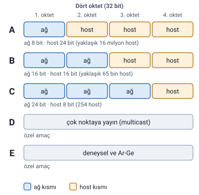

### Sınıflı adresleme: A'dan E'ye beş sınıf

IPv4 adresleri, ağ ve host bölümlerinin sabit biçimlerine göre sınıflandırılır. Beş sınıf vardır: **A, B, C, D ve E.**

**İlk oktet, adresin hangi sınıfa ait olduğunu belirler.**

| Sınıf | Kullanım |
| --- | --- |
| A | Genel ağlar |
| B | Genel ağlar |
| C | Genel ağlar |
| D | Özel amaç |
| E | Özel amaç |

A, B ve C kullanıcı ağları için; D ve E özel amaçlar için ayrılır.

> **Ek:** İlk oktetin aralığı, aslında ilk birkaç bitten gelir: A sınıfında ilk bit `0`, B'de ilk iki bit `10`, C'de ilk üç bit `110`, D'de ilk dört bit `1110`, E'de ilk dört bit `1111`'dir. Örneğin `10` ile başlayan bir oktet en az 128 (`10000000`), en çok 191 (`10111111`) olabilir; B sınıfının aralığı budur. A sınıfında ilk bitin 0 olması 0–127 aralığını verir; 0 ve 127 cihazlara verilmediği için kullanılabilir aralık 1–126'dır.

### Sınıf A: az ağ, çok host

**İlk oktet ağı, kalan üç oktet host'u belirler.** Bu yapı az sayıda ağ oluşturur; her ağda çok sayıda cihaz bulunabilir.

| Ağ bölümü | Host bölümü |
| --- | --- |
| 8 bit (ilk oktet) | 24 bit (kalan üç oktet) |
| İlk oktet aralığı: 1–126 | Yaklaşık 16 milyon host |

Hocanın örnek okuması: `10.24.8.17` adresinde **10 ağ**, **24.8.17 host** tarafıdır.

> **Dikkat:** Slaytlarda A sınıfının ilk oktet aralığı iki farklı biçimde yazılmış: Sınıf A slaytında "0–126", loopback slaytında "A Sınıfı 1'den 126'ya kadar tanımlanır". Notta 1–126 kullanıldı: 0 ile başlayan adresler cihazlara verilmez, 127 de loopback için ayrılmıştır (aşağıda). Slaytta "0–126" yazdığını bilin.

> **Ek:** Yaklaşık 16 milyon, 24 bitlik host alanından gelir: 2²⁴ − 2 = 16.777.214 kullanılabilir host. Neden 2 çıkarıldığı aşağıda, "Neden 2ⁿ − 2 host" başlığında.

### Sınıf B ve Sınıf C

Adres sınıfı büyüdükçe **ağ bölümü genişler, ağ başına düşen host sayısı azalır.**

| Sınıf | İlk oktet | Ağ bitleri | Host bitleri | Yaklaşık host |
| --- | --- | --- | --- | --- |
| B | 128–191 | 16 | 16 | 65 bin |
| C | 192–223 | 24 | 8 | 254 |

#### Sınıf B: orta ölçekli ağ

**İlk iki oktet ağ kısmıdır.** Kalan iki oktet host'ları tanımlar.

#### Sınıf C: küçük ağ

**İlk üç oktet ağ kısmıdır.** Son oktet host'ları tanımlar.

Hoca bu slaytın altına şunu ekler: sınıflı adresleme, modern ağlarda çoğunlukla **alt ağ maskesi** ve **CIDR** ile daha esnek biçimde kullanılır.

> **Ek:** CIDR (Classless Inter-Domain Routing, sınıfsız alanlar arası yönlendirme), ağ kısmının uzunluğunu sınıfa bağlı olmadan, `/` işaretinden sonra yazılan bit sayısıyla belirler. Bugün internette adres blokları sınıflara göre değil, bu yolla dağıtılır; sınıflar ise kavramı öğrenmek için temel olarak anlatılır.

> **Dikkat:** "Sınıf büyüdükçe" sözü harf sırasıyla A'dan C'ye gidişi anlatır. A'da ağ bölümü en dar (8 bit), host sayısı en çoktur; C'de ağ bölümü en geniş (24 bit), host sayısı en azdır.

### Sınıf D ve E: özel kullanım blokları

İlk okteti **223'ün üzerinde** olan adresler, klasik uç cihaz (host) atamalarına dahil edilmez.

| Sınıf | İlk oktet | Amaç |
| --- | --- | --- |
| D | 224–239 | Çok noktaya yayın (multicast) |
| E | 240–255 | Deneysel ve Ar-Ge |

**Sınıf D: çok noktaya yayın.** **Multicast** iletişimi için tahsis edilmiştir. Tek bir veri paketini **aynı anda belirli bir abone grubuna** iletmek amacıyla kullanılır.

**Sınıf E: deneysel ve Ar-Ge.** Gelecekteki araştırma ve laboratuvar çalışmaları için rezerve edilmiştir; standart yerel ağlarda istemcilere verilmez.

> **Ek:** Multicast'e örnek olarak canlı bir video yayınının yalnızca o yayına abone olan cihazlara tek akışla gönderilmesi verilebilir. Ağdaki bütün cihazlara giden "yayın" (broadcast) ile karıştırmayın; multicast yalnızca abone gruba gider.

### Neden 2ⁿ − 2 host

Bir alt ağdaki host bitlerinin bütün olasılıkları cihazlara dağıtılamaz; **iki kritik adres rezerve edilir.** n host biti için kullanılabilir host sayısı **2ⁿ − 2**'dir.

#### Ağ adresi: host bitlerinin tümü 0

Host bitlerinin tamamı **sıfır** olduğunda bu adres **alt ağın kendisini** temsil eder; hiçbir cihaza verilemez.

#### Yayın (broadcast) adresi: host bitlerinin tümü 1

Host bitlerinin tümü **bir** olduğunda bu adres **yayın adresidir**: ağdaki tüm cihazlara toplu duyuru için kullanılır; cihaza atanamaz.

#### Hocanın örneği: Sınıf C

8 bitlik host alanı için: 2⁸ − 2 = 256 − 2 = **254** kullanılabilir host kalır.

> **Ek:** Örneğin `192.168.1.0/24` ağında host kısmı son oktettir. `192.168.1.0` ağ adresi, `192.168.1.255` yayın adresidir; cihazlara `192.168.1.1` ile `192.168.1.254` arasındaki 254 adres verilebilir.

### 127.x.x.x ve loopback

A sınıfı **1'den 126'ya** kadar tanımlanır; **127 bloğunun tamamı** donanım ve yazılım içi sınama için ayrılmıştır.

**127.0.0.1 (localhost).** Bu adrese gönderilen paket, ağ kartından kabloya çıkmadan **doğrudan yerel TCP/IP yığınına geri döner.**

**A sınıfı ağ sayısı: 126.** 127 bloğu loopback için çıkarıldığından, A sınıfında kullanılabilir ağ sayısı **127 değil, tam 126'dır.**

**16 milyonluk test bloğu.** Tek bir makinenin kendi kendini sınaması uğruna **devasa bir /8 adres bloğu** genel yönlendirmeye kapatılmıştır.

> **Ek:** Yani bilgisayar bu adresle kendi kendisiyle konuşur. "/8", ilk 8 bitin (ilk oktetin) ağa ait olduğu demektir; 127 ile başlayan bütün adresler (127.0.0.0 – 127.255.255.255) bu bloktadır. Yazılımcılar bilgisayarlarında çalıştırdıkları bir web sunucusunu tarayıcıda `localhost` ya da `127.0.0.1` yazarak açar.

### Alt ağ maskesi

**Maske**, 32 bitlik IP adresinin neresinin **ağ** (network), neresinin **cihaz** (host) kimliği olduğunu belirten **ikili şablondur.** Alt ağ maskesi ağı ayırır.

| Sınıf | Varsayılan maske | CIDR gösterimi | Ağ / host bölümü |
| --- | --- | --- | --- |
| Sınıf A | 255.0.0.0 | /8 | 8 bit ağ, 24 bit host |
| Sınıf B | 255.255.0.0 | /16 | 16 bit ağ, 16 bit host |
| Sınıf C | 255.255.255.0 | /24 | 24 bit ağ, 8 bit host |

Hocanın örneği: `192.168.1.0/24`, **ilk 24 bitin ağa ait olduğunu** gösterir.

> **Ek:** Maskede ağ bitleri 1, host bitleri 0'dır. 255 ikilikte `11111111` olduğu için 255.255.255.0 maskesi 24 tane 1 ve 8 tane 0'dan oluşur; "/24" yazımı bu 1'lerin sayısıdır.

> **Dikkat:** CIDR gösterimindeki sayı (ör. /24) **ağa ait bit sayısıdır**, host sayısı değildir. /24'te host için 32 − 24 = 8 bit kalır.
