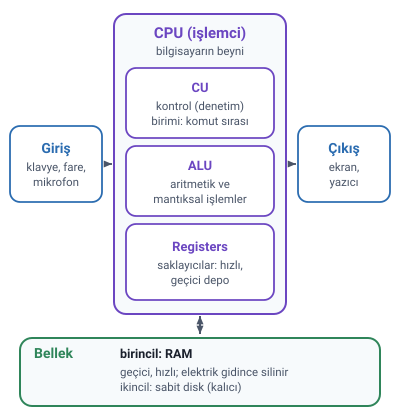

### Genel programlama bilgisi

Bir programcının program yazabilmesi için yapması gereken çalışmalar ve bilmesi gereken ön bilgiler vardır; çünkü bir problemin bilgisayar ortamında çözülmesi hazırlıksız ve hızlı bir şekilde gerçekleşemez.

- Her şeyden önce **programlama bir süreçtir**: programın yazılıp bitmesiyle bitmez, çoğunlukla programın yaşadığı süre içinde değişik şekillerde devam eder.
- Bu nedenle program yazılmadan ya da problem çözülmeye başlamadan önce bazı adımları sağlam atmak gerekir. Bu adımlar çoğu zaman **raporlarla belgelendirilir**, çünkü yazılımın yaşam döngüsü boyunca bu raporlara ya da başlangıç adımlarına ihtiyaç duyulabilir.
- Sağlam temelli programlar yazabilmek için ön çalışmalar mutlaka **kâğıt üzerinde** yapılır ve elde edilen verilere göre program yazılır.

#### Programlama mantığı

Programlamaya yeni başlayan biri için hemen program yazmak zordur; önce **programlama mantığını** ve **problem çözme ön sezisini** edinmek gerekir. Hocaya göre ders notları yalnızca temel bilgileri verir; bu mantık ve sezgiler program yazdıkça gelişir. Programlama yeteneğini edinmek, resim yapma ya da güzel sanatlara karşı bir yetenek edinmekten çok daha kolaydır.

Programlama dilleri zaman içinde gelişmiş, değişmiş, kaybolmuş ya da yenileri çıkmıştır. Bu yüzden programlama bilgisi **asla bir programlama diline bağlı tutulmamalıdır.** Programlama mantığı ve ön sezileri iyi gelişmiş, algoritmaları kolay kurup algılayabilen, çok karmaşık sorunlar üzerinde fikir yürütüp çözüm üretebilen biri için bildiği dilin fazla önemi kalmaz; bir programlama dili çoğunlukla 1–2 hafta gibi bir sürede orta düzeyde öğrenilebilir. Hocaya göre en doğrusu, her derde çözüm olabilecek temel bir programlama dilini çok iyi öğrenip her çözüme uyarlayabilmektir. Önemli olan programlama mantığını iyi kapmaktır.

Hocanın vurgusu: programlama dilinin alternatifleri vardır, ama **programlamanın alternatifi yoktur.** Bir program yazılacaksa mutlaka programlamanın kurallarına göre yazılmalıdır.

### Bilgisayar nedir

**Bilgisayar**, verileri işleyerek özet bilgiler şekline sokabilen, bu veri ve bilgileri yüksek kapasitelerde saklayıp başka ortamlara iletebilen **elektronik cihazdır.** Bu işlemleri çok yüksek hızlarda ve bıkmadan usanmadan, tekrarlı olarak yapar.

Ancak tek başına bir bilgisayar donanımı bu işleri gerçekleştirecek durumda değildir: işlemler donanım tarafından yapılsa da **asıl iş yazılımlar tarafından** gerçekleştirilir.

### Bilgisayar organizasyonu

Bir elektronik bilgisayarda **giriş, çıkış, veri işleme ve veri saklama** işlemleri gerçekleştirilir. Hocanın saydığı birimler:

- **Giriş birimi:** Klavye, fare, mikrofon, kamera gibi cihazlardan biri ya da birkaçından oluşur. Veri ve komutların bilgisayara yollanmasını sağlar.
- **Bellek birimi:** Veri, komut ve programların saklandığı donanımlardır. Ana bellek çoğunlukla RAM olarak anılır ve SIMM gibi donanımlarla belirlenir. Yan ya da ikincil bellek ise floppy ve sabit diskleri ifade eder; bilgilerin daha kalıcı saklanmasını sağlayan alanlardır.
- **Aritmetik-mantık birimi:** Bilgisayardaki tüm aritmetik ve mantıksal işlemlerin yapıldığı birimdir.
- **Denetim birimi:** Tüm işlemleri yapan ana birimdir. Bilgisayar programının çalışmasını denetleyen, programda yapılan hesaplamalara göre hangi işlerin yapılacağına karar veren birimdir. Makine diline çevrilmiş bir programda komutları teker teker ve sırayla ana işlem birimine getirip yorumlar ve komutu çalıştırır.
- **Çıkış birimi:** Bilgisayarda oluşan verilerin dış ortama verilmesini sağlayan birimlerdir: ekran, yazıcı gibi.

Bir programcı bu birimlerin ne işe yaradığını bilmelidir. Özellikle **aritmetik-mantık birimi ve denetim birimi bilgisayarın beynini** oluşturduğu için nasıl davrandıklarını iyi bilmek zorundadır.

> **Ek:** Hocanın bellek örnekleri (SIMM modülü, floppy disk) eskidir. Bugün ana bellek DIMM modüllerle takılır; floppy disk kullanılmaz, ikincil bellek olarak sabit disk (HDD) ve SSD kullanılır. SSD'nin dönen plakası, dolayısıyla devir sayısı (rpm) yoktur.

### Donanım ve yazılım

- **Donanım (hardware):** Bilgisayarın fiziksel parçaları. Hocanın örnekleri: yazıcı, monitör, klavye, anakart.
- **Yazılım (software):** Bilgisayar tarafından kullanılan programlar. Hocanın örnekleri: Word, Excel, Turbo Pascal.

### Donanımın dört bölümü

Hocaya göre bir bilgisayar sisteminde **4 önemli bölüm** bulunur:

1. **Giriş aygıtları (input devices):** Bilgisayara bilgi göndermek için kullanılır: klavye, fare.
2. **Çıkış aygıtları (output devices):** Bilgisayardan kullanıcıya bilgi iletmek için kullanılır: monitör, yazıcı.
3. **CPU (işlemci)**
4. **Bellek (memory)**

> **Dikkat:** Hoca bilgisayarın parçalarını iki ayrı slaytta iki biçimde sayıyor. "Bilgisayar organizasyonu"nda **beş birim** var (giriş, bellek, aritmetik-mantık, denetim, çıkış); "Donanım"da **dört bölüm** var (giriş, çıkış, CPU, bellek). Fark şuradan gelir: aritmetik-mantık birimi ve denetim birimi, CPU'nun içindedir.

#### CPU

**CPU** (Central Processing Unit, merkezi işlem birimi ya da işlemci) **bilgisayarın beyni** olarak bilinir; **aritmetiksel ve mantıksal işlemleri** yapan aygıttır.

- Aritmetiksel işlemler: toplama, çıkarma, çarpma, bölme.
- Mantıksal işlemler: büyüklük, küçüklük, eşitlik tespiti gibi karşılaştırma işlemleri.

CPU aynı zamanda bilgisayar birimlerinin çalışmasını ve bu birimler arasındaki **veri akışını** da kontrol eder. Bir programdaki talimatları alıp programın istediği işlemleri gerçekleştirir. Hocanın örneği: tipik bir CPU komutu, 0 ve 1'leri sayı olarak algılar ve "17 numaralı hafıza birimindeki sayıyı al, 19 numaralı hafıza biriminden aldığın sayıya ekle, sonucu 55 numaralı hafıza birimine yaz" gibi düşünülebilir.

> **Dikkat:** Slaytta CPU'nun açılımı "Merkezi İşletim Ünitesi" diye yazılmış; yerleşik Türkçe karşılığı **merkezi işlem birimi**dir (hoca da bellek slaytında böyle yazıyor).

#### CPU'nun parçaları

CPU **3 ana parçadan** oluşur:

- **CU (Kontrol Birimi):** CPU'da komutların gerçekleştirilme **sırasını** kontrol eden birimdir.
- **ALU (Arithmetic Logic Unit, Aritmetik Lojik Birim):** Bilgisayarda genel anlamda **aritmetik ve mantıksal işlemlerin** yapıldığı birimdir.
- **Registers (saklayıcılar):** Modern işlemci tasarımının merkezidir. İşlemci üzerinde bulunan ve hesaplamalarda **geçici depo** görevi gören yüksek hızlı hafıza birimleridir.

> **Dikkat:** Aynı birimler farklı adlarla geçiyor: "kontrol birimi (CU)" ile "denetim birimi" aynı birimdir; "ALU" ile "aritmetik-mantık birimi" de aynı birimdir.

### Bellek

Hocaya göre **2 tip hafıza** vardır: birincil hafıza ve ikincil hafıza.

#### Birincil hafıza (RAM)

- Birincil hafıza, bilgisayarın **rastgele erişilebilir belleğidir: RAM** (Random Access Memory).
- En temel işlevi, işlemcinin program çalıştırırken verileri **geçici olarak** sakladığı ve sırası geldikçe kullandığı alan olmasıdır.
- İşlemci programları çok basit toplama, çıkarma seviyesinde işlemler yaparak çalıştırır. Karmaşık bir program bu tür basit işlemlere indirgenebilir, ama bu çok sayıda işlem demektir. CPU anlık olarak bu işlemlerden **yalnızca birini** yapabilir; geri kalanlar sırasını beklemek ve bu sırada bir yerde saklanmak zorundadır.
- RAM, bilgisayarda çalışan her programın CPU'da çalışmak için bekletildiği ve o ana kadar biriken verilerinin saklandığı hafıza ünitesidir.
- RAM harddisklere göre **daha hızlı** (ve dolayısıyla daha pahalı) olsa da içindeki bilgiler **elektrik kesilince kaybolur.** Bu yüzden ikincil hafızaya her zaman ihtiyaç vardır; bilgisayar kapanıp açıldığında verilerin korunması için RAM'deki bilgiler diske yazılabilir.
- RAM birbirinden tamamen bağımsız **hücrelerden** oluşur; her hücrenin kendine ait **sayısal bir adresi** vardır. Herhangi bir hücreye istenildiği anda, diğerlerinden bağımsız olarak erişilebilir. **"Rastgele erişimli bellek"** adı buradan gelir.
- RAM, adresler ve içerikleri tablosu olarak da görülebilir.
- Bellek kapasitesi **byte** cinsinden verilir. Byte bellek ölçü birimidir ve **8 bitten** oluşur. **Bit** ise "1" ya da "0" sayısal bilgisini saklayan **en küçük** hafıza birimidir.

#### İkincil hafıza (sabit disk)

- Hocaya göre **sabit disk** olarak da bilinir.
- Verilerin **uzun ömürlü** ve en güvenilir şekilde saklanmasını sağlayan depolama aygıtlarıdır.
- Bilgisayarın çevre birimleriyle uyumlu çalışması için gereken **işletim sistemi** sabit diske kurulur; sürekli çalışması gereken yazılımlar da sabit diskte tutulur.
- Sabit diskler **kapasiteleri ve devir sayılarıyla** anılır. Kapasite, en küçük anlamlı bilgi kümesi olan byte'ın üst katlarıyla belirtilir. Devir sayısı **RPM** (Rotation Per Minute, dakikadaki dönüş sayısı) olarak adlandırılır ve disk plakalarının dakikadaki dönüş sayısını belirtir.
- 90'lı yıllardan günümüze 3600, 5400, 7200 ve 10000 rpm hızlı sabit diskler üretilmiştir. Yüksek rpm'li diskler daha fazla ısındığı için kasada hava sirkülasyonunun çok iyi sağlanması gerekir.

> **Dikkat:** RAM ile sabit diski karıştırmayın: RAM **geçici**, hızlı ve pahalıdır, elektrik kesilince içindekiler silinir; sabit disk **kalıcıdır**, işletim sistemi ve programlar ona kurulur.

### Yazılım

- **Yazılım**, donanım birimlerini istenen işleme yöneltip verimli bir çalışma içinde kullanımını sağlayan bir dizi komut, prosedür gibi **sanal tanımlardır.**
- Bilgisayar ile kullanıcı arasındaki iletişimi sağlayan görünen öğedir.
- Bilgisayarın çalışmasını ve işlem yapmasını sağlayan bütün programlar yazılım grubunu oluşturur.
- Bilgisayarın çalışmasını sağlayan en önemli ve vazgeçilmez unsurlardan biri de yazılımdır (işletim sistemi).

#### Yazılım türleri

Yazılımlar genel olarak birkaç alt grupta incelenebilir:

| Sistem yazılımları | Uygulama yazılımları |
| --- | --- |
| İşletim sistemi | Ticari paket yazılımlar |
| Bellek ve disk hizmet yazılımları | Ofis otomasyonu yazılımları |
| Derleyiciler | Diğer özel ve genel yazılımlar (çizim, tasarım, dizgi vb.) |
| Veritabanı yönetim yazılımları | |
| İletişim ve haberleşme yazılımları | |
| Ağ yönetim yazılımları | |

**En önemli yazılım işletim sistemidir**, çünkü bu yazılım olmadan bilgisayar açılamaz.

> **Dikkat:** Derleyiciler ve veritabanı yönetim yazılımları hocanın listesinde **sistem yazılımıdır**; Word, Excel gibi ofis programları ise **uygulama yazılımıdır.**
