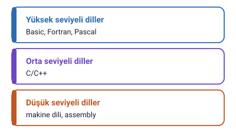
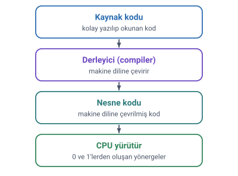
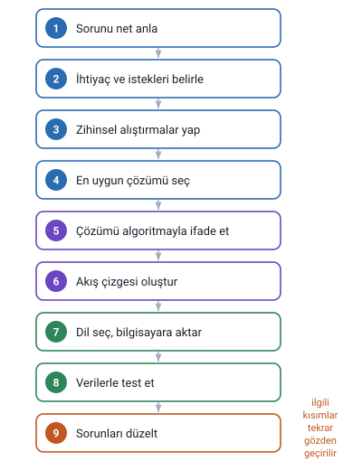
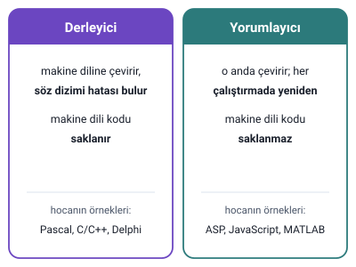

### Programlama

Hocanın programlama hakkındaki tespitleri:

- Her şeyden önce **herkes** bir programlama dilini öğrenebilir.
- Bilgisayar programlama yüksek bir zekâ ve matematik bilgisi **gerektirmez**; asla vazgeçmeme sabrı ve öğrenme isteği yeterlidir.
- Programlama bir **hünerdir.** Bazı insanlar doğal olarak diğerlerinden daha iyidir, ama herkes **pratik yaparak** iyi olabilir.
- Başaramamaktan korkmak yerine kendinizi bu maharete vererek öğrenmek için uğraşın. Programlama eğlencelidir, ama yanlış çalışma yöntemleriyle sinir bozucu olabilir ve zaman kaybettirebilir.

### Programlama dilleri ve seviyeleri

**Programlama dili**, insan-makine ve makine-makine arasındaki **iletişimi sağlar.**

Programlama dilleri kullanım yapısına göre genel olarak **üç seviyede** incelenir:

| Seviye | Hocanın örnekleri |
| --- | --- |
| Düşük seviyeli diller | Makine dili ve assembly |
| Orta seviyeli diller | C/C++ |
| Yüksek seviyeli diller | Basic, Fortran, Pascal |

### Yüksek seviyeli diller ve derleme

- Pascal, C/C++, COBOL ve FORTRAN gibi diller **derlenmesi gereken** dillerdir.
- Kodlar kolayca yazılıp okunabilen ve hata ayıklaması yapılabilen bir şekilde yazılır. Buna **kaynak kodu** denir.
- **Derleyici (compiler)** denen program, bu kaynak kodunu **nesne kodu** denen, makine diline çevrilmiş kodu saklayan dosyaya çevirmek için kullanılır.
- **Makine dili**, program çalıştırıldığında CPU tarafından yürütülen basit yönergelerin **ikili sayılardan (0 ve 1)** oluşan kodlanmış hâlidir.

> **Dikkat:** Slaytlarda C/C++ iki yerde iki farklı grupta geçiyor: seviyeler slaytında **orta seviyeli** diller arasında, bu slaytta ise Pascal, COBOL ve FORTRAN ile birlikte **yüksek seviyeli** diller arasında. Hocanın üç seviyeli sınıflandırmasında C/C++ **orta seviyeli** dildir.

### Neden C++

Hoca bu derste genel amaçlı kullanıma uygun dillerden **C++** programlama dilinin öğretileceğini söylüyor. Gerekçeleri:

- C dili günümüzde çok yaygın olarak kullanılmaktadır.
- C dili makineye en yakın dil olarak görülmektedir; bu yüzden sistem programları daha hızlı ve randımanlı yapılır.
- **C yalnızca yapısal programlamaya izin verirken, C++ nesne yönelimli programlamaya imkân verir.**
- Herhangi bir programlama dilini iyi kavrayıp programlama kavramını anladıktan sonra başka bir dili öğrenmek çok kolaydır.

> **Dikkat:** Slaytta "C dili makineye en yakın dil olarak görülmektedir" yazıyor. Hocanın seviyeler slaytına göre makineye en yakın olanlar **düşük seviyeli** dillerdir (makine dili ve assembly); C/C++ orta seviyelidir.

### Problem

**Problem**, bir işlemin, otomasyonun ya da bilimsel hesaplamanın **bilgisayarla çözülmesi fikrinin** ortaya çıkmasıdır.

- Bu tür fikirlerde insanların sorunları beyinle çözmesi ya imkânsızdır ya da çok zor ve zaman alıcıdır.
- Böyle bir sorunu bilgisayarla çözebilme fikrinin ortaya çıkması, bir bilgisayar probleminin ortaya çıkmasına neden olur.
- Bazen de bir işletmenin ya da yönetimin otomasyonunu sağlamak amacıyla bu tür problemler tanımlanır.

### Problem çözümü

Hocanın problem çözümü adımları:

1. Problemi çözebilmek için öncelikle sorunun programcı tarafından **çok net anlaşılmış** olması gerekir.
2. **Tüm ihtiyaçlar ve istekler belirlenmelidir.** Gerekiyorsa bunun için birebir görüşmeler planlanıp yapılmalıdır.
3. Problemin çözümüne ilişkin **zihinsel alıştırmalar** yapılır; bu alıştırmaların bilgisayar çözümüne yakın olması hedeflenir.
4. Bir sorunun birden fazla çözümü olabilir; bu durumda bilgisayar için **en uygun çözüm seçilmelidir**, çünkü bazen pratik çözümler bilgisayar için uygun olmayabilir.
5. Oluşturulan çözüm **algoritma** denen adımlarla ifade edilmelidir.
6. Algoritmanın daha anlaşılır olması için **akış çizgesi** oluşturulmalıdır.
7. Uygun bir **programlama dili seçilmeli** ve algoritma ile akış şeması bu dil aracılığıyla bilgisayar ortamına aktarılmalıdır.
8. Oluşturulan program birtakım verilerle **test edilmelidir.**
9. Oluşabilecek sorunlarda ilgili kısımlar tekrar gözden geçirilerek **düzeltilir.** Bu adımlar defalarca tekrarlanmak zorunda kalınabilir.

> **Ek:** Slaytta adımlar madde işaretiyle verilmiş; burada sıralarını göstermek için numaralandı. Akış çizgesi (akış şeması) bu notta yalnızca adı geçen bir kavramdır; nasıl çizildiği slaytlarda henüz anlatılmıyor.

### Program ve programlama

**Program:** Problem çözümü kısmında anlatılan adımlar uygulandıktan sonra ortaya çıkan ve **sorunu bilgisayar ortamında çözen ürüne** program denir. Bazı durumlarda bu ürüne **yazılım** da denebilir.

**Programlama:** Problem çözümünde anlatılan **adımların tümüne birden** programlama denilebilir. Çoğunlukla, çok iyi tanımlanmış bir sorunun çözümüne dair adımlarla çözümün oluşturulup bir programlama dili ile bilgisayar ortamına aktarılmasına programlama denir.

> **Dikkat:** Program bir **üründür** (sonuç); programlama ise bu ürünü ortaya çıkaran **adımların tümüdür** (süreç).

### Programlama dili, derleyici ve yorumlayıcı

**Programlama dili:** Bir problemin algoritmik çözümünün bilgisayara anlatılmasını sağlayan, son derece **sıkı kuralları** bulunan kurallar dizisidir.

**Derleyici:** Bir programlama diliyle bilgisayara aktarılan programı, bilgisayarın anlayabileceği **makine diline çeviren** ve yazılan programda **söz dizimi hatalarının** olup olmadığını bulan yazılımlardır. Hocaya göre her programlama dili için bir derleyici olması gerekir; hocanın örnekleri: Pascal, C/C++, Delphi.

**Yorumlayıcı:** Derleyici gibi çalışan, ancak yazılmış programları **o anda** makine diline çeviren yazılımlardır. Bu tür yazılımda programın makine diliyle oluşturulmuş kısmı **bilgisayarda tutulmaz**; program her çalıştırıldığında her adım için makine dili karşılıkları oluşturulur ve çalıştırılır. Hocanın örnekleri: ASP, JavaScript, MATLAB.

> **Dikkat:** Derleyici programı makine diline çevirir ve bu kod (nesne kodu) saklanır; yorumlayıcı ise **her çalıştırmada**, adım adım çevirir ve makine dili kodunu saklamaz. Hocanın örnekleri aslında dillerdir: Pascal, C/C++ ve Delphi derleyiciyle, ASP, JavaScript ve MATLAB yorumlayıcıyla çalıştırılan dillerdir.
