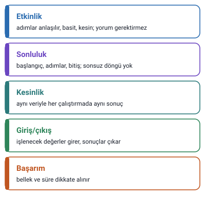

### Algoritma ve akış şemaları

- Bilgisayarlar **yalnızca** onlara yapmalarını söylediğiniz komutları uygular.
- Bilgisayar kullanarak soru çözmek için sonuca giden yolun **tam olarak** belirlenmesi gerekir.
- Bir sorunu çözerken bilgisayarı, atması gereken her adımı ve yapması gereken her işi (görmek, duymak dâhil) söylemeniz gereken bir makine olarak düşünün.
- Aynı soru için **değişik çözüm yolları** geliştirilebilir.
- Bilgisayara verilen çözüm yanlışsa çıkan sonuç da yanlış, çözüm doğruysa çıkan sonuç da doğrudur.

### Algoritma

- Bir sorunu çözebilmek için gerekli olan **sıralı mantıksal adımların tümüne** algoritma denir.
- Ya da: bir problemin çözümündeki **adımların tümüne** algoritma denir.
- Programlamanın **en önemli kısmı**, problemin çözümü için algoritma hazırlayabilmek ve geliştirebilmektir.
- Hazırlanan algoritmanın bir programlama diliyle kodlanması **işin basit kısmıdır.**
- Kullanılan dilin Basic, Pascal, C ya da başka bir programlama dili olması bir şeyi değiştirmez.

> **Dikkat:** Hocaya göre zor olan algoritmayı **hazırlamak**, kolay olan onu bir dille **kodlamaktır.** Algoritma dilden bağımsızdır.

### Algoritma nasıl olmalı

Hocaya göre bir algoritmanın taşıması gereken beş özellik: **etkinlik, sonluluk, kesinlik, giriş/çıkış, başarım (performans).**

#### Etkinlik

Bilgisayarlar düşünemez. Bu yüzden algoritmanın her adımı **anlaşılır, basit ve kesin** bir biçimde ifade edilmiş olmalıdır. Yorum gerektirmemeli ve belirsiz ifadelere sahip olmamalıdır. Gereksiz tekrarlar içermemeli, **diğer algoritmalar içinde de kullanılabilir** olmalıdır.

#### Sonluluk

Her algoritmanın bir **başlangıç noktası**, belirli **işlem adımları** ve bir **bitiş noktası** olmalıdır. **Sonsuz döngüye girmemelidir.**

#### Kesinlik

İşlem sonucu kesin olmalı; **aynı veri için her yeni çalıştırmada aynı sonucu** üretmelidir.

#### Giriş/çıkış

Algoritma **giriş** (üzerinde işlem yapılacak değerler) ve **çıkış** (yapılan işlemler sonucunda üretilen değerler) değerlerine sahip olmalıdır.

#### Başarım/performans

Amaç, donanım gereksinimi (bellek kullanımı gibi) ve çalışma süresi gibi **performans kriterlerini** dikkate alarak yüksek başarımlı programlar yazmak olmalıdır. Hocanın özeti: **doğru zamanda, doğru yerde, doğru şeyi kullanmak.**

> **Dikkat:** Hocanın tanımlarında "kesin" sözü iki yerde geçiyor: **etkinlik**, adımların anlaşılır ve yorum gerektirmeyecek kadar kesin **yazılmasıdır**; **kesinlik** ise **sonucun** aynı veriyle her çalıştırmada aynı çıkmasıdır. "Sonsuz döngüye girmemeli" **sonluluk**, "bellek ve süre" **başarım** özelliğidir.

### Makarna algoritması

Hocanın günlük hayattan örneği:

1. Tencereyi çıkar.
2. Tencerenin içine su koy.
3. Ocağı aç.
4. Tencereyi ocağın üstüne koy.
5. Su kaynayana kadar bekle.
6. Kaynamaya başladıysa makarnayı tencereye dök.
7. Makarnaların haşlanmasını bekle.
8. Haşlandıysa makarnaları süzgece dök.
9. Tencerenin içine salça ve yağ ekle.
10. Makarnayı tekrar tencereye dök.
11. Birkaç dakika pişir.
12. Servis et.
13. Afiyet olsun.

### Araba çalıştırma algoritması

Hocanın ikinci örneği:

1. Arabanın kapısını aç.
2. Koltuğa otur.
3. Kapıyı kapat.
4. Emniyet kemerini tak.
5. Vitesin boşta olduğunu kontrol et.
6. Kontağı çevir.
7. Debriyaja bas, vitesi 1'e al.
8. Bir ayağın frende olarak el frenini kaldır.
9. Hafifçe ayağını frenden kaldır ve gaz ver.
10. Arabayı sür.

> **Dikkat:** Bu örneklerde adımların **sırası** önemlidir: su kaynamadan makarna dökülmez, kontak çevrilmeden araba sürülmez. Bir adımın yeri değişirse algoritma yanlış sonuç verebilir.

### Örnek soru: çay yapma

Hocanın sorusu: **Çay yapma algoritmasını oluşturun; çevrenizde algoritma hakkında bilgisi olan birinden de çay yapma algoritmasını oluşturmasını isteyin ve algoritmanızı karşılaştırın.**

Hoca "aynı soru için değişik çözüm yolları geliştirilebilir" diyor ("Algoritma ve akış şemaları" başlığı); bu soru da bunu görmeyi amaçlar: iki kişinin algoritması farklı olabilir, ikisi de doğru olabilir.

#### Çay yapma çözümü (Ek)

Slaytta çözüm yok. Makarna algoritmasının kalıbıyla bir çözüm:

1. Çaydanlığın altına su koy.
2. Çaydanlığı ocağa koy ve ocağı aç.
3. Su kaynayana kadar bekle.
4. Demliğe çay koy.
5. Kaynayan sudan demliğe dök.
6. Demliği çaydanlığın üstüne koy.
7. Çay demlenene kadar bekle.
8. Bardağa çay ve su koy.
9. Servis et.
