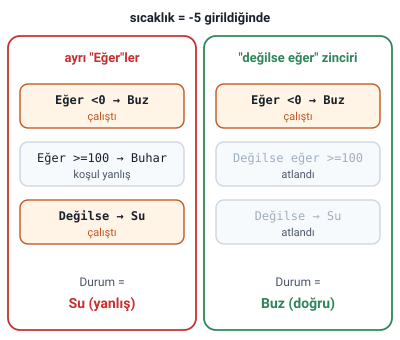

### Algoritma ifade şekilleri

Hocanın bu notta verdiği iki ifade şekli:

1. Algoritmanın **metin olarak** yazılması
2. **Pseudo kod** (kaba kod, sözde kod)

### Algoritmanın metin olarak yazılması

- Çözülecek problem, **adım adım metin olarak** yazılır.
- **Her satıra numara** verilir.
- **"Başla"** ile başlanır, **"son"** ile bitirilir.

#### Örnek: sayının karesi

Hocanın problemi: **Klavyeden girilen sayının karesini hesaplayarak ekrana yazdıran programın algoritmasını yazınız.**

1. Başla
2. Sayıyı (A) gir
3. Sayının karesini hesapla (`Kare=A*A` işlemini yap)
4. Sonucu (Kare) yaz
5. Dur

> **Dikkat:** Kuralda bitiş adımı "son" diye geçiyor, örnekte ise "Dur" yazılmış; ikisi de aynı işi görür. Bitiş için BİTİR, SON ya da DUR yazılabildiği "Algoritma Yazımı: Örnekler" konusunda da geçer.

### Sözde kod (pseudo code)

**Sözde programlar**, doğrudan konuşma dilinde ve programlama mantığı altında, **"eğer", "iken"** gibi koşul kelimeleri ve **`>`, `=`, `<`** gibi ifadelerle birlikte yazılır. İyi bir biçimde yazılmış sözde koddan programlama diline **kolaylıkla** geçilebilir.

Bir metin algoritmasını sözde koda dönüştürürken şu adımlar izlenir:

1. Girdi ve çıktıları (değişkenleri) belirlemek
2. Sıralı adımları, karar yapılarını, tekrarlı yapıları ve işlemleri belirlemek
3. Yapı, işlem ve adımları uygun şekilde düzenlemek

#### Sözde kodda başla, dur, GET ve DISPLAY

- Sözde kodda **başla ve dur adımları yazılmaz.** Çünkü sözde kod bir program olarak düşünüldüğünden zaten ilk satırla başlayacak, son satırla bitecektir.
- Sözde kodda çıktı işlemleri için **DISPLAY** ve **WRITE** ifadeleri kullanılır: bir bilgiyi **ekranda göstermek** için DISPLAY, **veritabanına ya da dosyaya** yazdırmak için WRITE kullanılır.
- Sözde kodda **oku** adımı için **GET**, **yaz** adımı için **DISPLAY** komutları kullanılır.

> **Dikkat:** Metin algoritması ile sözde kodun farkı: metin algoritması **Başla ile başlayıp Son (Dur) ile biter**; sözde kodda **başla ve dur yazılmaz** (hocanın sözde kod örneğinde de satırlar numaralıdır). DISPLAY ile WRITE'ı karıştırmayın: DISPLAY **ekrana**, WRITE **dosyaya ya da veritabanına** yazar.

> **Dikkat:** "Algoritma Yazımı: Örnekler" konusundaki metin algoritmasında kullanılan `OKU:` adımı sözde kodda GET, `YAZ:` adımı DISPLAY olur.

#### Örnek: suyun durumu

Hocanın problemi: **Verilen bir sıcaklık derecesine göre suyun durumunu belirten bir sözde program (kaba kod) yazınız.**

1. Program açıklama mesajı yaz
2. Kullanıcının sıcaklığı girmesi için bir uyarı mesajı yaz
3. Girilen sıcaklığı oku
4. Eğer sıcaklık<0 ise Durum="Buz"
5. Eğer sıcaklık>=100 ise Durum="Buhar"
6. Değilse Durum="Su"
7. Sonucu yaz

> **Dikkat:** Slayttaki 4. ve 5. satır birbirinden bağımsız iki "Eğer" olarak okunursa, 6. satırdaki "Değilse" yalnızca 5. satıra bağlanır. O zaman sıcaklık 0'ın altındayken önce Durum="Buz" olur, ardından 5. satırın koşulu sağlanmadığı için "Değilse" çalışır ve Durum="Su" olur: sonuç yanlış çıkar. Doğru çalışması için 5. satır **"Değilse eğer"** diye 4. satıra bağlanmalıdır: `Eğer sıcaklık<0 ise Durum="Buz"`, `Değilse eğer sıcaklık>=100 ise Durum="Buhar"`, `Değilse Durum="Su"`. -5 için ilk okuma "Su", ikincisi "Buz" verir; 0 ile 100'ün altı ve 100 ile üstü için ikisi de aynı sonucu verir. Hocanın amacı 0'ın altı için Buz, 0 ile 100'ün altı için Su, 100 ve üstü için Buhar'dır; bu amaca göre -5 için doğru sonuç Buz'dur.

> **Ek:** Hocanın kuralıyla (oku için GET, ekrana yazmak için DISPLAY, başla ve dur yazılmaz) aynı sözde kod şöyle yazılabilir: `DISPLAY açıklama mesajı`, `DISPLAY "Sıcaklığı girin"`, `GET sıcaklık`, `Eğer sıcaklık<0 ise Durum="Buz"`, `Değilse eğer sıcaklık>=100 ise Durum="Buhar"`, `Değilse Durum="Su"`, `DISPLAY Durum`.
