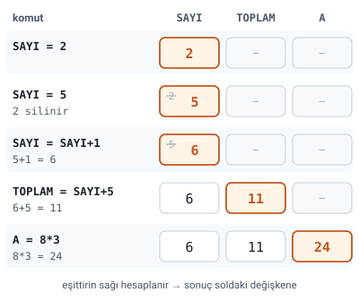
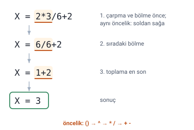

### Algoritmanın temel öğeleri

Algoritmaları geliştirirken **değişken, sabit, atama, döngü, karar yapısı, alt yordam** gibi birtakım öğeler kullanılır. Algoritma yazımına geçmeden önce, tüm programlama dillerinde mevcut olan bu temel kavramlar ana hatlarıyla tanınmalıdır.

### Tanımlayıcı

**Tanımlayıcı**, değişken, sabit, alt yordam, alan gibi programlama birimlerine **yazılımcı tarafından verilmiş isimlerdir.**

> **Ek:** Tanımlayıcının İngilizcesi "identifier"dır. Örneğin `TOPLAM`, `SAYI`, `PI` birer tanımlayıcıdır.

### Sabit ve gömülü değer

**Sabit**, program her çalıştığında ve programın içinde herhangi bir anda **aynı değeri döndüren** tanımlayıcılardır. Hocanın örneği: `PI=3,14`.

**Gömülü değer**, kod içinde yazılmış olan metinsel, sayısal ya da diğer veri tiplerindeki **sabit değerlerdir.** Hocanın örnekleri: `PI=3,14`'teki **3,14** ya da `mesaj='merhaba'`'daki **merhaba**.

> **Dikkat:** Sabit ile gömülü değeri karıştırmayın. `PI=3,14` yazımında **PI** sabittir (bir tanımlayıcı, yani isim); **3,14** ise gömülü değerdir (koda doğrudan yazılmış değerin kendisi).

> **Dikkat:** Hoca ondalık sayıyı Türkçedeki gibi virgülle yazmış (`3,14`). Programlama dillerinde ondalık ayırıcı **noktadır**: `3.14`.

### Değişken

**Değişken**, programın akışı içinde **farklı değerleri tutmak üzere ayrılmış bellek bölümüdür.** Hocanın örneği: `C=A+B` ifadesinde A, B ve C değişkendir.

Hocanın ikinci tanımı: dışarıdan alınan veya bir işlem sonucunda elde edilen verilerin saklandığı bellek (hafıza) birimlerine **değişken** denir. Bu bellek birimlerine belirli bir **isim** verilir; daha sonra bu isimle, değişkenin içinde bulunan değer tekrar tekrar kullanılabilir.

#### Değişken isimlendirme kuralları

Değişken isimleri verilirken şu kurallara dikkat edilmelidir:

- İngiliz alfabesindeki A-Z veya a-z arası **26 harf** kullanılabilir.
- **0-9 rakamları** kullanılabilir.
- Sembollerden yalnızca **alt çizgi** (`_`) kullanılabilir.
- Değişken isimleri harf veya alt çizgi ile başlayabilir ama **rakamla başlamaz.**
- İsimler oluşturulurken **boşluk kullanılmamalıdır.**

> **Dikkat:** Slaytta boşluk kuralının örneği olarak “ogrencino” değil “ogrenci_no” yazılmış. Oysa `ogrencino` boşluk içermez ve kurallara uygundur. Kastedilen, **boşluklu** `ogrenci no` yazılmaması, yerine `ogrenci_no` yazılmasıdır.

> **Dikkat:** Hocanın kuralına göre yalnızca İngiliz alfabesinin harfleri kullanılır; bu alfabede ç, ğ, ı, ö, ş, ü yoktur. Bu yüzden `öğrenci` yerine `ogrenci` yazılır. `2sayi` (rakamla başlıyor) ve `sayi-1` (tire, alt çizgi dışında bir sembol) da kurala uymaz.

> **Ek:** Yeni C++ derleyicileri ve Python 3 gibi bazı ortamlar Türkçe harfli adları da kabul eder; ama hocanın kuralı İngiliz alfabesidir ve her ortamda çalışan yol da budur.

### Aritmetik işlemler

Programlamadaki en temel işlemler toplama, çıkarma, çarpma ve bölmedir. Hocanın tablosu:

| İşleç | Adı | Örnek | Açıklama |
| --- | --- | --- | --- |
| `+` | Toplama | `C=A+B` | A ile B sayısını toplar. |
| `-` | Çıkarma | `D=E-F` | E'den F'yi çıkarır. |
| `*` | Çarpma | `X=Y*Z` | Y sayısıyla Z sayısını çarpar. |
| `/` | Bölme | `T=P/S` | P sayısını S sayısına böler. |
| `=` | Atama | `A=B+C` | B ve C sayılarının toplamını A değişkenine atar. |
| `^` | Üs alma | `C=A^B` | A sayısının B'nci kuvvetini C'ye atar. |
| `%` | Mod alma | `C=A%B` | A sayısının mod B'ye göre kalanını C'ye atar. |

> **Dikkat:** Çarpma işareti `x` değil **yıldızdır** (`*`); bölme işareti de `÷` değil **eğik çizgidir** (`/`). Mod alma (`%`) yüzde hesabı değil, **bölümden kalandır**: `17%5` sonucu 2'dir.

> **Dikkat:** Algoritma yazımında `^` üs almadır (`2^3` = 8). Ancak bu dersin dili olan **C++**'ta (ayrıca C, Java ve Python'da) `^` üs alma **değildir**; bu dillerde başka bir işlemdir (bit düzeyinde XOR) ve `2^3` sonucu 1 çıkar. Python'da üs alma `**` ile yapılır.

### Değişkenlere değer atama

Programcılıkta eşittir (`=`) ifadesi **değer atama** işlemi için kullanılır ve matematikteki eşittir ile karıştırılmamalıdır. Atama işleminde eşittir ifadesinin **sağ tarafındaki işlemler yapılır** ve bulunan sonuç **soldaki değişkene aktarılır.**

#### Atama örnekleri

Hocanın örnekleri, verildiği sırayla:

1. `SAYI = 2`: SAYI değişkeninin içine 2 değerini koy.
2. `SAYI = 5`: SAYI değişkeninin içine 5 değeri atandı. Bir önceki değer olan 2 silindi.
3. `SAYI=SAYI+1`: SAYI değişkeninin içindeki değer 5'tir. Eşitliğin sağ tarafındaki toplama işlemi yapılırsa 5+1=6 sonucu elde edilir. Elde edilen sonuç yine SAYI değişkenine atanır. SAYI'nın yeni değeri 6 olur, eski değer olan 5 silinir.
4. `TOPLAM=SAYI+5`: Eşitliğin sağ tarafındaki işlem sonucu 6+5=11 olarak bulunur. Elde edilen 11, TOPLAM adlı değişkene aktarılır. TOPLAM'ın değeri artık 11'dir.
5. `A=8*3`: Eşitliğin sağ tarafındaki işlem sonucu 8×3=24 olarak bulunur. Elde edilen 24, A adlı değişkene aktarılır. A'nın yeni değeri artık 24'tür.

> **Dikkat:** `SAYI=SAYI+1` matematikte yanlış bir eşitlik gibi görünür, ama programlamada anlamı "SAYI'nın değerine 1 ekle ve sonucu yine SAYI'ya yaz" demektir. Bir değişkene yeni değer atanınca **eski değer silinir**; değişken aynı anda yalnızca bir değer tutar.

### İşlem önceliği

Matematiksel işlemler içeren bir ifadedeki işaretlerin bir **işlem önceliği** vardır. İşlem önceliği sırası:

1. Parantezler `()`
2. Üs alma `a^b`
3. Çarpma ve bölme `a*b` veya `a/b`
4. Toplama ve çıkarma `a+b` veya `a-b`

**Aynı önceliğe sahip işlemler yan yana bulunuyorsa işlem önceliği soldan sağa doğrudur.** Hocanın örneği: `X=2*3/6+2`.

> **Ek:** Örneğin çözümü slaytta verilmemiş. Çarpma ve bölme aynı önceliktedir ve toplamadan önce gelir; ikisi soldan sağa yapılır: önce 2×3=6, sonra 6/6=1, en son 1+2=3. Sonuç **X=3**.

> **Ek:** Hocanın işlem önceliği listesinde mod alma (`%`) yok; C++'ta mod, çarpma ve bölmeyle aynı önceliktedir.
