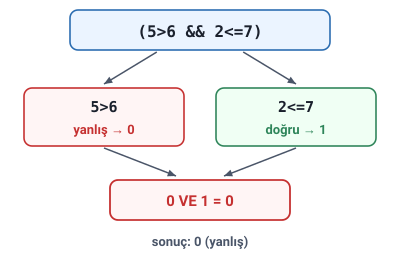

### Karşılaştırma işleçleri

Hoca bu işlemlere **mantıksal işlemler (karşılaştırma operatörleri)** diyor: bir programın akışı içerisinde, belirli bir koşula bağlı olarak **akışın hangi yönde ilerleyeceğine karar vermede** kullanılırlar.

Hocanın örnekleri: `Yas>=18`, `Hız<90` gibi ifadeler mantıksal ifadelerdir. Bu ifadelerin sonucunda **doğru (true)** ya da **yanlış (false)** değeri elde edilir.

| İşleç | Adı | Örnek | Açıklama |
| --- | --- | --- | --- |
| `>` | Büyük | `A>B` | A'nın değeri B'den büyükse True, değilse False döner. |
| `<` | Küçük | `A<B` | A'nın değeri B'den küçükse True, değilse False döner. |
| `==` | Eşit | `A==B` ya da `A=B` | A'nın değeri B'ye eşitse True, değilse False döner. |
| `!=` | Farklı | `A!=B` ya da `A<>B` | A'nın değeri B'den farklıysa True, değilse False döner. |
| `>=` | Büyük eşit | `A>=B` | A'nın değeri B'den büyükse ya da eşitse True, değilse False döner. |
| `<=` | Küçük eşit | `A<=B` | A'nın değeri B'den küçükse ya da eşitse True, değilse False döner. |

> **Dikkat:** Hoca eşitlik için `A=B`, farklılık için `A<>B` yazımını da veriyor; bunlar bazı dillerde ve algoritma yazımında kullanılır. Bu dersin dili olan **C++**'ta (ayrıca C ve Python'da) karşılaştırma yalnızca `==` ve `!=` ile yapılır: bu dillerde `=` **atamadır** ("Temel Öğeler, Aritmetik İşlemler ve Atama" konusundaki "Değişkenlere değer atama" başlığı), `<>` ise yoktur.

> **Dikkat:** `>=` ve `<=` eşitliği de kapsar: A=5, B=5 iken `A>=B` doğrudur, `A>B` yanlıştır.

### Mantıksal operatörler

Programlarda birden fazla karşılaştırma ifadesi bir anda kullanılmak istenebilir. Bu gibi durumlarda mantıksal ifadeler (**mantıksal operatörler**) kullanılması zorunludur:

- **VE** (`&&`)
- **VEYA** (`||`)

> **Dikkat:** Hoca iki grubu da "mantıksal" diye anıyor. Karıştırmamak için: `>`, `<`, `==`, `!=`, `>=`, `<=` **karşılaştırma** işleçleridir ve iki değeri karşılaştırır; `&&` (VE) ve `||` (VEYA) ise **karşılaştırma ifadelerini birleştiren** mantıksal operatörlerdir.

### Mantıksal işlem sonuçları

| Sonuç | Rakam olarak | Bilgisayar dilinde |
| --- | --- | --- |
| Doğru | 1 | True (1) |
| Yanlış | 0 | False (0) |

### Doğruluk tablosu

Mantıksal işlemlerde doğruluk tablosu aşağıdaki gibidir. Burada A ve B **birer karşılaştırma ifadesini** temsil etmektedir.

| A | A' |
| --- | --- |
| 0 | 1 |
| 1 | 0 |

| A | B | A VE B |
| --- | --- | --- |
| 0 | 0 | 0 |
| 0 | 1 | 0 |
| 1 | 0 | 0 |
| 1 | 1 | 1 |

| A | B | A VEYA B |
| --- | --- | --- |
| 0 | 0 | 0 |
| 0 | 1 | 1 |
| 1 | 0 | 1 |
| 1 | 1 | 1 |

> **Ek:** İlk tablodaki `A'` (slaytta üst simgeyle yazılmış), A'nın **değili**dir: A 0 ise 1, 1 ise 0 olur. Bu işlemin adı slaytta yazmıyor; C++'ta `!` işaretiyle yazılır.

### Birleştirilmiş ifadelerin sonucu

Doğruluk tablosu yalnızca iki ifade için örneklenmiş olsa da daha fazla ifadeyi mantıksal operatörlerle birleştirmek mümkündür. Birleştirilmiş ifadeden hangi değerin döneceğini bulmak için şu genel kural uygulanabilir:

- **VE** ile birleştirilmiş ifadelerde, **bütün** ifadelerden ayrı ayrı 1 değeri dönüyorsa birleştirilmiş ifadeden de 1 döner. Geri kalan durumlarda 0 döner.
- **VEYA** ile birleştirilmiş ifadelerde, **en az bir** ifadeden 1 değeri dönüyorsa birleştirilmiş ifadeden de 1 döner. Bütün ifadelerden 0 dönüyorsa birleştirilmiş ifadeden de 0 döner.

> **Dikkat:** Kısaca: VE'de **tek bir 0** sonucu 0 yapar; VEYA'da **tek bir 1** sonucu 1 yapar.

### Örnek: tek ifadenin çözümü

Hocanın örneği: `(5>6 && 2<=7)` ifadesini inceleyelim.

- `&&`, VE anlamına gelir.
- `5>6`: bu ifadeden **yanlış** sonucu döner.
- `2<=7`: bu ifadeden **doğru** sonucu döner.

Sonuç olarak ifade (yanlış VE doğru), yani (0 VE 1) hâlini alır. Doğruluk tablosuna göre bu ifadeden **0 (yanlış)** sonucu döner.

### Örnekler: A=5, B=18

Hocanın örnekleri; A=5, B=18 olsun:

- `(A!=B && B>5)` → 1 (doğru)
- `(5==A || B<15)` → 1 (doğru)
- `(4>6 || B!=18 || A>3)` → 1 (doğru)
- `(A==5 && B>=18 && 5%2==1)` → 1 (doğru)
- `(B<20 && A<6 && 2%2==1)` → 0 (yanlış)
- `(A==B || B<5)` → 0 (yanlış)

Çözüm yolu (slaytta yalnızca sonuçlar var):

- `(A!=B && B>5)`: 5≠18 doğru, 18>5 doğru → 1 VE 1 = **1**.
- `(5==A || B<15)`: 5==5 doğru → VEYA'da bir 1 yeter: **1**.
- `(4>6 || B!=18 || A>3)`: 4>6 yanlış, 18≠18 yanlış, 5>3 doğru → **1**.
- `(A==5 && B>=18 && 5%2==1)`: doğru, 18>=18 doğru, 5'in 2'ye bölümünden kalan 1 → doğru → **1**.
- `(B<20 && A<6 && 2%2==1)`: doğru, doğru, 2'nin 2'ye bölümünden kalan 0 → yanlış → VE'de bir 0 yeter: **0**.
- `(A==B || B<5)`: 5==18 yanlış, 18<5 yanlış → **0**.
