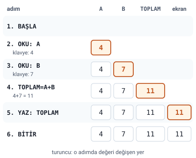

### Örnek 1: iki sayının toplamı

Hocanın sorusu: **Klavyeden girilecek iki sayıyı toplayıp sonucu ekrana yazacak programın algoritmasını yazınız.**

Hocanın çözümü:

1. BAŞLA
2. A sayısını oku (ya da `OKU: A`): klavyeden bir değer okunur ve A adlı değişken içinde saklanır.
3. B sayısını oku (ya da `OKU: B`): klavyeden bir değer okunur ve B adlı değişken içinde saklanır.
4. `TOPLAM=A+B` işlemini yap: A ve B değişkenlerindeki değerler toplanır; elde edilen sonuç TOPLAM adlı değişkende saklanır.
5. TOPLAM değerini ekrana yaz (ya da `YAZ: TOPLAM`).
6. BİTİR (ya da SON, DUR).

> **Ek:** Şekildeki 4 ve 7 değerleri örnek olarak seçildi; slaytta giriş değeri verilmemiştir.

#### Adımların kısa yazılışı

Hocanın çözümünde okuma, yazma ve bitirme adımlarının iki yazılışı var:

| Uzun yazılış | Kısa yazılış |
| --- | --- |
| A sayısını oku | `OKU: A` |
| TOPLAM değerini ekrana yaz | `YAZ: TOPLAM` |
| BİTİR | SON ya da DUR |

> **Dikkat:** Algoritmanın iskeleti: **BAŞLA** ile açılır; önce girdiler **okunur** (OKU), sonra **işlem** yapılır ve sonuç bir değişkene **atanır**, sonra sonuç **yazılır** (YAZ), en son **BİTİR** (SON, DUR) ile kapanır. Bir değer okunmadan ya da hesaplanmadan kullanılamaz: `TOPLAM=A+B` adımı, A ve B okunduktan sonra gelir.

### Örnek 2: dikdörtgenin alanı

Hocanın sorusu: **Klavyeden kısa ve uzun kenarı girilen dikdörtgenin alanını hesaplayıp ekrana yazan programın algoritmasını yazınız.**

#### Örnek 2 çözümü (Ek)

Slaytta çözüm verilmemiş. Örnek 1'in kalıbıyla:

1. BAŞLA
2. `OKU: KISA` (kısa kenar okunur ve KISA değişkeninde saklanır)
3. `OKU: UZUN` (uzun kenar okunur ve UZUN değişkeninde saklanır)
4. `ALAN=KISA*UZUN` (dikdörtgenin alanı kısa kenar ile uzun kenarın çarpımıdır)
5. `YAZ: ALAN`
6. BİTİR

### Örnek 3: üç sayının ortalaması

Hocanın sorusu: **Klavyeden girilen 3 sayının ortalamasını hesaplayıp ekrana yazan programın algoritmasını yazınız.**

#### Örnek 3 çözümü (Ek)

Slaytta çözüm verilmemiş. Örnek 1'in kalıbıyla:

1. BAŞLA
2. `OKU: A`
3. `OKU: B`
4. `OKU: C`
5. `ORTALAMA=(A+B+C)/3`
6. `YAZ: ORTALAMA`
7. BİTİR

> **Dikkat:** Ortalamada parantez şarttır. İşlem önceliğine göre bölme toplamadan önce yapılır ("Temel Öğeler, Aritmetik İşlemler ve Atama" konusu): `ORTALAMA=A+B+C/3` yazılırsa yalnızca C üçe bölünür. Örneğin 3, 6 ve 9 girilirse doğru yazım 18/3=6 verir, parantezsiz yazım ise 3+6+3=12 verir.
