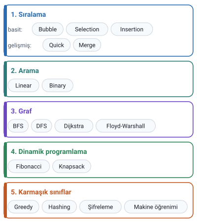
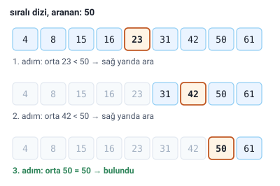

### Temel algoritmalar

Temel algoritmalar, bilgisayar bilimlerinde ve programlamada **sıkça kullanılan**, çeşitli problemleri çözmek için **etkili yöntemlerdir.** Hoca bunları beş grupta veriyor: sıralama, arama, graf algoritmaları, dinamik programlama ve karmaşık algoritma sınıfları.

### Sıralama algoritmaları

Hoca sıralama algoritmalarını basit ve gelişmiş (daha hızlı) olarak ikiye ayırıyor.

#### Basit sıralama algoritmaları

- **Bubble Sort (Kabarcık Sıralama):** Dizi elemanlarını karşılaştırarak ve yer değiştirerek sıralar. Basit ama genellikle **yavaş** bir algoritmadır.
- **Selection Sort (Seçmeli Sıralama):** Dizi üzerinde **en küçük elemanı bulup baştaki elemanla değiştirir.** Bu işlem dizinin tüm elemanları için tekrarlanır.
- **Insertion Sort (Araya Ekleme Sıralaması):** Her elemanı, dizinin **zaten sıralanmış olan kısmında doğru yerine ekler.**

> **Ek:** Kabarcık sıralamada karşılaştırılan elemanlar **yan yana** olanlardır; her turda en büyük eleman, suyun yüzüne çıkan kabarcık gibi dizinin sonuna ilerler. Adı buradan gelir.

#### Gelişmiş sıralama algoritmaları

Hoca bunlara "daha hızlı" diyor:

- **Quick Sort (Hızlı Sıralama):** **"Böl ve yönet"** yaklaşımını kullanarak bir **pivot** eleman seçer ve diziyi ondan daha küçük ve daha büyük alt dizilere ayırır. Genellikle hızlıdır.
- **Merge Sort (Birleştirmeli Sıralama):** Dizi **alt dizilere bölünür**, her biri sıralanır ve ardından **birleştirilir.** Kararlı bir sıralama algoritmasıdır.

> **Dikkat:** İki gelişmiş algoritmanın ayırt edici sözcükleri: Quick Sort'ta **pivot**, Merge Sort'ta **birleştirme**. Selection Sort'ta **en küçük eleman**, Insertion Sort'ta **sıralanmış kısma ekleme**, Bubble Sort'ta **karşılaştırıp yer değiştirme**.

> **Ek:** "Kararlı" (stable) sıralama, değeri eşit olan elemanların sıralamadan sonra da birbirlerine göre ilk sıralarını korumasıdır.

### Arama algoritmaları

- **Linear Search (Doğrusal Arama):** Dizi elemanlarını **baştan sona** kontrol ederek aranan değeri bulmaya çalışır. Basit ama büyük dizilerde yavaş olabilir. Hoca: "Sıralı olmayan dizilerde kullanılır."
- **Binary Search (İkili Arama):** **Sıralı** bir dizinin **orta noktasını** kontrol eder. Aranan değerin orta noktanın solunda mı yoksa sağında mı olduğunu belirleyerek arama alanını **sürekli yarıya indirir.** Çok hızlıdır.

> **Dikkat:** İkili arama yalnızca **sıralı** dizide çalışır; sırasız dizide orta noktaya bakıp sol ya da sağ yarıyı atmak yanlış sonuç verir. Doğrusal arama ise sıralı dizide de çalışır; hocanın "sıralı olmayan dizilerde kullanılır" sözü, sırasız dizide başvurulacak yolun doğrusal arama olduğunu anlatır.

> **Ek:** Şekildeki dizi ve aranan değer (50) örnek olarak seçildi; slaytta örnek yoktur.

### Graf algoritmaları

Graf algoritmaları, **düğüm (vertex)** ve **kenarlardan (edge)** oluşan veri yapılarını (grafları) incelemek için kullanılır. Ağlar, haritalar ve sosyal ilişkiler gibi birçok karmaşık problemi çözerler.

- **BFS (Breadth-First Search, Genişlik Öncelikli Arama):** Grafta arama yaparken bir düğümden başlayarak tüm komşularını **katman katman** gezer.
- **DFS (Depth-First Search, Derinlik Öncelikli Arama):** Grafta arama yaparken **olabildiğince derine** iner, çıkmaz sokağa girince **geri döner.**
- **Dijkstra Algoritması:** Graftaki **bir başlangıç düğümünden diğer tüm düğümlere** olan en kısa yolu bulur. Hocanın örneği: bir şehir haritasındaki iki nokta arasındaki en kısa yolu bulmak.
- **Floyd-Warshall Algoritması:** Graftaki **tüm düğüm çiftleri arasındaki** en kısa yolu bulur.

> **Dikkat:** Slaytta başlık "Graf (Grafik) Algoritmaları", metinde "grafik" diye geçiyor. Bu konudaki Türkçe terim **graf**tır; "grafik" daha çok çizelge (chart) anlamında kullanılır.

> **Dikkat:** İki en kısa yol algoritmasının farkı: Dijkstra **bir** başlangıç düğümünden diğer tüm düğümlere, Floyd-Warshall **tüm düğüm çiftleri** arasında en kısa yolu bulur. BFS ile DFS'nin farkı: BFS **genişliğine** (katman katman), DFS **derinliğine** gezer.

### Dinamik programlama

**Dinamik programlama**, büyük ve karmaşık bir problemi, **daha önce çözülmüş olan alt problemlerin çözümlerini hafızada tutarak** (önbellekleme, memoization) verimli bir şekilde çözer. Genellikle **optimizasyon (en iyileme)** problemlerinde kullanılır.

- **Fibonacci sayıları:** Fibonacci dizisini hesaplamak için önceki sonuçları saklayarak zaman tasarrufu sağlar.
- **Knapsack problemi:** Belirli bir ağırlık sınırına göre **maksimum değeri** elde etmeyi hedefler; dinamik programlama ile çözülür. Belirli bir kapasitedeki çantaya en değerli eşyaları sığdırma problemidir.

> **Ek:** Fibonacci dizisinde her sayı kendinden önceki iki sayının toplamıdır: 0, 1, 1, 2, 3, 5, 8, 13… Önceki sonuçlar saklanmazsa aynı değerler tekrar tekrar hesaplanır. Knapsack'in Türkçesi "sırt çantası problemi"dir.

### Karmaşık algoritma sınıfları

Bunlar, bir problemin çözümü için özel yaklaşımlar kullanan geniş kategorilerdir:

- **Greedy (Açgözlü) algoritmalar:** Her adımda **o an için en iyi** kararı verir. Hocanın örneği: para üstü verirken her zaman en büyük madeni parayı vermek.
- **Hashing (Karma) algoritmalar:** Veriyi **sabit uzunluklu bir değere (hash)** dönüştürerek hızlı arama ve doğrulama sağlar. Hocanın verdiği kullanım alanları: şifreleme, veri bütünlüğü kontrolü.
- **Şifreleme (Cryptography) algoritmaları:** Veri güvenliği için kullanılır. Hocanın örnekleri: RSA, AES.
- **Makine öğrenimi algoritmaları:** Veriden öğrenerek tahminler yapmak veya kararlar almak için kullanılır. Hocanın örnekleri: karar ağaçları, sinir ağları.

> **Dikkat:** Slaytta hashing'in kullanım alanı olarak "(Şifreleme, veri bütünlüğü kontrolü.)" yazıyor; notta hocanın ifadesi korundu. Ancak hash, şifreleme ile aynı şey değildir. Şifrelenmiş veri anahtarla **geri açılabilir** (RSA, AES); hash ise tek yönlüdür, değerden asıl veriye **geri dönülemez.** Hash daha çok parolaların saklanmasında ve veri bütünlüğü kontrolünde kullanılır.

> **Ek:** Açgözlü yaklaşım her zaman en iyi sonucu vermez. Örneğin yalnızca 1, 3 ve 4 birimlik paralarla 6 birim para üstü verilecekse açgözlü yol 4+1+1 (3 para) verir, oysa 3+3 (2 para) daha iyidir.
