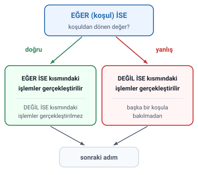
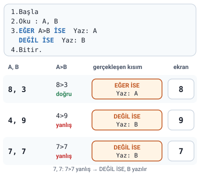

### Karar yapıları ve koşul

**Karar yapıları**, **karşılaştırma operatörü** içeren ifadeler ile birlikte kullanılırlar.

Karşılaştırma operatörü içeren ifade **koşul** olarak adlandırılır.

> **Dikkat:** Karşılaştırma operatörleri (`>`, `<`, `==`, `!=`, `>=`, `<=`) ve bunlardan doğru ya da yanlış değerinin döndüğü "Karşılaştırma ve Mantıksal Operatörler" konusundaki "Karşılaştırma işleçleri" başlığında anlatıldı. Hocanın orada mantıksal ifade diye örneklediği `Yas>=18`, `Hız<90` gibi ifadeler karşılaştırma operatörü içerdiği için birer koşuldur.

### Kullanım şekli: EĞER İSE ve DEĞİL İSE

Kullanım şekli:

- **EĞER (koşul) İSE**: koşuldan dönen değer **doğru** ise burada belirtilen işlemleri gerçekleştir.
- **DEĞİL İSE**: koşuldan dönen değer **yanlış** ise burada belirtilen işlemleri gerçekleştir.

> **Ek:** Bu dersin dili C++'ta EĞER (koşul) İSE `if (koşul)`, DEĞİL İSE `else` diye yazılır (bu konudaki "C++ karşılığı (Ek)" başlığı).

### DEĞİL İSE kısmında koşul kullanılmaz

Burada **DEĞİL İSE** kısmında **başka bir koşul ifadesi kullanılmaz.**

> **Dikkat:** Koşul yalnızca EĞER (koşul) İSE kısmında yazılır; DEĞİL İSE kısmının kendine ait bir koşulu yoktur. EĞER kısmındaki koşulun yanlış çıkması, DEĞİL İSE kısmındaki işlemlerin gerçekleştirilmesi için yeterlidir (bir sonraki başlık).

> **Ek:** Slaytta üç ya da daha çok durumun nasıl yazılacağı gösterilmiyor ("Karar Yapıları: Örnekler" konusundaki Örnek 2, 7 ve 8 böyledir). İki yol vardır. Birincisi, her durum için art arda **ayrı bir EĞER yapısı** yazmak ve aralığı koşulda tam vermektir: `EĞER SAYI==0 İSE Yaz: "Sıfıra eşit"`, `EĞER SAYI>0 İSE Yaz: "Sıfırdan büyük"`, `EĞER SAYI<0 İSE Yaz: "Sıfırdan küçük"`; burada DEĞİL İSE kısmında hiç koşul geçmez. İkincisi, DEĞİL İSE kısmında gerçekleştirilecek işlem olarak **yeni bir EĞER yapısı** yazmaktır: `EĞER SAYI==0 İSE Yaz: "Sıfıra eşit"`, `DEĞİL İSE EĞER SAYI>0 İSE Yaz: "Sıfırdan büyük"`, `DEĞİL İSE Yaz: "Sıfırdan küçük"`; buradaki ikinci koşul DEĞİL İSE kısmının değil, içindeki yeni EĞER yapısının koşuludur (C++'ta `else if`). Hocanın hangisini beklediği slaytta yazmıyor. İki yol da C++'ta -3, 0 ve 5 ile denendi, aynı sonucu verdi. "Algoritma İfade Şekilleri: Metin ve Sözde Kod" konusundaki "Örnek: suyun durumu" başlığının Dikkat kutusunda önerilen "değilse eğer" düzeltmesi ikinci yoldur; hocanın o örneğinde ayrı "Eğer"ler vardır.

### Koşul yanlış ya da doğru olduğunda

- EĞER (koşul) İSE kısmındaki koşuldan **yanlış** değeri geri dönerse buradaki işlemler **gerçekleştirilmez** ve DEĞİL İSE kısmındaki işlemler **başka bir koşula bakılmadan** gerçekleştirilir.
- EĞER (koşul) İSE kısmındaki koşuldan **doğru** değeri geri dönerse burada belirtilen işlemler gerçekleştirilir ve bu durumda DEĞİL İSE kısmındaki işlemler **gerçekleştirilmez**.



> **Dikkat:** Bir karar yapısında iki kısımdan **yalnızca biri** gerçekleştirilir: koşul doğruysa EĞER İSE kısmı, yanlışsa DEĞİL İSE kısmı. İkisi birden gerçekleştirilmez, ikisi birden atlanmaz.

### Örnek: iki sayıdan büyük olanı

Hocanın sorusu: **Klavyeden girilen iki sayıdan büyük olanını bulup ekrana yazan programın algoritmasını yazınız.**

Hocanın çözümü:

1. Başla
2. Oku : A, B
3. **EĞER** `A>B` **İSE** Yaz: A; **DEĞİL İSE** Yaz: B
4. Bitir.

Hocanın açıklamaları:

- Adım 2 (Oku : A, B): klavyeden art arda okunan iki değer sırası ile A ve B değişkenlerinde saklanır.
- Adım 3 (EĞER ... DEĞİL İSE): `A>B` ifadesi doğru sonucunu döndürürse ekrana A değişkenindeki değer yazılır. Doğru sonucunu döndürmez ise ekrana B değişkenindeki değer yazılır.

> **Dikkat:** DEĞİL İSE ayrı bir adım değildir: slaytta DEĞİL İSE satırının numarası yoktur, 3. adımın parçasıdır. Karar verildikten sonra 4. adım (Bitir) gelir.

> **Dikkat:** A ile B eşitse `A>B` yanlış olur (`>` eşitliği kapsamaz); DEĞİL İSE kısmı gerçekleştirilir ve B değişkenindeki değer yazılır. İki değer eşit olduğu için ekrana yine doğru sayı çıkar.



> **Ek:** Şekildeki giriş değerleri örnek olarak seçildi; slaytta giriş değeri verilmemiştir.

#### C++ karşılığı (Ek)

Hocanın çözümü bu dersin dili C++'ta şöyle yazılabilir. g++ ile derlenip denendi: 8 ve 3 girilince 8, 4 ve 9 girilince 9, 7 ve 7 girilince 7 yazar.

```cpp
#include <iostream>
using namespace std;

int main() {
    int A, B;
    cin >> A >> B;        // 2.Oku : A, B
    if (A > B)            // 3.EĞER A>B İSE
        cout << A;        //   Yaz: A
    else                  // DEĞİL İSE
        cout << B;        //   Yaz: B
    return 0;             // 4.Bitir.
}
```
