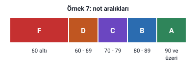
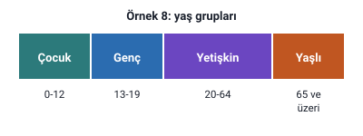

### Örnek 1: reşit olma

Hocanın sorusu: **Klavyeden girilen yaş değerine göre ekrana "Reşitsiniz" ya da "Reşit değilsiniz" mesajı veren algoritmayı sözde kod biçiminde yazalım.**

> **Dikkat:** Bu örnek **sözde kod** biçiminde isteniyor. Hocanın sözde kod kuralları "Algoritma İfade Şekilleri: Metin ve Sözde Kod" konusundaki "Sözde kodda başla, dur, GET ve DISPLAY" başlığındadır: başla ve dur adımları yazılmaz, oku adımı için GET, yaz adımı için DISPLAY kullanılır.

> **Ek:** Slaytta çözüm yok. Hocanın kurallarıyla bir çözüm: `GET YAS`, `EĞER YAS>=18 İSE DISPLAY "Reşitsiniz"`, `DEĞİL İSE DISPLAY "Reşit değilsiniz"`. Reşit olma yaşı slaytta yazmıyor; Türkiye'de reşit olma yaşı 18'dir.

### Örnek 2: sayının sıfıra göre durumu

Hocanın sorusu: **Klavyeden girilen bir sayının sıfıra eşit, sıfırdan büyük ya da sıfırdan küçük olma durumunu bulup ekrana yazan programın algoritmasını yazınız.**

> **Ek:** Slaytta çözüm yok. Burada üç durum var; bir EĞER İSE ve DEĞİL İSE yapısı iki kısımlıdır, bu yüzden DEĞİL İSE kısmına yeni bir EĞER yapısı yazılır ("Karar Yapıları" konusundaki "DEĞİL İSE kısmında koşul kullanılmaz" başlığı). Hocanın örneğinin kalıbıyla: `1.Başla`, `2.Oku: SAYI`, `3.EĞER SAYI==0 İSE Yaz: "Sıfıra eşit"`, `DEĞİL İSE EĞER SAYI>0 İSE Yaz: "Sıfırdan büyük"`, `DEĞİL İSE Yaz: "Sıfırdan küçük"`, `4.Bitir.` Art arda ayrı EĞER yapılarıyla da yazılabilir: `EĞER SAYI==0 İSE Yaz: "Sıfıra eşit"`, `EĞER SAYI>0 İSE Yaz: "Sıfırdan büyük"`, `EĞER SAYI<0 İSE Yaz: "Sıfırdan küçük"`. İki yazım da C++'ta -3, 0 ve 5 ile denendi.

### Örnek 3: 50'den büyük iki sayı

Hocanın sorusu: **Girilen a ve b sayısı 50'den büyük olduğunda c=a+b işlemini yapan, değilse "bu sayılar uygun değil" yazan programın algoritmasını metinsel olarak yazınız.**

> **Dikkat:** "a ve b sayısı 50'den büyük" olması, **ikisinin de** 50'den büyük olması demektir: iki karşılaştırma **VE** (`&&`) ile birleştirilir ("Karşılaştırma ve Mantıksal Operatörler" konusundaki "Mantıksal operatörler" başlığı). "50'den büyük" 50'yi kapsamaz: a ya da b 50 ise koşul yanlış olur ve "bu sayılar uygun değil" yazılır.

> **Dikkat:** Bu örnek **metinsel olarak** isteniyor: hocanın kuralına göre adım adım metin olarak yazılır, her satıra numara verilir, Başla ile başlanıp son ile bitirilir ("Algoritma İfade Şekilleri: Metin ve Sözde Kod" konusundaki "Algoritmanın metin olarak yazılması" başlığı).

> **Ek:** Slaytta çözüm yok. Bir çözüm: `1. Başla`, `2. a ve b sayılarını oku`, `3. EĞER a>50 VE b>50 İSE c=a+b işlemini yap`, `DEĞİL İSE ekrana "bu sayılar uygun değil" yaz`, `4. Son`. Soruda c'nin ekrana yazılması istenmiyor; istenirse c=a+b işleminden sonra "c'yi ekrana yaz" eklenir.

### Örnek 4: tek mi çift mi

Hocanın sorusu: **Klavyeden girilen sayının tek sayı mı çift sayı mı olduğunu bulup ekrana yazan programın algoritmasını yazınız.**

> **Dikkat:** Teklik ve çiftlik, sayının 2'ye bölümünden **kalana** bakılarak bulunur; kalanı veren işleç mod alma (`%`) işlecidir, bölme (`/`) değil ("Temel Öğeler, Aritmetik İşlemler ve Atama" konusundaki "Aritmetik işlemler" başlığı). Hoca `5%2==1` ve `2%2==1` ifadelerini "Karşılaştırma ve Mantıksal Operatörler" konusundaki "Örnekler: A=5, B=18" başlığında kullanıyor: 5 tek olduğu için kalan 1, 2 çift olduğu için kalan 0'dır.

> **Ek:** Slaytta çözüm yok. Bir çözüm: `1.Başla`, `2.Oku: SAYI`, `3.EĞER SAYI%2==0 İSE Yaz: "Çift"`, `DEĞİL İSE Yaz: "Tek"`, `4.Bitir.` C++'ta negatif tek sayının 2'ye göre kalanı -1 çıkar (g++ ile denendi: `-3%2` sonucu -1). Bu yüzden koşulu çift için `SAYI%2==0` diye yazmak negatif sayılarda da doğru sonuç verir; tek için `SAYI%2==1` diye yazmak vermez.

### Örnek 5: GEÇERLİ ya da GEÇERSİZ

Hocanın sorusu: **Kullanıcının klavyeden girdiği sayı 0-100 arasında ise "GEÇERLİ", değilse "GEÇERSİZ" yazan programın algoritmasını yazınız.**

> **Dikkat:** 0-100 arasında olmak, iki karşılaştırmanın **birlikte** doğru olmasıdır (biri 0 sınırını, biri 100 sınırını yoklar): **VE** (`&&`) gerekir. VEYA ile yazılırsa (`SAYI>=0 || SAYI<=100`) her sayı iki karşılaştırmadan en az birini sağladığı için koşul hep doğru döner ve hep "GEÇERLİ" yazılır.

> **Ek:** Slaytta çözüm yok ve 0 ile 100'ün aralığa dahil olup olmadığı yazmıyor; burada dahil alındı: `1.Başla`, `2.Oku: SAYI`, `3.EĞER SAYI>=0 VE SAYI<=100 İSE Yaz: "GEÇERLİ"`, `DEĞİL İSE Yaz: "GEÇERSİZ"`, `4.Bitir.`

### Örnek 6: büyükten küçüğü çıkarma

Hocanın sorusu: **Klavyeden girilen iki sayının büyük olanından küçük olanını çıkarıp bulunan sonucu ekrana yazan programın algoritmasını yazınız.**

> **Ek:** Slaytta çözüm yok. "Karar Yapıları" konusundaki "Örnek: iki sayıdan büyük olanı" başlığındaki hocanın çözümüne benzer: `1.Başla`, `2.Oku: A, B`, `3.EĞER A>B İSE SONUC=A-B`, `DEĞİL İSE SONUC=B-A`, `4.Yaz: SONUC`, `5.Bitir.` Sayılar eşitse DEĞİL İSE kısmı gerçekleştirilir ve sonuç 0 olur. C++'ta denendi: 4 ve 15 de, 15 ve 4 de 11 verir.

### Örnek 7: harf notu

Hocanın sorusu: **Bir öğrencinin notunu alarak, yüzlük notun harf notunu belirleyen bir algoritma yazın.** Not aralıkları şu şekildedir:

| Not | Harf notu |
| --- | --- |
| 90 ve üzeri | A |
| 80 - 89 | B |
| 70 - 79 | C |
| 60 - 69 | D |
| 60 altı | F |

> **Dikkat:** Sınır değerler: 90 A'dır ("90 ve üzeri" 90'ı kapsar), 89 B'dir; 60 D'dir, 59 F'dir ("60 altı" 60'ı kapsamaz).

> **Ek:** Slaytta çözüm yok. Beş durum olduğu için DEĞİL İSE kısımlarına yeni EĞER yapıları yazılır: `1.Başla`, `2.Oku: NOT`, `3.EĞER NOT>=90 İSE Yaz: "A"`, `DEĞİL İSE EĞER NOT>=80 İSE Yaz: "B"`, `DEĞİL İSE EĞER NOT>=70 İSE Yaz: "C"`, `DEĞİL İSE EĞER NOT>=60 İSE Yaz: "D"`, `DEĞİL İSE Yaz: "F"`, `4.Bitir.` Bir koşul doğru çıkınca onun DEĞİL İSE kısmı gerçekleştirilmez; bu yüzden ikinci koşula ayrıca `NOT<90` yazmaya gerek yoktur (art arda ayrı EĞER'lerle yazılırsa gerekir): oraya yalnızca `NOT>=90` yanlışsa gelinir. Art arda ayrı EĞER yapılarıyla yazılırsa her aralığın üst sınırı da koşulda verilir: `EĞER NOT>=90 İSE Yaz: "A"`, `EĞER NOT>=80 VE NOT<90 İSE Yaz: "B"`, `EĞER NOT>=70 VE NOT<80 İSE Yaz: "C"`, `EĞER NOT>=60 VE NOT<70 İSE Yaz: "D"`, `EĞER NOT<60 İSE Yaz: "F"`; üst sınır yazılmazsa 90 alan öğrenci için A, B, C ve D'nin hepsi yazılır. İki yazım da C++'ta 100'den 0'a sınır değerlerle denendi.

### Örnek 8: yaş grubu

Hocanın sorusu: **Bir kişinin yaşını alarak, bu kişinin hangi yaş grubuna ait olduğunu belirleyen bir algoritma yazın.** Yaş grupları şu şekildedir:

| Yaş | Grup |
| --- | --- |
| 0-12 | Çocuk |
| 13-19 | Genç |
| 20-64 | Yetişkin |
| 65 ve üzeri | Yaşlı |

> **Dikkat:** Aralıklar sınırlarıyla birlikte verilmiştir: 12 Çocuk, 13 Genç; 19 Genç, 20 Yetişkin; 64 Yetişkin, 65 Yaşlı.

> **Ek:** Slaytta çözüm yok. Bir çözüm: `1.Başla`, `2.Oku: YAS`, `3.EĞER YAS<=12 İSE Yaz: "Çocuk"`, `DEĞİL İSE EĞER YAS<=19 İSE Yaz: "Genç"`, `DEĞİL İSE EĞER YAS<=64 İSE Yaz: "Yetişkin"`, `DEĞİL İSE Yaz: "Yaşlı"`, `4.Bitir.` Art arda ayrı EĞER yapılarıyla da yazılabilir: `EĞER YAS<=12 İSE Yaz: "Çocuk"`, `EĞER YAS>=13 VE YAS<=19 İSE Yaz: "Genç"`, `EĞER YAS>=20 VE YAS<=64 İSE Yaz: "Yetişkin"`, `EĞER YAS>=65 İSE Yaz: "Yaşlı"`. İki yazım da C++'ta bütün sınır değerlerle denendi.

### Örnek 9: geçme notu

Hocanın sorusu: **Bir kişinin sınav notunu alarak, notun geçip geçmediğini belirleyen bir algoritma yazın. Geçme notu 50 ve üzeridir.**

> **Dikkat:** "50 ve üzeri" 50'yi kapsar: koşul `NOT>=50` diye yazılır. `NOT>50` yazılırsa 50 alan kişi kalmış sayılır.

> **Ek:** Slaytta çözüm yok. Bir çözüm: `1.Başla`, `2.Oku: NOT`, `3.EĞER NOT>=50 İSE Yaz: "Geçti"`, `DEĞİL İSE Yaz: "Kaldı"`, `4.Bitir.` Ekrana yazılacak mesajlar slaytta verilmemiştir.
