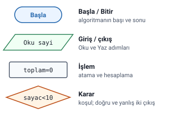
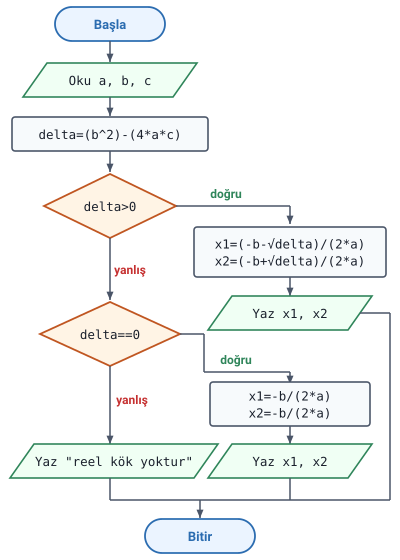

### Örnek 1: KDV ekleyerek fiyat

Hocanın sorusu: **Klavyeden girilen fiyatı, KDV (%18) ekleyerek ekrana yazdıran algoritmayı oluşturunuz.**

Hocanın çözümü:

1. Başla
2. Yaz "fiyatı giriniz:"
3. Oku fiyat
4. `yeni_fiyat=fiyat+((fiyat*18)/100)`
5. yaz yeni_fiyat
6. bitir.

> **Dikkat:** 2. adımdaki `Yaz "fiyatı giriniz:"` kullanıcıya ne gireceğini söyleyen bir mesajdır; fiyatı okuyan adım 3. adımdır (Oku fiyat).

> **Ek:** Tırnak içindeki yazı ekrana olduğu gibi çıkar; 5. adımdaki tırnaksız `yeni_fiyat` ise değişkenin içindeki değeri yazdırır.

#### KDV'li fiyatın hesaplanması

4. adımda önce `(fiyat*18)/100` ile fiyatın %18'i, yani KDV tutarı bulunur; bu tutar fiyata eklenir ve sonuç `yeni_fiyat` değişkenine atanır. Parantez içindeki işlemler önce yapılır: önce `fiyat*18`, sonra 100'e bölme, en son toplama ("Temel Öğeler, Aritmetik İşlemler ve Atama" konusundaki "İşlem önceliği" başlığı).

> **Ek:** Fiyat 100 girilirse KDV tutarı 100*18/100 = 18, yeni fiyat 100+18 = **118** olur; 250 girilirse 250+45 = **295** olur. Aynı sonuç `yeni_fiyat=fiyat*1.18` ile de bulunur.

> **Dikkat:** Soru metnindeki **%18** "yüzde on sekiz" demektir; algoritmadaki `%` işleci (mod alma, bölümden kalan) ile karıştırmayın. Hoca yüzdeyi `*18)/100` ile hesaplıyor; `fiyat%18` yazılsaydı fiyatın 18'e bölümünden kalan bulunurdu.

#### C++ karşılığı: KDV (Ek)

Hocanın çözümü C++'ta şöyle yazılabilir. g++ ile derlenip denendi: 100 girilince 118, 250 girilince 295, 105 girilince 123.9 yazar.

```cpp
#include <iostream>
using namespace std;

int main() {
    double fiyat, yeni_fiyat;
    cout << "fiyatı giriniz:";                 // 2.Yaz
    cin >> fiyat;                              // 3.Oku fiyat
    yeni_fiyat = fiyat + ((fiyat * 18) / 100); // 4.
    cout << yeni_fiyat;                        // 5.yaz yeni_fiyat
    return 0;                                  // 6.bitir.
}
```

> **Ek:** Değişkenler `double` (ondalıklı) tanımlandı. `int` (tam sayı) tanımlansaydı C++ bölmede küsuratı atar: 105 girilince 123.9 yerine 123 çıkar (g++ ile denendi).

### Örnek 2: ikinci dereceden denklemin kökleri

Hocanın sorusu: **Katsayıları verilen 2. dereceden bir denklemin köklerini hesaplayan programın algoritmasını yazınız ve akış diyagramını çiziniz.**

Hocanın çözümü (hocanın yazdığı gibi):

1. Başla
2. Yaz "x^2 li terimin katsayısını giriniz:"
3. Oku a
4. Yaz "x li terimin katsayısını giriniz:"
5. Oku b
6. Yaz "sabit terimi giriniz:"
7. Oku c
8. `delta=(b^2)-(4*a*c)`
9. Eğer `(delta>0)` ise `x1=[(-b)-(delta^1/2)]/2*a`, `x2=[(-b)+(delta^1/2)]/2*a`; Yaz x1, x2
10. Eğer `(delta==0)` ise `x1=-b/2*a`, `x2=-b/2*a` yaz x1, x2
11. Değilse yaz "reel kök yoktur"
12. Bitir.

> **Dikkat:** Hocanın belgesinde 9. adımın ikinci satırı `X2` diye büyük harfle yazılmış, aynı adımın sonunda `Yaz x1, x2` küçük harfle geçiyor; burada `x2` yazıldı.

> **Ek:** C++ gibi dillerde büyük ve küçük harf farklı ad sayılır (`X2` ile `x2` iki ayrı değişkendir); bu yüzden bir değişkenin adı algoritmanın her yerinde aynı yazılır.

#### Delta ve köklerin durumu

Hocanın çözümünde 8. adımda `delta=(b^2)-(4*a*c)` hesaplanır ve köklerin durumu delta'ya göre üç durumda ayrılır. Çözümün amaçladığı sonuçlar:

| Delta | Amaçlanan sonuç |
| --- | --- |
| `delta>0` (9. adım) | x1 ve x2 iki kök olarak hesaplanıp yazılır |
| `delta==0` (10. adım) | x1 ve x2 aynı değer olarak hesaplanıp yazılır |
| sıfırdan küçük (11. adım, Değilse) | "reel kök yoktur" yazılır |

> **Dikkat:** 11. adımdaki "Değilse" hocanın yazdığı hâliyle yalnızca delta sıfırdan küçükken çalışmaz; delta sıfırdan büyükken de çalışır (bu konudaki "Adım 10 ve 11: Değilse hangi Eğer'e bağlı" başlığı). Tablo, çözümün amacını gösterir.

> **Ek:** Denklem ax²+bx+c=0 biçimindedir; a, x²'li terimin, b, x'li terimin katsayısı, c sabit terimdir. Delta (diskriminant) sıfırdan büyükse iki farklı reel kök, sıfırsa iki eşit (çakışık) kök vardır, sıfırdan küçükse reel kök yoktur. Kökler x = (-b ± √delta) / (2a) formülüyle bulunur; delta sıfırken √delta sıfır olduğu için iki kök de -b / (2a) olur.

#### Kök formülünün yazımı

Hocanın 9. adımda yazdığı `delta^1/2` ile amaçlanan, delta'nın **karekökü** (1/2. kuvveti); `/2*a` ile amaçlanan da "2a'ya bölmek"tir.

> **Dikkat:** Hocanın işlem önceliği kuralı uygulanırsa ("Temel Öğeler, Aritmetik İşlemler ve Atama" konusundaki "İşlem önceliği" başlığı) bu iki yazım başka sonuç verir. `delta^1/2` yazımında üs alma bölmeden önce yapılır: önce `delta^1` (yani delta), sonra 2'ye bölme; sonuç karekök değil, **delta'nın yarısıdır**. Karekök için üs parantez içine alınır: `delta^(1/2)`. `/2*a` yazımında çarpma ve bölme aynı önceliktedir ve soldan sağa yapılır: önce 2'ye bölünür, sonra a ile **çarpılır**. 2a'ya bölmek için parantez gerekir: `/(2*a)`.

> **Dikkat:** Düzeltilmiş yazım: `x1=((-b)-(delta^(1/2)))/(2*a)`, `x2=((-b)+(delta^(1/2)))/(2*a)`; delta sıfırken `x1=-b/(2*a)`, `x2=-b/(2*a)`.

> **Dikkat:** Hocanın yazdığı hâliyle a=1, b=-5, c=6 (kökleri 2 ve 3) için x1 2.25, x2 2.75 çıkar; düzeltilmiş yazımla 2 ve 3 çıkar. a=2, b=4, c=2 (delta sıfır, kök -1) için hocanın yazımı -4, düzeltilmiş yazım -1 verir. İki yazım da C++'ta denendi. Notta hocanın çözümü olduğu gibi korundu.

> **Ek:** Köşeli parantez `[ ]` hocanın çözümünde işlem parantezi olarak kullanılmış. C++'ta işlem parantezi yalnızca normal parantezdir `( )`; köşeli parantez orada başka bir iş görür.

> **Ek:** C++'ta `^` üs alma değildir ("Temel Öğeler, Aritmetik İşlemler ve Atama" konusundaki "Aritmetik işlemler" başlığı); karekök `sqrt(delta)`, kare `pow(b,2)` ya da `b*b` diye yazılır (`<cmath>` kütüphanesi).

#### Adım 10 ve 11: Değilse hangi Eğer'e bağlı

Hocanın çözümünde 9. ve 10. adım **ayrı iki Eğer** olarak, 11. adım da tek bir "Değilse" olarak yazılmıştır.

> **Dikkat:** Ayrı iki Eğer'den sonra gelen "Değilse" yalnızca 10. adımdaki Eğer'e (`delta==0`) bağlanır. Böyle okunursa delta sıfırdan büyükken önce 9. adımda kökler yazılır, ardından 10. adımdaki `delta==0` koşulu yanlış döndüğü için 11. adımdaki "Değilse" de çalışır ve ekrana ayrıca "reel kök yoktur" yazılır (C++'ta a=1, b=-5, c=6 ile, kök formülü düzeltilmiş hâliyle denendi: önce 2 ve 3, sonra "reel kök yoktur" çıkar). Bu, "Algoritma İfade Şekilleri: Metin ve Sözde Kod" konusundaki "Örnek: suyun durumu" başlığında anlatılan durumun aynısıdır.

> **Ek:** Düzeltmenin iki yolu vardır ("Karar Yapıları" konusundaki "DEĞİL İSE kısmında koşul kullanılmaz" başlığının Ek kutusu). Birincisi 10. adımı **"Değilse eğer"** diye 9. adıma bağlamaktır: `Eğer (delta>0) ise ...`, `Değilse eğer (delta==0) ise ...`, `Değilse yaz "reel kök yoktur"`. İkincisi her durumu ayrı bir Eğer ile, koşulu tam vererek yazmaktır: 11. adım `Eğer (delta<0) ise yaz "reel kök yoktur"` olur. Hocanın hangisini beklediği kaynakta yazmıyor; şekildeki akış şeması birinci yolla çizildi.

#### Akış diyagramı: denklemin kökleri (Ek)

Hoca bu soruda akış diyagramının çizilmesini de istiyor; ama akış diyagramı hocanın belgesinde çizilmemiş ve sembolleri slaytlarda henüz anlatılmadı. Aşağıdaki şekiller ISO 5807'deki temel sembollerle çizildi. Akış diyagramına akış şeması da denir.



> **Ek:** ISO 5807'de giriş ve çıkışın ikisi de paralelkenarla gösterilir. Bazı kaynaklar ekrana yazmak için ayrı bir sembol (ekran ya da belge şekli) kullanır; hocanın derste gösterdiği semboller farklıysa hocanınkileri kullanın.



#### C++ karşılığı: denklemin kökleri (Ek)

Düzeltilmiş çözümün C++ karşılığı. g++ ile derlenip denendi: 1 -5 6 girilince 2 3, 2 4 2 girilince -1 -1, 1 2 5 girilince "reel kök yoktur" yazar.

```cpp
#include <iostream>
#include <cmath>
using namespace std;

int main() {
    double a, b, c, x1, x2, delta;
    cout << "x^2 li terimin katsayısını giriniz:"; cin >> a;
    cout << "x li terimin katsayısını giriniz:";   cin >> b;
    cout << "sabit terimi giriniz:";               cin >> c;
    delta = pow(b, 2) - (4 * a * c);
    if (delta > 0) {
        x1 = ((-b) - sqrt(delta)) / (2 * a);
        x2 = ((-b) + sqrt(delta)) / (2 * a);
        cout << x1 << " " << x2;
    } else if (delta == 0) {
        x1 = -b / (2 * a);
        x2 = -b / (2 * a);
        cout << x1 << " " << x2;
    } else {
        cout << "reel kök yoktur";
    }
    return 0;
}
```
