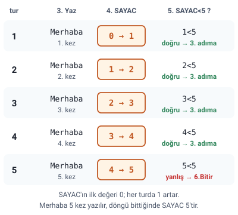

### Sayaç kavramı

Algoritmada **sayaç** kavramı, genellikle bir **döngü veya işlem sayısını takip etmek** için kullanılan bir **değişkendir.**

Sayaçlar, belirli bir işlemin **kaç kez tekrarlandığını** ya da bir koşulun **ne kadar süreyle sağlandığını** belirlemek amacıyla kullanılır.

> **Dikkat:** Sayaç ayrı bir komut ya da özel bir işaret değildir; sıradan bir **değişkendir** (hocanın örneklerinde `SAYAC`, `Sayac`, `sayac` adlarıyla). Ona bu işi gördüren, ilk değerinin verilmesi, her turda artırılması ve bir koşulla yoklanmasıdır.

### Sayaçların kullanım alanları

1. **Döngüler:** Sayaçlar, for döngülerinde sıklıkla kullanılır. Örneğin, bir dizi elemanlarını döngüyle gezmek için sayaç değişkeni kullanarak her bir elemanın indeksine erişilir.
2. **Koşul kontrolü:** Belirli bir koşul sağlandığında bir işlemi gerçekleştirmek için sayaç kullanılabilir. Örneğin, bir olayın kaç kez gerçekleştiğini saymak.
3. **Sıralama ve gruplama:** Veri yapılarında elemanları saymak veya gruplamak için sayaçlar kullanılabilir.

> **Ek:** Döngü, bir ya da birkaç adımın bir koşul sağlandıkça tekrar tekrar yapılmasıdır. İndeks, dizideki bir elemanın sıra numarasıdır.

### Sayaç mantığı: sayaçsız çözüm

Hocanın sorusu: **Ekrana 5 kez merhaba yazan algoritmayı yazalım.** Hoca sayaç mantığına geçmeden önce bu soruyu sayaçsız çözüyor:

1. BAŞLA
2. YAZ "MERHABA"
3. YAZ "MERHABA"
4. YAZ "MERHABA"
5. YAZ "MERHABA"
6. YAZ "MERHABA"
7. BİTİR.

> **Ek:** Bu çözümde her "MERHABA" için ayrı bir YAZ adımı vardır; 5 yerine 100 kez yazdırmak istense 100 ayrı YAZ adımı gerekirdi. Sayaçlı çözümde (bir sonraki başlık) adım sayısı değişmez, yalnızca koşuldaki sayı değişir.

### Örnek: ekrana 5 defa merhaba

Hocanın sorusu: **Ekrana 5 defa "merhaba" yazan programın algoritmasını yazınız.**

Hocanın çözümü:

1. Başla
2. `SAYAC=0`
3. Yaz: "Merhaba"
4. `SAYAC=SAYAC+1`
5. Eğer `SAYAC<5` İse 3.Adıma Dön
6. Bitir

Hocanın açıklamaları:

- Adım 2: SAYAC adlı değişken tanımlanır ve bu değişkenin **ilk değeri 0** olarak atanır.
- Adım 3: soruda istenilen işlem gerçekleştirilir.
- Adım 4: soruda istenilen işlem gerçekleştirildikten sonra SAYAC değişkeninin değeri artırılır. Bunu yapmak için SAYAC değerine 1 eklenir ve bulunan yeni sonuç yine SAYAC değişkeninde saklanır.
- Adım 5: SAYAC adlı değişken değeri artırıldıktan sonra hâlâ 5'ten küçük ise 3. adıma geri dönülür. Buradaki işlem tekrar edilir ve diğer adımlar yukarıdan aşağı doğru tekrar edilir. SAYAC 5'e eşit olduğunda `SAYAC<5` kontrol koşulu doğru sonucunu döndürmeyecek ve **döngü sona erecektir.**

> **Dikkat:** `SAYAC=SAYAC+1` bir **atamadır**: sağ taraf hesaplanır (SAYAC'ın değeri + 1), sonuç yine SAYAC'a yazılır ("Temel Öğeler, Aritmetik İşlemler ve Atama" konusundaki "Atama örnekleri" başlığı). Slayttaki 5. adımda değişken `Sayac` diye yazılmış; öbür adımlarda `SAYAC`'tır, burada hepsi `SAYAC` yazıldı.

> **Dikkat:** 5. adımda koşul yanlış dönünce yapılacak ayrı bir işlem (DEĞİL İSE) yazılmamıştır: koşul yanlışsa 3. adıma dönülmez, sıradaki adıma (6.Bitir) geçilir.

#### Adım adım izleme: 5 defa merhaba (Ek)

> **Ek:** Merhaba, SAYAC 0, 1, 2, 3 ve 4 iken yazılır: **5 kez**. Beşinci yazıştan sonra SAYAC 5 olur, `5<5` yanlış döner ve döngü biter; algoritma bittiğinde SAYAC'ın değeri **5**'tir. Koşul işlemden **sonra** yoklandığı için 3. ve 4. adımlar en az bir kez yapılır. Bu örneğin hocanın akış diyagramı: "Akış Diyagramları (Akış Çizgeleri)" konusundaki "Örnek: ekrana 5 defa merhaba" başlığı.

### Soru: girilen 10 sayıyı ekrana yazma

Hocanın sorusu: **Klavyeden girilen 10 adet sayıyı ekrana yazan algoritma.**

Hocanın çözümü:

1. Başla
2. `Sayac=0`
3. Yaz "bir sayı giriniz:"
4. Oku sayi
5. Yaz sayi
6. `Sayac=Sayac+1`
7. Eğer `Sayac<10` ise 3. Adıma dön
8. Bitir.

> **Dikkat:** Döngü 3. adıma döner: sayı istenir, okunur, yazılır ve sayaç artırılır; 3.–7. adımlar her turda tekrarlanır. Sayaç 0'dan başlayıp `Sayac<10` ile yoklandığı için döngü **10 kez** döner ve 10 sayı okunur.

### Soru: 1'den 100'e kadar tam sayılar

Hocanın sorusu: **1'den 100'e kadar olan tam sayıları ekrana yazınız.**

Hocanın çözümü:

1. Başla
2. `Sayac=1`
3. Yaz Sayac
4. `Sayac=Sayac+1`
5. Eğer `Sayac<=100` ise 3. Adıma dön
6. Bitir.

> **Dikkat:** Burada sayaç yalnızca tur saymaz, **ekrana yazılan sayının kendisidir**: 3. adım sayacın değerini yazar. Bu yüzden ilk değer 1'dir ve koşul `<=` ile kurulur ki 100 de yazılsın. Ekrana 1, 2, ..., 100 yazılır (100 sayı); algoritma bittiğinde Sayac 101'dir.

#### Sayacın ilk değeri ve koşul

Hocanın örneklerinde sayacın ilk değeri, artışı, koşulu ve döngünün kaç tur döndüğü:

| Örnek | İlk değer | Artış | Koşul | Tur sayısı |
| --- | --- | --- | --- | --- |
| 5 defa merhaba | 0 | 1 | `SAYAC<5` | 5 |
| 10 sayıyı yazma | 0 | 1 | `Sayac<10` | 10 |
| 1'den 100'e | 1 | 1 | `Sayac<=100` | 100 |

> **Ek:** Döngünün kaç kez döneceğini sayacın ilk değeri, artış miktarı ve koşul birlikte belirler.

> **Dikkat:** `<` ile `<=` arasındaki fark bir tur demektir. 5 defa merhaba örneğinde koşul `SAYAC<=5` yazılsaydı Merhaba **6 kez** yazılırdı (SAYAC 0, 1, 2, 3, 4 ve 5 iken). 1'den 100'e örneğinde koşul `Sayac<100` yazılsaydı 100 yazılmazdı. Aynı sınır sayısıyla (ör. 5) ilk değer 0 iken `<`, ilk değer 1 iken `<=` kullanılırsa döngü aynı sayıda (5 kez) döner.
