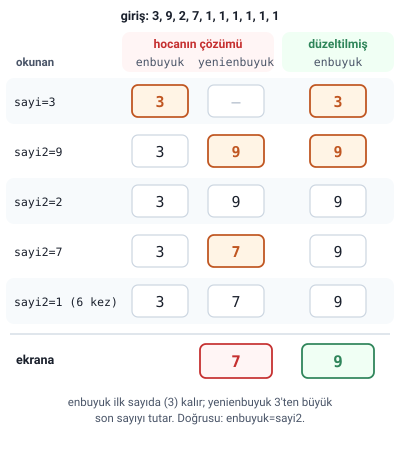
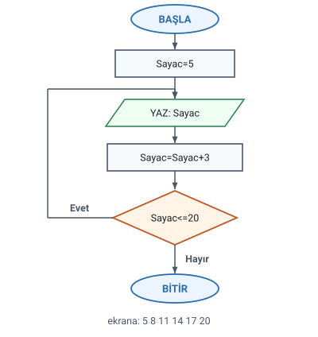
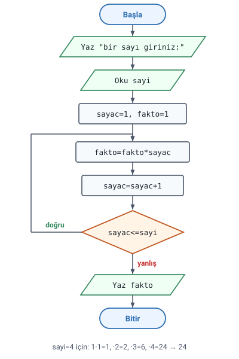

### Örnek 1: 10 sayının toplamı

Hocanın sorusu: **Klavyeden girilen 10 adet sayının toplamını bulup ekrana yazan programın algoritmasını yazınız.**

Hocanın çözümü:

1. Başla
2. `sayac=0`, `toplam=0`
3. Yaz "bir sayı giriniz:"
4. Oku sayi
5. `toplam=toplam+sayi`
6. `sayac=sayac+1`
7. eğer `sayac<10` ise 3.adıma dön
8. yaz "girilen sayıların toplamı:" toplam
9. bitir.

> **Dikkat:** Bu çözümde iki ayrı değişken birlikte çalışır: `sayac` kaç sayı okunduğunu sayar (her turda **1** artar), `toplam` okunan sayıları biriktirir (her turda **okunan sayı kadar** artar). İkisinin de ilk değeri 2. adımda **0** verilir; toplamın ilk değeri 0 olmalıdır ki ilk sayı eklendiğinde toplam o sayıya eşit olsun.

> **Dikkat:** Toplam ekrana döngü **bittikten sonra**, 8. adımda bir kez yazılır. 8. adım döngünün içinde (3. ile 7. adım arasında) olsaydı her turda o ana kadarki toplam yazılırdı.

> **Ek:** 1'den 10'a kadar sayılar girilince ekrana 55 yazılır. `toplam=toplam+sayi` biçimindeki değişkene kimi kaynaklarda "toplayıcı" ya da "biriktirici" denir.

### Örnek 2: çift sayıların karesi

Hocanın sorusu: **Klavyeden girilen 10 adet sayıdan sadece çift olanlarının karesini hesaplayıp ekrana yazan programın algoritmasını yazınız.**

Hocanın çözümü:

1. Başla
2. `Sayac=0`
3. Yaz "bir sayı giriniz:"
4. Oku sayi
5. Eğer `sayi%2==0` ise yaz `sayi*sayi` (yaz `sayi^2`)
6. `Sayac=Sayac+1`
7. Eğer `Sayac<10` ise 3. Adıma dön
8. Bitir.

> **Dikkat:** Sayının çift olduğu, 2'ye bölümünden **kalanın** 0 olmasıyla anlaşılır: `sayi%2==0` ("Karar Yapıları: Örnekler" konusundaki "Örnek 4: tek mi çift mi" başlığı). Sayı tekse 5. adımda hiçbir şey yazılmaz (DEĞİL İSE kısmı yoktur) ve 6. adıma geçilir.

> **Dikkat:** 6. adımdaki sayaç artırma Eğer'in içinde değildir: sayaç, sayı çift de olsa tek de olsa **her turda** artar. Sayaç çift sayıları değil **okunan sayıları** sayar; bu yüzden döngü tam 10 sayı okur.

> **Dikkat:** Hoca karenin iki yazımını veriyor: `sayi*sayi` ve parantez içinde `sayi^2`. Algoritmada `^` üs almadır ("Temel Öğeler, Aritmetik İşlemler ve Atama" konusundaki "Aritmetik işlemler" başlığı); iki yazım aynı sonucu verir.

### Örnek 3: en büyük sayı

Hocanın sorusu: **Klavyeden girilen 10 adet sayıdan en büyük olanı bulup ekrana yazan programın algoritmasını yazınız.**

Hocanın çözümü (hocanın yazdığı gibi):

1. Başla
2. `sayac=1`
3. Yaz "bir sayı giriniz:"
4. Oku sayi
5. `enbuyuk=sayi`
6. yaz "bir sayi giriniz:"
7. oku sayi2
8. eğer `sayi2>enbuyuk` ise `yenienbuyuk=sayi2`
9. `sayac=sayac+1`
10. eğer `sayac<10` ise 6. Adıma dön
11. yaz yenienbuyuk
12. bitir.

> **Dikkat:** İlk sayı döngüden **önce** okunur (3.–5. adım) ve en büyük olarak kabul edilir; döngü 6. adıma döner. İlk sayı okunmuş olduğu için sayaç **1**'den başlar; döngü 9 sayı daha okur ve toplam 10 sayı okunmuş olur.

#### Hocanın çözümündeki hata ve düzeltmesi

Hocanın çözümünde 8. adım daha büyük sayıyı `enbuyuk`'a değil, `yenienbuyuk` adlı başka bir değişkene yazıyor; 11. adımda da `yenienbuyuk` yazdırılıyor.

> **Dikkat:** Bu yüzden `enbuyuk` hep **ilk sayıda** kalır ve her yeni sayı yine ilk sayıyla karşılaştırılır. `yenienbuyuk` en büyük sayıyı değil, **ilk sayıdan büyük olan son sayıyı** tutar: 3, 9, 2, 7, 1, 1, 1, 1, 1, 1 girilince ekrana 9 yerine **7** yazılır. İlk sayı en büyükse (ör. 9, 1, 2, ...) 8. adımdaki koşul hiç doğru dönmez, `yenienbuyuk`'a hiç değer atanmaz ve 11. adımda yazılacak bir değer olmaz. Doğru sonuç ancak en büyük sayıdan sonra ilk sayıdan büyük başka bir sayı gelmezse çıkar (ör. sayılar küçükten büyüğe girilirse).

> **Dikkat:** Düzeltme: 8. adım `eğer sayi2>enbuyuk ise enbuyuk=sayi2`, 11. adım `yaz enbuyuk` olur. Böylece her yeni sayı **o ana kadarki en büyükle** karşılaştırılır.

> **Dikkat:** Notta hocanın çözümü olduğu gibi korundu.

### Örnek 4: 5'ten 20'ye 3'er 3'er

Hocanın sorusu: **5'ten 20'ye kadar 3'er 3'er sayıları yazdıran programın algoritmasını yazınız ve akış şemasını çiziniz.**

Hocanın çözümü:

1. Başla
2. `Sayac=5`
3. Yaz Sayac
4. `Sayac=Sayac+3`
5. Eğer `Sayac<=20` ise 3. Adıma dön
6. Bitir.

> **Dikkat:** Sayaç bu örnekte 1 değil **3** artar ve ilk değeri **5**'tir. Ekrana 5, 8, 11, 14, 17, 20 yazılır (6 sayı); algoritma bittiğinde Sayac 23'tür. Koşul `<=` olduğu için 20 de yazılır; `Sayac<20` yazılsaydı 20 yazılmazdı.

#### Akış şeması: 3'er 3'er sayılar (Ek)

Hocanın belgesinde akış şeması çizilmemiş. Hocanın çözümünün akış şeması, hocanın 6. haftada gösterdiği sembollerle ("Akış Diyagramları (Akış Çizgeleri)" konusundaki "Akış diyagramı sembolleri" başlığı):

> **Ek:** "3. Adıma dön" akış şemasında karar sembolünün **Evet** çıkışından `YAZ: Sayac`'a geri giden okla gösterilir; döngü bu geri dönüş okudur. **Hayır** çıkışı BİTİR'e gider. Hoca 6. haftada "Ekrana 5 defa merhaba" örneğinin döngüsünü de böyle çizdi ("Akış Diyagramları (Akış Çizgeleri)" konusundaki "Örnek: ekrana 5 defa merhaba" başlığı).

### Örnek 5: faktöriyel

Hocanın sorusu: **Klavyeden girilen N değerine göre bu sayının faktöriyelini hesaplayan programın algoritmasını yazınız ve akış şemasını çiziniz.**

Hocanın çözümü:

1. Başla
2. Yaz "bir sayı giriniz:"
3. Oku sayi
4. `sayac=1`, `fakto=1`
5. `fakto=fakto*sayac`
6. `sayac=sayac+1`
7. eğer `sayac<=sayi` ise 5. Adıma dön
8. yaz fakto
9. bitir

> **Ek:** Bir sayının faktöriyeli, 1'den o sayıya kadar olan tam sayıların çarpımıdır: 4! = 1·2·3·4 = 24, 5! = 120. 0! tanım gereği 1'dir.

> **Dikkat:** Faktöriyeli tutan `fakto` değişkeninin ilk değeri **1**'dir, 0 değildir: sayılar çarpılarak biriktirilir ve 0 ile başlansaydı sonuç hep 0 çıkardı. (Toplamada ise ilk değer 0'dır: bu konudaki "Örnek 1: 10 sayının toplamı" başlığı.)

> **Dikkat:** Koşul `sayac<=sayi`'dir: sayaç girilen sayıya **eşit olduğunda da** çarpılmalıdır (4! için 4 ile de çarpılır). `sayac<sayi` yazılsaydı son çarpım yapılmazdı ve 4 için 6 çıkardı. Hocanın belgesinde 7. adımda "ise" sözcüğü eksik yazılmış; burada eklendi.

> **Ek:** 5. adım koşuldan önce geldiği için en az bir kez yapılır: 0 ya da 1 girilince `fakto=1*1=1` olur, ardından koşul yanlış döner ve 1 yazılır (0! ve 1! 1'dir). 0, 1, 3, 5 ve 10 girilince sırasıyla 1, 1, 6, 120, 3628800 yazılır.

#### Akış şeması: faktöriyel (Ek)

Hoca aynı soruyu 6. haftada akış diyagramıyla çözdü ("Akış Diyagramı Örnekleri" konusundaki "Örnek 3: faktöriyel" başlığı); aşağıdaki şema bu çözümün akış diyagramı gibi çizildi: döngüdeki iki işlem tek bir hesaplama sembolünde, Evet çıkışı bu sembole geri döner.

> **Ek:** Geri dönüş oku 5. adıma (`fakto=fakto*sayac`) gider; 4. adımdaki ilk değer verme döngünün **dışındadır** ve yalnızca bir kez yapılır. İlk değerler döngünün içine alınsaydı her turda sıfırlanırdı.
