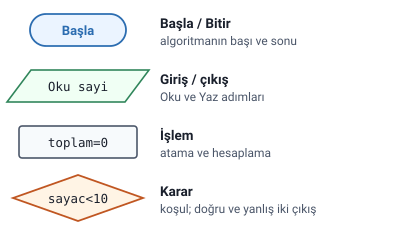
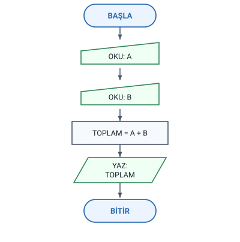
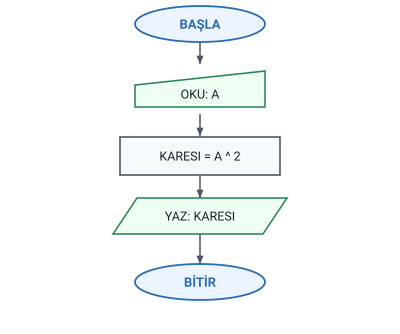
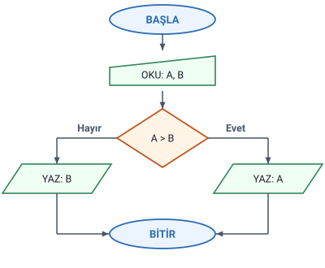
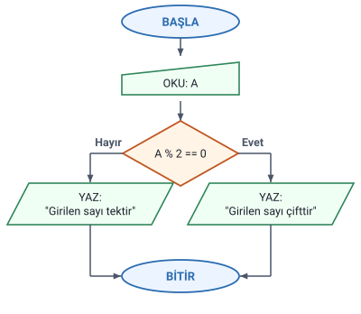
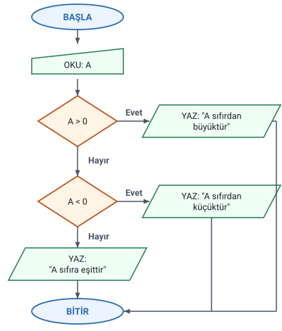
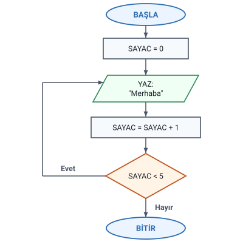

### Akış çizgeleri (diyagramları)

**Akış çizgesi (akış diyagramı), bir algoritmanın şekillerle görsel gösterimidir.** Hoca bu konuya hem "akış diyagramları" hem "akış çizgeleri" diyor; örnek sorularda "akış şemasını çiziniz" de yazıyor ("Akış Diyagramı Örnekleri" konusu).

- Algoritma doğal dille yazıldığı için **herkes tarafından anlaşılamayabilir.**
- Ancak akış çizgelerinde her bir şekil **standart bir anlam** taşıdığı için farklı yorumlanması mümkün değildir.
- Her bir ifade için **ayrı bir sembol** kullanılmaktadır.
- Akış diyagramı çizmek için çevrimiçi olarak **draw.io** adresi kullanılabilir.

> **Dikkat:** Slayttaki cümle "farklı yorumlanıp anlaşılamaması mümkün değildir" diye yazılmış; kastedilen, şekillerin standart anlamı olduğu için akış çizgesinin **farklı yorumlanamayacağıdır**. Notta bu anlamla yazıldı.

### Akış diyagramı sembolleri

Hocanın sembolleri ve anlamları:

| Sembol (şekli) | Anlamı |
| --- | --- |
| Yuvarlak köşeli kutu (örneklerde elips) | Algoritmanın başladığını ya da sona erdiğini belirtmek için kullanılır. |
| Üst kenarı eğik dörtgen | Klavye aracılığı ile giriş ya da okuma yapılacağını gösterir. |
| Alt kenarı dalgalı kutu | Yazıcı aracılığı ile çıkış yapılacağını gösterir. |
| Dikdörtgen (slaytta) | Kart okuyucu aracılığıyla giriş yapılacağını gösterir. |
| Altıgen | Yapılacak işler birden fazla sayıda yinelenecek ise, diğer bir deyişle iş akışında çevrim (döngü) var ise bu sembol kullanılır. |
| Ok | Oklar işin akış yönünü gösterir. |
| Paralelkenar | Araç belirtmeden giriş ya da çıkış yapılacağını gösterir. |
| Dikdörtgen | Hesaplama ya da değerlerin değişkenlere aktarımını gösterir. |
| Eşkenar dörtgen | Aritmetik ve mantıksal ifadeler için karar verme ya da karşılaştırma durumunu gösterir. |
| Silindir | Diskten okuma veya diskete yazmayı gösterir. |
| Elips | Bağ. |

> **Ek:** Slaytta sembollerin şekil adları yazmaz, yalnızca çizimleri vardır; tablodaki şekil adları (paralelkenar, eşkenar dörtgen, silindir…) çizimlerin tarifidir.

#### Başla ve bitir sembolü

Algoritmanın başı (BAŞLA) ve sonu (BİTİR) aynı sembolle gösterilir. Hocanın bütün örneklerinde diyagram bu sembolle başlar ve bu sembolle biter.

> **Dikkat:** Sembol listesinde (slayt 3) bu sembol **yuvarlak köşeli bir kutu** olarak çizilmiş; hocanın örneklerinde ise BAŞLA ve BİTİR **elips** (iki sayının toplamında uçları yuvarlak kutu) içinde yazılır. İkisi de aynı anlamdadır: algoritmanın başı ya da sonu.

> **Dikkat:** Örneklerdeki BAŞLA/BİTİR elipsi, sembol listesindeki **bağ** sembolüyle (elips) aynı şekildedir. Örneklerde ikisi, içindeki yazıdan (BAŞLA, BİTİR) ayırt edilir.

#### Giriş ve çıkış sembolleri

Sembol listesindeki giriş ve çıkış sembolleri: klavyeden giriş, araç belirtmeden giriş ya da çıkış, yazıcıdan çıkış, kart okuyucudan giriş ve disk (diskten okuma, diskete yazma).

Hocanın bütün örneklerinde:

- **OKU** adımları (klavyeden okunan değerler) **klavye aracılığı ile giriş** sembolüyle (üst kenarı eğik dörtgen) çizilir: `OKU: A`, `OKU: A, B`.
- **YAZ** adımları (ekrana yazılan değer ya da mesaj) **araç belirtmeden giriş ya da çıkış** sembolüyle (paralelkenar) çizilir: `YAZ: TOPLAM`, `YAZ: "Merhaba"`.

> **Dikkat:** Karıştırmayın: paralelkenar "araç belirtmeden" giriş ya da çıkıştır; klavyeden okuma için hocanın ayrı bir sembolü vardır (üst kenarı eğik dörtgen) ve örneklerde OKU adımları hep bu sembolle çizilmiştir. Yazıcıdan çıkış sembolü (alt kenarı dalgalı) ekrana yazmak için kullanılmamıştır.

> **Dikkat:** Slaytta kart okuyucudan giriş sembolü düz bir dikdörtgen olarak çizilmiş; bu çizim hesaplama sembolüyle aynı görünür.

> **Ek:** Akış diyagramı standartlarında (ISO 5807) kart sembolü sol üst köşesi kesik bir dikdörtgendir.

#### İşlem, karar ve döngü sembolleri

- **Hesaplama** ya da bir değerin değişkene **aktarımı (atama)** dikdörtgenle gösterilir: `TOPLAM = A + B`, `SAYAC = 0`.
- **Karar** (karşılaştırma) eşkenar dörtgenle gösterilir; içine koşul yazılır: `A > B`, `A % 2 == 0`. Karar sembolünün iki çıkışı vardır: koşul doğruysa **Evet**, yanlışsa **Hayır** çıkışından devam edilir.
- **Döngü** (çevrim) için listede altıgen sembolü vardır.

> **Dikkat:** Hocanın örneklerinde döngü altıgen sembolüyle değil, **karar sembolü ve geri dönen okla** çizilmiştir: "Ekrana 5 defa merhaba" örneğinde `SAYAC < 5` kararının Evet çıkışı geri, YAZ adımına döner (bu konudaki "Örnek: ekrana 5 defa merhaba" başlığı).

> **Ek:** Karar sembolündeki Evet ve Hayır, "Karar Yapıları" konusundaki EĞER (koşul) İSE ve DEĞİL İSE kısımlarına karşılık gelir: Evet çıkışı koşulun doğru dönmesine, Hayır çıkışı yanlış dönmesine karşılık gelir. Hocanın çözüm belgesindeki diyagramlarda Evet yerine **E**, Hayır yerine **H** yazılmıştır.

#### Oklar ve bağ

Oklar **işin akış yönünü** gösterir: akış, sembolden sembole okun gösterdiği yönde izlenir. Bir sembolden çıkan ok bir sonraki adıma gider; karar sembolünden iki ok çıkar (Evet ve Hayır).

Sembol listesinde bir de **bağ** sembolü (elips) vardır; slaytta yalnızca adı yazılıdır.

> **Ek:** Bağ sembolü, büyük bir diyagramda akış çizgisinin kesilip başka bir yerde sürdüğünü göstermek için kullanılır; aynı işaretli iki bağ birbirine bağlı sayılır. Hocanın örneklerinde bağ kullanılmamıştır.

### İzlenecek adımlar

Hocanın "İzlenecek Adımlar" listesi:

1. Problem iyice anlaşılır.
2. Öncelikle algoritma kurulur.
3. Problemin hangi dil kullanılarak çözüleceği belirlenir.
4. Belirlenen dilin sentaksına uygun şekilde kaynak kodları yazılır.
5. Kaynak kodlarını makine diline çevirecek olan derleyici kullanılır.
6. Çalıştırılabilir dosya oluşturulur.
7. Program çalıştırılır.

> **Ek:** Slaytta adımlar madde işaretiyle verilmiş; burada sıralarını göstermek için numaralandı. Kaynak kod, derleyici ve makine dili "Programlama Dilleri, Problem ve Program" konusundaki "Yüksek seviyeli diller ve derleme" başlığında anlatılır.

> **Dikkat:** Bu liste, "Programlama Dilleri, Problem ve Program" konusundaki "Problem çözümü" başlığındaki dokuz adımlık listeyle aynı değildir. Oradaki liste problemin çözümünü (zihinsel alıştırma, algoritma, akış çizgesi, test, düzeltme) anlatır; buradaki liste algoritmadan **çalışan programa** giden yolu (dil, kaynak kod, derleyici, çalıştırılabilir dosya) anlatır.

### Örnek: iki sayının toplamı

Hocanın sorusu: **Klavyeden girilecek iki sayıyı toplayıp sonucu ekrana yazacak programın algoritmasını yazınız.**

Hocanın çözümü:

1. Başla
2. A sayısını oku
3. B sayısını oku
4. `TOPLAM=A+B` işlemini yap
5. TOPLAM değerini ekrana yaz
6. Bitir

Akış diyagramında her adım bir sembol olur: BAŞLA, `OKU: A` ve `OKU: B` (klavyeden giriş), `TOPLAM = A + B` (hesaplama), `YAZ: TOPLAM` (araç belirtmeden çıkış), BİTİR. Karar olmadığı için akış tek bir çizgi hâlinde yukarıdan aşağı iner.

> **Ek:** Aynı örnek "Algoritma Yazımı: Örnekler" konusundaki "Örnek 1: iki sayının toplamı" başlığında açıklamalarıyla anlatılır.

### Örnek: sayının karesi

Hocanın sorusu: **Klavyeden girilen sayının karesini ekrana yazan programın algoritmasını yazınız.**

Hocanın çözümü:

1. Başla
2. A sayısını oku (ya da `OKU:A`): klavyeden bir değer okunur ve A adlı değişken içinde saklanır.
3. `KARESI=A^2`: A^2 işleminin sonucu hesaplanır ve bulunan değer KARESI adlı değişkende saklanır.
4. KARESI değerini ekrana yaz (ya da `YAZ:KARESI`)
5. BİTİR (ya da SON, DUR)

> **Dikkat:** Slayttaki 3. adımda `Karesı=a^2` yazılmış; açıklamada ve akış diyagramında değişken `KARESI`, sayı `A`'dır (`KARESI = A ^ 2`). Burada hepsi `KARESI` ve `A` diye yazıldı. `^` üs alma işaretidir: `A^2`, A'nın karesidir.

> **Ek:** "Algoritma İfade Şekilleri: Metin ve Sözde Kod" konusundaki "Örnek: sayının karesi" başlığında hoca karesi `Kare=A*A` diye hesaplıyor; `A*A` ile `A^2` aynı sonucu verir.

### Örnek: iki sayıdan büyük olanı

Hocanın sorusu: **Klavyeden girilen iki sayıdan büyük olanını bulup ekrana yazan programın algoritmasını yazınız.**

Hocanın çözümü:

1. BAŞLA
2. `OKU:A,B`
3. EĞER `A>B` İSE `YAZ:A` DEĞİL İSE `YAZ:B`
4. BİTİR

Akış diyagramında 3. adım bir **karar** sembolüdür (`A > B`). Koşul doğruysa **Evet** çıkışından `YAZ: A`'ya, yanlışsa **Hayır** çıkışından `YAZ: B`'ye gidilir; iki yol da BİTİR'de birleşir.

> **Dikkat:** A ile B eşitse `A > B` yanlıştır; Hayır çıkışından gidilir ve B yazılır. Aynı örnek "Karar Yapıları" konusundaki "Örnek: iki sayıdan büyük olanı" başlığında da anlatılır.

### Örnek: tek mi çift mi

Hocanın sorusu: **Klavyeden girilen sayının tek sayı mı çift sayı mı olduğunu bulup ekrana yazan programın algoritmasını yazınız.**

Hocanın çözümü:

1. BAŞLA
2. `OKU:A`
3. EĞER `A%2==0` İSE `YAZ: "Girilen sayı çifttir"` DEĞİL İSE `YAZ: "Girilen sayı tektir"`
4. BİTİR

Karar sembolünde `A % 2 == 0` koşulu vardır: A'nın 2'ye bölümünden kalan 0 ise **Evet** çıkışından "Girilen sayı çifttir", değilse **Hayır** çıkışından "Girilen sayı tektir" yazılır.

> **Dikkat:** `%` mod alma (kalan) işlecidir, `==` eşitlik karşılaştırmasıdır. Kalan 0 ise sayı çifttir.

> **Ek:** 8 girilince `8%2` 0'dır, "Girilen sayı çifttir" yazılır; 7 girilince `7%2` 1'dir, "Girilen sayı tektir" yazılır.

> **Ek:** Bu örnek "Karar Yapıları: Örnekler" konusundaki "Örnek 4: tek mi çift mi" sorusunun hocanın çözümüdür.

### Örnek: sayının sıfıra göre durumu

Hocanın sorusu: **Klavyeden girilen bir sayının sıfıra eşit, sıfırdan büyük ya da sıfırdan küçük olma durumunu bulup ekrana yazan programın algoritmasını yazınız.**

Hocanın çözümü:

1. BAŞLA
2. `OKU:A`
3. EĞER `A>0` İSE `YAZ:"A sıfırdan büyüktür"`, 5.adıma git
4. EĞER `A<0` İSE `YAZ:"A sıfırdan küçüktür"` DEĞİL İSE `YAZ:"A sıfıra eşittir"`
5. BİTİR

> **Ek:** Bu örnek "Karar Yapıları: Örnekler" konusundaki "Örnek 2: sayının sıfıra göre durumu" sorusunun hocanın çözümüdür.

#### Adıma git ve art arda kararlar

Üç durum olduğu için hocanın çözümünde iki karar vardır:

- 3. adımda `A>0` doğruysa "A sıfırdan büyüktür" yazılır ve **5. adıma gidilir**: 4. adım atlanır, algoritma biter.
- `A>0` yanlışsa 4. adıma geçilir: `A<0` doğruysa "A sıfırdan küçüktür", yanlışsa (DEĞİL İSE) "A sıfıra eşittir" yazılır.

Akış diyagramında bu, birinci kararın (`A > 0`) **Hayır** çıkışının ikinci karara (`A < 0`) gitmesiyle gösterilir. Evet çıkışlarından mesaj yazılıp BİTİR'e gidilir; ikinci kararın Hayır çıkışından "A sıfıra eşittir" yazılır. Her giriş için ekrana **tek bir mesaj** yazılır.

> **Ek:** 7 için "A sıfırdan büyüktür", -3 için "A sıfırdan küçüktür", 0 için "A sıfıra eşittir" yazılır.

> **Dikkat:** 3. adımdaki "5.adıma git" sözü gereklidir. Yazılmasaydı sıfırdan büyük bir sayı için 3. adımda "A sıfırdan büyüktür" yazıldıktan sonra 4. adıma da geçilirdi; `A<0` yanlış olduğu için DEĞİL İSE kısmı çalışır ve ekrana bir de "A sıfıra eşittir" yazılırdı. Aynı sorun "Algoritma İfade Şekilleri: Metin ve Sözde Kod" konusundaki "Örnek: suyun durumu" başlığında ve "Algoritma Örnekleri: KDV ve Denklem Kökleri" konusundaki "Adım 10 ve 11: Değilse hangi Eğer'e bağlı" başlığında anlatılır.

> **Ek:** Akış diyagramında "adıma git" ayrı bir sembol değildir; Evet yolundaki YAZ sembolünden çıkan okun doğrudan BİTİR'e gitmesidir.

### Örnek: ekrana 5 defa merhaba

Hocanın sorusu: **Ekrana 5 defa "merhaba" yazan programın algoritmasını yazınız.**

Hocanın çözümü:

1. Başla
2. `SAYAC=0`
3. `Yaz:"merhaba"`
4. `SAYAC=SAYAC+1`
5. Eğer `SAYAC<5` İse 3.Adıma Dön
6. Bitir

Akış diyagramında döngü, karar sembolünden (`SAYAC < 5`) geri dönen okla gösterilir: **Evet** çıkışı `YAZ: "Merhaba"` sembolüne geri gider ("3.Adıma Dön"); **Hayır** çıkışı BİTİR'e gider. SAYAC = 0 kutusu döngünün dışında kalır: ilk değer yalnızca bir kez verilir.

> **Dikkat:** Slayttaki adımlarda değişken `Sayac` ve `sayac` diye yazılmış, akış diyagramında `SAYAC`; hepsi aynı değişkendir, burada `SAYAC` yazıldı. Mesaj adımlarda "merhaba", akış diyagramında "Merhaba" diye yazılmıştır.

> **Ek:** Aynı örnek "Sayaç" konusundaki "Örnek: ekrana 5 defa merhaba" başlığında hocanın açıklamalarıyla anlatılır.
