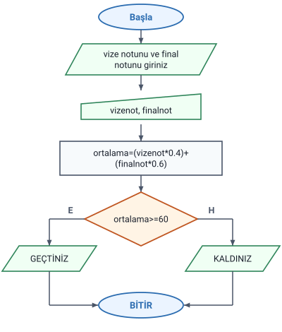
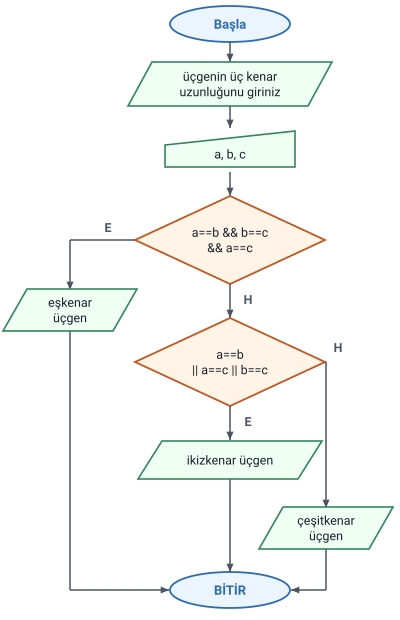
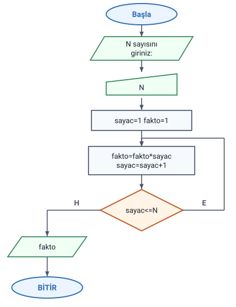

### Örnek 1: ders ortalaması ve geçme

Hocanın sorusu: **Bir üniversitede bir dersin başarı notu bir vize bir final sınavı notu ile hesaplanmaktadır. Vize notunun katsayısı %40, final notunun katsayısı %60'tır. Bir öğrencinin sınavda almış olduğu bu notlar neticesinde ders ortalamasını bulan ve geçip geçmediğini belirten programın algoritmasını yazınız ve akış diyagramını çiziniz. (Geçme notu = 60 olarak kabul edilecektir.)**

Hocanın çözümü:

1. Başla
2. Yaz "vize notunu giriniz:"
3. Oku vizenot
4. Yaz "final notunu giriniz:"
5. Oku finalnot
6. `ortalama=(vizenot*0.4)+(finalnot*0.6)`
7. Eğer `ortalama>=60` ise yaz "GEÇTİNİZ"
8. Değilse yaz "KALDINIZ"
9. Bitir.

> **Dikkat:** Katsayılar yüzde olarak verilmiş, algoritmada ondalık sayıyla yazılmıştır: %40 = `0.4`, %60 = `0.6`.

> **Ek:** Vize 50, final 70 ise ortalama 50·0,4 + 70·0,6 = 20 + 42 = **62** olur ve "GEÇTİNİZ" yazılır; vize 70, final 50 ise 28 + 30 = **58** olur ve "KALDINIZ" yazılır.

> **Dikkat:** Geçme notu 60'tır ve koşul `ortalama>=60`'tır: ortalaması tam 60 olan öğrenci **geçer**. `ortalama>60` yazılsaydı 60 alan öğrenci kalmış sayılırdı.

> **Ek:** 8. adımdaki "Değilse", 7. adımdaki Eğer'in DEĞİL İSE kısmıdır; hoca onu ayrı numarayla yazmış. Burada tek bir Eğer olduğu için yalnızca bir mesaj yazılır.

#### Örnek 1 akış diyagramı

Hocanın akış diyagramında:

- İki mesaj tek bir giriş-çıkış sembolünde (paralelkenar) verilmiştir: "vize notunu ve final notunu giriniz".
- İki not tek bir klavyeden giriş sembolünde okunur: `vizenot, finalnot`.
- Ortalama hesaplama sembolünde (dikdörtgen), koşul karar sembolünde (`ortalama>=60`) yazılır.
- **E** (Evet) çıkışından "GEÇTİNİZ", **H** (Hayır) çıkışından "KALDINIZ" yazılır; iki yol BİTİR'de birleşir.

> **Dikkat:** Algoritmada mesajlar ve okumalar ayrı ayrı adımlardır (2–5. adımlar), akış diyagramında ise ikişer adım birer sembolde birleştirilmiştir. Hoca çözüm belgesindeki diyagramlarda sembollerin içine "Yaz" ve "Oku" sözcüklerini yazmamış, yalnızca mesajı ya da değişkeni yazmıştır; hangi işin yapıldığını sembolün şekli gösterir.

### Örnek 2: üçgenin çeşidi

Hocanın sorusu: **Üç kenar uzunluğu girilen üçgenin çeşidini bulan programın algoritmasını yazınız ve akış şemasını çiziniz.**

Hocanın çözümü:

1. Başla
2. Yaz "üçgenin üç kenar uzunluğunu giriniz:"
3. Oku a, b, c
4. Eğer `a==b && b==c && a==c` ise yaz "eşkenar üçgen"
5. Eğer `a==b || a==c || b==c` ise yaz "ikizkenar üçgen"
6. Değilse yaz "çeşitkenar üçgen"
7. Bitir.

Eşkenar üçgenin koşulunda karşılaştırmalar **VE** (`&&`), ikizkenar üçgenin koşulunda **VEYA** (`||`) ile bağlanmıştır; ikisi de tutmazsa "Değilse" kısmında **çeşitkenar** yazılır.

> **Ek:** Eşkenar üçgende üç kenar da eşittir: VE ile bağlanan karşılaştırmaların hepsi doğru olmalıdır. İkizkenar üçgende herhangi iki kenar eşittir: VEYA ile bağlanan karşılaştırmalardan birinin doğru olması yeter ("Karşılaştırma ve Mantıksal Operatörler" konusundaki "Mantıksal operatörler" başlığı). Hiçbir kenar eşit değilse üçgen çeşitkenardır.

> **Dikkat:** Hocanın belgesinde 5. adımda "ise" sözcüğü eksik yazılmış; burada eklendi.

> **Ek:** 4. adımda `a==b` ve `b==c` doğruysa `a==c` de doğrudur; üçüncü karşılaştırma sonucu değiştirmez.

#### Örnek 2 akış diyagramı

Hocanın akış diyagramında birinci kararın (`a==b && b==c && a==c`) **E** çıkışından "eşkenar üçgen" yazılır, **H** çıkışı ikinci karara (`a==b || a==c || b==c`) gider. İkinci kararın E çıkışından "ikizkenar üçgen", H çıkışından "çeşitkenar üçgen" yazılır. Üç yol BİTİR'de birleşir.

> **Ek:** 5, 5, 8 girilince birinci karar H, ikinci karar E olur ve "ikizkenar üçgen" yazılır; 3, 4, 5 girilince iki karar da H olur ve "çeşitkenar üçgen" yazılır; 3, 3, 3 girilince birinci karar E olur ve "eşkenar üçgen" yazılır.

#### Ayrı Eğer'ler ve akış diyagramı

Hocanın metin algoritmasında 4. ve 5. adım **ayrı iki Eğer**dir; 6. adımdaki "Değilse" 5. adımdaki Eğer'e bağlıdır.

> **Dikkat:** Metin algoritması adım adım izlenirse üç kenarı eşit bir üçgende (ör. 3, 3, 3) 4. adımda "eşkenar üçgen" yazılır, ardından 5. adıma geçilir; `a==b` doğru olduğu için ekrana bir de **"ikizkenar üçgen"** yazılır. Hocanın akış diyagramında ise birinci kararın E yolu "eşkenar üçgen" yazıldıktan sonra doğrudan BİTİR'e gittiği için yalnızca "eşkenar üçgen" yazılır. Yani metin ile diyagram 3, 3, 3 girişinde farklı sonuç verir; öbür girişlerde aynı sonucu verir. Bu, "Akış Diyagramları (Akış Çizgeleri)" konusundaki "Adıma git ve art arda kararlar" başlığında anlatılan durumdur.

> **Ek:** Metni diyagramla aynı hâle getirmek için hocanın sıfıra göre durum örneğindeki yol kullanılabilir: 4. adım `Eğer a==b && b==c && a==c ise yaz "eşkenar üçgen", 7. adıma git` diye yazılır. Notta hocanın çözümü olduğu gibi korundu.

### Örnek 3: faktöriyel

Hocanın sorusu: **Klavyeden girilen N değerine göre bu sayının faktöriyelini hesaplayan programın algoritmasını yazınız ve akış şemasını çiziniz.**

Hocanın çözümü:

1. Başla
2. `sayac=1` `fakto=1`
3. yaz "N sayısını giriniz:"
4. oku N
5. `fakto=fakto*sayac`
6. `sayac=sayac+1`
7. eğer `sayac<=N` ise 5. Adıma dön
8. yaz fakto
9. bitir.

> **Ek:** N=4 için döngü dört kez döner: fakto sırasıyla 1·1 = 1, 1·2 = 2, 2·3 = 6, 6·4 = **24** olur; sayac 5 olunca `sayac<=N` yanlış döner ve 24 yazılır. N=5 için 120 yazılır.

> **Ek:** Aynı soru "Sayaçlı Döngü Örnekleri" konusundaki "Örnek 5: faktöriyel" başlığında da var; orada hocanın çözümünde sayı `sayi` adlı değişkene okunur ve ilk değerler okumadan sonra verilir. Faktöriyelin tanımı da orada.

#### Örnek 3 akış diyagramı

Hocanın akış diyagramında:

- "N sayısını giriniz:" mesajı giriş-çıkış sembolünde (paralelkenar), `N` klavyeden giriş sembolünde okunur.
- İlk değerler (`sayac=1 fakto=1`) bir hesaplama sembolünde, döngüde tekrar edilen iki işlem (`fakto=fakto*sayac`, `sayac=sayac+1`) **tek bir** hesaplama sembolünde yazılır.
- `sayac<=N` kararının **E** çıkışı geri, iki işlemin bulunduğu sembole döner ("5. Adıma dön"); **H** çıkışından fakto yazılır ve BİTİR'e gidilir.

#### Döngü ve ilk değerler

> **Dikkat:** Hocanın metninde ilk değerler 2. adımda, mesaj ve okumadan **önce** verilir; akış diyagramında ise `sayac=1 fakto=1` sembolü N okunduktan **sonra** gelir. İki sıra da aynı sonucu verir: ilk değerler döngüye girmeden yalnızca bir kez verilir.

> **Dikkat:** Geri dönüş oku ilk değerlerin bulunduğu sembole değil, `fakto=fakto*sayac` sembolüne gider. Ok ilk değerlere dönseydi her turda sayac yeniden 1, fakto yeniden 1 olurdu; N 2 ya da daha büyükse döngü hiç bitmezdi.

> **Dikkat:** fakto'nun ilk değeri 1'dir (çarpım biriktirilir; 0 ile başlansaydı sonuç hep 0 olurdu) ve koşul `sayac<=N`'dir (sayaç N'ye eşitken de çarpılır).
