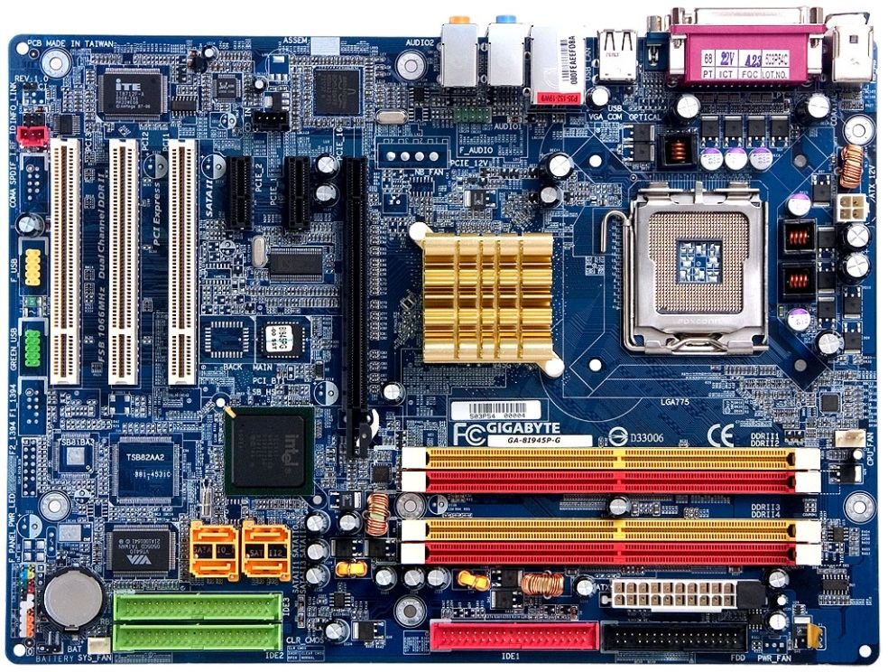
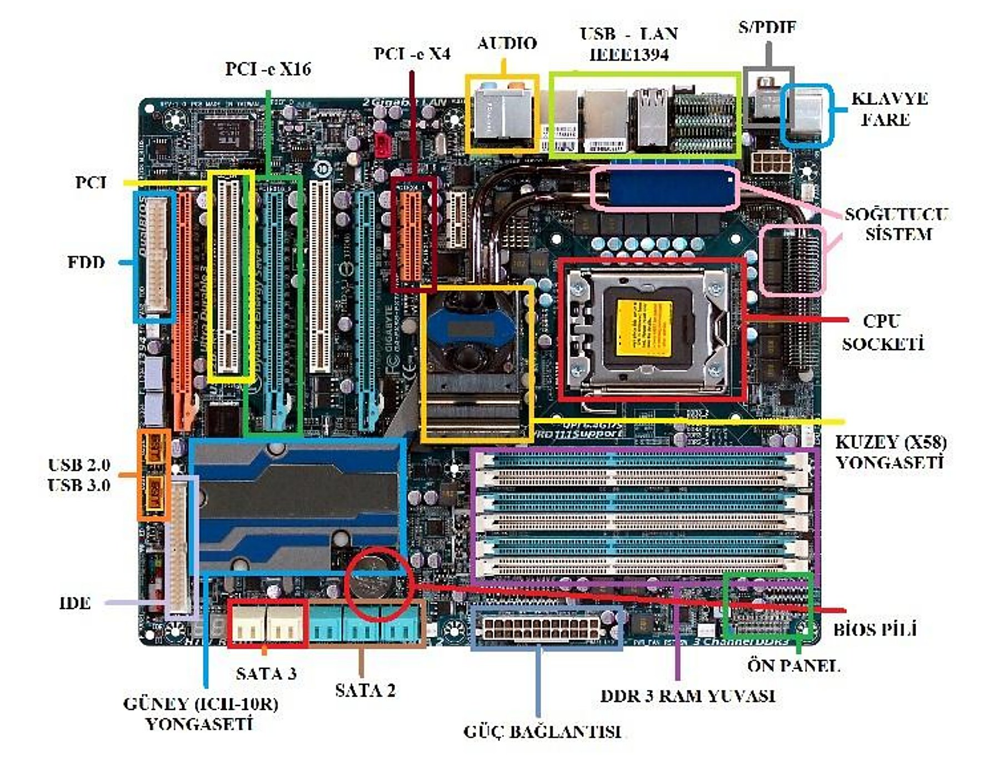
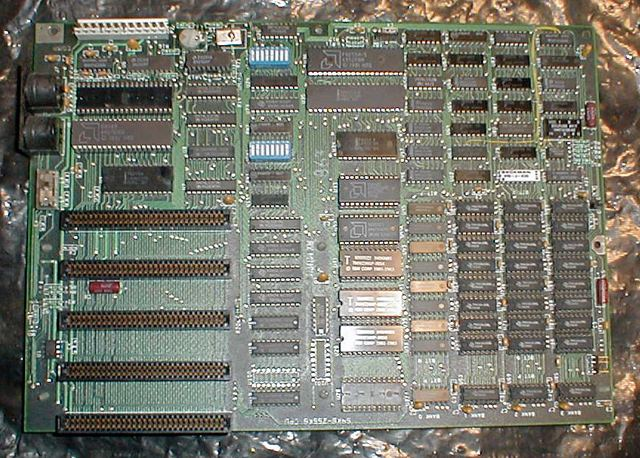
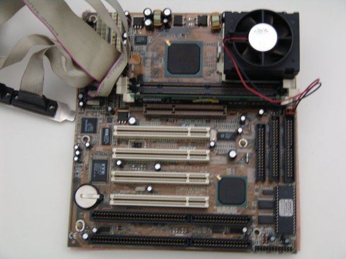
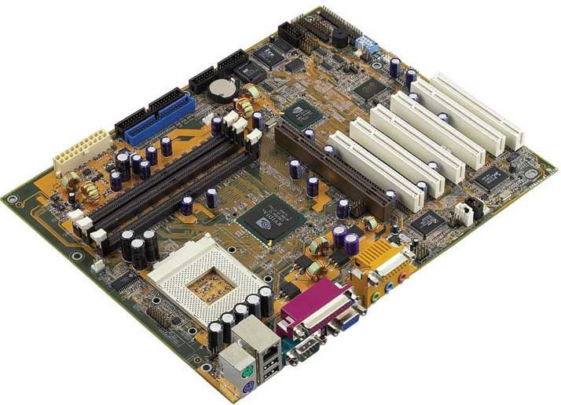
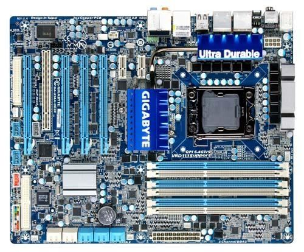

### Anakart nedir

**Anakart**, bir bilgisayarın tüm parçalarını üzerinde barındıran ve bu parçaların **iletişimini sağlayan** elektronik devredir. **Fiberglastan** (sert bir plastik türevi) yapılmış, üzerinde **bakır yolların** bulunduğu, genellikle **koyu yeşil** bir levhadır.

Anakart üzerinde şunlar yer alır:

- mikroişlemci yuvası
- bellek
- genişleme yuvaları
- BIOS
- diğer kartlar için genişletme yuvaları
- diğer yardımcı devreler (sistem saati, kontrol devreleri gibi)

> **Ek:** 2. slayttaki anakart mavi renktedir; levhanın rengi üreticiye göre değişir. Elemanların resim üzerinde tek tek tanıtıldığı yer "Anakart Üzerindeki Elemanlar" konusudur.

### Anakartın önemi

Anakart, bir PC'nin **hangi özelliklere sahip olabileceğini belirleyen en önemli bileşendir.** Çünkü anakart üzerindeki elektronik bileşenler şunları belirler:

- bu PC'ye hangi tür işlemcilerin takılabileceğini,
- en çok (maksimum) bellek kapasitesinin ne kadar olabileceğini,
- bazı bileşenlerin hangi hızlara çıkabileceğini,
- hangi yeni donanım teknolojilerini destekleyebileceğini.

### İlk anakart

Hocaya göre ilk anakart **1982** yılında **IBM** firmasının ürettiği PC'lerde kullanıldı. Büyük devre elemanlarından oluşan bu kartın üzerinde **Intel 8088 işlemci**, BIOS, bellek ve çeşitli kartların takılabileceği yuvalar bulunuyordu.

Bu bilgisayara disket sürücü, paralel çıkış ya da başka bir şey takılmak istenirse ona uygun bir **kart** alınıp anakarta takılması gerekiyordu. Parçaların takılıp çıkarılmasını çok kolaylaştırarak bu yöntemde öncülüğü **Apple II** yaptı.

Anakartların **değiştirilebilir parçalardan** oluşması, kullanıcıların kendilerine ve ihtiyaçlarına özgü bilgisayarlar oluşturmalarını sağlamıştır.

> **Dikkat:** Kaynaklarda IBM PC'nin piyasaya çıkış yılı genellikle **1981** olarak geçer; slaytta 1982 yazıyor. Notta hocanın ifadesi korundu.

### Anakart çeşitleri

Hoca üç anakart çeşidi anlatır: **XT**, **AT** ve **ATX**.

#### XT anakartlar

İlk kişisel bilgisayarlarda kullanılan anakartlardır. **8086 ya da 8088** mikroişlemcilerini üzerinde **sabit** olarak taşır; bu yüzden işlemciyi değiştirmek için anakartın değiştirilmesi gerekiyordu. Anakartın ek donanım birimi yalnızca **8 bit** olmalıdır.

#### AT anakartlar

XT anakartlardan sonra gelen, günümüzde kullanılan ATX anakartlara benzeyen ama **yalnızca 5 ve 12 volt** güç alan anakartlardır. **PS/2 desteği yoktur.** ISA, PCI ve AGP veri yollarıyla **değiştirilebilir işlemci** desteği sunar.

Anakart üreticileri yıllarca IBM uyumlu anakartlar üretti. Bu standartların başında gelen AT modeli, hocaya göre 1982'den beri kullanılmaktadır.

> **Dikkat:** Hocanın XT ve AT slaytlarındaki resimler metinle uyuşmuyor. "XT" resmindeki kartta işlemci yuvası, fan ve PCI yuvaları var (sonraki dönemin AT biçimli bir kartı); "AT" resmindeki kartta ise PS/2 portları ve AGP yuvası var (ATX biçimli bir kart). Çeşitleri resimlerden değil, metindeki özelliklerden ayırın: XT'de işlemci sabittir, AT'de PS/2 yoktur.

> **Ek:** IBM PC/AT bilgisayarı kaynaklarda genellikle 1984 yılıyla anılır. Slayttaki yıl notta korundu.

#### ATX anakartlar

**Pentium II** işlemciyle birlikte ilk kez piyasaya sunulmuş olan ATX standardı sürekli geliştirilmiştir ve günümüzde **hâlâ yaygın** olarak kullanılmaktadır.

> **Ek:** ATX standardını Intel 1995'te yayımlamıştır; yaygınlaşması Pentium II dönemine denk gelir. ATX anakartlarda klavye ve fare için PS/2 portları bulunur (AT'de yoktu).

> **Dikkat:** Üç çeşidi karıştırmayın: **XT**'de işlemci anakarta sabittir; **AT**'de işlemci değiştirilebilir ama PS/2 desteği yoktur ve yalnızca 5 ve 12 volt güç alır; **ATX** ise bugün hâlâ kullanılan standarttır.

### Başlıca anakart üreticileri

Hocanın listesi: **Intel, Dell, Asus, ECS, MSI, Gigabyte, Foxconn, Biostar, EPoX ve ASRock.**

> **Ek:** Slaytta "Foxcon" ve "Asrock" diye yazılmış; doğru yazımları Foxconn ve ASRock'tur.
