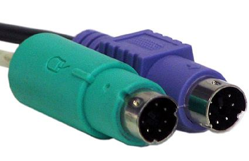
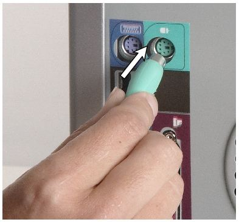
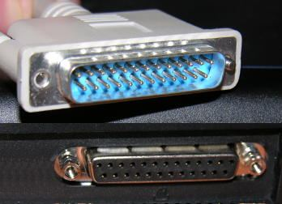
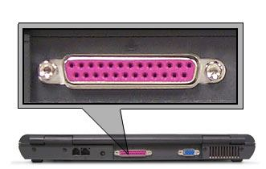
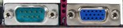
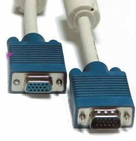
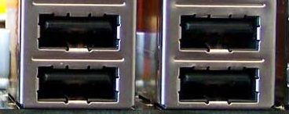
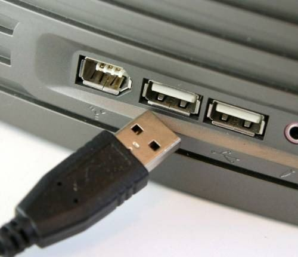
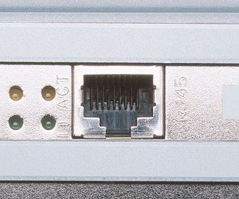
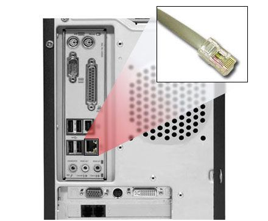

### PS/2 portları

Klavye ve fare (mouse) bağlamak için kullanılan portlara **PS/2** denir. **ATX** anakartlarda **iki** tane bulunur.

İki portun **şekli ve pin sayısı aynıdır**; bu yüzden **renkleri farklıdır**:

| Port rengi | Takılan aygıt |
| --- | --- |
| Yeşil | Fare (mouse) |
| Mor | Klavye |

Kabloların üzerinde de fare ve klavye simgeleri vardır.

> **Dikkat:** Renkleri karıştırmayın: **yeşil fare**, **mor klavye**. Şekilleri aynı olduğu için yanlış porta da takılabilir; renk bunu önlemek içindir.

### Paralel port

Paralel port genellikle **tarayıcı ve yazıcı** bağlantısı için kullanılır. **Eski tip** anakartlarda kullanılmaktadır. Yeni anakartlarda bu port yerine **USB** portları kullanılmaktadır.

> **Ek:** Hocanın fotoğraflarındaki paralel port 25 delikli, uzun bir porttur ve arka panelde genellikle pembe renklidir (hocanın numaralı arka panel resminde 2 numara).

### COM portu ve ekran bağlantısı

Hocanın slaytında iki port birlikte gösterilir.

#### COM portu

**COM (Communications) portu**, fare ve harici modem bağlantıları için kullanılır. **USB ve PS/2** portlarının kullanılmaya başlamasıyla bu port önemini yitirmiştir.

#### Ekran bağlantısı (display connector)

Monitörü bağlamak için anakart üzerinde **onboard** (anakarta tümleşik) olarak bulunan porttur. Genelde harici olanlar tercih edilir.

> **Ek:** Hocanın resmindeki ekran bağlantısı mavi renkli **VGA** portudur. "Harici olan" sözüyle anakarta ayrıca takılan ekran kartının portu kastedilir. COM portu ise 9 iğneli seri porttur.

### USB

**USB** (Universal Serial Bus, Evrensel Seri Veri Yolu); IBM, Intel, Microsoft, Compaq gibi birçok firmanın ortaya koyduğu bir **veri yoludur**. Bu porta birçok aygıt bağlanabilir ve bu aygıtlar **sistemi yeniden başlatmaya gerek kalmadan** kullanılabilir. Yeni tip anakartlarda klavye ve fare de USB porta takılır.

> **Dikkat:** Slaytta son cümle "Yeni tip anakartlarda fare ve mouse da USB porta takılır" diye yazılmış; fare ile mouse aynı aygıttır. Notta "klavye ve fare" diye düzeltildi. Slaytın başlığındaki "Universel" de "Universal" olarak düzeltildi.

> **Ek:** Aygıtın bilgisayar açıkken takılıp çıkarılabilmesine "çalışırken takıp çıkarma" (hot plug) denir.

### LAN (RJ-45) portu

**Yerel alan ağlarında** (LAN) ağa bağlanmak için kullanılır. Bu konnektör **telefon kablosunun** uç yapısına benzer.

> **Dikkat:** Slaytta bu konnektör için "10 pinli" yazıyor. RJ-45 konnektörü **8 pinlidir** (8 iletkenli). Pin sayısı notta düzeltildi.
