### PCI

**PCI** (Peripheral Component Interconnect, Çevresel Bileşen Ara Bağlantısı) Intel tarafından **1993** yılında geliştirilmiştir. **64 bitlik** veri yolu olarak üretilmiştir, fakat uyum sorunu nedeniyle **32 bit** olarak kullanılmaktadır. **33 MHz ya da 66 MHz** veri aktarım hızı vardır. **Beyaz** renktedir.

Bu yuvalara **ses kartı, TV kartı ve ethernet kartı** takılır.

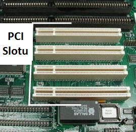
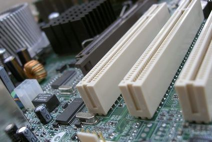

> **Ek:** PCI standardının ilk sürümü kaynaklarda genellikle 1992 yılıyla anılır; yaygınlaşması 1993'ten sonradır. Standart PCI yuvası 32 bittir; 64 bitlik daha uzun bir türü de vardır. Notta hocanın ifadesi korundu.

### PCI Express

**PCI Express** (PCI-e) yuvaları **PCI'ın yerini almak** için tasarlanmıştır. Veri aktarım hızı ve kullanışlılığı (ergonomisi) bakımından PCI ile kıyaslanamayacak kadar güçlüdür.

Hocanın verdiği en yüksek bant genişlikleri:

| Veri yolu | En yüksek bant genişliği (slayttaki yazımla) |
| --- | --- |
| PCI | 533 Mbps |
| PCI-X | 4266 Mbps |
| PCI Express | 8000 Mbps |

PCI'a takıldığı gibi bu yuvalara da **ses kartı, TV kartı, ethernet kartı** takılır.

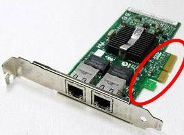
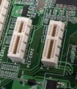

> **Dikkat:** Tablodaki değerlerin birimi slaytta "Mbps" (megabit/saniye) yazıyor; bu değerler kaynaklarda genellikle **MB/s** (megabayt/saniye) olarak geçer. Sıralama değişmez: PCI < PCI-X < PCI Express.

### PCI Express x16

Bu yuva **AGP'ye alternatif** olarak üretilmiştir. Temelde PCI Express mantığını kullanır. **Ekran kartı** bu yuvaya takılır.

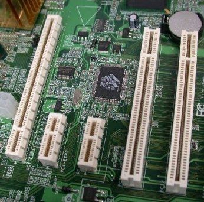
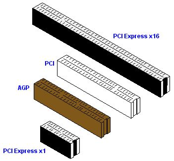

> **Ek:** "x16", yuvanın 16 veri hattı (şerit) kullandığı demektir; "x1" yuva tek hatlıdır. Karşılaştırma resminde PCI Express x16 en uzun, PCI Express x1 en kısa yuvadır.

### AGP

**AGP** (Accelerated Graphics Port, Hızlandırılmış Grafik Yuvası) Intel tarafından **1997**'de **yalnızca ekran kartları** için geliştirilmiş veri yoludur. Windows işletim sisteminin getirdiği grafik uygulamalarının ihtiyaç duyduğu yüksek hızı sunabilir.

- AGP kanalı **32 bit** genişliğindedir ve **66 MHz** hızında çalışır.
- AGP yuvası **kahverengidir** ve **PCI yuvalarından kısadır.**

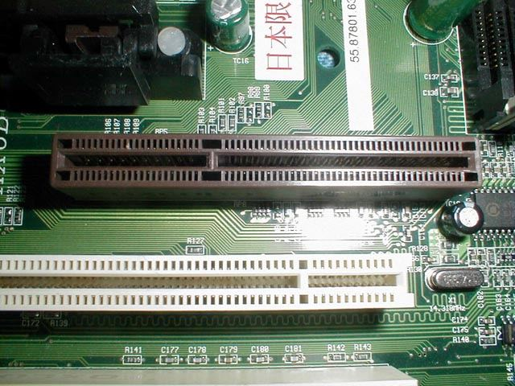

> **Dikkat:** AGP ile PCI Express x16'yı karıştırmayın: ikisi de **ekran kartı** içindir. AGP eski yuvadır (kahverengi); PCI Express x16 ise AGP'ye alternatif olarak üretilmiştir.

### IDE (ATA) portu

**IDE** (Integrated Drive Electronics, Dahili Sürücü Elektroniği) portu, bilgisayara **CD-ROM, CD-RW, DVD-ROM** ve IDE destekli **sabit diskleri** bağlamak için kullanılır.

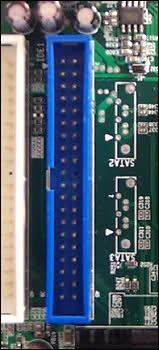

> **Dikkat:** Bu resimde IDE yuvasının yanında kartın üzerinde "SATA2", "SATA3" yazıları görünür; bunlar yakındaki başka bağlantıların adlarıdır. Mavi, geniş yuva IDE'dir.

### SATA portu

**SATA** (Serial Advanced Technology Attachment, Seri İleri Teknoloji Bağlantısı) portu, bilgisayara **CD-ROM, DVD-ROM ve sabit diskleri** bağlamak için kullanılır. **ATA'nın yetersiz kalması** üzerine geliştirilmiştir. Hoca slayt başlığında **SATA ve SATA 2** portlarından söz eder.

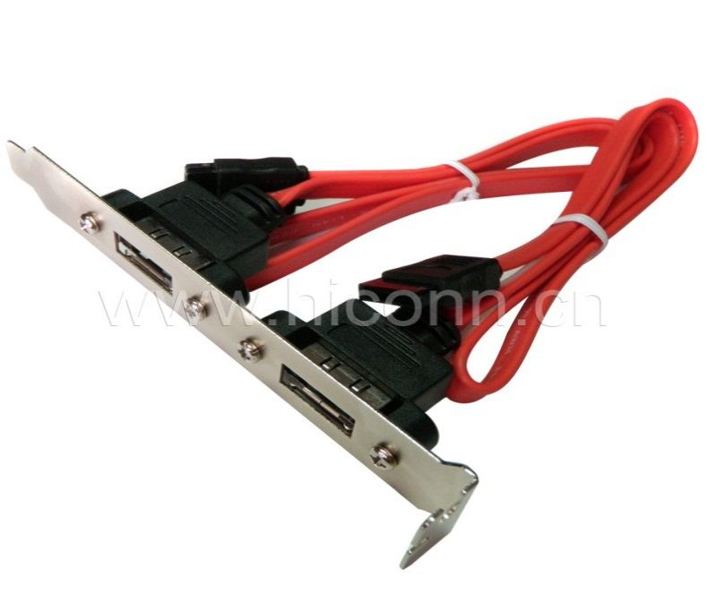
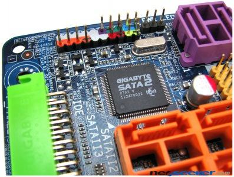

> **Dikkat:** IDE ile SATA'yı karıştırmayın: ikisine de sürücüler (disk, CD/DVD) bağlanır. **IDE (ATA)** eski, geniş yassı kablolu bağlantıdır; **SATA** ise ATA'nın yetersiz kalması üzerine geliştirilen **seri** bağlantıdır.

### Disket sürücü bağlantı portu

Bu porta **disket sürücüler** bağlanır. Veri aktarım hızı son derece sınırlıdır ve kullanışlı değildir. **Yeni nesil** bilgisayarlarda bu port artık kullanılmamaktadır.

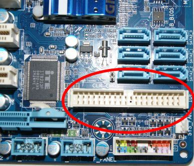
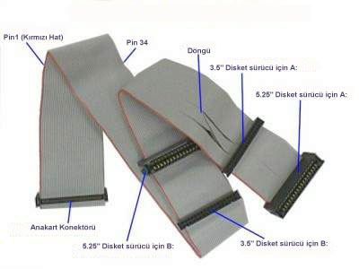

### Güç bağlantı portu

Kasadaki **güç kaynağından** anakarta gerekli gücü sağlamak için kullanılan porttur. Karta sağlam biçimde monte edilmiştir; kart için gereken **+5 V, −5 V ve +12 V** gerilimler buradan sağlanır.

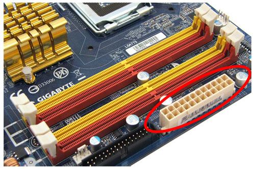
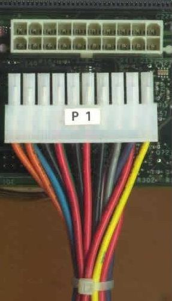

> **Ek:** ATX güç bağlantısında bunlardan başka +3,3 V ve −12 V hatları da bulunur.
