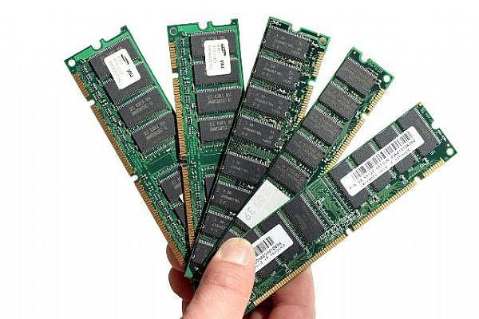
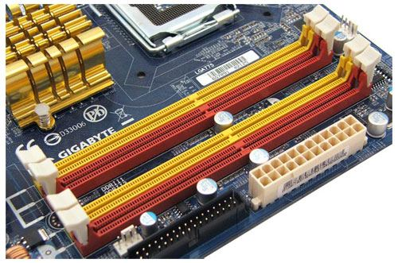
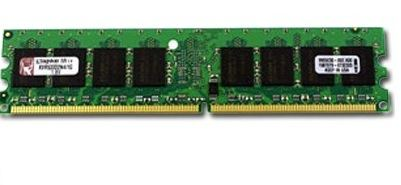
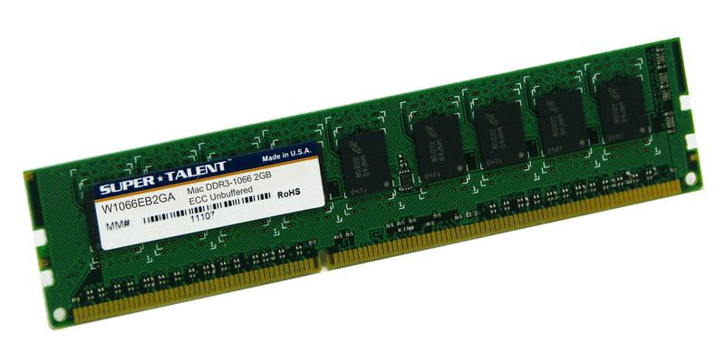
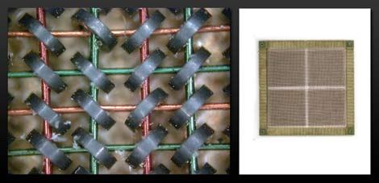

### RAM nedir

**RAM** (Random Access Memory, Rastgele Erişimli Bellek), bilgisayarda **o an çalışan programların** gerekli bilgilerinin saklandığı ve gerektiğinde kullanım için geri çağrıldığı alandır. Başka bir deyişle **geçici bellek** görevindedir.

Bilgisayar **kapatıldığında** bu bilgiler **silinir.** Bilgileri uzun süre saklamak istiyorsak **HDD**'ye (sabit diske) kaydederiz.

> **Dikkat:** RAM ile sabit diski (HDD) karıştırmayın: RAM geçicidir, bilgisayar kapanınca bilgiler silinir; HDD'deki bilgiler kalıcıdır.

### Boyutuna göre RAM bellekler

Hoca RAM'leri üç bakımdan sınıflar: **boyutuna göre, üzerindeki yongalara göre, özelliklerine göre.** Boyutuna göre çeşitler, anakarta bağlandığı yerdeki **pin sayısıyla** anılır:

| Çeşit | Hocanın açıklaması |
| --- | --- |
| 30 pinli SIMM | Eski bilgisayarlarda kullanılır. Anakarta bağlandığı yerdeki pin sayısı oldukça azdır; küçük boyutlu bir bellek tipidir. |
| 72 pinli SIMM | Hocaya göre 1995'te Pentium I ile kullanılmaya başlandı, Pentium II'lerle birlikte kullanımdan kalktı. |
| 168 pinli DIMM | Pentium III anakartlarda kullanılır. EDO ve SDRAM bellek modellerinde bu boyut kullanıldı. |
| 184 pinli R-DIMM | Pentium IV anakartlarında kullanılan DDR-RAM ve RD-RAM bellek modellerinde bu boyut kullanılır. |

> **Ek:** 72 pinli SIMM bellekler kaynaklarda 486 döneminde (1990'ların başı) yaygınlaşmış olarak geçer; Pentium (1993) bilgisayarlarda da kullanıldı. Slayttaki 1995 yılı notta hocanın ifadesi olarak korundu.

### Üzerindeki yongalara göre RAM bellekler

| Çeşit | Hocanın açıklaması |
| --- | --- |
| Standart RAM | Günümüzde artık kullanımdan kalkmıştır. |
| EDO-RAM | DRAM'lerden daha hızlıdır. Yeni Pentium II ve Pentium III anakartlarda EDO-RAM için yuva yoktur. |
| SDRAM | 10–12 ns hızında ve 66 MHz veri yolu hızlarında piyasaya girmiştir. |
| DDR-SDRAM | SDRAM'in sunduğu bant genişliğinin **iki katını** sunar. 2,5 V ile çalışır. |

> **Dikkat:** Slaytta DDR için "2.5 akım çeker", DDR2 için "1.8 v akım çeker", DDR3 için "1.5 v akım çeker" yazıyor. Volt (V) **gerilimin** birimidir, akımın değil. Doğrusu "2,5 V / 1,8 V / 1,5 V gerilimle çalışır" demektir. Değerler aynı kalır.

### DDR2, DDR3 ve DDR4

#### DDR2 SDRAM

Bilgisayarlarda **ana bellek** olarak kullanılır. Hızları **400 MHz ile 1066 MHz** arasında değişir. DDR bellek teknolojisinin bir **ileri kuşağıdır**: daha yüksek hız, yüksek bant genişliği, düşük güç tüketimi ve iyileştirilmiş ısı davranışı kazandırılmıştır. Hız olarak DDR'ın **iki katıdır.** **1,8 V** ile çalışır.

#### DDR3 SDRAM

Bir bilgisayarın verileri yüksek hızlı biçimde saklamasında kullanılan bir RAM teknolojisidir. SDRAM ailesinden gelen DDR3, **DDR2'nin gelişmiş hâlidir.** **1,5 V** ile çalışır.

#### DDR4 SDRAM

DDR4 belleklerin sunduğu özelliklerden biri **Deep power-down** desteğidir. Bu özellik sayesinde DDR4 kullanan cihazlar **bekleme modundayken** yaklaşık **%45** güç tasarrufu sağlar.

DDR4 güç tasarrufunun yanında hız sınırını da artırır. Hocaya göre DDR3'ün en çok ulaşabildiği hız olan **2133 MHz**, DDR4'ün en düşük hızıyla aynıdır. DDR4 bellekler **3200 MHz**'e kadar ulaşabilir; **overclock** (hız aşırtma) yapılırsa **4266 MHz**'e kadar çıkabilir.

> **Ek:** JEDEC standardında DDR4'ün en düşük hız sınıfı 1600 MHz'tir; piyasadaki DDR4 modüllerin çoğu 2133 MHz'ten başlar. Notta hocanın ifadesi korundu.

> **Dikkat:** Gerilimler kuşaktan kuşağa düşer: DDR **2,5 V**, DDR2 **1,8 V**, DDR3 **1,5 V**. Sırayı karıştırmayın.

### Özelliklerine göre RAM bellekler

| Çeşit | Hocanın açıklaması |
| --- | --- |
| Pariteli RAM | Bilgi 0 ve 1'ler hâlinde belleğe ulaştığında fazladan bir yonga ikili sayılar üzerinde hesap yapar; toplam yanlış gelirse veriyi geri gönderip hesabın yeniden yapılmasını sağlar. |
| Hata düzeltmeli RAM | Yanlış bilgiyi anladığında hatanın hangi 0 ya da 1'de olduğunu bulup düzeltir. |
| SPD'li RAM | 100 ve 133 MHz veri yolunu kullanan sistemlerde bellekteki yongaya giderek durumunu sorgular; yonganın hız ve özelliklerini öğrenir. Anakart bunu desteklerse gerekli bilgileri kullanarak komşu RAM'lerle arabuluculuk yapar. |

> **Dikkat:** Pariteli RAM ile hata düzeltmeli RAM'i karıştırmayın. Hocaya göre **pariteli RAM** hatayı fark edip verinin **yeniden gönderilmesini** sağlar; **hata düzeltmeli RAM** ise hatalı biti **bulup kendisi düzeltir.**

> **Ek:** Hata düzeltmeli RAM'e İngilizce kısaltmasıyla ECC (Error Correcting Code) RAM denir. Parite denetimi gerçekte hatayı yalnızca **fark eder**; veriyi yeniden göndermez ve düzeltemez, hatayı sisteme bildirir.

### İlk RAM

Hocaya göre üretilen ilk yazılabilir RAM olan **"Manyetik Çekirdek Hafıza"** 1951'de tasarlandı. Bilgileri, etrafı kablolarla sarılı küçük manyetik seramik halkalar arasındaki kutuplaşma aracılığıyla kaydediyordu. Bugünün aksine **güç kaynağı kapatılsa bile** bilgiler hafızada tutuluyordu. Silikon RAM yongalarının üretildiği **1970'lere** kadar kullanıldı.

> **Dikkat:** Slaytta bu belleğin "Harvard Üniversitesi MIT laboratuvarlarında" tasarlandığı yazıyor. Harvard ve MIT iki ayrı üniversitedir; manyetik çekirdek bellek kaynaklarda genellikle **MIT**'deki Whirlwind bilgisayarı çalışmalarıyla anılır. Notta yer adı verilmedi.
