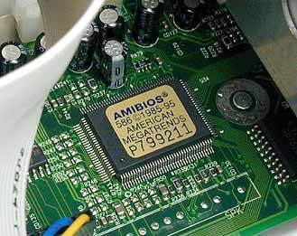
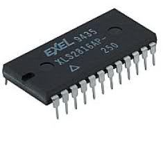
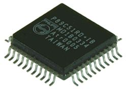
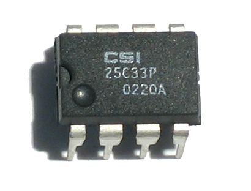
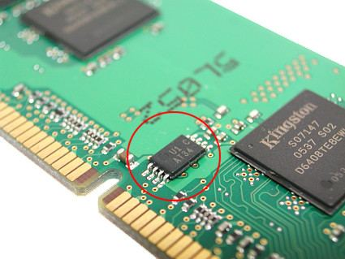
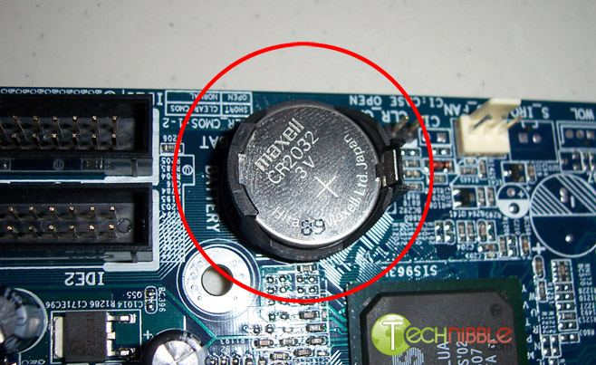

### ROM nedir

**ROM** (Read Only Memory, Sadece Okunabilir Bellek) temel olarak **yalnızca okunabilen** bir bellek türüdür. ROM'un üzerindeki bilgiler **kalıcıdır** ve genelde çok gerekli bilgiler saklanır. **BIOS** gibi bilgisayar için önemli bilgilerin tutulduğu entegre bellek yapısında ROM kullanılır. Merkezi işlemcinin bu tür belleklere doğrudan bilgi **yazması söz konusu değildir.**

> **Dikkat:** RAM ile ROM'u karıştırmayın: **RAM** geçicidir, bilgisayar kapanınca bilgiler silinir; **ROM**'daki bilgiler kalıcıdır ve işlemci ROM'a doğrudan yazmaz.

### ROM çeşitleri

Hoca dört çeşit anlatır: ROM, PROM, EPROM ve EEPROM. Fark, belleğe **kimin, kaç kez ve nasıl** yazabildiğindedir.

#### ROM

Bilgiler **değiştirilemez**, kalıcıdır. ROM'lara biz kullanıcılar bilgi yazamayız; bilgileri **yalnızca üretici firmalar** yazar.

#### PROM

**PROM** (Programmable ROM, Programlanabilir ROM) **boş** olarak üretilir ve kullanıcı tarafından isteğe uygun olarak **yalnızca bir kez** programlanabilir.

#### EPROM

**EPROM** (Erasable Programmable ROM, Silinebilir Programlanabilir ROM) **ultraviyole ışığıyla** silinebilir; bu sayede ROM'a yeniden yazılabilir. Hocaya göre EPROM'un silinmesi ve programlanmasında bir sınırlama yoktur.

> **Ek:** Klasik EPROM yongalarının üzerinde, ışığın içeri girmesi için küçük bir kuvars pencere bulunur; hocanın resmindeki yonga ise üzerindeki yazıya göre bir mikrodenetleyicidir (P89C51). Gerçekte silip yazma sayısı sınırsız değildir; yonga yıprandıkça bir sınıra ulaşılır. Notta hocanın ifadesi korundu.

#### EEPROM

**EEPROM** (Electrically Erasable Programmable ROM, Elektrikle Silinebilir Programlanabilir ROM) da EPROM'a benzer biçimde silinebilir ve yazılabilir; ama bu silme işi **elektriksel** olarak yapılır. Hocaya göre **BIOS'un kullandığı ROM tipi EEPROM'dur.**

> **Ek:** Bugünkü anakartlarda BIOS (ya da UEFI), EEPROM'un bir türü olan flaş bellekte durur.

> **Dikkat:** EPROM ile EEPROM'u silme yönteminden ayırın: **EPROM ultraviyole ışıkla**, **EEPROM elektrikle** silinir. PROM ise yalnızca **bir kez** programlanır; ROM'a kullanıcı hiç yazamaz.

### BIOS pili

**BIOS pili**, bilgisayarda BIOS'ta yapılan değişikliklerin ve **tarih-saat** gibi bilgilerin, bilgisayar kapatıldıktan sonra yeniden açılıncaya kadar **hafızada kalmasını** sağlar. Bilgisayarın gücü kesildiğinde **saatin geri kalmamasının** sebebi BIOS pilidir.

> **Ek:** BIOS piline CMOS pili de denir; çoğunlukla CR2032 tipi düğme pildir. Pil bitince bilgisayar her açılışta tarih ve saati yanlış gösterir.
