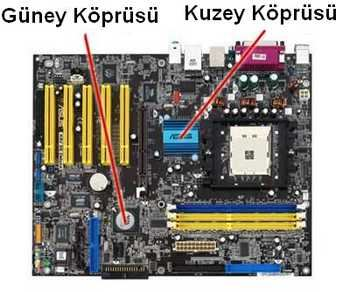
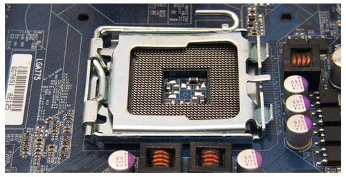
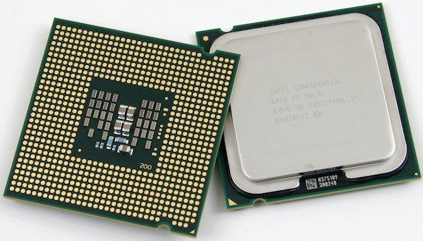
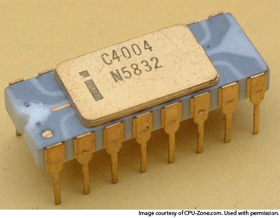

### Yonga seti (chipset)

Anakartın **beynini** oluşturan entegre devrelere **yonga seti (chipset)** denir. Bunlara bilgisayarın **trafik polisleri** diyebiliriz: işlemci, önbellek, sistem veri yolları ve çevre birimleri arasındaki, kısaca donanımlar arasındaki **veri akışını denetler.**

Günümüzde yonga setini **Intel, AMD, VIA, SiS** gibi belli başlı firmalar üretmektedir.

### Kuzey köprüsü ve güney köprüsü

#### Kuzey köprüsü

**İşlemci, bellekler ve AGP / PCI Express** yuvalarına **en yakın** olan yongadır. Görevi bu üçlünün (**RAM, AGP / PCI Express ve işlemci**) arasındaki iletişimi sağlamak ve denetlemektir.

#### Güney köprüsü

Görevi **IDE, USB, LAN, PCI ve ses**, yani bilgisayarın **diğer çevre birimlerini** denetlemektir. Güney köprüsü de **çevre birimlerinin** bulunduğu bölüme yakındır.

> **Dikkat:** İki köprüyü görevlerinden ayırın: **kuzey** köprüsü hızlı üçlüyü (işlemci, RAM, ekran kartı yuvası) bağlar; **güney** köprüsü çevre birimlerini (IDE, USB, LAN, PCI, ses) denetler. Resimde kuzey köprüsü işlemcinin yanında, güney köprüsü genişleme yuvalarının ve sürücü bağlantılarının yakınındadır.

### İşlemci

**İşlemci**, kendisine gelen komut ve bilgileri uygun biçimde işleyerek **çıktıları RAM'e ve diğer gereken parçalara** aktarır. Bilgilerin büyük kısmı RAM üzerinde toplanacağı için bu iki parça arasında **çok sayıda bağlantı** vardır ve genellikle **birbirine yakın** konumda tasarlanırlar.

### İşlemcinin soğutulması

İşlemciler çalışırken ısıları yükseldiği için **soğutulmaya kesinlikle ihtiyaç duyar.** Hatta pasif değil, **fan** takılarak **aktif** olarak soğutulmaları gerekir. Soğutucunun bağlanabilmesi için yuvanın çevresinde belirli bir **boşluk** bulunur.

Hocaya göre işlemcinin üzerinde soğutucu yoksa işlemci **2–5 saniye** içinde çok ısınır; sonunda ya bilgisayar kapanır ya da işlemci yanar.

> **Ek:** Pasif soğutma yalnızca metal soğutucuyla (fansız) yapılan soğutmadır; aktif soğutmada soğutucunun üzerinde hava akımı sağlayan bir fan vardır.

### İlk mikroişlemci: Intel 4004

**1971** yılının **Kasım** ayında Intel firmasının mühendisleri **Federico Faggin, Ted Hoff ve Stan Mazor** dünyanın ilk mikroişlemcisini, **Intel 4004**'ü tanıttı. Bu buluşla, bilgisayarların büyük olmasına neden olan bütün işlemler **küçük bir yonganın** içine sığdırılmış oldu.

