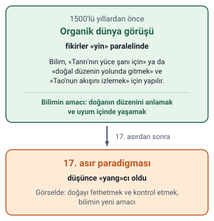
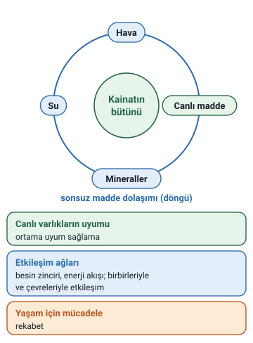

### Ders hakkında

Ekoloji Bilgisi dersi, Kocaeli Sağlık ve Teknoloji Üniversitesi Avrupa Meslek Yüksekokulunda 2026/2027 Öğretim Yılı Güz Yarıyılında okutulur. Dersin öğretim üyesi Dr. Öğr. Üyesi Onur Altınbaşak'tır (onur.altinbasak@kocaelisaglik.edu.tr).

Bu notlar dersin 1. hafta slaytından hazırlandı. Slaytlarda çok sayıda resim var; resimlerde hocanın metnine eklenen bilgi varsa notta "slayttaki görselde" diye belirtildi.

### Çevre bilincinin gelişimi ve küresel boyut

Hoca çevre bilincinin bugünkü durumunu dört başlıkta özetler:

- **Çevre bilincinin artışı:** İnsanoğlunun kültür seviyesinin yükselmesiyle birlikte çevre bilinci ve doğaya duyarlılık artmaktadır.
- **Uluslararası çalışmalar:** OECD ve Dünya Bankası gibi uluslararası kuruluşlar çevre koruma raporları hazırlamakta ve yaşanabilir çevre oluşturmayı teşvik etmektedir.
- **Yasal düzenlemeler:** Gelişmiş ülkelerde doğal hayatı korumaya yönelik kanunlar çıkarılmakta ve kararlar uygulanmaktadır.
- **Temel amaç:** Yapılan çalışmalar doğal hayatı sanayi devrimi öncesine döndüremese de kötüye gidişi önlemek ve mevcut durumu korumak açısından kritik önem taşır.

> **Ek:** OECD, Ekonomik İşbirliği ve Kalkınma Örgütü'nün kısaltmasıdır (İngilizcesi Organisation for Economic Co-operation and Development).

### 1500'lerden önce: organik dünya görüşü

İnsan-doğa ilişkilerine tarihi açıdan bakıldığında **1500'lü yıllardan önce organik bir dünya görüşü** hâkimdi.

Bilim, «Tanrı'nın yüce şanı için» ya da Çinlilere göre «doğal düzenin yolunda gitmek» ve «Tao'nun akışını izlemek» için yapılıyordu.

> **Ek:** Slayttaki görsel bu dönüşümü "Organik dünya görüşünden mekanik paradigmaya" diye adlandırır. Bir yanda 1500 öncesi (doğanın düzeni, uyum içinde yaşamak), öbür yanda 17. asır paradigması (doğayı fethetmek ve kontrol etmek, bilimin yeni amacı) çizilmiştir. Bu ayrıntılar yalnızca görselde vardır, slaytın metninde yoktur.

> **Dikkat:** Hoca 3. slaytta 1500'lerden önce "organik bir dünya görüşü" hâkimdi der; "Ekoloji Biliminin Doğuşu: Düşünce Tarihi" konusundaki slaytta ise "Ortaçağ boyunca egemen olan insan-merkezci düşünce" geçer. İkisi farklı açılardan anlatılır: organik dünya görüşü bilimin amacını (doğanın düzenini anlamak, uyum), insan-merkezci düşünce ise insanın doğaya bakışını (doğa insan için vardır) anlatır. İkisini karıştırmayın.

### Yin ve yang

Hocaya göre 1500 öncesinde fikirler **«yin»** paralelindeydi; **17. asırdan sonra** ise düşünce **«yang»cı** oldu.

> **Ek:** Yin ve yang Çin düşüncesindeki iki karşıt ve birbirini tamamlayan kutuptur. Slayttaki görselde yin için "alıcılık, dişilik, sakinlik" yazar; bu yalnızca görseldedir. Organik dünya görüşünden yang'a geçiş anlatımı, Fritjof Capra'nın The Turning Point (1982; Türkçesi "Batı Düşüncesinde Dönüm Noktası") kitabındaki anlatımla örtüşür.

### Eski çağlarda bilimin amacı

Eski çağlarda bilimin amacı **doğanın düzenini anlamak** ve **uyum içinde yaşamaktı**.

### Çevre bilgisinin ilk insanla başlaması

Çevre bilgisi **ilk insanla birlikte** başlamıştır. Bitki ve hayvanlar tanınarak, **tecrübe ve yaşayarak** öğrenilmiştir.

### Geleneksel üretim bilgisi

Sistemli ekoloji eğitimi almamış eski çiftçiler buğday yetiştirme şartlarını biliyordu. Hayvancılıkla uğraşanlar da **yazın yaylalarda, kışın ılıman bölgelerde** otlatma yapılması gerektiğini bilmekteydi.

### Semavi dinlerin rolü

Yazılı kaynaklar incelendiğinde çevre hassasiyetinin **en eski ve en iyi ifadeleri kutsal kitaplarda** yer alır.

### Türk-İslam kültüründe çevre ve hayvan hakları

#### Doğaya saygı anlayışı

Türk-İslam kültüründe, **Allah'ı tesbih ettiği** düşüncesiyle ibadetine mani olmamak için yeşil bir yaprağı veya çiçeği dahi koparmayan çevreci bir anlayış vardır.

#### Tarihi fermanlar ve atasözleri

Fatih Sultan Mehmet Han'ın **"Ormanlarımdan bir dal kesenin başını keserim"** fermanı ve **"Yaş kesen, baş keser"** atasözü çevreye verilen değeri özetler.

> **Ek:** Bu söz Fatih'e yaygın olarak atfedilir; ancak fermanın tarihi, metni ya da arşiv kaydı güvenilir bir kaynakta bulunamamıştır. Notta hocanın ifadesi korundu.

#### Osmanlı hayvan koruma vakıfları

Osmanlı'da dağlardaki **aç kurtların beslenmesi** için kurulan vakıflar ile **leylek, kedi ve köpeklerin** tedavisi için inşa edilen **şifahaneler** bulunmaktadır.

> **Ek:** Bunun bilinen örneklerinden biri, Bursa'daki "Gurabâhâne-i Laklakan" adıyla anılan leylek bakımevleridir.

> **Dikkat:** Vakıflar kurtların **beslenmesi** için, şifahaneler ise leylek, kedi ve köpeklerin **tedavisi** için anılır. Kurtlar şifahaneler listesinde değildir.

### Kainatın bütünlüğü (slayt görseli)

Slaytlardan birinde yalnızca bir görsel vardır. Görselin ortasında bir ağaç ve gövdesinin çevresinde "sonsuz madde dolaşımı" yazan bir döngü çizilidir. Görselin üstündeki kutuda şu cümle yazar:

"Kainat bir bütündür, kainatı oluşturan unsurlar sonu olmayan bir madde dolaşımı ile birbirine dönüşürler, canlı varlıklar yaşadıkları ortama uymuşlardır, hem birbirleri hem de çevreleriyle etkileşim halinde bulunurlar; aynı zamanda aralarında yaşam için bir mücadele vardır."

Görseldeki öbür yazılar: "Canlı Varlıkların Uyumu" ve "Ortama Uyum Sağlama" (dağ kartalı, balıklar), "Etkileşim Ağları" (besin zinciri, birbirleriyle etkileşim, çevreleriyle etkileşim, enerji akışı) ve "Yaşam İçin Mücadele" (rekabet).

> **Ek:** Bu cümle ve görseldeki adlar yalnızca slayttaki resimde vardır; şekilde öğeler tek halka üzerinde yönsüz gösterildi, çünkü dolaşımın sırası slaytta belirtilmez; hoca bunları ayrıca metin olarak yazmamıştır. Görselin başlık şeridi slaytta kesik olduğu için okunamıyor.
