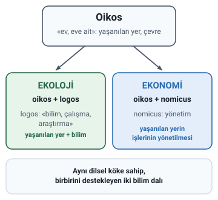
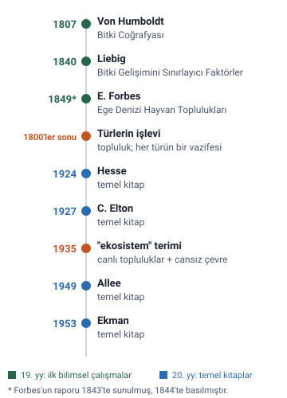
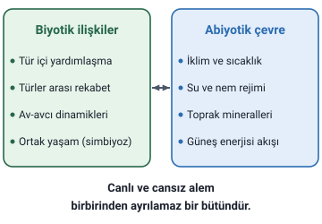

### Oikos ve logos

Ekoloji sözcüğü iki eski sözcükten türetilmiştir:

- **Oikos** eski Yunanca'da **«ev, eve ait»** anlamına gelir. Burada ev ile kastedilen **yaşanılan yer, çevredir**.
- **Logos** ise **«bilim, çalışma, araştırma»** anlamına gelir.

> **Dikkat:** Hoca bir slaytta oikos'un eski Yunanca olduğunu, sonraki slaytta ise "Latince oikos (ev, yaşanan yer) ve logos (bilim, araştırma)" yazar. Doğrusu **eski Yunanca**dır: oikos (οἶκος) ve logos (λόγος) Yunanca sözcüklerdir; slayttaki görsellerde de Yunan harfleriyle ve "Antik Yunanca" diye yazılmıştır.

### Ekolojinin tanımı

**Ekoloji:** Canlıların birbirleriyle ve çevreleri ile **uyum içinde** yaşamlarını sürdürmelerini inceleyen bilim dalıdır.

### Terimin doğuşu: Ernst Haeckel

Ekoloji terimi ilk kez **Ernst Haeckel** tarafından kullanılmıştır. Slaytta bunun yılı 1869 diye verilir.

> **Dikkat:** Haeckel "Oekologie" terimini ilk kez **1866**'da "Generelle Morphologie der Organismen" adlı kitabında kullanmıştır (Spektrum Biyoloji Sözlüğü). 1869, Haeckel'in Jena'da verdiği ve ekolojiyi daha ayrıntılı tanımladığı konuşmanın yılıdır ("Über Entwickelungsgang und Aufgabe der Zoologie", darwin-online.org.uk). Slayttaki yıl 1869'dur. Notta hocanın ifadesi korundu.

### Ekonomi ile bağı

Ekonomi terimi de **oikos** ve **nomicus (yönetim)** kelimelerinden oluşur; yani **"yaşanılan yerin işlerinin yönetilmesi"** anlamındadır.

> **Dikkat:** Slaytta ekonominin ikinci parçası "nomicus" diye yazılmıştır. Yunanca kökte bu parça **nomos**'tur (yasa, düzen, yönetim); "oikonomia" sözcüğü oikos ve nomos'tan gelir. "-nomicus" sözcüğün Latinceleşmiş sıfat biçiminde görülür (oeconomicus).

### İki bilimin ilişkisi

Ekoloji ve ekonomi hem **aynı dilsel kökene** sahiptir hem de **birbirini destekleyen** iki bilim dalıdır.

> **Ek:** Slayttaki görselde bu fikir şöyle yazar: "Ekoloji ve ekonomi aynı kökten doğmuştur; birbirini çatışarak değil, tamamlayarak var ederler." Görselde ekoloji "evimizi anlama ve inceleme", ekonomi "evin işlerinin yönetimi" diye özetlenir.

### İlk bilimsel çalışmalar

Hocaya göre ekoloji alanındaki ilk bilimsel adımlar şunlardır:

| Yıl (slayttaki) | Yazar | Çalışma |
| --- | --- | --- |
| 1807 | Von Humboldt | Bitki Coğrafyası |
| 1840 | Liebig | Bitki Gelişimini Sınırlayıcı Faktörler |
| 1849 | E. Forbes | Ege Denizi Hayvan Toplulukları |

> **Dikkat:** Edward Forbes'un Ege Denizi çalışması (Ege Denizi yumuşakçaları ve derisidikenlileri üzerine rapor) **1843**'te İngiliz Bilim Derneği'ne sunulmuş, **1844**'te basılmıştır (Wikipedia, "Edward Forbes"). Slaytta 1849 yazıyor.

> **Ek:** Slayttaki görselde ilk adları da yazar: Alexander von Humboldt, Justus von Liebig, Edward Forbes. Liebig'in adıyla anılan ilke "minimum kuralı"dır: bitkinin gelişimini en az bulunan besin öğesi sınırlar. Wikipedia'ya göre bu ilkeyi tarım biliminde önce Carl Sprengel geliştirmiş, Liebig yaygınlaştırmıştır. Slayttaki eser adları konuyu anlatan Türkçe adlardır; Liebig'in 1840 kitabının asıl adı "Die organische Chemie in ihrer Anwendung auf Agricultur und Physiologie"dir (Wikipedia, "Justus von Liebig").

### 20. yüzyıl literatürü

Hesse (1924), C. Elton (1927), Allee (1949) ve Ekman (1953) ekoloji üzerine temel kitaplar kaleme almıştır.

> **Dikkat:** Slaytın metninde "Alle (1949)" yazıyor; doğru yazımı **Allee**'dir (W. C. Allee). Görselde de "W. Allee" yazar.

> **Ek:** Slayttaki görselde bu kitapların konuları da yazar: R. Hesse, ekolojik coğrafya (1924, "Tiergeographie auf ökologischer Grundlage"); C. Elton, hayvan ekolojisi (1927, "Animal Ecology"; besin zinciri, ekolojik niş ve sayı piramidi bu kitapta anlatılır); W. Allee, popülasyon ekolojisi (1949, "Principles of Animal Ecology"); S. Ekman, deniz biyocoğrafyası. Ekman'ın kitabının Almancası 1935'te, İngilizcesi ("Zoogeography of the Sea") 1953'te çıkmıştır.

### Türlerin işlevi ve ekosistem

**1800'lerin sonlarında** canlı türlerinin bir **topluluk** oluşturduğu ve **her türün bir vazifesi** olduğu anlaşılmıştır.

**1935**'ten itibaren canlı toplulukları ve cansız çevrelerini ifade etmek için **"ekosistem"** terimi kullanılmaya başlanmıştır.

> **Ek:** Slayttaki görselde ekosistem terimi İngiliz ekolog Arthur Tansley ile anılır; terimi 1935'te Tansley ortaya atmıştır. Görselde ekosistem, biyotik (canlı topluluklar) ve abiyotik (cansız çevre: toprak, su, iklim, mineraller) öğelerin birlikte oluşturduğu bir bütün olarak çizilmiştir.

### Mikroskoptan ekolojiye (slayt görseli)

Slaytlardan biri yalnızca bir bilgi görselinden oluşur. Başlığı "Mikroskoptan Ekolojiye: Bilimsel Kökler"dir ve iki kişiyi karşılaştırır: Antoni van Leeuwenhoek ve Ernst Haeckel.

#### Antoni van Leeuwenhoek

Görselde Leeuwenhoek "mikroskobun keşfi ve erken popülasyon ekolojisi" ile anılır. Görseldeki iki madde:

- **Besin zincirinin mikro boyutu:** Gözle görülmeyen sularda dahi küçük canlıların daha büyük organizmalara yem olduğunu, tabiatta kusursuz bir mikro besin zinciri işlediğini ilk kez belgeledi.
- **Popülasyon büyümesinin kontrolü:** Canlıların sınırsızca çoğalamayacağını; besin kıtlığı, avcı baskısı ve yaşam alanı darlığı sebebiyle türlerin nüfusunun doğal bir denge içinde sınırlandığını matematiksel gözlemlerle ortaya koydu.

Görseldeki grafik, nüfusun önce artıp sonra bir sınır (K kapasite) çevresinde dalgalandığını gösterir; altında "Doğal av-avcı ilişkisi türleri dengede tutar." yazar.

> **Dikkat:** Görseldeki "mikroskobun keşfi" ifadesi Leeuwenhoek'un mikroskobu icat ettiği anlamına gelmez: o, kendi yaptığı mercekler ve tek mercekli mikroskoplarla çalışmıştır (bugüne kalanları 275 kata kadar büyütür); gözlemleri 1673'ten itibaren Royal Society tarafından yayımlanmıştır (Wikipedia, "Antonie van Leeuwenhoek"). Görseldeki "ilk kez belgeledi" ve "matematiksel gözlemlerle ortaya koydu" ifadeleri de abartılıdır: Leeuwenhoek besin zincirini inceleyen en erken araştırmacılardan biridir ve çoğalmayı sınırlayan etkenler üzerine yalnızca tahminde bulunmuştur (Egerton, ESA Bulletin, 19. bölüm).

> **Ek:** Ekoloji tarihçisi Frank Egerton'a göre Leeuwenhoek besin zincirini inceleyen en erken araştırmacılardan biridir (1717 tarihli mektubu) ve 1687'de bir sinek türü için kuramsal çoğalma hızını hesaplamıştır; çoğalmayı sınırlayan etkenler olarak genellikle besin ve iklimi düşünmüştür (ESA Bulletin, "A History of the Ecological Sciences", 19. bölüm).

#### Haeckel'in tanımı ve ekolojik diyalektik matrisi

Görselde Haeckel'in ekoloji tanımı şöyle verilir: "Ekoloji; canlıların birbirleriyle ve yaşadıkları ortamla olan organik-inorganik tüm ilişkileri dahil, doğal çevrenin bütüncül olarak çalışılmasıdır."

Görsele göre terim, Antik Yunanca **oikos** (ev, yurt) ve **logos** (bilim) sözcüklerinden doğmuştur ve canlıyı tek başına değil, içinde yaşadığı "evin" tüm unsurlarıyla ele alır.

Görseldeki "ekolojik diyalektik matrisi" iki kutudan oluşur ve altında "Canlı ve cansız alem birbirinden ayrılamaz bir bütündür." yazar.

> **Ek:** Bu başlıktaki bilgilerin tamamı slayttaki görseldedir; hoca bunları metin olarak yazmamıştır.
