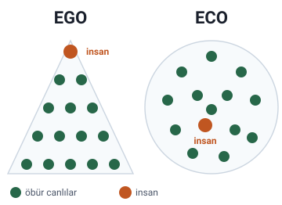

### Doğanın sunduğu değerler ve parasal değer

Hocaya göre hangi politik ideoloji olursa olsun, sistemler doğanın sunduğu değerlere **parasal değer biçmezler**. **Bir sorun çıkmadığı sürece** doğanın bedelsiz olarak sunduğu maddelerin ve hizmetlerin değeri hep göz ardı edilir.

### Cornucopizm yanılgısı

Doğanın sunduğu bu madde ve hizmetlerin **sınırsız olduğu** ve **hiç bitmeyeceği**, teknolojinin de gelişimi ile beraber nasıl olsa onların **yerine geçebilen yeni keşifler** olacağı varsayılır. Hoca bu varsayıma **Cornucopizm Yanılgısı** der.

> **Ek:** Ad, Yunan mitolojisindeki bolluk boynuzunun Latince adı "cornucopia"dan (cornu copiae: sahibine bitmeyen yiyecek ve içecek veren boynuz) gelir. Cornucopianism (bolluk boynuzculuk), insanlığın maddi ihtiyaçlarının teknolojik ilerlemeyle sürekli karşılanabileceği görüşüdür (Wikipedia, "Cornucopianism").

### Ortaçağda insan-merkezci düşünce

Ortaçağ boyunca egemen olan **insan-merkezci düşünce**, doğayı **insanın dışında** tutmuş, **doğanın insan için var olduğuna** inanmıştır. Bu doğrultuda bir bakış açısı geliştirmiştir.

> **Dikkat:** "1500'lerden önce organik dünya görüşü hâkimdi" cümlesi ile karıştırmayın. Organik dünya görüşü bilimin amacını (doğanın düzenini anlamak, uyum içinde yaşamak) anlatır; insan-merkezci düşünce ise doğanın insan için var olduğu inancıdır.

### Rönesans'tan sonra ekolojiye dair yazılar

**Rönesans'tan sonra** tekrar ortaya çıkan ekolojiye dair yazılar ekoloji bilimine yön vermiştir.

### Mekanist evren anlayışı ve Descartes

Hocaya göre Ortaçağın son dönemlerinde karşımıza çıkan düşünce **"Mekanist Evren Anlayışı"**dır. Bu anlayışın geri planında **René Descartes'ın zihin-beden ikiliği**, yani **Kartezyen düşünce** vardır.

Descartes'a göre **doğanın işleyişi mekanik kurallara tabidir**.

> **Dikkat:** Slayttaki cümle yarım kalmıştır: "Bu anlayışın geri planında, Réne Descartes'ın zihin-beden ikiliğini kartezyen düşünce olduğu". Kastedilen, mekanist evren anlayışının arkasında Descartes'ın zihin-beden ikiliğinin (Kartezyen düşüncenin) olduğudur. Adın doğru yazımı "René"dir.

> **Dikkat:** Slaytta mekanist evren anlayışı "Ortaçağın son dönemlerinde" ortaya çıkmış diye verilir; oysa Descartes (1596–1650) 17. yüzyıl düşünürüdür ve mekanist anlayış genellikle 16.–17. yüzyıl bilim devrimiyle (Descartes, Newton) anılır. Hocanın 3. slayttaki "17. asırdan sonra «yang»cı oldu" ifadesi de dönüşümü 17. yüzyıla koyar. Notta hocanın ifadesi korundu. Kartezyen sözü Descartes'ın Latince adından (Cartesius) gelir.

### Makine görüşü ve endüstri devrimi

Descartes'taki **makine görüşü**, **endüstri devriminin felsefesini** oluşturmaktadır.

Hocaya göre makineleşen bir dünyayı görmekteyiz. Bu görüş **sadece doğanın değil insanın da** makineleştiği bir dönemin kapısını aralamıştır.

> **Ek:** Slayttaki siyah beyaz fotoğraf, Charlie Chaplin'in "Modern Zamanlar" (1936) filminden çark sahnesidir; insanın da makinenin bir parçasına dönüşmesini anlatmak için kullanılmıştır.

### Newtoncu bilim ve yararcı mantık

Burada söz konusu olan şudur: Doğa eskiden (pre-modern dönemde) **hem üretkenlik kaynağı hem de vahşi ve denetlenemez bir güç** olarak görülüyordu. **Newtoncu bilimin yükselişi** paralelinde doğa **matematik bir düzenlilik** içerisine sokuldu ve **"yararcı mantığın"** gerekliliklerine göre yeniden ele alındı.

> **Ek:** "Pre-modern", modern çağ öncesi demektir.

### Kartezyen dünya görüşü

Hocaya göre **Kartezyen dünya görüşü**, doğayı **kullanmak ve sömürmek** hâline geldi.

### Charles Darwin

Hocaya göre **Charles Darwin**, bütün tabiattakilerin **birbiriyle uyum içinde** olduklarını ortaya koymuştur.

> **Ek:** Darwin'in en bilinen eseri 1859'da yayımlanan "Türlerin Kökeni"dir; burada canlıların çevrelerine uyumunu doğal seçilim ve yaşam mücadelesiyle açıklar.

### Ekoloji bilimi gelişiyor

Hocaya göre ekolojinin **ayrı bir bilim dalı** olması **1900'lü yılları** bulmaktadır.

#### Yerkürenin uzaydan görünüşü

Hocaya göre yerkürenin uzaydan görünüşünün ilk fotoğrafları astronotlar tarafından **1968-1970** yılları arasında çekilmeye başlamıştır. **Ay'a ilk iniş 20 Temmuz 1969'da** gerçekleşmiştir.

Küresel çapta bilinçlenme ve uyanış da bu yıllar içinde tetiklendi. Yerkürenin **kırılıp bozulabilen** ve **uzayda tek başına dolaşan** bir gezegen olduğu ilk kez anlaşıldı.

> **Dikkat:** Uzaydan çekilmiş ilk Dünya fotoğrafları 1968'den önceye gider: ilk fotoğraf 24 Ekim 1946'da bir V-2 roketinden çekildi; yörüngeden fotoğraf çeken ilk insan 6 Ağustos 1961'de Vostok 2'de Gherman Titov'dur; Ay yörüngesinden ilk Dünya görüntüsü 23 Ağustos 1966'da Lunar Orbiter 1'den alındı. Bir insanın çektiği ilk tam Dünya fotoğrafı ise 21 Aralık 1968'de Apollo 8'de William Anders'e aittir; ünlü "Dünya'nın doğuşu" (Earthrise) fotoğrafı 24 Aralık 1968'de çekilmiştir (Wikipedia, "Timeline of first images of Earth from space" ve "Vostok 2"). Hocanın vurguladığı, 1968-1970 arasında astronotların çektiği fotoğrafların küresel bilinci tetiklemesidir. Slaytta ayrıca 1968-1970 aralığı için "bu iki yıl" deniyor.

#### 1970'lerde küresel ilgi

**1970'li yılların başında** hemen herkes şu konulara ilgi duymaya başladı:

- kirlenme,
- doğal alanların korunması,
- hızlı nüfus artışı,
- gıda ve enerji tüketimi,
- biyolojik çeşitlilik.

### Derin ekoloji: Arne Naess

**Derin ekoloji** kavramının temellerini **Arne Naess** atmıştır.

Naess'e göre: «Kendini bulmanın **en üst noktası** çeşitliliğin içinde herkesle birden bir **birlik duygusu** içinde yaşamak; **en alt noktası** ise insanın her şeye yabancılaşmasıyla noktalanan **egoizmdir**.»

> **Ek:** Arne Naess Norveçli bir filozoftur. "Derin ekoloji" adı ilk kez 1973'te yayımladığı "The Shallow and the Deep, Long-Range Ecology Movement" (Sığ ve derin, uzun vadeli ekoloji hareketi) makalesinde geçer (Wikipedia, "Deep ecology").

#### Ego ve eko (slayt görseli)

Slaytta Naess'in sözünün yanında iki şekil vardır. **EGO** başlıklı şekilde canlılar bir **piramit** oluşturur ve insan piramidin **tepesindedir**. **ECO** başlıklı şekilde ise canlılar bir **daire** içine dağılmıştır ve insan onların **arasında**, herhangi bir canlı gibi yer alır.

> **Ek:** Şeklin yorumu: EGO görünümü insan-merkezci bakışı (insan en üstte, doğa onun için), ECO görünümü ise insanın doğanın bir parçası olduğu bakışı anlatır. Slayttaki şekilde canlılar siluet olarak çizilmiştir, yazı olarak yalnızca EGO ve ECO vardır; buradaki "insan" ve "öbür canlılar" etiketleri Ek'tir. Slaytta şeklin yanında açıklama da yoktur; bu yorum Naess'in sözüne ve "Ekolojinin Temel İlkeleri" konusundaki "insan merkezci düşüncenin reddi" ifadesine dayanır.
