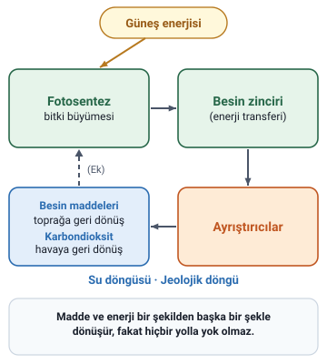
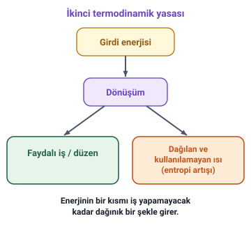

### Ekolojiyi diğer bilim dallarından ayıran özellik

Ekolojiyi diğer bilim dallarından ayıran en önemli özellik; canlı varlıkların yaşadıkları ortam ile çevresindeki **cansız varlıklar** arasındaki ilişkileri **"bütüncül" bir yöntem** ile inceleyen bilim dalı olmasıdır.

Bu da **insan merkezci düşüncenin reddi** anlamına gelir.

### On temel ilke

Hoca ekolojinin temel ilkelerini a'dan j'ye kadar on madde olarak sıralar. Her ilkenin slaytında ilkeyi canlandıran bir görsel vardır; görsellerdeki yazılar çoğunlukla ilkenin cümlesini tekrar eder.

#### a) Doğanın bütünlüğü ilkesi

Canlı ve cansız tüm varlıklarıyla **doğa bir bütündür** ve yaşam için birbirleriyle **etkileşim ve dayanışma** içindedir.

> **Ek:** Slayttaki görselde bir yanda canlı varlıklar (besin zinciri, enerji akışı), öbür yanda cansız varlıklar (toprak, su, hava, güneş ışığı, mineraller) ve aralarında "döngüler" ile "karşılıklı bağımlılık" çizilmiştir.

#### b) Doğanın sınırlılığı ilkesi

Her ne kadar doğanın **kendini yenileyebilme yeteneği** varsa da çoğalan nüfusu ve kirlilikleri **taşıma kapasitesi sınırlıdır** ve **doğa sonsuz değildir**.

> **Ek:** Taşıma kapasitesi, bir ortamın kalıcı olarak barındırabileceği en yüksek nüfus ya da kaldırabileceği yük demektir. Slayttaki görselde "taşıma kapasitesini aşma", "özümseme kapasitesini aşma", "küresel ayak izi" ve "geri dönüşü olmayan eşikler" yazar.

#### c) Doğanın özdenetim ilkesi

Ekosistemler, **özdenetim (oto organizasyon)** ve **geri beslenme** işlemleriyle bütünlüklerini ve yaşamlarını **kendi sınırı içinde** korumaya yönelirler.

> **Dikkat:** Sınırlılık ilkesi doğanın kaldırabileceği yükün **sınırlı** olduğunu, özdenetim ilkesi ise ekosistemin bütünlüğünü **kendi kendine** (özdenetim ve geri beslenmeyle) koruduğunu anlatır. İkisinde de "sınır" sözü geçer; anlamlarını karıştırmayın.

#### d) Doğanın çeşitliliği ilkesi

Canlılar arasındaki **çeşitlilik**, **birbirine bağımlı** bir sistem içinde **yaşamın sürekliliğini** sağlar.

> **Ek:** Slayttaki görselde "tozlaşma", "besin ağı", "besin döngüsü" ve "yaşam alanları" yazar.

#### e) Doğada hiçbir şey yok olmaz ilkesi

Bu ilke termodinamik yasasına dayanır: var olan **her madde ve enerji** bir şekilden başka bir şekle **dönüşecek** fakat **hiçbir yolla yok olmayacaktır**.

> **Dikkat:** Slaytta yalnızca "termodinamik yasası" denir, hangisi olduğu söylenmez. Enerjinin yok olmayıp dönüştüğünü söyleyen **birinci** termodinamik yasasıdır (enerjinin korunumu); maddenin yok olmadığı ise kütlenin korunumu ilkesidir. Bir sonraki ilke (f) ise **ikinci** termodinamik yasasıdır. İkisini karıştırmayın.

> **Ek:** Şekildeki adlar slayttaki görselden alınmıştır: güneş enerjisi, fotosentez, besin zinciri (enerji transferi), ayrıştırıcılar, besin maddeleri (toprağa geri dönüş), karbondioksit (havaya geri dönüş), su döngüsü, jeolojik döngü. Besin maddelerinden fotosenteze giden kesik ok görselde yoktur; döngüyü kapatmak için eklendi (Ek).

#### f) Doğaya karşı elde edilen her başarının bir bedeli vardır ilkesi

**İkinci termodinamik yasası** olan bu ilkeye göre **her enerji dönüşümünde** enerjinin bir kısmı **iş yapamayacak kadar dağınık** bir şekle girer.

> **Ek:** Slayttaki görselde girdi enerjisinin dönüşümle bir yandan "faydalı iş/düzen"e, öbür yandan "dağılan ve kullanılamayan ısı (entropi artışı)"na ayrıldığı çizilmiştir. Entropi, bu dağınıklığın ölçüsüdür.

#### g) Doğanın geri tepmesi ilkesi

Fizikteki **her etkinin bir tepkisi** olduğu gerçeğinden hareketle, doğa yapılan **müdahalelere karşı koyma gücüne** sahiptir.

> **Ek:** Slayttaki görselde bir sel ya da heyelanın bir barajı ve yerleşimi yıktığı bir manzara vardır.

#### h) En uygun çözümü doğa bulmuştur ilkesi

Her canlı **milyonlarca yıl süren evrim** sonucunda **en uygun şeklini** almıştır ve bu doğanın temel yasasıdır.

#### i) Kültürel evrim ve geleneksel ekolojiye saygı ilkesi

Evrim sonucunda son hâline gelmiş olan insan, **biyolojik evrim** sonucunda **kültürü yaratmıştır** ve bu da bir **ekolojik uyumdur**.

#### j) Doğa ile birlikte gitmek ilkesi

Doğanın kendi içerisinde meydana getirdiği **ekolojik döngülerini** ve **mevsimlerini** göz önünde bulundurmak gerekir.

> **Ek:** Slayttaki görselde dört mevsim (ilkbahar, yaz, sonbahar, kış) yan yana çizilmiştir.

### İlkelerin birbiriyle ilişkisi

- Yukarıdaki ilkeler **birbirleriyle ilişkilidir**, çünkü doğa **kendi kendini denetleyen bir bütündür**.
- İnsanın **ileriyi görmeden, bilinçsizce** çevresinde yaptığı değişiklikler, bu bütünün çeşitli **dengelerini bozmaktadır**.
- İnsan **doğanın bir parçası** olduğunu kabul etmeli ve görevini yerine getirmeye çalışmalıdır.
- İnsanın doğaya karşı **aykırı tutumu**, kendine zarar vermenin dışında başka bir işe yaramayacaktır.

### Görünmez bağlar (slayt görseli)

Son slaytta yalnızca bir görsel vardır. Bir kelebeğin kanat çırpışından okyanusun öbür yanındaki bir fırtınaya uzanan ışıklı çizgiler çizilmiştir. Görselde şu sözler yazar:

"Dünyanın bir yerinde kelebek kanat çırparsa, diğer yerinde fırtınalar kopabilir. Ekoloji, bu görünmez bağların haritasıdır."

> **Ek:** Bu söz "kelebek etkisi" diye bilinen fikre dayanır: küçük bir değişiklik, birbirine bağlı bir sistemde uzakta büyük sonuçlar doğurabilir. Sözler yalnızca görseldedir.
