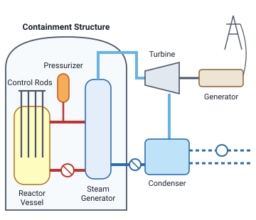
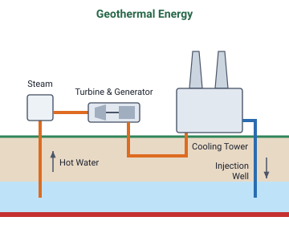
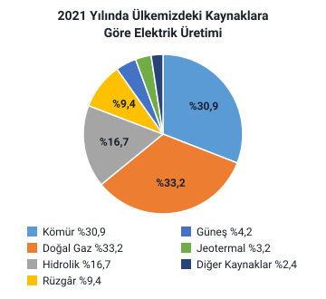

### Elektrik enerjisinin üretimi ve iletimi

- Evlerimizde, iş yerlerimizde kullandığımız elektrik enerjisi **elektrik santrallerinde** üretilir.
- Elektrik enerjisi dediğimizde akla ilk gelen kavramlar **gerilim** ve **akım** kavramlarıdır.
- Santrallerde üretilen elektrik gerilimi, **enerji kayıplarını azaltmak** için **transformatörler (trafolar)** yardımıyla **yükseltilir**, ardından **dağıtım merkezlerinde** evlerin ve iş yerlerinin kullandığı değerlere **düşürülür**.

> **Dikkat:** Gerilim santralden sonra önce **yükseltilir** (enerji kayıplarını azaltmak için), sonra dağıtım merkezlerinde evlerin ve iş yerlerinin kullandığı değerlere **düşürülür**. Sırayı karıştırmayın.

### Kaynakların sınıflandırılması

Hoca elektrik enerjisinin üretiminde kullanılan kaynakları dört başlıkta toplar:

1. Termik kaynaklar
2. Hidrolik kaynaklar
3. Nükleer kaynaklar
4. Diğer kaynaklar: rüzgâr, güneş, jeotermal ve gelgit enerjisi

### Termik kaynaklar

**Termik** kelimesi **ısı ya da ısı ile ilgili** (ısıl, ısısal) anlamında kullanılmaktadır.

Kömür, petrol ve ürünleri, doğal gaz gibi **fosil kaynaklı yakıtlar** yakılarak tanklarda ısıtılan su, **yüksek basınçlı buhar** hâline getirilir. Elde edilen yüksek basınçlı buhar, borularla taşınarak **buhar türbininin** döndürülmesi sağlanır.

- Termik santrallerin **ilk kurulum masrafları**, en çok kullanılan hidrolik santrallere göre **daha azdır**.
- Ancak **yakıt masrafları** nedeniyle zaman ilerledikçe **pahalı** olmaya başlarlar.
- Ayrıca kullanılan yakıtlar nedeniyle **çevreye zarar** verirler.

> **Dikkat:** Termik santralin **kurulumu** hidrolik santrale göre ucuzdur; **zamanla** yakıt masrafları yüzünden pahalı olur. "Termik santral ucuzdur" ya da "termik santral pahalıdır" diye tek yönlü düşünmeyin.

> **Dikkat:** Slayttaki "en çok kullanılan hidrolik santraller" ifadesi korunmuştur. Ancak hocanın 2021 verisinde Türkiye'de elektrik üretiminin en büyük payları doğal gaz (%33,2) ve kömürdendir (%30,9); hidrolik enerjinin payı %16,7'dir. Bu pay, aynı verideki fosil olmayan kaynaklar içinde en büyüğüdür.

> **Dikkat:** Hocanın bu slayttaki şekli bir nükleer santrali gösterir; şekil bu notta "Nükleer kaynaklar" başlığına alındı.

### Hidrolik kaynaklar

Hidroelektrik santrallerin gerisinde **suyun depolandığı barajlar** mevcuttur. Barajlarda tutulan su, **borular** yardımıyla **türbine** ulaştırılır ve **yüksek bir basınçla** türbine vuran su kütlesi türbini döndürür. Türbin dönerken türbine bağlı **alternatör mili** de döneceğinden **alternatör elektrik enerjisi üretir**.

> **Ek:** Alternatör, kendisine verilen mekanik enerjiyi alternatif akım (AC) elektrik enerjisine çeviren makinedir; dersin ilerleyen haftalarında ayrıca anlatılır.

### Nükleer kaynaklar

Nükleer kaynaklar, **uranyum, plütonyum** gibi elementlerin **tepkimeye sokularak ısı üretilmesi** prensibine göre çalışırlar. Elde edilen ısı, **termik santrallerdeki gibi** suyun ısıtılması ve yüksek basınçlı buhar elde edilmesinde kullanılır. Elde edilen bu buhar, **buhar türbininin**, dolayısıyla da **alternatörün** döndürülmesinde kullanılır. Alternatör mili dönünce de elektrik enerjisi elde edilir.

> **Dikkat:** Hocanın slaytında bu şekil **"Termik Kaynaklar"** başlığının altındadır. Ama şekildeki Reactor Vessel, Control Rods, Pressurizer ve Containment Structure adları bir **nükleer** santrali gösterir. Şeklin buhar, türbin ve generatör bölümü termik santralle aynı işi görür; termik ile nükleer santrali ayıran, suyu ısıtan ısının kaynağıdır: termikte fosil yakıtların yakılması, nükleerde uranyum, plütonyum gibi elementlerin tepkimesi.

> **Ek:** Şekildeki İngilizce adların Türkçesi: Containment Structure: koruma yapısı; Reactor Vessel: reaktör kabı; Control Rods: kontrol çubukları; Pressurizer: basınçlandırıcı; Steam Generator: buhar üreteci; Turbine: türbin; Generator: generatör; Condenser: kondenser (yoğuşturucu). Bu adlar yalnızca şekilde geçer; metinde "alternatör" denen makine şekilde "Generator" diye yazılıdır. Şekilde reaktörde ısınan su (kırmızı) buhar üretecinde ikinci devredeki suyu buhara çevirir; buhar türbini döndürür, kondenserde yeniden suya döner.

### Diğer kaynaklar

Hoca diğer kaynaklar olarak rüzgâr, güneş, jeotermal ve gelgit enerjisini anlatır.

#### Rüzgâr enerjisi

Rüzgâr **kanatları**, kanatlar da **şaftı** döndürür. **Güç aktarım kutusunda** dönüş hızı **artırılarak** ikinci şafta aktarılır. Yüksek hızlı bu şaft, **alternatörün rotorunu** döndürerek **alternatör statorunda** elektrik enerjisi elde edilmesini sağlar.

Şayet rüzgâr çok şiddetli ise **fren sistemi** devreye girer ve alternatörün **sabit bir hızda** dönmesi sağlanır.

> **Dikkat:** Hocanın cümlesinde şaft alternatörün **rotorunu** döndürür; elektrik enerjisi ise alternatörün **statorunda** elde edilir. Güç aktarım kutusu dönüş hızını **artırır**.

#### Güneş enerjisi

Güneş enerjisinden elektrik enerjisi elde etmek için yaygın olarak kullanılan **iki yöntem** mevcuttur:

1. Güneş ışığını belli merkezlerde **odaklayıp** bazı sıvıların **buhara** dönüştürülerek bir **alternatörün** döndürülmesi yoluyla
2. Bazı **yarı iletkenler (foto piller)** vasıtasıyla

> **Ek:** Foto pile bugün daha çok güneş pili denir; ışığı doğrudan elektrik enerjisine çevirir. Hocanın slaytındaki fotoğraflar, çatılara kurulmuş güneş panellerini gösterir.

#### Jeotermal enerji

Yer kürenin derinliklerindeki **magma** ya da bazı kayaçlarda gerçekleşen **radyoaktif tepkimeler** sonucu sıcaklıklar oluşur. Jeotermal enerjinin elektrik enerjisine dönüştürülebilmesi için derinlerdeki bu sıcaklık, **borularla taşınan su** ile yüzeye çıkarılarak gerekli makinelerle **elektrik veya ısınma** amaçlı kullanılır.

> **Ek:** Şekildeki İngilizce adların Türkçesi: Hot Water: sıcak su; Steam: buhar; Turbine & Generator: türbin ve generatör; Cooling Tower: soğutma kulesi; Injection Well: enjeksiyon (geri basım) kuyusu. Şekilde yer altındaki sıcak su bir boruyla yüzeye çıkar, buhar türbin ve generatöre gider; soğutma kulesinden geçen su enjeksiyon kuyusundan yer altına geri iner. Bu akış yalnızca şekilde vardır, slayt metninde geçmez.

#### Gelgit enerjisi

**Gelgit**, diğer bir adıyla **medcezir**, ay ve güneşin dünya üzerinde oluşturduğu **çekim gücüne** ve dünyanın kendi **ekseni etrafında dönmesine** bağlı olarak deniz ve okyanuslardaki su seviyelerinde meydana gelen **alçalma ve yükselme** hareketlerine verilen isimdir.

Gelgit enerjisinin elektrik enerjisine dönüştürülebilmesi için şunlara ihtiyaç duyulur:

- su tutan bir **baraj**
- **iki yönde dönebilen** özel **türbinler**
- bu türbinlerle döndürülen **alternatörler**

Gelgit enerjisinden faydalanırken baraj hem dolarken hem de boşaltırken elektrik enerjisi elde edilebilse de türbinler **verimlilik** açısından genellikle **barajın boşalması** esnasında devreye sokulur.

> **Dikkat:** Elektrik, barajın hem dolarken hem boşalırken **elde edilebilir**; ama türbinler verimlilik açısından **genellikle boşalma** sırasında devreye sokulur.

### Kaynakları karşılaştırma

Slaytlardaki anlatımlara göre her kaynakta enerjinin kaynağı ve döndürülen makine:

| Kaynak | Enerjinin kaynağı | Ne döndürülür |
| --- | --- | --- |
| Termik | Fosil yakıtların (kömür, petrol ve ürünleri, doğal gaz) yakılması | Yüksek basınçlı buhar buhar türbinini döndürür |
| Hidrolik | Barajda tutulan su | Yüksek basınçla vuran su türbini, türbin de alternatör milini döndürür |
| Nükleer | Uranyum, plütonyum gibi elementlerin tepkimesiyle üretilen ısı | Buhar, buhar türbinini, dolayısıyla alternatörü döndürür |
| Rüzgâr | Rüzgâr | Kanatlar şaftı; hızı artırılan ikinci şaft alternatörün rotorunu döndürür |
| Güneş | Güneş ışığı | Odaklanan ışıkla elde edilen buhar alternatörü döndürür ya da foto piller kullanılır |
| Jeotermal | Magma ya da kayaçlardaki radyoaktif tepkimelerle oluşan sıcaklık | Sıcaklık borularla taşınan suyla yüzeye çıkarılır, gerekli makinelerle kullanılır |
| Gelgit | Su seviyelerindeki alçalma ve yükselme | Barajdaki su iki yönde dönebilen türbinleri, türbinler alternatörleri döndürür |

### Türkiye'de 2021 yılında elektrik üretimi

2021 yılında elektrik üretimimizin **%30,9**'u kömürden, **%33,2**'si doğal gazdan, **%16,7**'si hidrolik enerjiden, **%9,4**'ü rüzgârdan, **%4,2**'si güneşten, **%3,2**'si jeotermal enerjiden ve **%2,4**'ü diğer kaynaklardan elde edilmiştir.

| Kaynak | Pay |
| --- | --- |
| Kömür | %30,9 |
| Doğal gaz | %33,2 |
| Hidrolik | %16,7 |
| Rüzgâr | %9,4 |
| Güneş | %4,2 |
| Jeotermal | %3,2 |
| Diğer kaynaklar | %2,4 |
| Toplam | %100 |

Kömür ve doğal gaz, termik kaynaklarda yakılan fosil yakıtlardandır; 2021'de ikisinin toplam payı %64,1'dir.

> **Dikkat:** En büyük pay **doğal gazındır** (%33,2); kömür (%30,9) ikinci sıradadır. Slaytta kömür önce yazıldığı için ikisi kolayca karıştırılır.

> **Dikkat:** Bu verideki "diğer kaynaklar" (%2,4), yukarıdaki "Diğer kaynaklar" başlığıyla aynı şey değildir: rüzgâr, güneş ve jeotermal 2021 verisinde ayrı ayrı verilmiştir.
