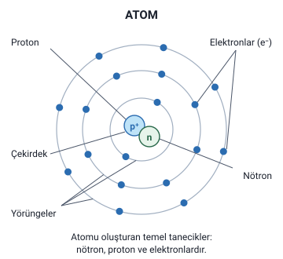
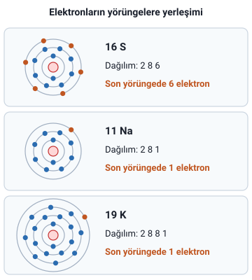
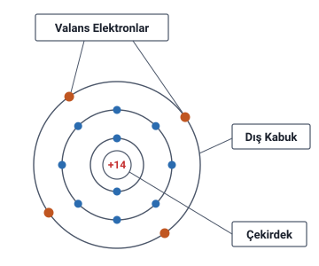

### Atom nedir

- Maddenin en küçük yapı taşına **atom** denir.
- Elektrik enerjisinin **elde edilmesini**, **iletimini (taşınmasını)** ve **kullanılmasını** anlamak için bizlere bilgi veren maddenin yapı taşına atom denir.

### Atomun yapısı: çekirdek ve elektronlar

Atomu oluşturan temel tanecikler **nötron**, **proton** ve **elektronlardır**.

- **Çekirdek:** atomun **tam merkezinde** bulunur. Atomun cinsine göre belirli sayıda **proton** ve **nötrondan** oluşur.
- **Elektronlar:** çekirdeğin etrafında belirli **yörüngelerde** durmaksızın dönen parçacıklara **elektron** denir. Hem **çekirdek etrafında** hem de **kendi etraflarında** dönerler.

> **Dikkat:** Proton ve nötron **çekirdektedir**; elektronlar çekirdeğin **etrafındaki yörüngelerde** döner. Elektronlar hem çekirdeğin etrafında hem de kendi etraflarında döner.

> **Dikkat:** "Elektriğin Kısa Tarihçesi" konusunda geçen **"Elektron"**, Thales'in kehribara verdiği addır (Yunanca kehribar). Bu konudaki **elektron** ise atomun parçacığıdır.

> **Ek:** Şekilde proton p⁺, nötron n, elektron e⁻ işaretiyle gösterilir; bu işaretler yalnızca şekilde geçer. Proton artı (+), elektron eksi (−) yüklüdür, nötron yüksüzdür. Hocanın şeklinde yörüngelerde içten dışa **2, 8 ve 17** elektron vardır. Dış yörüngedeki 17 elektron, aşağıdaki "dış yörüngede en çok sekiz elektron" bilgisiyle uyuşmadığı için buradaki şekilde yörüngelere 2, 8 ve 8 elektron çizildi. Şekildeki elektron sayıları belli bir atomu göstermez.

### Dış yörünge ve doymuş yörünge

- Atomun dış yörüngesinde değişik sayıda elektron bulunabilir. Fakat bu elektronların sayısı **sekizden fazla olamaz**.
- Dış yörüngede **sekiz elektronu** bulunan atomlar bir nevi **kararlılık** kazanmıştır.
- Sekiz elektronlu dış yörüngelere **"doymuş yörünge"** denir.
- Doymuş yörüngenin elektronları çekirdeğe **daha sıkı** olarak bağlıdır.

### Elektron dağılımı örnekleri

Hocanın üç örneğinde, atom numarası verilen elementin elektronları yörüngelere yerleştirilir ve **son yörüngesinde** kaç elektron bulunduğu bulunur. Hocanın yazımıyla:

- Örnek 1: atom numarası 16 olan S elementi. **16 S: 2 8 6**. Son yörüngesinde **6** elektron bulunmaktadır.
- Örnek 2: 11 Na elementi. **11 Na: 2 8 1**. Son yörüngesinde **1** elektron bulunmaktadır.
- Örnek 3: 19 K elementi. **19 K: 2 8 8 1**. Son yörüngesinde **1** elektron bulunmaktadır.

| Element | Atom numarası | Elektron dağılımı | Son yörüngedeki elektron |
| --- | --- | --- | --- |
| S | 16 | 2 8 6 | 6 |
| Na | 11 | 2 8 1 | 1 |
| K | 19 | 2 8 8 1 | 1 |

> **Dikkat:** K'nin dağılımında üçüncü yörüngede 8 elektron vardır, ama son yörünge **dördüncü** yörüngedir ve orada **1** elektron bulunur. Na ile K'nin son yörüngelerindeki elektron sayısı aynıdır (1).

> **Ek:** Yukarıdaki şekil slaytta yoktur; hocanın çözümlerindeki sayılar çizildi. Hocanın örneklerinde elementler simgeleriyle anılır: S kükürt, Na sodyum, K potasyumdur. Nötr bir atomda elektron sayısı atom numarasına eşittir; bu yüzden dağılımdaki sayıların toplamı atom numarasını verir: 2 + 8 + 6 = 16, 2 + 8 + 1 = 11, 2 + 8 + 8 + 1 = 19. Çözümlerde görülen yerleşim şudur: ilk yörüngeye en çok 2, sonraki yörüngelere 8'er elektron. Bu basit yerleşim atom numarası 20'ye kadar olan elementlerde geçerlidir; daha ağır elementlerde iç yörüngeler 8'den çok elektron alabilir.

### Valans elektronları (serbest elektronlar)

- Atomların **dış yörüngelerinde** bulunan elektronlara **valans elektron** ya da **serbest elektron** denir.
- Bunlar çekirdeğe **zayıf bir bağ** ile bağlı olduklarından **ufak bir enerji** ile atomu terk edebilirler.
- Serbest elektronlar bu hareket özelliklerinden dolayı **elektrik iletiminde önemli rol** oynarlar.

Bir atomun **valans bandındaki** elektronlar (serbest elektronlar), atomun diğer elektronlarına göre **daha fazla enerjiye** sahiptir. Bu nedenle bazı elementlerin atomlarındaki bu elektronlar, düşük seviyeli enerjilerin etkisinde kaldıklarında (enerji aldıklarında) **çekirdeğin çekim kuvvetini aşacak** enerjiye sahip olurlar ve kendi atomundan **kopabilirler**. Kazandıkları enerjiyi kaybettiklerinde ise ya **geri dönerler** ya da **başka bir atomun son yörüngesine** geçebilirler.

Hoca bu cümlenin yanına "İyonik bağ – kovalent bağ" yazar; slaytta bu bağlar açıklanmaz.

> **Dikkat:** Elektron **enerji alınca** çekirdeğin çekim kuvvetini aşıp atomundan kopabilir; **enerjiyi kaybedince** ya geri döner ya da başka bir atomun son yörüngesine geçer. İkisini karıştırmayın.

> **Ek:** Hocanın şeklinde çekirdeğin yükü +14'tür ve elektronlar yörüngelere 2, 8, 4 diye dizilmiştir; dış kabuktaki 4 elektron valans elektronlarıdır. "Dış kabuk", dış yörünge demektir. Atom numarası 14 olan element silisyumdur (Si); şeklin hangi atom olduğu slaytta yazmaz, bu bilgiler yalnızca şekilde geçer.

> **Ek:** İyonik bağda bir atom son yörüngesindeki elektronu başka bir atoma verir (ör. sofra tuzunda sodyum, elektronunu klora verir). Kovalent bağda atomlar son yörüngelerindeki elektronları ortak kullanır. Başka kaynaklarda "serbest elektron" daha dar anlamda, atomundan kopup madde içinde serbestçe dolaşan elektron için kullanılır.

### İletkenler

**Son yörüngelerinde 3 ya da daha az elektron** bulunduran atomlardan oluşan maddelere **iletken** denir. Bunlar elektrik akımını iyi iletirler.

#### İletken maddeler

- Tüm **metaller** iletkendir.
- **İnsan vücudu** iyi bir iletkendir.
- **Asit, baz ve tuz çözeltileri** iyi bir iletkendir ve bunlara **elektrolit** adı verilmektedir.
- **Saf su yalıtkan**, günlük hayatta kullandığımız **içme suyu** ise iletkendir.
- **Toprak**, içinde su olduğu için iletkendir.
- **Gazlar** genelde yalıtkandır; fakat **iyonlarına ayrılmış** gazlar iletkenlik kazanırlar.

> **Dikkat:** Su için iki ayrı bilgi var: **saf su yalıtkandır** (yalıtkan maddeler listesinde de geçer); günlük hayatta kullandığımız **içme suyu iletkendir**. Toprak da içinde su olduğu için iletkendir.

#### En iyi iletkenler

En iyi iletkenler: **Gümüş > Bakır > Altın > Alüminyum**

- **Bakır**, hem iyi bir iletken hem de diğerlerinden **daha ucuz** olduğu için **en çok kullanılan** iletken maddedir.
- **Alüminyum** ise **hafif** olduğundan **uzun iletim hatlarında** kullanılır.

> **Dikkat:** **En iyi** iletken **gümüştür**; **en çok kullanılan** iletken **bakırdır**. Bakır hem iyi iletken hem de diğerlerinden ucuz olduğu için, alüminyum ise hafif olduğu için tercih edilir.

> **Ek:** Gümüş, bakır ve altın atomlarının son yörüngesinde 1, alüminyum atomunun son yörüngesinde 3 elektron vardır; dördü de hocanın iletken tanımına (3 ya da daha az) uyar.

### Yarı iletkenler

**Son yörüngelerinde dört (4) elektron** bulunan maddelere **yarı iletken** denir.

- Yarı iletken maddeler, **yarı iletken devre elemanlarının** yapımında kullanılır.

11. haftada hoca yarı iletkenleri şöyle de tanımlar: **Yarı iletkenler devrede hem yalıtkan hem de bazı özel şartlar altında iletken durumuna geçen devre elemanları olarak tanımlanabilir.**

Güneş enerjisinden elektrik elde etmede kullanılan foto piller de hocaya göre bazı yarı iletkenlerdir ("Elektrik Enerjisinin Üretiminde Kullanılan Kaynaklar" konusu).

> **Ek:** Slaytta bu bilgilerin yanında bir transistörün sembolü (B, C, E uçlarıyla), P, N, P katmanlarından oluşan yapısı ve transistör fotoğrafları vardır. Bunlar yalnızca şekilde geçer, slaytta açıklanmaz.

#### N tipi ve P tipi malzeme

- **Silisyum (Si)** veya **germanyum (Ge)** içerisine **5 valans elektronu** olan atomların belli bir oranda eklenmesi ile **N tipi malzeme** elde edilir.
- Silisyum (Si) veya germanyum (Ge) içerisine **3 valans elektronu** olan atomların belli bir oranda eklenmesi ile **P tipi malzeme** elde edilir.

| Si veya Ge içine eklenen atomun valans elektronu | Elde edilen malzeme |
| --- | --- |
| 5 | N tipi malzeme |
| 3 | P tipi malzeme |

> **Dikkat:** **5** valans elektronlu atom eklenirse **N** tipi, **3** valans elektronlu atom eklenirse **P** tipi malzeme elde edilir. Eklenen atom silisyum ya da germanyumun **içine** belli bir oranda eklenir.

> **Ek:** Silisyum ve germanyum atomlarının son yörüngesinde 4 elektron bulunur; bu yüzden hocanın tanımına göre yarı iletkendirler. N ve P tipi yarı iletkenler 11. haftada ayrıca anlatılır.

### Yalıtkanlar

Atomlarının **son yörüngelerinde 5 ve daha fazla elektron** bulunduran maddelere **yalıtkan** denir.

İyi bir yalıtkan maddedeki atomların son yörüngelerinde **sekiz (8) ya da daha fazla** elektron bulunması gerekir.

> **Dikkat:** Slayttaki "sekiz (8) ya da daha fazla" ifadesi korundu. Ancak hoca atomun yapısını anlatırken dış yörüngedeki elektron sayısının **sekizden fazla olamayacağını** söyler; iki ifade birbiriyle çelişir.

#### Yalıtkan maddeler

Hocanın yalıtkan madde örnekleri: cam, lastik, plastik, yağ, asfalt, fiberglas, porselen, seramik, mika, kuartz, kuru kumaş, kuru kâğıt, kuru ağaç, hava, elmas, saf su.

> **Dikkat:** Kumaş, kâğıt ve ağaç listede **kuru** olarak, su ise **saf su** olarak geçer. İçme suyu ve içinde su bulunan toprak iletkendir.

Cam ve hava için hocanın verdiği bilgiler:

- **Cam**, **20 °C**'de iyi bir yalıtkan iken **300 °C**'nin üzerinde iletken hâle geçer.
- **Hava** iyi bir yalıtkandır. Fakat **30000 V/cm**'de iletken hâle geçer.

> **Dikkat:** Slaytta havanın değeri "30.000 V/cm" diye, binlik ayırıcı noktayla yazılmıştır: otuz bin volt/santimetre. Cam için iki sıcaklık var: 20 °C'de iyi bir yalıtkandır, 300 °C'nin üzerinde iletken hâle geçer.

> **Ek:** V/cm, santimetre başına volt demektir. 30000 V/cm, kabaca 1 cm'lik hava aralığının 30000 V civarındaki bir gerilimde iletken hâle geçmesi anlamına gelir. Hocanın "iyonlarına ayrılmış gazlar iletkenlik kazanır" cümlesi bununla ilgilidir: yüksek gerilimde havanın molekülleri iyonlaşır.

### Dirence göre iletken ve yalıtkan

11. haftada hoca iletken ve yalıtkan tanımlarını tekrarlar ve maddeleri son yörüngelerindeki elektronlara (valans elektronlarına) göre iletken veya yalıtkan diye sınıflandırdıktan sonra bu tanıma ek olarak şunu söyler:

- Elektrik akımına karşı **çok küçük direnç** gösteren malzemeler **iletken**, elektrik akımına karşı **çok yüksek direnç** gösteren malzemeler **yalıtkan** olarak adlandırılabilir.

> **Dikkat:** İletken ve yalıtkan iki yoldan tanımlanır: son yörüngedeki elektron sayısına göre (3. hafta) ve elektrik akımına karşı gösterdiği dirence göre (11. hafta). Direnci **çok küçük** olan iletken, **çok yüksek** olan yalıtkandır.

### İletken, yarı iletken ve yalıtkanın karşılaştırması

| Özellik | İletken | Yarı iletken | Yalıtkan |
| --- | --- | --- | --- |
| Son yörüngedeki elektron sayısı | 3 ya da daha az | 4 | 5 ve daha fazla; iyi yalıtkanda sekiz (8) ya da daha fazla (Yalıtkanlar başlığındaki Dikkat kutusuna bakın) |
| 11. haftadaki ek tanım | Akıma karşı çok küçük direnç gösterir | Devrede hem yalıtkan hem de bazı özel şartlar altında iletken durumuna geçer | Akıma karşı çok yüksek direnç gösterir |
| Hocanın andığı maddeler | Tüm metaller (en iyileri gümüş, bakır, altın, alüminyum), insan vücudu, elektrolitler, içme suyu, toprak | Silisyum (Si), germanyum (Ge) (N ve P tipi malzemenin ana maddesi olarak) | Cam, lastik, plastik, porselen, seramik, mika, kuru ağaç, hava, elmas, saf su ve diğerleri |

### Periyodik tablo

**Periyodik tablo**, kimyasal elementlerin sınıflandırılması için geliştirilmiş tablodur. Günümüzde **periyodik tablo**, **periyodik cetvel**, **periyodik çizelge**, **elementler tablosu** gibi birçok şekilde isimlendirilmiştir.

> **Ek:** Hocanın slaytında Türkçe element adlı bir periyodik tablo resmi ve "URL" yazılı bir bağlantı vardır. Bu konudaki elementlerin atom numaraları tablodan okunabilir: sodyum (Na) 11, alüminyum (Al) 13, silisyum (Si) 14, kükürt (S) 16, potasyum (K) 19, bakır (Cu) 29, germanyum (Ge) 32, gümüş (Ag) 47, altın (Au) 79. Bu numaralar yalnızca resimde geçer; elektron dağılımı örneklerindeki atom numaraları ise slayt metnindedir.
