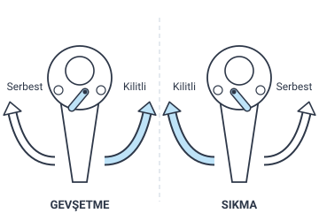
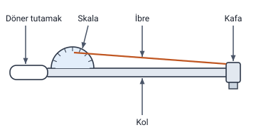

### Anahtarlar

Hoca 3.4 El takımları ve kullanımı bölümünün ikinci kısmında **mekanik alanındaki** el takımlarını anlatır. Elektrik alanındakiler "El Takımları: Elektrik Alanında" konusundadır.

> **Ek:** Aletlerin "anahtarlar", "penseler" gibi gruplara ayrılması slaytta yoktur; notu düzenlemek için yapıldı. Grupların altındaki bilgiler slayttandır.

Hocanın anlattığı anahtarların çoğu cıvata ve somunların **sökülmesinde ve sıkılmasında** kullanılır. Onları birbirinden ayıran, hocanın her biri için söylediği özelliktir:

| Anahtar | Hocanın verdiği kullanım yeri ya da ayırt edici özellik |
| --- | --- |
| Açık ağız anahtarları | Dört köşe somun ve cıvataların sıkılıp sökülmesi; iki ağızlı ve tek ağızlı |
| Yıldız anahtarlar | Sökme ve sıkmada yaygın; altıgen ve on iki köşeli yapılır |
| Kombine anahtarlar | Düz kısım boşluk alırken, yıldız kısım sıkarken; iki ağzın ölçüsü aynı |
| Lokma anahtarlar | En çok tercih edilen anahtar; takım lokma anahtarı ve lokma kolundan oluşur |
| Cırcır anahtarlar | Tek yöne döner; somun veya cıvata kafasından çıkarılmadan çabuk çalışılır |
| Rekor anahtarlar | Rekorlu birleştirmeler; açık ağıza göre daha kuvvetli kavrama |
| Buji anahtarları | Bujilerin sökülmesi ve sıkılması |
| Bijon anahtarları | Tekerlek bijon somunları veya cıvataları |
| Kanca anahtar | Büyük çaplı özel cıvata ve somunlar |
| Kurbağacık | Ağızları paralel hareket eder, ayarlanabilir; küçük değerde sıkma ve sökme |
| Boru anahtarı | Rot ve benzeri parçalar; anahtar ağzı bozulan cıvata ve somunlar |

#### Açık ağız anahtarları

- **Dört köşe somun ve cıvataların** sıkılıp sökülmesinde kullanılır.
- İki şekildedir: **iki ağızlı açık ağız anahtarlar** ve **tek ağız açık ağız anahtarlar**.

#### Yıldız ve kombine anahtarlar

**Yıldız anahtarlar:**

- Sökme ve sıkma işlemlerinde **yaygın olarak** kullanılır.
- **Altıgen** ve **on iki köşeli** olarak yapılır.

**Kombine anahtarlar:**

- Sökme takma işlemlerinin **daha hızlı** yapılması için **düz yıldız anahtarlar** kullanılmaya başlamıştır.
- **Boşluk alırken düz kısmı**, **sıkarken yıldız kısmı** kullanılır. Böylece daha seri ve kolay iş yapma imkânı sunar.
- Anahtarın **iki ağız kısmının ölçüsü de aynıdır.**
- Slayttaki fotoğrafların adları: **normal tip** ve **cırcırlı tip**.

> **Dikkat:** Kombine anahtarda **boşluk alırken düz** kısım, **sıkarken yıldız** kısım kullanılır; ikisini ters çevirmeyin. Kombine anahtarın iki ağzının ölçüsü **aynıdır**.

> **Ek:** Fotoğraflarda kombine anahtarın bir ucu açık ağızlı, öteki ucu yıldız (halka) ağızlıdır; bu yalnızca fotoğrafta görülür. Hocanın "düz kısım" dediği buna göre açık ağızlı uçtur. Hocanın yıldız anahtar şeklinde "Anahtar ağzı (mm)" başlığıyla şu ölçüler yazılıdır: 22 x 24, 19 x 21, 14 x 17, 12 x 14, 10 x 12, 12 x 14 (kısa), 10 x 12 (kısa). Bu ölçüler yalnızca şekilde geçer.

#### Lokma anahtarlar ve lokmalı tornavidalar

**Lokma anahtarlar:**

- **En çok tercih edilen** anahtar çeşididir.
- Bir lokma anahtar takımı, **lokma anahtarı** ve **lokma kolundan** oluşur.
- Lokma anahtar ağızları **üç çeşit** şeklinde yapılır:

1. On iki köşe yıldız anahtarlar
2. Altıgen ağızlı lokma
3. Altı köşe tam yıldız (torks)

**Lokmalı tornavidalar:** Lokma takımının **uçlarının tornavida şeklindeki** el aletidir.

> **Dikkat:** Lokma anahtar tek parça değildir: bir lokma anahtar takımı **lokma anahtarı** ve **lokma kolundan** oluşur. Lokmalı tornavida ise lokma takımının uçlarının **tornavida şeklindeki** el aletidir.

> **Dikkat:** Hoca lokma ağızlarından birini "on iki köşe yıldız anahtarlar" diye yazar. Liste lokma ağızlarını saydığı için bu, lokmanın on iki köşe yıldız biçimindeki ağzı olarak anlaşılır; ayrı bir anahtar türü olan yıldız anahtarla karıştırmayın. Torks (torx) adı elektrik alanındaki torx tornavidada da geçer.

> **Ek:** Lokma, cıvatanın ya da somunun başına geçen parçadır; lokma kolu onu çevirir. Slayttaki çizimde lokmalar ve onları çeviren çeşitli kollar (T kol, cırcır kol, uzatmalar gibi) görülür; çizimde adları yazılı değildir ve bu kollar yalnızca şekilde görülür.

#### Cırcır anahtarlar

- Cırcır kol **sadece bir yöne** dönerek çalıştırılabilir.
- Somun veya cıvata **kafasından çıkarılmadan** çok çabuk çalışma imkânı verir.
- **Dönme yönü cırcır kilidinden** değiştirilebilir.

Hocanın şeklinde cırcır anahtarın **gevşetme** ve **sıkma** konumları gösterilir. Her konumda dönüş yönlerinden biri **kilitli**, öteki **serbest** diye işaretlidir; gevşetmede ve sıkmada kilitli ve serbest yönler yer değiştirir.

> **Ek:** Şeklin yorumu: kol kilitli yönde çevrilince somunu ya da cıvatayı da çevirir; serbest yönde ise boşa döner, böylece anahtar kafadan çıkarılmadan geri getirilir. İki konumda yönlerin yer değiştirmesi, hocanın "dönme yönü cırcır kilidinden değiştirilebilir" cümlesine karşılık gelir. Kilitli ve serbest adları yalnızca şekilde geçer.

> **Dikkat:** Cırcır anahtarın üstünlüğü, anahtarı somun veya cıvata **kafasından çıkarmadan** çalışabilmektir. Kol yalnızca **bir yönde** çevirir; yön, **cırcır kilidiyle** değiştirilir.

#### Rekor, kanca ve boru anahtarları

**Rekor anahtarlar:** **Rekorlu birleştirme** yapılan yerlerde bağlantıların sökülüp takılmasında kullanılır. **Açık ağız anahtarlara göre** daha kuvvetli kavrama sağlar.

**Kanca anahtar:** **Büyük çaplı özel** cıvata ve somunların sökülüp takılmasında kullanılır.

**Boru anahtarı:** **Rot** ve benzeri parçalar ile **anahtar ağzı bozulan** cıvata ve somunların sökülmesinde kullanılır.

> **Dikkat:** Hocanın anlatımında "ağzı bozulmuş" ifadesi üç alette geçer: **boru anahtarı** (rot ve benzeri parçalar, anahtar ağzı bozulan cıvata ve somunlar), **ayarlı pense** (ağzı bozulmuş somunun daha kolay tutulması) ve **papağan pense** (anahtar ağzı bozulmuş rekor ve benzeri parçalar). Penseler aşağıda "Penseler" başlığındadır.

#### Kurbağacık

- **Ağızları birbirine paralel** hareket eden ve **istenilen ölçüye ayarlanabilen** anahtarlardır.
- Cıvata ve somunların **küçük değerde** sıkılmasında ve sökülmesinde kullanılır.

> **Dikkat:** Kurbağacığın ağzı istenilen ölçüye ayarlanır, ama cıvata ve somunları **küçük değerde** sıkmak ve sökmek için kullanılır. Cıvata ve somunların **istenilen değerde** sıkılmasını sağlayan alet **torkmetredir**.

#### Buji ve bijon anahtarları

**Buji anahtarları:**

- **Bujilerin** sökülmesinde ve sıkılmasında kullanılır.
- **Buji porseleninin kırılmaması** için **lokma boyu gereğinden uzun yapılmaz.**
- Slayttaki fotoğrafın adı: **T kollu buji anahtarı**.

**Bijon anahtarları:**

- **Tekerlek bijon somunlarının veya cıvatalarının** sökülmesinde ve takılmasında kullanılır.
- Slayttaki fotoğrafların adları: **altı köşe ağızlı bijon anahtarı**, **istavroz tipi bijon anahtarı** ve **diğer bijon anahtarları**.

> **Dikkat:** Buji ile bijon adları birbirine benzer. **Buji** anahtarı motordaki bujiler, **bijon** anahtarı tekerleğin bijon somunları veya cıvataları içindir. Buji anahtarında lokma boyu, buji porseleni kırılmasın diye gereğinden uzun yapılmaz.

> **Ek:** Slaytta "YANLIŞ" ve "DOĞRU" yazılı iki çizim vardır: eğik tutulan buji anahtarının lokması buji porselenine çarpar, dik tutulan anahtarın lokması çarpmaz. Bu bilgi yalnızca şekilde geçer.

### Torkmetre

- Cıvata ve somunların **istenilen değerde sıkılmasını** sağlar.
- Aynı zamanda **kullanma kolaylığı** ve **zaman tasarrufu** sağlar.
- Hoca formülü şöyle yazar:

**T = F · X**

Hocanın şeklinde torkmetrenin parçaları adlandırılmıştır: **döner tutamak**, **skala**, **ibre**, **kol** ve **kafa**.

> **Ek:** Formüldeki harflerin anlamı slaytta yazmaz. T tork (döndürme etkisi), F uygulanan kuvvet, X kuvvetin uygulandığı noktanın dönme merkezine uzaklığıdır (kol uzunluğu). Kuvvet newton (N), uzaklık metre (m) alınırsa tork N·m çıkar: örneğin 0,4 m'lik kolun ucuna 50 N kuvvet uygulanırsa T = 50 · 0,4 = 20 N·m olur. Şekildeki ibre, kolun ucuna uygulanan kuvvetle skalada değeri gösterir. Torkmetreye başka kaynaklarda tork anahtarı da denir.

### Penseler

**Ayarlı pense:**

- Ayarlı penseler **çok güçlü sıkıştırma** gerektiren yerlerde kullanılır.
- **Ağzı bozulmuş bir somunun** daha kolayca tutulması veya **kırık bir cıvatanın** değiştirilmesinde kullanılır.
- Parça üzerinde **kilitlenerek** devamlı ve çok güçlü sıkma yapar.

**Papağan (fort) pense:**

- Papağan penseler **düz penselere göre** daha güçlü tutma özelliğine sahiptir.
- **Anahtar ağzı bozulmuş rekor** ve benzeri parçaların sökülmesinde kullanılır.

**Segman pense:** **İç ve dış emniyet segmanlarının** sökülmesi ve takılmasında kullanılır.

**Segman kelepçesi ve pensi:** **Pistonların silindire** kolayca takılması için **segmanları yuvalarında tutmaya** yarar.

> **Dikkat:** Ayarlı penseyi ayıran, parça üzerinde **kilitlenerek** devamlı ve çok güçlü sıkma yapmasıdır. Papağan (fort) penseyi ayıran, **düz penselere göre** daha güçlü tutmasıdır.

> **Dikkat:** İki segman aletini karıştırmayın. **Segman pense** iç ve dış emniyet segmanlarını **söker ve takar**. **Segman kelepçesi ve pensi** ise pistonlar silindire takılırken segmanları **yuvalarında tutar**.

### Çektirmeler ve presler

**Çektirmeler:** Motorlu araçların mekanik parçalarında **sıkı geçmeye** çok yerde karşılaşırız. Çektirmeler, örneğin **vites kutularında, rot başlarında, aks milinde, amortisörlerde** ve bunun gibi birçok parçanın **sökülmesinde** kullanılmaktadır. Hocanın saydığı çeşitleri:

- Kollu çektirme
- Aks çektirmesi
- Direksiyon çektirmesi
- Rulman çektirmesi
- Dişli çektirmesi
- Rotil çektirmesi

Slayttaki bir fotoğrafın altında ayrıca **supap çektirmesi** yazar.

**Presler:** Yerinde **sıkı geçme** çalışan parçaların **sökülmesinde ve takılmasında** kullanılır. **Mekanik** ve **hidrolik** presler vardır.

> **Dikkat:** Çektirmeler de presler de **sıkı geçme** parçalarla ilgilidir. Hoca çektirmeler için parçaların **sökülmesini**, presler için **sökülmesini ve takılmasını** söyler. Çektirmelerin altı çeşidi sayılır; preslerin iki çeşidi vardır: mekanik ve hidrolik.

> **Dikkat:** Hocanın çektirme listesinde altı çeşit vardır; supap çektirmesi bu listede değil, yalnızca fotoğrafın altında geçer.

### Filtre sökme ve levyeler

**Filtre sökme:** Araç üzerinde bulunan bazı **filtrelerin** sökülmesinde kullanılır; örneğin **motor yağ filtresi**. **Zincirli** ve **kayışlı** olmak üzere iki çeşidi vardır.

**Levyeler:** **Lastik sökme takma** ve buna benzer işlerde **kuvvet uygulamak** için **manivela kolu** olarak kullanılır.

### Gres pompası

- Katı yağ çeşidi olan **gres yağlarıyla** yağlama yapılacak yerlerin kolay bir şekilde yağlanmasına yardımcı olur.
- Örneğin araçların veya yapıların mekanik kısımlarındaki **gresörlüklere** gres yağı **doldurmak ve basmak** için kullanılır.

> **Ek:** Gresörlük, gres yağının basıldığı küçük yağlama memesidir.

### Krikolar ve araba sehpaları

**Krikolar:** **Binek arabalarında tekerlek değiştirmek** için kullanılır. Slayttaki fotoğrafların adları: **mekanik krikolar**, **hidrolik krikolar** ve **arabalı krikolar**.

**Araba sehpaları:**

- Araba sehpaları **kriko ile kaldırılan araçların emniyete alınması** veya **kaldırılmış durumda kalmasını** sağlamak için kullanılır.
- **Aracın ağırlığına uygun** şekil ve büyüklükte kullanılmalıdır.

> **Dikkat:** Kriko aracı kaldırır; araba sehpası kriko ile **kaldırılmış** aracı **emniyete alır** ve kaldırılmış durumda kalmasını sağlar. Tekerleğin bijon somunlarını sökmek ise bijon anahtarının işidir.

### Caraskallar ve liftler

**Caraskallar:** Araç üzerinden **motorun veya ağır parçaların** alınmasında ve montajında kullanılır.

**Liftler:**

- **Taşıtın** yerden **istenildiği kadar yukarı** kaldırılmasında kullanılır. Böylece **tamirat işlemleri** kolaylaşmış olur.
- Araç lifte alınırken **dengeli bağlama** yapılmalıdır.
- Lift ayakları **kayma yapmayacak sağlam bir zemine** oturtulmalıdır.

Hoca bu bölümde liftlerle ilgili bir video gösterir; slaytta videonun yalnızca başlığı ("Liftler") vardır.

> **Dikkat:** Araç kaldırmada ve kaldırılmış araçla çalışmada kullanılan dört aleti ayırın: **kriko** binek arabalarında tekerlek değiştirmek için; **lift** taşıtı yerden istenildiği kadar yukarı kaldırıp tamiratı kolaylaştırmak için; **caraskal** araç üzerinden motoru veya ağır parçaları almak ve takmak için; **araba sehpası** kriko ile kaldırılan aracı emniyete almak için kullanılır.
