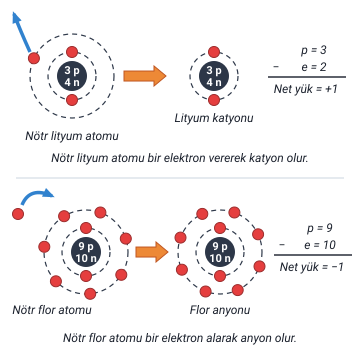
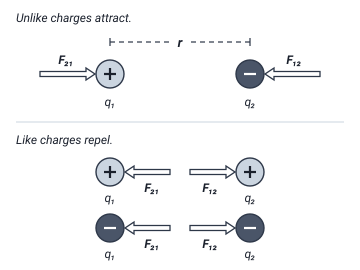
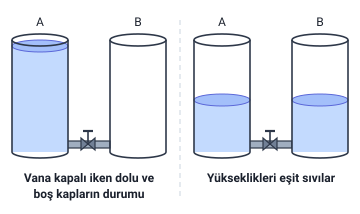
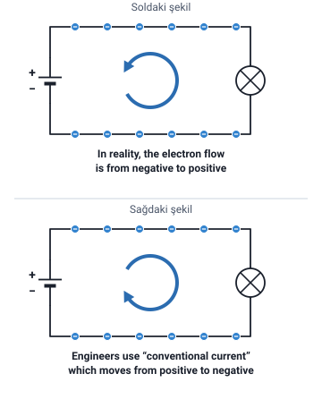

### Nötr madde ve iyonlar

Bilindiği gibi atomların normal şartlarda **proton ve elektron sayıları eşittir**. Bunun anlamı, bir etkiye maruz kalmamış maddeler **yüksüz (nötr)** hâldedirler.

Şayet madde atomları:

- **elektron kaybetmişlerse** **pozitif (+) iyon** veya **katyon**,
- **elektron kazanmışlarsa** **negatif (−) iyon** veya **anyon**

durumuna geçecektir.

> **Dikkat:** Elektron **kaybeden** atom **pozitif (+) iyon**, yani **katyon**; elektron **kazanan** atom **negatif (−) iyon**, yani **anyon** olur.

> **Ek:** Lityum ve flor örnekleri yalnızca şekilde geçer, slayt metninde yoktur. Şekilde net yük, proton sayısından elektron sayısı çıkarılarak bulunur: lityum katyonunda 3 − 2 = +1, flor anyonunda 9 − 10 = −1. Elektron eksi yüklü olduğu için elektron kaybeden atomda artı yük, elektron kazanan atomda eksi yük fazla kalır. Şekilde çekirdeğe lityum için 3 p ve 4 n yazılıdır (p proton, n nötron, e elektron sayısı). Hocanın şeklinde flor çekirdeğine 9 p ve **9 n** yazılıdır; flor atomunda nötron sayısı 10'dur, bu yüzden buradaki şekilde 10 n çizildi. Nötron yüksüz olduğu için bu fark net yük hesabını etkilemez.

### Elektrik yükü ve birimi

- **Elektrik yükü:** bir maddedeki atomların yüklerinin toplamı şeklinde tanımlanabilir.
- **Q** ya da **q** harfleri ile gösterilir. Birimi **Kulon (Coulomb)**'dur ve **C** ile gösterilir.
- **1 Coulomb:** **6,24 · 10¹⁸** tane elektronun taşıdığı yük miktarıdır.

> **Dikkat:** **Q** (ya da q) yükün harfi, **C** ise biriminin (coulomb) kısaltmasıdır. Slaytta sayı "6,24.10" ve küçük yazılmış bir "18" diye görünür; doğrusu 6,24 · 10¹⁸, yani 6,24 ile 10 üzeri 18'in çarpımıdır.

> **Ek:** Bir elektronun yükü yaklaşık 1,602 · 10⁻¹⁹ coulombdur; 1 / (1,602 · 10⁻¹⁹) ≈ 6,24 · 10¹⁸ eder. "Kulon", Fransız fizikçi Charles-Augustin de Coulomb'un adının Türkçe yazılışıdır; hoca iki yazımı da kullanır.

### Coulomb kanunu

- **Farklı** iki yük arasında **çekme** ve **aynı** iki yük arasında **itme** kuvveti vardır.
- **Kulon Kanunu**, cisimlerin elektriksel yüklerinin birbirlerine etkisini tanımlar ve açıklar.

Slayttaki ikinci şekilde ("Electrostatic Force - Coulomb's Law") kanunun formülü verilir:

**F = k · q₁ · q₂ / r²**

| Harf | Şekildeki açıklama | Türkçesi |
| --- | --- | --- |
| F | electrostatic force | elektrostatik kuvvet |
| q | electric charge | elektrik yükü |
| r | distance between charge centers | yük merkezleri arasındaki uzaklık |
| k | Coulomb constant: 9.0 X 10⁹ N · m²/C² | Coulomb sabiti: 9,0 · 10⁹ N · m²/C² |

> **Dikkat:** "Farklı iki yük", şekilde biri artı (+), öteki eksi (−) olan yüklerdir ("Unlike charges attract": farklı yükler çeker). "Aynı iki yük", ikisi de artı ya da ikisi de eksi olan yüklerdir ("Like charges repel": aynı yükler iter).

> **Ek:** Formül, harflerin açıklamaları ve k sabitinin değeri slayt metninde değil, yalnızca bu iki şekilde (İngilizce) geçer; tablodaki Türkçe karşılıklar çeviridir. Şekilde q₁'in yanındaki kuvvet oku F₂₁, q₂'nin yanındaki F₁₂ diye adlandırılmıştır: çekmede oklar öteki yüke doğru, itmede öteki yükten uzağa doğrudur. Formüle göre yükler büyüdükçe kuvvet artar; aradaki uzaklık iki katına çıkınca kuvvet dörtte birine iner, çünkü r'nin karesi paydadadır. N (newton) kuvvetin birimidir.

### Akım

- **Akım:** bir iletken maddede **serbest elektronların** bir noktadan başka bir noktaya **hareketidir**. Birimi **amperdir**.
- Elektronun hareketi ile belirli bir yük bir noktadan diğerine taşınabilmektedir.

Serbest elektronlar, "Atom, İletken, Yarı İletken ve Yalıtkan" konusunda anlatılan, atomların dış yörüngelerindeki valans elektronlarıdır.

Hocanın akımla ilgili maddeleri:

- Elektrik yüklerinin hareketi **akım** olarak adlandırılır.
- Akım, **birim zamanda** hareket eden birim yüke denir.
- **Pozitif yük yönü** akım yönünü verir.
- **Elektron hareketinin tersi** akım yönüdür.
- Elektrik potansiyelinin **yüksek** olduğu uç **(+)**, **düşük** olduğu uç **(−)** ile gösterilir. Akım **yüksek potansiyelden düşük potansiyele** akma eğilimindedir.
- Birimi **Amper (A)** veya **Coulomb/s**'dir.

> **Dikkat:** "Akım, birim zamanda hareket eden birim yüke denir" maddesinde hocanın ifadesi korundu. Akım, birim zamanda (1 saniyede) geçen yük miktarıdır: Q = I · t formülünden I = Q / t yazılır. Buradaki "birim yük" sözünü yükün kendisiyle (Q) karıştırmayın.

### Taşınan yük miktarı ve amper

Elektronların hareketiyle taşınan yük miktarı:

**Q = I · t (Amper · Saniye) = Kulon (Coulomb)**

- **1 Amper:** Bir iletken kesitinden **1 saniyede** **6,24 · 10¹⁸ elektron (1 C)** geçiyorsa bu akımın şiddeti **1 amperdir**.

> **Ek:** Slaytta harflerin adı yazmaz, birimlerinden anlaşılır: Q taşınan yük (coulomb), I akım (amper), t süredir (saniye). Formül I = Q / t diye de yazılabilir: akım, iletken kesitinden bir saniyede geçen yük miktarıdır. Hocanın "Birimi Amper (A) veya Coulomb/s'dir" maddesi bunu söyler: 1 A = 1 C/s. Örneğin 2 A'lik akım 5 saniyede 2 · 5 = 10 C yük taşır. Süre dakikayla verilirse önce saniyeye çevrilir (1 dakika = 60 saniye).

### Gerilim ve volt

- Gerilimin birimi **volt**'tur.
- **1 Volt:** Bir noktadan başka bir noktaya **1 coulomb'luk yükü** hareket ettirmek için **1 joule'lük enerji** kullanıldığı zaman, iki nokta arasındaki potansiyel fark miktarına **bir voltluk gerilim** denir.

**V = W / Q = (Joule / Coulomb) = Volt**

> **Dikkat:** Formülün başındaki **V** gerilimin harfidir; sondaki **Volt** gerilimin birimidir. Hoca gerilim kaynağını ve elektriksel işi anlatırken gerilimi **U** harfiyle gösterir; V ve U aynı büyüklüğü (gerilimi) gösterir. Bu formüldeki **W** ise iştir (enerjidir); "İş, Güç ve Direnç" konusunda güç maddesinin yanındaki (W), gücün birimi watt'tır.

> **Ek:** Slaytta W ile Q'nun adı yazmaz, birimlerinden anlaşılır: joule iş ve enerjinin, coulomb yükün birimidir. Örneğin 2 C'luk yükü taşımak için 24 J enerji kullanılıyorsa gerilim 24 / 2 = 12 V olur.

### Gerilim, iş ve EMK

- İletken üzerinde elektronu belli bir yönde hareket ettirebilmek için belli bir **iş ya da enerji transferi** gerekmektedir.
- Bu iş harici bir **elektromotor kuvveti (EMK)** ile gerçekleşir.
- Gerilim, elektronların hareketi için harcanan enerjinin **birim yük başına** değeridir.
- Gerilim, **birim yükü a noktasından b noktasına taşımak için gereken iş (enerji)** olarak tanımlanır.
- **EMK**, **gerilim (voltage)** ya da **potansiyel farkı** olarak da bilinir.

> **Ek:** Slaytta üçüncü ve dördüncü maddenin öznesi yazmaz; maddeler gerilim başlığı altındadır. "Birim yük başına enerji" V = W / Q formülünün sözle söylenişidir. EMK, 5. haftada ölçme konularıyla birlikte ayrıca anlatılır.

### Gerilim kaynağı

- Elektrik yüklü taşıyıcıları harekete geçiren, yani akımın artmasını sağlayan bir **kuvvet** olmalıdır.
- Biz iletkende elektronları harekete geçirerek elektrik akımı oluşturmak için iletkenin uçlarına **"iki ucu arasında elektron açısından potansiyel fark bulunan"** bir yapı bağlamalıyız.
- Bu yapı devrede görülen **gerilim kaynağıdır**.
- Uçları arasında potansiyel fark oluşturulan, yani **gerilim üreten** bu yapılara **gerilim kaynağı**, **kaynak** veya **üreteç** denir.

Hoca bu anlatımın yanında üç resim gösterir: kaynağa bağlanmamış bir iletken ve lamba; bir pile ve lambaya bağlı devrede dolaşan elektronlar; altta vanalı bir boruyla birbirine bağlı iki su kabı. Su kapları resmi 1 volt tanımının yanında da vardır:

> **Ek:** Su kapları resmi slaytta açıklanmaz; gerilimi anlatmak için kullanılan yaygın bir benzetmedir. Vana kapalıyken dolu A kabı ile boş B kabı arasında bir seviye farkı vardır; bu fark potansiyel farka (gerilime) benzer. Vana açılınca su A'dan B'ye akar (akıma benzer) ve iki kaptaki suyun yüksekliği eşit olunca akış durur: seviye farkı kalmayınca akış da kalmaz. Akımın sürmesi için uçlar arasındaki farkı sürekli koruyan bir gerilim kaynağı bu yüzden gerekir. Resimdeki yazılar ("Vana kapalı iken dolu ve boş kapların durumu", "Yükseklikleri eşit sıvılar", A, B) yalnızca resimde geçer.

### Elektron akışı ve akımın sürekliliği

Hoca slayttaki soldaki şekli şöyle anlatır:

- **U** gerilim kaynağının, yani **pilin**, **(+) ucunda elektron eksikliği** ve **(−) ucunda elektron fazlalığı** vardır.
- Kaynak bir **R direncine (ampul)** bağlanırsa **(−) kutuptan (+) kutba** doğru bir **elektron akışı** başlar.
- Gerilim kaynağı kendi **elektromotor kuvveti** yardımıyla (+) kutba ulaşan elektronları (−) kutba aktararak (+) ve (−) kutuplardaki elektron yoğunluklarının sürekli olarak **sabit kalmasını** sağlar. Böylece **akımın sürekliliği** sağlanır.

> **Dikkat:** Dış devrede (ampulden geçerek) elektronlar **(−) kutuptan (+) kutba** gider. Gerilim kaynağı ise (+) kutba ulaşan elektronları kendi elektromotor kuvvetiyle yeniden **(−) kutba** aktarır; kutuplardaki elektron yoğunlukları böylece sabit kalır.

### Elektron akış yönü ve kabul edilen akım yönü

Devrede akım yönü **aslında elektron akış yönüdür**. Ancak bilim insanları yıllar önce akım ile ilgili araştırmalar yaparken akımın yönünün **pozitif kutuptan negatif kutba** doğru olduğunu düşünmüşler ve birçok bilimsel çalışmalarını buna göre yapmışlardı. Bunun için devredeki akımın yönünün günümüze kadar **pilin pozitif kutbundan negatif kutbuna** doğru olduğu **kabul edilmiştir** (sağdaki şekil).

| Yön | Nereden nereye | Slayttaki şekil |
| --- | --- | --- |
| Elektron akış yönü | (−) kutuptan (+) kutba | Soldaki şekil |
| Kabul edilen akım yönü | (+) kutuptan (−) kutba | Sağdaki şekil |

> **Dikkat:** Hoca akım yönünden iki yerde söz eder. Akım slaytında "Pozitif yük yönü akım yönünü verir", "Elektron hareketinin tersi akım yönüdür" ve "Akım yüksek potansiyelden düşük potansiyele akma eğilimindedir" der: bunlar kabul edilen akım yönünü, yani (+)'dan (−)'ye yönü anlatır. Burada ise "Devrede akım yönü aslında elektron akış yönüdür" der. İkisini karıştırmayın: **elektronlar (−) kutuptan (+) kutba** akar; **akımın yönü** ise günümüze kadar **(+) kutuptan (−) kutba** doğru kabul edilmiştir.

> **Ek:** Şekillerdeki İngilizce yazılar yalnızca şekilde geçer. "In reality, the electron flow is from negative to positive": gerçekte elektron akışı negatiften pozitife doğrudur. "Engineers use “conventional current” which moves from positive to negative": mühendisler pozitiften negatife doğru hareket eden "geleneksel akımı" kullanır. Kabul edilen akım yönüne başka kaynaklarda "geleneksel akım yönü" de denir. Slayttaki resimlerde pil ve ampul resim olarak çizilidir; buradaki şekilde sembolleriyle gösterildi.

### Yük, akım ve gerilimin karşılaştırması

| Büyüklük | Harf | Birim | Hocanın formülü | 1 birimin tanımı |
| --- | --- | --- | --- | --- |
| Elektrik yükü | Q ya da q | Kulon (Coulomb), C | Q = I · t | 6,24 · 10¹⁸ tane elektronun taşıdığı yük miktarı |
| Akım | I | Amper (A) veya Coulomb/s | Q = I · t | Bir iletken kesitinden 1 saniyede 6,24 · 10¹⁸ elektron (1 C) geçiyorsa akım 1 amperdir |
| Gerilim | V (gerilim kaynağı ve elektriksel işte U) | Volt | V = W / Q | 1 coulomb'luk yükü hareket ettirmek için 1 joule'lük enerji kullanılıyorsa gerilim 1 volttur |
