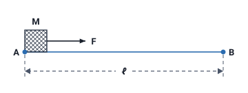

### Mekaniksel iş

Bir **M kütlesini** **A** noktasından **B** noktasına götürmek için **mekaniksel** olarak bir **iş** yapılır. Ve bu iş sonucunda **enerji** açığa çıkmaktadır.

**EM = F · ℓ = m · a · ℓ = (kg · m/s² · m) = Joule**

Formüldeki EM mekaniksel işi (enerjiyi) gösterir.

> **Dikkat:** Formülde **m** iki anlamda geçer: m · a · ℓ çarpımındaki m **kütledir**; parantezdeki birimlerde (kg · m/s² · m) m **metredir**. Hoca metinde ve şekilde kütleyi büyük **M** ile ("Bir M kütlesini"), formülde küçük **m** ile yazar; ikisi aynı kütledir.

> **Ek:** Slaytta F, m, a ve ℓ'nin adı yazmaz: F kuvvet, m kütle, a ivme, ℓ yoldur (şekilde A ile B arasındaki uzaklık). Slayttaki şekilde yol düz "l" diye yazılmıştır; buradaki şekilde formüldeki gibi ℓ kullanıldı. Kuvvet kütle ile ivmenin çarpımı olduğu için (F = m · a) F · ℓ = m · a · ℓ yazılır. kg kilogramın, m/s² ivmenin birimidir. Örneğin 2 kg'lık kütle 3 m/s² ivmeyle 5 m götürülürse EM = 2 · 3 · 5 = 30 J olur.

### Mekaniksel güç

**Güç:** Mekaniksel olarak **birim zamanda yapılan iştir**.

**P = EM / t = (Joule / Saniye) = (kg · m²/s³) = Watt**

> **Dikkat:** Slaytta mekaniksel güç formülü "P = EE / t" diye, elektriksel işin harfiyle (EE) yazılmıştır. Mekaniksel güçte bölünen mekaniksel iştir; notta EM yazıldı. Formülün geri kalanı (Joule / Saniye = kg · m²/s³ = Watt) slayttaki gibidir.

### Elektriksel iş

Mekaniksel işe benzer şekilde **U gerilimi** altında **Q yükü** hareket ettirilir ise **elektriksel iş** yapılmış olur. Bu durumda da **enerji** açığa çıkmaktadır.

**EE = U · Q = U · I · t = (Volt · Amper · Saniye) = (kg · m²/s²) = Joule**

Formüldeki EE elektriksel işi (enerjiyi) gösterir. Taşınan yük Q = I · t olduğu için ("Elektrik Yükü, Coulomb Kanunu, Akım ve Gerilim" konusu) U · Q yerine U · I · t yazılır.

> **Ek:** Örneğin 12 V gerilim altında 2 A akım 10 saniye geçerse EE = 12 · 2 · 10 = 240 J olur.

### Elektriksel güç

**Güç:** Elektriksel olarak **birim zamanda harcanan enerjidir**.

**P = EE / t = U · I = (Joule / Saniye) = (kg · m²/s³) = Watt**

> **Ek:** EE / t = U · I · t / t = U · I olduğu için elektriksel güç, gerilim ile akımın çarpımıdır. Örneğin 220 V gerilim altında 5 A akım çeken bir alıcının gücü 220 · 5 = 1100 W olur.

### Enerji ve güç üzerine maddeler

Hoca bu bölümü üç maddeyle özetler:

- **İş yapabilme kapasitesi** (Joule = Watt · sn)
- Devrede **harcanan toplam enerji**, devrenin **sağladığı toplam enerjiye** eşittir.
- **Güç:** harcanan ya da çekilen enerjinin **zamanla değişimidir** (W).

> **Dikkat:** **W** harfi derste iki ayrı anlamda geçer. Gerilim formülündeki **W** (V = W / Q) **iştir**, birimi joule'dür. Güç maddesindeki **(W)** ise gücün birimi **watt**'tır.

> **Ek:** İlk maddede neyin tanımlandığı yazmaz; birimi joule olduğu için madde enerjiyi (iş yapabilme kapasitesini) anlatır. Joule = Watt · sn: 1 watt gücündeki bir alıcı 1 saniyede 1 joule enerji harcar. Örneğin 100 W'lık bir alıcı 2 dakikada (120 saniyede) 100 · 120 = 12000 J enerji harcar.

### Birimlerin türetilmesi

Hocanın formüllerindeki birim eşitlikleri:

| Birim | Eşit olduğu birimler | Geçtiği formül |
| --- | --- | --- |
| Joule (iş, enerji) | kg · m/s² · m | EM = F · ℓ = m · a · ℓ |
| Joule | Volt · Amper · Saniye = kg · m²/s² | EE = U · Q = U · I · t |
| Joule | Watt · sn | İş yapabilme kapasitesi maddesi |
| Watt (güç) | Joule / Saniye = kg · m²/s³ | P = EM / t, P = EE / t = U · I |
| Volt (gerilim) | Joule / Coulomb | V = W / Q |
| Kulon (Coulomb, yük) | Amper · Saniye | Q = I · t |

> **Ek:** Mekaniksel işteki kg · m/s² · m, metreler çarpılınca kg · m²/s² olur (m · m = m²); bu ara adım slaytta yazmaz, ama elektriksel işin satırında hoca Joule'ü kg · m²/s² diye verir.

> **Dikkat:** Joule'de saniyenin üssü **2**'dir (kg · m²/s²), watt'ta **3**'tür (kg · m²/s³): watt, joule'ün saniyeye bölünmesidir.

### Mekaniksel ve elektriksel iş ve güç

| | Mekaniksel | Elektriksel |
| --- | --- | --- |
| İş nasıl yapılır | M kütlesi A noktasından B noktasına götürülür | U gerilimi altında Q yükü hareket ettirilir |
| İşin formülü | EM = F · ℓ = m · a · ℓ | EE = U · Q = U · I · t |
| Gücün tanımı | Birim zamanda yapılan iş | Birim zamanda harcanan enerji |
| Gücün formülü | P = EM / t | P = EE / t = U · I |
| Birimler | İş joule, güç watt | İş joule, güç watt |

### Direnç

**Dirençler**, elektrik akımına **zorluk gösteren** elektronik devre elemanlarıdır. Direnç değeri **yüksek** olursa içinden geçen akım değeri **düşük** olur. Bu olay **Alman** bilim adamı **Ohm** tarafından **1827** yılında bulunmuştur.

Ohm'un 1827'deki çalışması "Elektriğin Kısa Tarihçesi" konusunda da geçer. İletken ve yalıtkanın dirence göre tanımı "Atom, İletken, Yarı İletken ve Yalıtkan" konusundadır. Hoca 9. haftada dirençler konusuna bu slaytı tekrarlayarak başlar; orada yalnızca tipler cümlesi yoktur.

### Direncin gösterimi ve birimi

Direnç **"R"** harfi ile gösterilir, birimi **ohm**'dur. **Omega** simgesi ile gösterilir (**Ω**).

> **Dikkat:** **R** direncin harfi, **Ω** (omega) ise biriminin (ohm) simgesidir. Ohm, hem direncin akımla ilişkisini bulan bilim adamının adı hem de direncin birimidir.

### Direncin kullanım amaçları ve tipleri

- Dirençler **akımı sınırlamak**, **gerilimi bölmek** ve **ısı üretmek** amacıyla kullanılırlar.
- Dirençler **sabit** ve **değişken** (1- **potansiyometre**, 2- **reosta**) değerli olmak üzere **2 tipte** yapılırlar.

| Tip | Hocanın andığı örnekler |
| --- | --- |
| Sabit değerli | Slaytta örnek yok |
| Değişken değerli | Potansiyometre, reosta |

> **Ek:** Slayttaki fotoğraflarda potansiyometreler ve üzerinde "Laboratuvar tipi sürgülü reostalar, 100 watt'tan 1000 watt'a kadar" yazan reostalar vardır; bu yazı yalnızca fotoğrafta geçer. Direnç çeşitleri 9. haftada ayrıca anlatılır.
