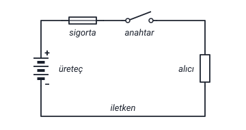

### Elektrik devresinin tanımı

Hoca elektrik devresini iki biçimde tanımlar:

- **Tanım 1:** Üreteç, sigorta, anahtar, alıcı (yük) ve iletkenden oluşan akımın geçtiği yola **elektrik devresi** denir.
- **Tanım 2:** Üreteçten çıkan akımın; sigorta, anahtar, alıcı (yük) ve iletkenden geçerek **tekrar üretece gelmesi** için izlediği yola **elektrik devresi** denir.

> **Dikkat:** İki tanımda aynı beş eleman sayılır. Tanım 2, akımın üreteçten **çıkıp yeniden üretece döndüğünü** de söyler: devre, akımın gidip geldiği bir yoldur.

> **Ek:** Şekildeki semboller: üreteç uzun ve kısa çizgi çiftleriyle, sigorta içinden tel geçen küçük bir dikdörtgenle, anahtar iki kontak ve kalkık bir dille, alıcı dikdörtgenle gösterilmiştir. Sembollerin adları yalnızca şekilde yazılıdır.

### Üreteç

**Üreteç (batarya, kaynak):** Elektrik devresindeki **alıcıların çalışabilmesi** için gerekli olan **elektrik enerjisini üreten** elemandır. Üreteç çeşitleri şunlardır:

| Üreteç çeşidi | Hocanın örnekleri |
| --- | --- |
| Doğru akım kaynakları | Pil, akümülatör, dinamo, güneş pili |
| Alternatif akım kaynakları | Alternatör |

"Gerilim kaynağı, kaynak veya üreteç" tanımı "Elektrik Yükü, Coulomb Kanunu, Akım ve Gerilim" konusundadır.

> **Ek:** Akü, akümülatörün kısaltılmış adıdır. Güneş piline "Elektrik Enerjisinin Üretiminde Kullanılan Kaynaklar" konusunda foto pil denir. Doğru akım ve alternatif akım dersin ilerleyen haftalarında ayrıca anlatılır.

### Gerilim üretme yöntemleri

| Yöntem | Hocanın örneği |
| --- | --- |
| 1. İndüksiyon (manyetik alan) yoluyla | Dinamo ve alternatör (barajlarda) |
| 2. Kimyasal etki yoluyla | Pil, batarya, akü |
| 3. Işık yoluyla | Güneş pili |
| 4. Isı yoluyla | Termo kupl = termo eleman |
| 5. Sürtünme yoluyla | Statik elektrik deneyi |

> **Dikkat:** **Dinamo** da **alternatör** de indüksiyon (manyetik alan) yoluyla gerilim üretir; ama üreteç çeşitlerinde dinamo **doğru akım**, alternatör **alternatif akım** kaynağıdır.

> **Ek:** Termo kupl bitişik "termokupl" diye de yazılır; iki farklı metalin birleşim yeri ısıtılınca uçları arasında gerilim oluşan elemandır. Alternatörün barajlarda kullanılışı "Elektrik Enerjisinin Üretiminde Kullanılan Kaynaklar" konusundaki hidroelektrik santrallerde, statik elektrik deneyi "Elektriğin Kısa Tarihçesi" konusunda geçer.

### Doğru gerilim ve alternatif gerilim

Hoca gerilim üretme yöntemlerinin altına şu notu yazar. Bütün bu üretim şekillerinde:

1. **Pozitif yükler bir kutupta** ve **negatif yükler bir kutupta** sürekli kalıyorsa bir **doğru gerilim**,
2. **Kutupların yük cinsleri (polaritesi) sürekli değişiyor** ise bir **alternatif gerilim**

üretiliyor demektir.

> **Dikkat:** Doğru gerilimde kutupların yük cinsi **değişmez**; alternatif gerilimde kutupların yük cinsi (polaritesi) **sürekli değişir**.

### Alıcı (yük)

**Alıcı (yük):** Elektrik enerjisini **başka enerjilere çeviren** elemanlara alıcı denir.

| Hocanın örneği | Neye çevirir | Yük türü |
| --- | --- | --- |
| Ütü | Akımı ısıya çevirir | R yükü |
| Lamba | Akımı ışığa çevirir | R yükü |
| Motor | Akımı hareket enerjisine çevirir | RL yükü |

> **Ek:** Slaytta "R yükü" ve "RL yükü" açıklanmaz. R yükü yalnızca direnç gibi davranan (omik) yüktür. RL yükünde direncin yanında bobin de vardır; motorun sargıları bobin gibi davranır. Bobinler dersin ilerleyen haftalarında anlatılır.

### İletken

**İletken:** Kaynak ve yük arasında **elektrik akımının dolaşımını** sağlamak için **bakır, alüminyum** gibi metallerden yapılan elemandır.

**Not:** Elektrikli yüklerin beslenmesinde kullanılan iletkenler **rastgele seçilmez.** Örneğin konutlardaki:

- **Priz** sortilerinin beslenmesinde **en az 2,5 mm²**,
- **Lamba** sortilerinin beslenmesinde **en az 1,5 mm²**

kesitinde **yalıtkanlı bakır** iletkenler kullanılır.

> **Dikkat:** Konutlarda **priz** sortileri için en az **2,5 mm²**, **lamba** sortileri için en az **1,5 mm²**: prizlerin iletkeni daha kalındır. İkisinde de iletken **yalıtkanlı bakırdır**.

> **Ek:** Sorti, tesisatta bir prizi ya da lambayı besleyen hattır. mm² iletkenin kesit alanının birimidir. Bakırın en çok kullanılan, alüminyumun hafif olduğu için uzun iletim hatlarında kullanılan iletken olduğu "Atom, İletken, Yarı İletken ve Yalıtkan" konusunda geçer.

### İletken kesitleri tablosu

Hocanın tablosu, kablo kesitine göre kablonun **emniyetle taşıyabileceği akım şiddetini** ve kullanıldığı yerleri verir:

| Kablo kesiti (mm²) izolesi | Emniyetle taşıyabileceği akım şiddeti (amper) | Kullanıldığı yer |
| --- | --- | --- |
| 0,75 | 4 | Gösterge devrelerinde |
| 1 | 6 | Düşük güçlü aydınlatma sistemlerinde |
| 1,5 | 10 | Yüksek güçlü aydınlatma sistemlerinde |
| 2,5 | 15 | Farlar ve motorlar |
| 4 | 20 | Yüksek güçlü motorlar, selenoidler |
| 6 | 25 | Normal kapasiteli genel akım ve şarj |
| 10 | 35 | Yüksek kapasiteli genel akım ve şarj |
| 35–150 | 125–325 | Marş kabloları |

> **Dikkat:** Slaytta tablonun üçüncü sütununun başlığı da yanlışlıkla ikinci sütunun başlığıyla aynı ("Emniyetle taşıyabileceği akım şiddeti (Amper)") yazılmıştır. Sütunda kullanım yerleri sıralandığı için notta "Kullanıldığı yer" denildi.

> **Dikkat:** Kesit büyüdükçe kablonun emniyetle taşıyabileceği akım da büyür. Tabloda 1,5 mm² kablo **10 A**, 2,5 mm² kablo **15 A** taşır.

> **Ek:** Tablodaki kullanım yerlerinin bir kısmı (farlar, marş kabloları, şarj) taşıt elektriğine ait adlardır; konutlardaki priz ve lamba için hocanın verdiği en küçük kesitler yukarıdaki iki maddededir. "İzolesi" izoleli (yalıtkanlı) kablo demektir. Selenoid, "solenoid" diye de yazılır.

### Bir iletkenin direncinin bulunması

Doğada bulunan her maddenin, iletken kabloların (tellerin) ve elektrik aygıtlarının **bir direnci vardır**.

Bir iletkenin direnci; **boyu (L)**, **kesiti (A)** ve **özgül direncine (ρ)** bağlı olarak hesaplanır:

**R = ρ · L / A = L / (ℵ · A)**

| Harf | Anlamı | Birimi ya da okunuşu |
| --- | --- | --- |
| L | İletkenin boyu | Birimi metre |
| A | İletkenin kesiti | Birimi mm² |
| ρ | İletkenin özgül direnci | Okunuşu "ro" |
| ℵ | 1 / ρ | Okunuşu "Alef" |

**ℵ = 1 / ρ:** Özgül direnç çok küçük olduğundan, hesaplamalarda hata yapmamak amacıyla kullanılır.

> **Dikkat:** Slaytta "Bir iletkenin direnci; Boyu (L), Kesiti (A) ve **Özgül Ağırlığına** (ρ) bağlı olarak hesaplanır" yazar. Aynı slaytta ρ "İletkenin Özgül Direnci" diye tanımlanır; doğrusu **özgül dirençtir**. Notta düzeltildi.

> **Dikkat:** Formülde L **metre**, A **mm²** alınır. Uzunluk kilometreyle verilirse önce metreye çevrilir: hocanın örneğinde 1 km, formüle **1000** diye girer.

> **Dikkat:** Hoca formülde ℵ (Alef) işaretini kullanır; aşağıdaki tablonun başlığında ve Örnek 1'deki "χcu = 56" değerinde ise aynı büyüklük için başka bir işaret vardır (slaytta χ'ye benzeyen ϗ; notta χ diye yazıldı). İkisi de 1 / ρ'dur. χcu'daki **cu**, bakırın kimyasal simgesidir (Cu): χcu = 56, bakırın değeri demektir.

> **Ek:** ℵ, İbrani alfabesinin ilk harfidir. Başka kaynaklarda 1 / ρ'ya **öz iletkenlik** (iletkenlik katsayısı) denir ve χ (ki) ya da κ (kappa) harfiyle gösterilir. L metre, A mm² alındığında ℵ'nin birimi m / (Ω · mm²), ρ'nun birimi Ω · mm² / m olur: bakır için ρ = 1 / 56 ≈ 0,0179 Ω · mm² / m. Formüle göre iletken uzadıkça direnci artar, kesiti büyüdükçe direnci azalır. Direncin tanımı ve birimi (ohm, Ω) "İş, Güç ve Direnç" konusundadır.

### Direncin ısıya göre değişmesi

**R₂ = R₁ · [1 + α · (t₂ − t₁) + β · (t₂ − t₁)²]**

- **R₁:** t₁ anındaki direnç değeri
- **R₂:** t₂ anındaki direnç değeridir.
- **α ve β** malzemenin **ısıl katsayılarıdır**.
- **1000 °C'nin altında β ihmal edilir.**

Hocanın tablosu (değerler 20 °C içindir):

| İletken | χ (20 °C) | α (20 °C) | β (20 °C) |
| --- | --- | --- | --- |
| Bakır | 56 | 3,93 | 0,6 |
| Alüminyum | 35 | 3,77 | 1,3 |
| Wolfram | 18 | 4,1 | 1 |
| Krom-nikel (Cr-Ni) | 0,91 | 0,2 | --- |

> **Dikkat:** β ihmal edilince (1000 °C'nin altında) formül **R₂ = R₁ · [1 + α · (t₂ − t₁)]** olur; hocanın Örnek 2'sindeki çözüm de böyledir.

> **Dikkat:** Tablonun α ve β sütunlarında çarpan (üs) ve birim yazmaz; Örnek 2'de ise α, çarpanı ve birimiyle **42 · 10⁻⁴ °C⁻¹** diye verilir. Tablodaki 3,93 formüle 3,93 diye girmez.

> **Ek:** t₁ ve t₂ sıcaklıklardır (°C); "t₁ anındaki direnç", iletken t₁ sıcaklığındayken ölçülen direnç demektir. Tablodaki α'nın çarpanı slaytta yazmadığı için bu kutuya alındı: 42 · 10⁻⁴ = 4,2 · 10⁻³ olduğundan, Örnek 2'deki α ile karşılaştırınca tablodaki α değerleri 10⁻³ ile çarpılmış değerler olarak okunur (bakır için 3,93 · 10⁻³ °C⁻¹); başka kaynaklarda da bakırın α'sı 20 °C için 3,93 · 10⁻³ 1/°C olarak verilir. β'nın çarpanı slayttan çıkarılamaz. Wolfram ampul flamanlarında kullanılan bir metal, krom-nikel ise ısıtıcı tellerinde kullanılan bir alaşımdır; tabloda krom-nikelin α'sının çok küçük olduğu görülür.

### Örnek 1: bakır telin direnci

Hocanın örneği: **1 km** uzunluğundaki bakır bir telin kesiti **35 mm²**'dir. Bu bilgilere göre telin direncini hesaplayınız. (χcu = 56)

Hocanın çözümü:

**R = ρ · L / A = L / (ℵ · A) = 1000 / (56 · 35) = 0,51 Ω**

> **Ek:** Ara adımlar: 1 km = 1000 m; 56 · 35 = 1960; 1000 / 1960 = 0,5102 Ω, yuvarlanınca 0,51 Ω. Slaytta çarpma işareti nokta (56 .35) olarak yazılmıştır.

### Örnek 2: ısınan sargıdan geçen akım

Hocanın örneği: Bir telden oluşturulmuş **15 °C** derecedeki sargıya **220 V** uygulandığında **10 A** geçmektedir. Gerilim aynı kalmasına rağmen bir süre sonra sargı sıcaklığının **40 °C**'ye yükseldiği gözleniyor. Son durumda sargılardan geçen akımı bulunuz. (α = 42 · 10⁻⁴ °C⁻¹)

Hocanın çözümü:

- R₁ = (220 / 10) = **22 Ω**
- R₂ = R₁ · [1 + α · (t₂ − t₁) + β · (t₂ − t₁)²]
- R₂ = 22 · [1 + 42 · 10⁻⁴ · (40 − 15)] = **24,31 Ω**
- I₁ = 220 / 22 = **10 A**
- I₂ = 220 / 24,31 = **9,049 A**

> **Dikkat:** Slaytta son sonuç **9,049 A** yazılıdır. 220 / 24,31 = 9,0498… olduğundan üç ondalığa yuvarlanınca **9,050 A** olur; slayttaki değer son basamakta kesilmiştir. İki ondalıkla ikisi de 9,05 A'dır.

> **Ek:** Ara adımlar: t₂ − t₁ = 40 − 15 = 25 °C; 42 · 10⁻⁴ · 25 = 0,105; 22 · 1,105 = 24,31 Ω. β verilmediği ve sıcaklık 1000 °C'nin altında olduğu için β'lı terim çözüme girmez. R₁ = 220 / 10 ve I = 220 / R adımları, gerilim, akım ve direnç arasındaki Ohm kanunudur; bu slaytta adı geçmez. Bağıntı 5. haftada, direncin ölçülmesi anlatılırken slayt 88'deki V-I-R üçgenlerinde V = I · R, I = V / R, R = V / I diye verilir (ölçme konusu, el-olcme). I₁ = 220 / 22 = 10 A satırı, bulunan R₁'in denetimidir. Hocanın sonuçlarına göre sargı ısınınca direnci artmış (22 Ω → 24,31 Ω), aynı gerilimde geçen akım azalmıştır (10 A → yaklaşık 9,05 A).

### Anahtar

Hoca devre elemanlarını iki gruba ayırır: üreteç, alıcı ve iletken **devre elemanları**; anahtar ve sigorta **yardımcı devre elemanlarıdır**.

**Anahtar:** Elektrik devresini **açıp kapamaya** yarayan araçtır. Anahtar açıldığında alıcıya giden **akım kesilir** ve alıcının **çalışması durur**.

> **Ek:** Slayttaki fotoğraflarda çeşitli anahtarlar (kollu, sürgülü, duvar tipi, I / O işaretli) vardır; adları slaytta yazmaz.

### Sigorta

**Sigorta:** Elektrik devresini, üreteci ve alıcıyı **aşırı akım geçişlerine karşı korumaya** yarayan elemandır. Uygulamada **buşonlu, otomatik, bıçaklı** ve benzeri sigortalar kullanılır.

> **Dikkat:** Anahtar devreyi **isteğe göre** açıp kapar; sigorta ise devreyi, üreteci ve alıcıyı **aşırı akıma karşı** korur. İkisi de yardımcı devre elemanıdır.

> **Ek:** Slayttaki fotoğraflarda cam sigortalar, buşonlu sigorta, otomatik sigortalar ve bıçaklı sigorta vardır.

### Devre elemanları ve yardımcı devre elemanları

| Grup | Eleman | Görevi |
| --- | --- | --- |
| Devre elemanları | Üreteç (batarya, kaynak) | Alıcıların çalışabilmesi için gerekli elektrik enerjisini üretir |
| Devre elemanları | Alıcı (yük) | Elektrik enerjisini başka enerjilere çevirir |
| Devre elemanları | İletken | Kaynak ve yük arasında elektrik akımının dolaşımını sağlar |
| Yardımcı devre elemanları | Anahtar | Elektrik devresini açıp kapamaya yarar |
| Yardımcı devre elemanları | Sigorta | Devreyi, üreteci ve alıcıyı aşırı akım geçişlerine karşı korur |
