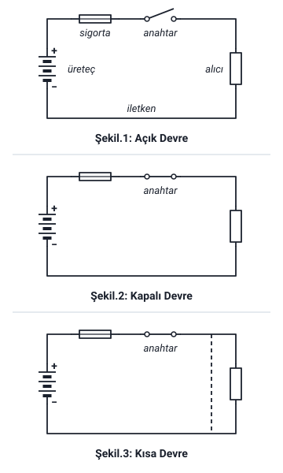

### Elektrik devre türleri

Elektrik devreleri **akımın alıcıdan geçiş durumuna göre** üç çeşittir: **açık devre**, **kapalı devre** ve **kısa devre**.

Devrenin elemanları (üreteç, sigorta, anahtar, alıcı, iletken) "Elektrik Devresi ve Devre Elemanları" konusundadır. Şekil 1, o konudaki devre şeklinin aynısıdır; Şekil 2 ve 3'te yalnızca anahtar adlandırılmıştır.

Hoca 5. haftaya ("5. Elektrik Devresi") bu slaytı tekrarlayarak başlar. Metin ve üç şekil aynıdır; yalnızca slaytın başlığı "4.8. Elektrik Devre Türleri" yerine "5. Elektrik Devresi"dir.

### Açık devre

**Açık devre:** Şekil 1'de görüldüğü gibi **anahtarın açık olduğu** ve **akımın geçmediği** devredir.

**Sigortanın atması**, **iletkenlerin kopması**, **ek yerlerinin değmemesi** de açık devreyi oluşturur.

> **Ek:** Bu üç durumda da akımın yolu bir yerden kesilmiştir; anahtar açılınca olduğu gibi akım geçmez.

### Kapalı devre

**Kapalı devre:** Şekil 2'de görüldüğü gibi **devreye kumanda eden anahtarın kapalı olmasıdır**.

> **Ek:** Anahtar kapalıyken akım, "Elektrik Devresi ve Devre Elemanları" konusundaki ikinci tanımda anlatıldığı gibi üreteçten çıkar, sigorta, anahtar, alıcı ve iletkenden geçerek yeniden üretece döner.

### Kısa devre

**Kısa devre:** Şekil 3'te görüldüğü gibi, herhangi bir **arıza nedeniyle** akım **alıcıya gitmeden** devresini **kısa yoldan tamamlıyorsa** bu duruma kısa devre denir.

Hocanın notları:

1. İletkenlerin, **yalıtkan kaplamalarının özelliğini kaybetmesinden** ötürü **birbirine değmesi** de kısa devreyi oluşturabilir.
2. Elektrik akımı, **direncin en küçük olduğu yerden** geçmek ister. Kısa devre durumunda devreden **yüksek akım** geçer ve **sigorta atar**.

> **Dikkat:** Şekil 3'te kısa devre, anahtarla alıcı arasında iki teli birleştiren **kesik çizgiyle** gösterilir: akım alıcıya gitmeden bu kısa yoldan döner.

> **Ek:** Kısa yolun direnci alıcınınkinden çok küçük olduğu için akım alıcıyı değil bu yolu seçer ve devreden yüksek akım geçer. Sigortanın aşırı akıma karşı koruması burada işe yarar.

### Açık devre ile kısa devrenin farkı

| | Açık devre | Kısa devre |
| --- | --- | --- |
| Hocanın tanımı | Anahtarın açık olduğu ve akımın geçmediği devre | Akımın arıza nedeniyle alıcıya gitmeden devresini kısa yoldan tamamlaması |
| Oluşturan durumlar | Sigortanın atması, iletkenlerin kopması, ek yerlerinin değmemesi | Yalıtkan kaplaması özelliğini kaybeden iletkenlerin birbirine değmesi |
| Akım | Geçmez | Yüksek akım geçer, sigorta atar |

> **Dikkat:** Ek yerlerinin **değmemesi** açık devreyi, iletkenlerin birbirine **değmesi** kısa devreyi oluşturur.

> **Dikkat:** Sigortanın atması açık devrenin **nedenlerinden** biridir; kısa devrede ise sigortanın atması bir **sonuçtur** (yüksek akım geçer ve sigorta atar). Sigorta attıktan sonra devre açık devre olur.

### Elektrik akımının etkileri

Hoca elektrik akımının beş etkisini sayar:

| Etki | Hocanın açıklaması | Hocanın örneği |
| --- | --- | --- |
| 1. Isı etkisi | İçerisinden akım geçen iletken ısınır | Ocak, ısıtıcı, fırın |
| 2. Işık etkisi | Elektrik ampulleri elektrik enerjisini ısı dolayısı ile ışık enerjisine çevirirler | (Örnek maddesi yok; tanımdaki elektrik ampulleri) |
| 3. Manyetik etkisi | İçerisinden akım geçen iletken etrafında bir manyetik alan oluşur | Motor, generatör, transformatör ve rölenin çalışma prensibi |
| 4. Kimyasal etkisi | İçerisinden akım geçen elektrolitlerde kimyasal bir değişim görülür | Pil ve akümülatörün çalışma prensibi |
| 5. Fizyolojik etkisi | Elektrik akımı hayvan ve insanların sinir ve kaslarına etki ederek canlılarda organik bozukluklar ve hatta ölümlere yol açabilir | 100–500 mA, geçiş süresine bağlı olmakla birlikte ölüme neden olur |

> **Dikkat:** Bu etkileri "Elektrik Devresi ve Devre Elemanları" konusundaki **gerilim üretme yöntemleriyle** karıştırmayın. Orada ısı, ışık, kimyasal etki ve manyetik alan (indüksiyon) yoluyla gerilim **üretilir** (termo kupl, güneş pili, pil, dinamo ve alternatör). Burada ise iletkenden geçen **akım** ısı, ışık, manyetik alan ve kimyasal değişim **meydana getirir**.

### Isı etkisi

**Isı etkisi:** İçerisinden akım geçen **iletken ısınır.**

Örnek: **ocak, ısıtıcı, fırın**.

> **Ek:** Dirençlerin kullanım amaçlarından biri olan ısı üretmek ("İş, Güç ve Direnç" konusu) bu etkiye dayanır. Hocanın alıcı örneklerinden ütü de akımı ısıya çevirir.

### Işık etkisi

**Işık etkisi:** Elektrik **ampulleri** elektrik enerjisini **ısı dolayısı ile ışık** enerjisine çevirirler.

> **Dikkat:** Hocanın cümlesine göre ampul, elektrik enerjisini **önce ısıya**, ısı dolayısıyla **ışığa** çevirir; ışık etkisi burada ısı etkisine bağlıdır. Bu etkinin altında ayrı bir "Örnek" maddesi yoktur; örnek cümledeki ampullerdir.

### Manyetik etki

**Manyetik etkisi:** İçerisinden akım geçen iletken etrafında bir **manyetik alan** oluşur.

Örnek: **motor, generatör, transformatör** ve **rölenin** çalışma prensibi.

> **Ek:** Joseph Henry'nin bobinle güçlü manyetik alan yaratması ve elektrik motoru "Elektriğin Kısa Tarihçesi" konusunda geçer. Röle, bir bobinin manyetik alanıyla açılıp kapanan anahtardır.

### Kimyasal etki

**Kimyasal etkisi:** İçerisinden akım geçen **elektrolitlerde** kimyasal bir **değişim** görülür.

Örnek: **pil ve akümülatörün** çalışma prensibi.

> **Ek:** Elektrolitlerin (asit, baz ve tuz çözeltileri) iyi bir iletken olduğu "Atom, İletken, Yarı İletken ve Yalıtkan" konusunda geçer.

### Fizyolojik etki

**Fizyolojik etkisi:** Elektrik akımı hayvan ve insanların **sinir ve kaslarına** etki ederek canlılarda **organik bozukluklar** ve hatta **ölümlere** yol açabilir.

Örnek: **100–500 mA**, geçiş süresine bağlı olmakla birlikte **ölüme** neden olur.

> **Ek:** mA (miliamper), amperin binde biridir: 100–500 mA = 0,1–0,5 A. İnsan vücudunun iletken olduğu "Atom, İletken, Yarı İletken ve Yalıtkan" konusunda geçer.
