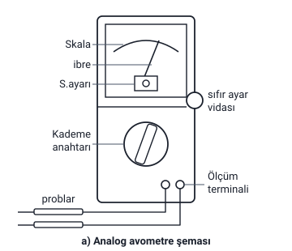
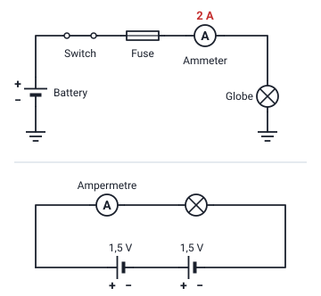
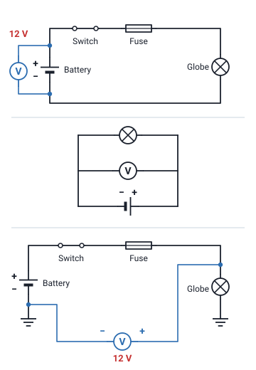
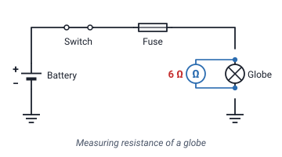
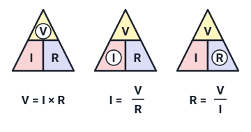

### Analog avometre (multimetre) ile ölçüm

5. haftanın İçindekiler slaytında "5. Elektrik Devresi" başlığı altında şu bölümler sayılır: 5.1 Elektrik ve elektronik büyüklükleri ölçme ve ölçü aletleri, 5.2 Akımın ölçülmesi, 5.3 Gerilimin ölçülmesi, 5.4 Direncin ölçülmesi, 5.5 Elektro motor kuvveti (EMK). İçindekiler'den sonraki ilk slayt devre türlerinin tekrarıdır ("Devre Türleri ve Elektrik Akımının Etkileri" konusu).

- Her şeyden önce analog avometre ile ölçüme başlamadan önce **sıfır ayarı** yapılmalıdır.
- Daha sonra ölçülecek büyüklük, **uygun kademe** seçildikten sonra **yalnız ait olduğu skala taksimatından** okunmalıdır (Ω, V, A gibi).
- Ayrıca skalanın bölümlendirilmesinde **aynı noktada alt alta birden fazla değer** yazılmıştır. Bu değerler, ölçülecek büyüklüğün kademesi değiştikçe, o kademe için skala taksimatındaki noktanın **yeni değeridir**.

> **Ek:** Şekildeki parça adları (skala, ibre, S.ayarı, sıfır ayar vidası, kademe anahtarı, ölçüm terminali, problar) yalnızca şekilde yazılıdır; slaytta açıklanmaz. Şekilde "Ölçüm Termina" diye kesik yazılmıştır (ölçüm terminali). Problar, ölçülecek yere değdirilen uçlardır; skala, ibrenin üzerinde gezdiği bölümlendirilmiş yaydır. Slaytta ayrıca bir analog avometre fotoğrafı ve analog avometreyle direnç ölçümünü gösteren bir fotoğraf vardır. Avometre adı amper, volt ve ohm'un baş harflerinden (AVO) gelir; hepsini ölçebildiği için multimetre (çok ölçer) de denir. Slaytta avometrenin tanımı yoktur. Devrede enerji olup olmadığına bakmak için kullanılan kontrol kalemi "El Takımları: Elektrik Alanında" konusundadır.

### Analog avometrede ölçülen değerin bulunması

Tüm ölçü aletlerinde olduğu gibi avometreler ile ölçüm yapılırken analog avometrelerde büyüklüğün tespiti için: **kademe anahtarının bulunduğu konum ile skaladan okunan değer çarpılarak** ölçülen büyüklüğün değeri tespit edilir.

Örneğin kademe anahtarı **X100** kademesinde iken skalada okunan değer, **100 ile çarpılarak** ölçülen büyüklüğün değeri bulunur.

Analog ölçü aletlerinde seçilen kademe ile okunan değer arasında sonuca ulaşmak için **işlem yapmak** gerekebilir. Hocanın iki örneği:

| Hocanın örneği | İbrenin gösterdiği | Hesap | Sonuç |
| --- | --- | --- | --- |
| AC 1000 V kademesinde alternatif gerilim ölçülüyor | 4 rakamının üzeri | Skalanın en son değeri 10 yerine 1000 V kabul edilince 4 değerinin de 400 V olması gerektiği orantı ile hesaplanır | 400 V |
| X100 kademesinde direnç ölçülüyor | Ω skalasında 10 rakamı | 10 · 100 = 1000 Ω | 1000 Ω = 1 kΩ |

> **Dikkat:** İki örnekte işlem farklıdır. **X100** gibi bir kademede okunan değer kademeyle **çarpılır** (10 · 100 = 1000 Ω; slaytta "10X100" diye yazılmıştır). **1000 V** kademesinde ise okunan 4, 1000 ile çarpılmaz: skalanın **en son değeri (10)** 1000 V kabul edilir ve 4'ün değeri **orantıyla** bulunur (10 → 1000 V ise 4 → 400 V).

> **Ek:** Orantı tek satırda şöyle yazılabilir: ölçülen değer = okunan değer · kademe / skalanın en son değeri = 4 · 1000 / 10 = 400 V. AC alternatif akımın (gerilimin) kısaltmasıdır. kΩ (kiloohm) 1000 Ω'dur; slaytta "1KΩ" diye yazılmıştır.

### Kademe seçimi

- Kademe seçiminin **doğru ve uygun** yapılması, ölçmedeki **hata oranını azaltan** en önemli faktörlerden biridir.
- Ölçme için kademe anahtarının konumu belirlenirken direnç değerine göre kademe tayin edildikten sonra ölçme yapılır. **Sapma miktarı az ise kademe küçültülür.**

> **Dikkat:** Slaytta "Sapma miktarı az ise kademe küçültülür" cümlesi, "direnç değerine göre kademe tayin edildikten sonra ölçme yapılır" cümlesinin hemen arkasından gelir. Notta hocanın ifadesi korundu.

> **Ek:** Kaynaklarda "sapma az ise kademe küçültülür" kuralı akım ve gerilim kademeleri için anlatılır; direnç (Ω) kademesinde ise bunun tersi anlatılır. Kaynaklara göre gerilim ya da akım ölçerken kademe küçültülünce (ör. 250 V'tan 50 V'a) aynı değer için ibre daha çok sapar ve daha rahat okunur. Analog avometrenin Ω skalası ise ters yönlüdür: slayt 83'teki fotoğrafta Ω skalasının 0'ı sağda, büyük değerleri solda yazılıdır (bu yalnızca fotoğrafta görülür). Kaynaklara göre Ω kademesinde ibrenin az sapması direncin büyük olduğunu gösterir ve bu durumda kademenin büyütülmesi (ör. X10'dan X100'e) önerilir.

### Dijital avometre (multimetre) ile ölçüm

- Dijital avometreler ile ölçüm yapmak **daha kolaydır**. Ancak bazı değerlerin ölçülmesinde analog avometrelerdeki kadar **hassas ölçüm yapılamaz**.
- Dijital avometreler ile ölçüm yapılırken değer **ekranında görünen değer, ölçülen değerin kendisidir**; ayrıca **hesaplama işlemi** yapılmasını gerektirmez.
- Dijital avometrelerde **direnç, endüktans ve kapasite** ölçümü aynen **LCR metrelerde** olduğu gibi yapılır.
- Akım ve gerilim ölçerken **AC-DC seçimi**, kademe anahtarı ile uygun kademe seçimi yapılırken yapılır; bazı avometrelerde ise **ayrı bir komütatör anahtar** aracılığı ile yapılmaktadır. Ölçüm yapılırken **bu seçim unutulmamalıdır.**

> **Dikkat:** Slayttaki son cümle iki yan cümlenin birleşmesiyle bozulmuştur: "Akım ve gerilim ölçerken AC-DC seçimi kademe anahtarı ile uygun kademe seçimi yapılırken bazı avometrelerde ayrı bir komütatör anahtar aracılığı ile yapılmaktadır." Notta iki cümleye ayrıldı.

> **Dikkat:** Analog avometrede ölçülen değer çoğu zaman kademe ile skaladan okunan değerden **hesaplanır**; dijital avometrede ekranda görünen değer **ölçülen değerin kendisidir**.

> **Ek:** Slayttaki "Tek kademeli ve çok kademeli avometre şeması" adlı şekilde iki dijital avometre vardır. Birinin altında "KADEME EL İLE SEÇİLİR" yazar; onda her büyüklük için birçok kademe vardır (doğru gerilimde 200m, 2000m, 20, 200, 1000 gibi). Ötekinin altında "KADEME OTOMATİK SEÇİLİR" yazar; onda her büyüklük için tek konum (V, Ω, mA, 10A) ve "AC◀▶DC AUTO-SELECTION" yazısı vardır. Bu bilgiler yalnızca şekilde geçer. DC doğru akımın, AC alternatif akımın kısaltmasıdır. LCR metre endüktansı (L), kapasiteyi (C) ve direnci (R) ölçen alettir; endüktans bobinlerin, kapasite kondansatörlerin konusudur ve dersin ilerleyen haftalarında anlatılır. Komütatör anahtar, burada AC ile DC arasında geçiş yapan ayrı anahtardır.

### Analog ve dijital ölçü aletlerinin avantaj ve dezavantajları

**Analog ölçü aletlerinin avantajları:**

- Ölçtükleri büyüklük ile bağlantıya geçtikleri anda ibreleri sapar. Yani **hızlı çalışırlar**.
- Daha basit yapılı olmaları sebebiyle **ucuzdurlar**. **Bakım ve onarımları kolaydır.**

**Analog ölçü aletlerinin dezavantajları:**

- Kadran alanı sınırlı olduğu için gerektiği gibi **taksimatlandırılma zorluğu** vardır. İbrenin gösterdiği değer **%1-3** arasında farklı olabilir.
- Ölçülen değerin okunmasındaki hassasiyet **kişiden kişiye** değişebilmektedir.
- **Okuma hızı** da kişiden kişiye değişir.
- **Elektromanyetik alandan etkilenirler.**
- **Mekanik arıza** yapma olasılıkları fazladır.

**Dijital ölçü aletlerinin avantajları:**

- Ölçülen değeri ekranda gösterdiği için **insandan kaynaklanan okuma hatalarını** ortadan kaldırırlar.
- Yapısından kaynaklanan hata, **%0,01** civarındadır.
- **Enerji sarfiyatları** çok azdır.
- **Elektromanyetik alandan** etkilenmeleri çok azdır.
- **Mekanik arıza** yapmazlar.

**Dijital ölçü aletlerinin dezavantajları:**

- Gösterge olarak **LCD veya LED** kullanıldığı için **uzaktan okunması zordur**.
- **Üretimi, onarımı, bakımı zordur.** Dolayısıyla **daha pahalıdır**.

| | Analog | Dijital |
| --- | --- | --- |
| Hata | İbrenin gösterdiği değer %1-3 arasında farklı olabilir | Yapısından kaynaklanan hata %0,01 civarındadır |
| Okuma | Hassasiyet ve okuma hızı kişiden kişiye değişir | Değer ekranda; insandan kaynaklanan okuma hatası yok; uzaktan okunması zor |
| Elektromanyetik alan | Etkilenirler | Etkilenmeleri çok azdır |
| Mekanik arıza | Olasılığı fazladır | Yapmazlar |
| Fiyat, bakım ve onarım | Ucuz; bakım ve onarımı kolay | Daha pahalı; üretimi, onarımı, bakımı zor |
| Diğer | Hızlı çalışırlar | Enerji sarfiyatları çok azdır |

> **Dikkat:** Hoca dijital avometre slaytında "bazı değerlerin ölçülmesinde analog avometrelerdeki kadar hassas ölçüm yapılamaz" der; bu slaytta ise dijital aletin yapısından kaynaklanan hatayı **%0,01**, analog aletin ibresinin gösterdiği değerdeki farkı **%1-3** olarak verir. İki ifade de hocanındır; "dijital alet her ölçümde daha hassastır" diye genelleme yapmayın.

> **Dikkat:** Bakım ve onarım analogda **kolay**, dijitalde **zordur**; analog **ucuz**, dijital **daha pahalıdır**. Elektromanyetik alandan analog **etkilenir**, dijital **çok az** etkilenir.

### Akımın ölçülmesi: ampermetre

Elektrik devrelerinde alıcıların yapmış oldukları iş karşılığında kaynaktan çektikleri **akım** değerini ölçen ölçü aletlerine **ampermetre** denir.

- Ampermetre devreye **seri bağlanır**. İç direnci **küçüktür (0,1-0,5 Ω)**.
- Eğer ampermetre devreye **paralel** olarak bağlanırsa devre ampermetre üzerinden **kısa devre** olur. **Ampermetre zarar görür.**

Kısa devre "Devre Türleri ve Elektrik Akımının Etkileri" konusundadır: elektrik akımı direncin en küçük olduğu yerden geçmek ister; kısa devre durumunda devreden yüksek akım geçer.

> **Ek:** Şekillerdeki adlar slayttaki resimde İngilizcedir ve yalnızca şekilde geçer: Battery (pil), Switch (anahtar), Fuse (sigorta), Ammeter (ampermetre), Globe (ampul). Ampermetrenin gösterdiği 2 A da yalnızca şekildedir. Üstteki şekilde pilin (−) ucu ve lamba, birbirine bağlı sayılan toprak (şase) sembollerine bağlanır; devre bu yoldan tamamlanır. Slayttaki resimlerde pil, ampul ve ölçü aleti resim olarak çizilidir; buradaki şekillerde sembolleriyle gösterildi. Ampermetrenin iç direnci çok küçük olduğu için paralel bağlanınca akım alıcıya gitmeden ampermetrenin üzerinden kısa yoldan geçer.

### Gerilimin ölçülmesi: voltmetre

Elektrik devrelerinde, **iki nokta arasındaki potansiyel farkı (gerilimi)** ölçen ölçü aletlerine **voltmetre** denir.

- Voltmetre devreye **paralel bağlanır**. İç direnci **çok büyüktür (10 kΩ, 100 kΩ)**.
- Voltmetre devreye **seri** bağlanırsa, **zarar görmez**.

> **Ek:** Slayttaki üç resimde voltmetre her seferinde ölçtüğü elemana paralel bağlıdır: ilkinde pilin iki ucuna, ikincisinde lamba ve pille paralel, üçüncüsünde (−) ucu pilin (−) ucuna, (+) ucu lambanın üst ucuna bağlıdır. Üçüncüde pilin (−) ucu ve lamba toprağa bağlı olduğu için voltmetre lambanın uçları arasındaki gerilimi ölçer. Voltmetrenin gösterdiği 12 V ve İngilizce adlar yalnızca şekilde geçer. Ortadaki resimde tellerin üzerindeki küçük ok uçları buradaki şekilde çizilmedi. Voltmetrenin iç direnci çok büyük olduğu için seri bağlanınca devreden çok küçük bir akım geçer; bu yüzden zarar görmez, ama devredeki alıcı da çalışmaz.

### Ampermetre ile voltmetrenin karşılaştırması

| | Ampermetre | Voltmetre |
| --- | --- | --- |
| Ne ölçer | Alıcıların kaynaktan çektikleri akım değerini | İki nokta arasındaki potansiyel farkı (gerilimi) |
| Devreye bağlanışı | Seri | Paralel |
| İç direnci | Küçük (0,1-0,5 Ω) | Çok büyük (10 kΩ, 100 kΩ) |
| Yanlış bağlanırsa | Paralel bağlanırsa devre ampermetre üzerinden kısa devre olur; ampermetre zarar görür | Seri bağlanırsa zarar görmez |

Direnci ölçen ohmmetre "Direncin ölçülmesi: ohmmetre" başlığındadır; ohmmetre ile direnç ölçümü yapılırken devrede gerilim olmamalıdır.

> **Dikkat:** **Ampermetre seri, voltmetre paralel** bağlanır; bunları karıştırmayın. İç direnç de terstir: ampermetreninki **küçük**, voltmetreninki **çok büyüktür**. Yanlış bağlanınca **ampermetre zarar görür**, **voltmetre zarar görmez**.

### Direncin ölçülmesi: ohmmetre

- Direnç değeri ölçümü yapılırken **alıcının uçları arasındaki gerilim** ve **alıcının çektiği akım** değerleri ölçülerek hesaplanabilir.
- Ya da bu işlemi tek başına yapabilen **ohmmetre** isimli ölçü aleti ile yapabiliriz. Ohmmetreler içlerinde **9 voltluk bir pil** sayesinde alıcı uçlarına bir gerilim uygular ve daha sonra alıcının çekmiş olduğu akım değerini ölçerek hesaplar.
- Ohmmetre ile direnç ölçümü yapılırken **devredeki kaynak kapalı olmalıdır**. Yani **devrede gerilim olmamalıdır.**

> **Dikkat:** Ohmmetre alıcıya **kendi içindeki 9 voltluk pille** gerilim uygular. Ölçülen devrenin **kaynağı** ise **kapalı** olmalıdır, yani devrede gerilim olmamalıdır.

> **Ek:** Şekildeki "Measuring resistance of a globe", "bir ampulün direncinin ölçülmesi" demektir. Şekilde lambanın iki ucundaki teller boşlukla ayrılmıştır: lamba devreden ayrılarak ölçülür. Ohmmetrenin gösterdiği 6 Ω yalnızca şekildedir.

### V, I ve R üçgenleri

Hoca direncin ölçülmesi slaytında gerilim (**V**), akım (**I**) ve direnç (**R**) arasındaki bağıntıyı üç üçgenle verir. Üçgenin üstünde V, altında yan yana I ve R vardır; her üçgende bulunacak harf daire içine alınmıştır:

**V = I · R**

**I = V / R**

**R = V / I**

| Daire içindeki harf | Altındaki formül |
| --- | --- |
| V (gerilim) | V = I · R |
| I (akım) | I = V / R |
| R (direnç) | R = V / I |

> **Ek:** Slaytta yalnızca üçgenler ve formüller vardır; üçgeni okuma yolu şöyle düşünülebilir: bulunacak harf kapatılınca I ile R yan yana kalırsa çarpılır (V = I · R); V üstte, R ya da I altta kalırsa V alttakine bölünür. Direncin, alıcının uçları arasındaki gerilim ve çektiği akım ölçülerek hesaplanması da R = V / I ile yapılır.

> **Dikkat:** Slaytta çarpma "x" ile yazılmıştır (V = I x R); notta "·" kullanıldı. Burada gerilimin harfi **V**'dir; hoca gerilim kaynağını ve elektriksel işi anlatırken gerilimi **U** harfiyle gösterir ("Elektrik Yükü, Coulomb Kanunu, Akım ve Gerilim" konusu). V ve U aynı büyüklüğü gösterir. Formüldeki V gerilimin harfi, volt (V) ise biriminin kısaltmasıdır.

> **Ek:** Bu bağıntıya **Ohm kanunu** denir; slaytta adı yazmaz. Ohm'un 1827'deki çalışması (direnç değeri yüksek olursa içinden geçen akım düşük olur) "Elektriğin Kısa Tarihçesi" ve "İş, Güç ve Direnç" konularında geçer. "Elektrik Devresi ve Devre Elemanları" konusundaki Örnek 2'nin çözümünde (R₁ = 220 / 10, I₂ = 220 / 24,31) de bu bağıntı kullanılır. Birimler: gerilim volt (V), akım amper (A), direnç ohm (Ω). Ohmmetrenin, uyguladığı gerilim ve ölçtüğü akımla direnci "hesaplaması" da R = V / I'dır.

### Elektromotor kuvveti (EMK)

- **EMK**; kısaca bir **kaynağın uçları arasındaki potansiyel farktır**. (Şekil-1)
- **Açık devrede**; kaynağın uçları arasındaki potansiyel fark da **EMK'dır**. (Şekil-2)
- **Kapalı devrede**, kaynağın uçlarına bağladığımız voltmetre ise **kaynağın gerilimini** ölçer.

Şekillerde kaynak **E**, anahtar **S** harfiyle gösterilir. Şekil-1'de kaynağa yalnızca voltmetre bağlıdır ("Kaynağın emk"). Şekil-2'de S anahtarı **açıktır**: kaynağın uçlarındaki voltmetre "Kaynağın emk" yazısıyla gösterilir. Şekil-3'te S anahtarı **kapalıdır**: hem kaynağın uçlarındaki hem yükün uçlarındaki voltmetrenin yanında "Kaynağın Gerilimi" yazar.

> **Dikkat:** Voltmetre kaynağın uçlarına iki şekilde de aynı biçimde bağlıdır; farkı anahtar yapar. **Açık devrede** (Şekil-2) ölçülen **EMK**'dır; **kapalı devrede** (Şekil-3) ölçülen **kaynağın gerilimidir**.

> **Ek:** Şekil-3'te yük, kaynağın uçlarına doğrudan (anahtar kapalıyken) bağlı olduğu için yükün uçları arasındaki gerilim de kaynak uçlarındaki gerilimdir; iki voltmetre bu yüzden aynı adla gösterilmiştir. Şekillerdeki "emk" küçük harfle yazılmıştır. "Elektrik Yükü, Coulomb Kanunu, Akım ve Gerilim" konusunda hoca, elektronu hareket ettiren işin harici bir elektromotor kuvveti (EMK) ile gerçekleştiğini söyler.

### EMK ile kaynağın gerilimi

Bir kaynak için **EMK > GERİLİM**'dir. Çünkü kaynak devreye enerji verirken **gerilimin bir kısmı kaynakta harcanır**.

Kapalı bir devre için:

**EMK = Kaynakta Düşen Gerilim + Kaynak Uçlarındaki Gerilim**

Hoca bu bölümde bir EMK örneği çözer ("EMK ÖRNEĞİNİ ÇÖZ"); örnek slaytta yoktur.

> **Dikkat:** "Elektrik Yükü, Coulomb Kanunu, Akım ve Gerilim" konusunda hoca "EMK, gerilim (voltage) ya da potansiyel farkı olarak da bilinir" der; burada ise "EMK > gerilim" der. İkisini şöyle ayırın: EMK, **açık devrede** kaynağın uçları arasındaki potansiyel farktır. **Kapalı devrede** voltmetrenin ölçtüğü kaynağın gerilimi EMK'dan **küçüktür**, çünkü gerilimin bir kısmı kaynakta harcanır (kaynakta düşen gerilim).

> **Ek:** Formülden öteki iki büyüklük de bulunur: kaynak uçlarındaki gerilim = EMK − kaynakta düşen gerilim; kaynakta düşen gerilim = EMK − kaynak uçlarındaki gerilim. Kaynakta gerilimin düşmesi başka kaynaklarda kaynağın iç direnciyle açıklanır; iç direnç sözü slaytta geçmez. Açık devrede akım geçmediği için kaynakta gerilim düşmez ve voltmetre EMK'yı ölçer.
