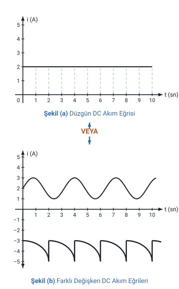
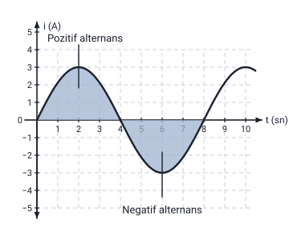
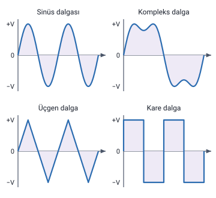
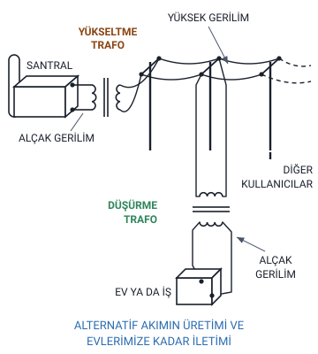
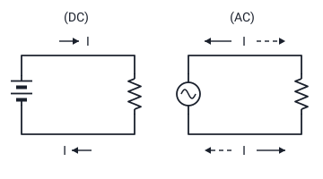

### Elektrik akımının çeşitleri

Hoca 7. haftada "Elektrik Akımının Çeşitleri" başlığı altında önce doğru akımı, alternatif akımı ve ikisinin karşılaştırmasını, ardından dirençlerin bağlantı şekillerini anlatır ("Dirençlerin Bağlantı Şekilleri" konusu). Haftanın öteki başlıkları (pil ve akümülatörde amper-saat oranı, doğru gerilim (DC) kaynaklarının seri ve paralel bağlanması, dirençlerin renk kodlarına göre değerlerinin okunması, topraklama) ayrı konulardadır.

**Elektrik akımı;** değerinin **zamana göre değişimine** göre **DOĞRU AKIM** ve **ALTERNATİF AKIM** diye ikiye ayrılır.

Hoca 14. haftada bu bölümü ("14. Elektrik Akımının Çeşitleri") yeniden anlatır. Doğru akım slaytı aynen tekrarlanır; alternatif akımın tanımında ve karşılaştırma slaytında değişiklikler vardır. Bunlar aşağıda ilgili başlıklarda verildi. 14. haftada alternatif akım başlığı "Alternatif Akım = AC = AA" diye yazılır.

> **Ek:** Elektrik akımının tanımı ve yönü "Elektrik Yükü, Coulomb Kanunu, Akım ve Gerilim" konusundadır. DC İngilizce "direct current" (doğru akım), AC "alternating current" (alternatif akım) sözlerinin kısaltmasıdır; DA ve AA Türkçe adların kısaltmasıdır.

### Doğru akım (DC, DA)

- Zamana bağlı olarak **yönü değişmeyen** akıma denir. (Şekil-a)
- Doğru akımın yönü değişmese de **şiddeti değişebilir**. (Şekil-b)

> **Dikkat:** Doğru akımda değişmeyen şey akımın **yönüdür**. Şiddeti (değeri) değişebilir: şiddeti değişmeyen doğru akım Şekil (a)'daki **düzgün** doğru akım, şiddeti değişen doğru akım Şekil (b)'deki **değişken** doğru akımdır.

> **Ek:** Şekillerde dikey eksen akımı (i, amper), yatay eksen zamanı (t, saniye) gösterir. Hoca iki şeklin arasına çift yönlü bir ok ve "VEYA" yazar: doğru akım ya Şekil (a)'daki gibi ya da Şekil (b)'deki gibi olabilir.

### Düzgün doğru akım

- Düzgün doğru akım **dinamolar, piller, akü ve bataryalardan** elde edilir.
- Şekil (a)'da zamanın **hangi anını** alırsak alalım akımın değerinde de **bir değişme yoktur**. Örneğin, akımın **2. ve 8. saniyelerdeki** değerlerine baktığımızda ikisinde de **2 A** olduğunu görmekteyiz.

"Elektrik Devresi ve Devre Elemanları" konusunda hoca doğru akım kaynaklarını pil, akümülatör, dinamo ve güneş pili diye sayar.

> **Ek:** Akü, akümülatörün kısaltılmış adıdır. Şekil (a)'da akım 0'dan 10. saniyeye kadar hep 2 A'dir; bu yüzden hangi saniyeye bakılırsa bakılsın değer 2 A okunur.

### Değişken doğru akım

Şekil (b)'de iki farklı **değişken doğru akım** eğrisi görülmektedir. Şekilde **birinci eğri pozitif** değere sahipken **ikinci eğri negatif** değere sahiptir.

> **Dikkat:** Şekil (b)'de birinci eğri pozitif, ikinci eğri negatif değerdedir; hoca **ikisini de değişken doğru akım** eğrisi sayar.

> **Ek:** Şekilde birinci eğri 1 A ile 3 A arasında dalgalanır; ikinci eğri her 2 saniyede −3 A'den −5 A'e iner ve yeniden −3 A'e döner. Bu değerler yalnızca şekildedir. İkinci eğri hiç sıfırı geçip pozitife çıkmaz; akımın işareti değişmediği için yönü de değişmez. Akımın işareti, dolayısıyla yönü, sürekli değişiyorsa akım alternatif akımdır (aşağıdaki şekildeki pozitif ve negatif alternans).

### Alternatif akım (AC, AA)

- Zamana bağlı olarak **hem yönü hem de şiddeti SİNÜS biçiminde** değişen akımlara denir.
- Alternatif akım denince akla **ilk olarak şebekeden çekilen akım** gelir.

> **Dikkat:** Hoca 14. haftada bu slaytı tekrarlarken tanımı değiştirir. 7. haftada: "hem yönü hem de şiddeti **SİNÜS biçiminde** değişen akımlara denir". 14. haftada: "Zamana bağlı olarak hem yönü hem de şiddeti **belirli bir düzende** değişen akımlara denir." Slaytın geri kalanı (şebeke cümlesi, dalga biçimleri cümlesi, bütün şekiller) iki haftada aynıdır. Notta iki ifade de korundu.

> **Dikkat:** Doğru akımda yalnızca **şiddet** değişebilir, yön değişmez. Alternatif akımda **hem yön hem şiddet** değişir.

> **Ek:** Şekildeki eğrinin eksenin üstünde kalan yarısının yanında "Pozitif alternans", altında kalan yarısının yanında "Negatif alternans" yazar; bu adlar ve eğrinin değerleri (en büyük değer 3 A, bir tam dalga 8 saniye) yalnızca şekildedir. Alternans, alternatif akımın yarım dalgasıdır; akım pozitif alternansta bir yönde, negatif alternansta öteki yönde akar. "Elektrik Devresi ve Devre Elemanları" konusunda hoca, kutupların yük cinsi (polaritesi) sürekli değişiyorsa alternatif gerilim üretildiğini söyler. Alternatif akımın yönleri ve sinüs dalgası 14. haftada ayrıca anlatılır.

### Dalga biçimleri

Farklı uygulamalarda **üçgen ve kare dalga** gibi değişik dalga biçimleri de kullanılmaktadır.

> **Ek:** Slayttaki şekilde dört dalga vardır: sinüs dalgası, kompleks dalga, üçgen dalga ve kare dalga. "Kompleks dalga" adı yalnızca şekilde geçer; metinde yalnızca üçgen ve kare dalga anılır. Bu şekillerin dikey ekseninde akım değil gerilim yazılıdır (+V, 0, −V); dört dalga da eksenin hem üstüne hem altına geçer, yani yönü değişen dalgalardır.

### Alternatif akımın üretimi ve evlerimize kadar iletimi

Hoca alternatif akım slaytında, alternatif akımın üretimini ve evlerimize kadar iletimini bir şekille gösterir:

Aynı yol "Elektrik Enerjisinin Üretiminde Kullanılan Kaynaklar" konusunda yazıyla anlatılır: santrallerde üretilen elektrik gerilimi, enerji kayıplarını azaltmak için transformatörler (trafolar) yardımıyla yükseltilir, ardından dağıtım merkezlerinde evlerin ve iş yerlerinin kullandığı değerlere düşürülür.

> **Ek:** Şekildeki sıra ve adlar yalnızca şekilde yazılıdır, slaytta ayrıca açıklanmaz: SANTRAL'den ALÇAK GERİLİM çıkar; YÜKSELTME TRAFO gerilimi yükseltir; direkler üzerindeki hatta YÜKSEK GERİLİM taşınır ve hat DİĞER KULLANICILAR'a da gider; DÜŞÜRME TRAFO gerilimi düşürür; EV YA DA İŞ yerine ALÇAK GERİLİM gelir. Trafolar, gerilimi yükselten ya da düşüren makinelerdir; ayrıntısı dersin ilerleyen haftalarında anlatılır.

### Doğru ve alternatif akım devreleri

- **Doğru akım** devrelerinde akım, üretecin **"+" kutbundan "−" kutbuna** direnç üzerinden geçerek ulaşır.
- **Alternatif gerilim** kaynağı bulunan devrelerde ise kaynağın **sabit bir "+" ya da "−" kutbu yoktur**. Kutuplar sürekli değiştiği için **her kutup değişiminde** direnç üzerinden geçen akımın da **yönü değişecektir**.

> **Dikkat:** Doğru akım devresinde kaynağın kutupları sabittir, akım hep "+" kutuptan "−" kutba gider. Alternatif gerilim kaynağının sabit kutbu yoktur; kutuplar her değiştiğinde direnç üzerinden geçen akımın yönü de değişir.

> **Ek:** Şekildeki semboller ve oklar yalnızca şekildedir: (DC) devresinde kaynak uzun ve kısa çizgilerle (pil), (AC) devresinde daire içinde dalga işaretiyle gösterilir; direnç zikzak çizgidir. (DC) devresinde I okları tek yönü, (AC) devresinde düz ve kesik oklar akımın iki ayrı yönünü gösterir. Akımın "+" kutuptan "−" kutba gitmesi, "Elektrik Yükü, Coulomb Kanunu, Akım ve Gerilim" konusundaki kabul edilen akım yönüdür.

### Alternatif akımın üstünlükleri

Bugün kullanılan elektrik enerjisinin **%90'ından fazlası alternatif akım** olarak üretilmektedir.

- **Üretim ve iletim** avantajlarının dışında alternatif akım **kullanımda da** bazı avantajlara sahiptir.
- Örneğin alternatif akım makinelerinin **daha basit yapıda ve daha az bakım** gerektirmeleri ve doğru akım ihtiyacı olan cihazlar için **kolaylıkla doğru akıma çevrilebilmesi** alternatif akımın başlıca üstünlükleridir.
- **Doğru akımın alternatif akıma** dönüştürülmesi işlemi **daha karmaşık ve daha pahalıdır**.

> **Dikkat:** Alternatif akım **kolaylıkla** doğru akıma çevrilir; tersi, yani doğru akımın alternatif akıma dönüştürülmesi **daha karmaşık ve daha pahalıdır**. Yönleri karıştırmayın.

### 14. haftadaki karşılaştırma slaytı

Hoca 14. haftada karşılaştırma slaytını tekrarlar. Doğru ve alternatif akım devrelerini anlatan iki madde, şekil ve %90 cümlesi aynıdır; alttaki maddeler şöyle yazılır:

- **Trafolar yardımı ile** kullanım yerine uygun olarak istenilen değerlerde **ayarlanabilmesi** ve **en önemlisi enerjinin taşınmasına imkân vermesidir.**
- Ayrıca alternatif akım makineleri **daha basit yapıdadır** ve **daha az bakım** gerektirirler.
- Doğru akım ihtiyacı olan cihazlar için, AC **kolaylıkla doğru akıma** dönüştürülebilir.
- Doğru akımın, alternatif akıma dönüştürülmesi işlemi **daha karmaşık ve daha pahalıdır**.

> **Dikkat:** Trafolar maddesi **yalnızca 14. haftada** vardır ve hoca bunu "en önemlisi" diye vurgular: enerjinin taşınmasına imkân vermesi. Buna karşılık 7. haftadaki "Üretim ve iletim avantajlarının dışında alternatif akım kullanımda da bazı avantajlara sahiptir" cümlesi 14. haftada yoktur. 7. haftada tek cümlede verilen iki üstünlük (makinelerin basit yapısı ve az bakımı; doğru akıma kolayca çevrilebilmesi) 14. haftada iki ayrı maddedir.

> **Ek:** Trafolar maddesinin öznesi slaytta yazmaz; madde alternatif akımın bir üstünlüğünü anlatır: alternatif akımın (geriliminin) trafolarla istenilen değerlere ayarlanabilmesi ve böylece enerjinin taşınabilmesi. Bu, yukarıdaki üretim ve iletim şeklinde görülen yükseltme ve düşürme trafolarıdır.

### Doğru akım ile alternatif akımın karşılaştırması

| | Doğru akım (DC, DA) | Alternatif akım (AC, AA) |
| --- | --- | --- |
| Tanım | Zamana bağlı olarak yönü değişmeyen akım | Zamana bağlı olarak hem yönü hem de şiddeti SİNÜS biçiminde (14. haftada: belirli bir düzende) değişen akım |
| Şiddet | Düzgün doğru akımda değişmez; değişken doğru akımda değişir | Değişir |
| Hocanın andığı kaynak | Düzgün doğru akım: dinamolar, piller, akü ve bataryalar | Akla ilk olarak şebekeden çekilen akım gelir |
| Devrede akım | Üretecin "+" kutbundan "−" kutbuna direnç üzerinden geçer | Kaynağın sabit kutbu yok; her kutup değişiminde akımın yönü değişir |
| Dönüştürme | Alternatif akıma dönüştürülmesi daha karmaşık ve daha pahalı | Kolaylıkla doğru akıma çevrilebilir |
