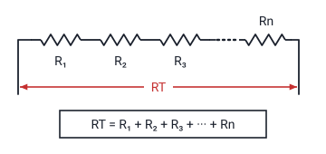
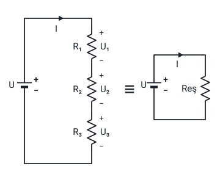
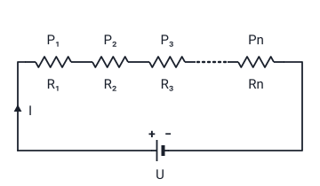
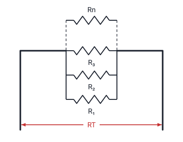
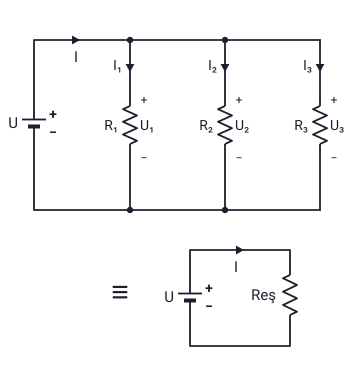
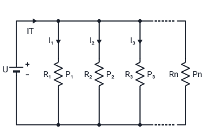

### Bağlantı şekilleri

Dirençler **seri**, **paralel** ve **seri-paralel** şeklinde devrelerde bağlantı şekillerini görebiliriz.

Hoca bu bölümü 7. haftada doğru akım ve alternatif akımdan sonra anlatır ("Doğru Akım ve Alternatif Akım" konusu) ve 9. haftada dört slaytıyla aynen tekrarlar; tekrar slaytları yalnızca bölüm numaralarıyla (7.4 yerine 9.2) ayrılır. Direnç, gösterimi (R) ve birimi (Ω) "İş, Güç ve Direnç" konusundadır; gerilim, akım ve direnç arasındaki bağıntı (V = I · R, I = V / R, R = V / I) "Ölçü Aletleri ve Ölçme, EMK" konusundadır.

Hoca seri bağlantı, seri devrede güç, paralel bağlantı ve paralel devrede güç slaytlarının her birinden sonra bir örnek çözer ("DİRENÇLERİN SERİ DEVRE ÖRNEĞİ", "SERİ DEVREDE GÜÇ ÖRNEĞİ", "DİRENÇLERİN PARALEL DEVRE ÖRNEĞİ", "PARALEL DEVREDE GÜÇ ÖRNEĞİ"; 9. haftada tek slayt: "DİRENÇLERİN DEVRE ÖRNEKLERİ"). Bu örnekler slaytlarda yoktur.

> **Dikkat:** Bu konuda gerilim **U** harfiyle yazılır (U₁ = I · R₁ gibi). "Ölçü Aletleri ve Ölçme, EMK" konusundaki üçgenlerde aynı bağıntı **V** harfiyle yazılmıştır (V = I · R). U ve V aynı büyüklüğü, gerilimi gösterir. Slaytlarda çarpma nokta ile yazılmıştır (I.R₁); notta "·" kullanıldı.

> **Ek:** Seri-paralel bağlantı slaytta yalnızca adıyla geçer; bir devrede seri ve paralel bağlı dirençlerin bir arada bulunmasıdır (karışık bağlantı da denir).

### Dirençlerin seri bağlanması

- İçlerinden **aynı akım** geçecek şekilde dirençler **birbiri ardına** eklenirse bu devreye **seri devre** denir.
- Seri bağlantıda **toplam direnç artar**. Dirençler üzerindeki **gerilimler farklı**, üzerinden geçen **akımlar aynıdır**.

**RT = R₁ + R₂ + R₃ + … + Rn**

Formülde RT toplam direnci, Rn n'inci (sonuncu) direnci gösterir.

> **Ek:** Slayttaki şeklin sol yarısında aynı dizilişin direnç fotoğraflarıyla gösterilişi vardır; buradaki şekilde yalnızca sembollü yarısı çizildi. RT'deki T, toplam (İngilizce total) demektir. Hocanın "gerilimler farklı" ifadesi dirençlerin değerleri farklı olduğu içindir: seri devrede her direncin gerilimi U = I · R ile bulunur ve akım aynı olduğundan büyük dirençte büyük gerilim düşer; değerleri eşit dirençlerde gerilimler de eşit olur.

### Kirşof'un gerilimler kanunu

"Devreye uygulanan gerilim; dirençler üzerinde düşen gerilimlerin toplamına eşittir."

> **Ek:** Kirşof, Alman fizikçi Gustav Robert Kirchhoff'un adının Türkçe okunuşudur; hoca "Kirşof" diye yazar. Hoca bu kanunu seri devrenin çözümünde kullanır: kaynağın gerilimi, dirençlerin her birinde düşen gerilimlere paylaşılır.

### Seri devrede eşdeğer direnç

Hoca seri devreyi şöyle çözer:

- Seri devrede akımlar aynıdır: **I = I₁ = I₂ = I₃**
- U₁ = I · R₁, U₂ = I · R₂, U₃ = I · R₃
- Kirşof'un Gerilimler Kanunundan: **U = U₁ + U₂ + U₃**
- I · Reş = I · R₁ + I · R₂ + I · R₃
- **Reş = R₁ + R₂ + R₃**

Reş, eşdeğer dirençtir: şekildeki "≡" işaretinin sağındaki devrede R₁, R₂ ve R₃'ün yerine konan tek dirençtir.

> **Dikkat:** Hoca toplam direnci sol şekilde **RT**, çözümde ve eşdeğer devrede **Reş** diye yazar. Seri devrede ikisi aynı biçimde, dirençler toplanarak bulunur.

> **Ek:** Dördüncü adımda soldaki U yerine eşdeğer devredeki U = I · Reş, sağdakilere de U₁ = I · R₁ gibi gerilimler konmuştur; her terimde ortak olan I sadeleşince Reş = R₁ + R₂ + R₃ kalır. Örneğin 5 Ω, 7 Ω ve 8 Ω'luk dirençler seri bağlanırsa Reş = 5 + 7 + 8 = 20 Ω olur; 40 V'luk kaynağa bağlanınca I = 40 / 20 = 2 A, U₁ = 2 · 5 = 10 V, U₂ = 14 V, U₃ = 16 V olur ve 10 + 14 + 16 = 40 V eder.

### Seri devrede güç

Seri bir devrede **toplam güç**; her bir direnç üzerinde **harcanan güçlerin toplamına** eşittir.

**PT = P₁ + P₂ + P₃ + … + Pn**

**PT = U · I**

**PT = I² · Reş**

**PT = U² / Reş**

Formüllerde PT toplam gücü, Pn n'inci direnç üzerinde harcanan gücü gösterir.

> **Dikkat:** Slayttaki şekilde dördüncü (sonuncu) direncin üstünde ve altında da "P₃" ve "R₃" yazar; formüldeki son terim Pn olduğu için burada şekilde **Pn** ve **Rn** yazıldı.

> **Ek:** PT = U · I, "İş, Güç ve Direnç" konusundaki elektriksel güç formülüdür (P = U · I). Eşdeğer devrede U = I · Reş olduğu için U · I yerine I · Reş · I = I² · Reş, I = U / Reş olduğu için U · U / Reş = U² / Reş yazılır. Örneğin 20 Ω'luk eşdeğer dirençten 2 A geçerse PT = 2² · 20 = 80 W olur; aynı devrede U = 40 V'tur ve 40² / 20 = 80 W, 40 · 2 = 80 W da aynı sonucu verir.

### Üretilen ve harcanan güç

Hoca seri devrede güç slaytına şu notu yazar:

- **Üretilen güç (−)** ve **harcanan güç (+)** işaretlidir.
- Bir devreye ilişkin **toplam güç her an için sıfıra** eşittir.

"İş, Güç ve Direnç" konusunda hoca, devrede harcanan toplam enerjinin devrenin sağladığı toplam enerjiye eşit olduğunu söyler.

> **Dikkat:** Bu slaytta "toplam güç" iki yerde geçer; karıştırmayın. **PT**, her bir direnç üzerinde **harcanan** güçlerin toplamıdır (PT = P₁ + P₂ + … + Pn). NOT ise üretilen gücü **(−)**, harcanan gücü **(+)** işaretli sayar ve bir devreye ilişkin toplam gücün **her an için sıfıra** eşit olduğunu söyler.

> **Ek:** NOT'taki toplam, kaynağın ürettiği (−) güç ile dirençlerin harcadığı (+) güçlerin işaretleriyle birlikte toplanmasıdır; slayt bunu ayrıca açıklamaz. Örneğin kaynak 80 W üretiyor, dirençlerde toplam 80 W harcanıyorsa: (−80) + (+80) = 0. Yani kaynağın ürettiği güç, dirençlerin harcadığı toplam güce (PT) eşittir.

### Dirençlerin paralel bağlanması

- Dirençlerin **karşılıklı uçlarının** bağlanması ile oluşan devreye **paralel bağlantı** denir.
- Paralel bağlantıda **toplam direnç azalır**. Dirençler üzerindeki **gerilimler eşit**, üzerinden geçen **akımlar farklıdır**.

> **Dikkat:** Seri ve paralel bağlantının özellikleri terstir. Seride toplam direnç **artar**, gerilimler **farklı**, akımlar **aynı**; paralelde toplam direnç **azalır**, gerilimler **eşit**, akımlar **farklıdır**.

> **Ek:** Slayttaki şeklin sol yarısında paralel bağlı direnç fotoğrafları vardır; buradaki şekilde yalnızca sembollü yarısı çizildi. Slaytta paralel bağlantı için RT'nin formülü yazılı değildir; eşdeğer direncin formülü aşağıda üç direnç için verilir. "Akımlar farklıdır" ifadesi de dirençlerin değerleri farklı olduğu içindir; eşit dirençlerden eşit akım geçer.

### Kirşof'un akımlar kanunu

"Devrede bir **düğüm noktasına gelen** akımların toplamı o düğüm noktasını **terk eden** akımların toplamına eşittir."

> **Ek:** Düğüm noktası, iki ya da daha çok iletkenin birleştiği noktadır; slaytta tanımı yoktur. Aşağıdaki şekilde kaynaktan gelen I akımı üst teldeki düğüm noktalarında I₁, I₂ ve I₃'e ayrılır. Örneğin bir düğüm noktasına 7 A geliyor, noktadan çıkan iki telden birinde 4 A gidiyorsa ötekinde 3 A gider.

### Paralel devrede eşdeğer direnç

Hoca paralel devreyi şöyle çözer:

- PARALEL devrede gerilimler aynıdır: **U = U₁ = U₂ = U₃**
- I₁ = U / R₁, I₂ = U / R₂, I₃ = U / R₃
- Kirşof'un Akımlar Kanunundan: **I = I₁ + I₂ + I₃**
- U / Reş = U / R₁ + U / R₂ + U / R₃
- **1 / Reş = 1 / R₁ + 1 / R₂ + 1 / R₃**

> **Dikkat:** Paralel devrede formül **Reş'i değil 1 / Reş'i** verir: önce 1 / R₁ + 1 / R₂ + 1 / R₃ toplanır, sonra sonucun tersi alınır. Seri devredeki gibi dirençler doğrudan toplanmaz.

> **Ek:** Örneğin 6 Ω ve 3 Ω paralel bağlanırsa 1 / Reş = 1 / 6 + 1 / 3 = 1 / 6 + 2 / 6 = 3 / 6 = 1 / 2, yani Reş = 2 Ω olur. Eşdeğer direnç, kollardaki en küçük dirençten (3 Ω) de küçüktür; hocanın "toplam direnç azalır" sözü budur. Dördüncü adımda soldaki I yerine eşdeğer devredeki I = U / Reş konmuştur; her terimdeki U sadeleşir.

### Paralel devrede güç

**Seri devrede olduğu gibi**, toplam güç; her bir direnç üzerinde **harcanan güçlerin toplamına** eşittir.

**PT = P₁ + P₂ + P₃ + … + Pn**

**PT = U · IT**

**PT = IT² · Reş**

**PT = U² / Reş**

Formüllerde IT toplam akımı (kaynaktan çıkan akımı) gösterir.

> **Dikkat:** Hoca toplam akımı paralel devre slaytında **I**, güç slaytında **IT** diye yazar; ikisi de kaynaktan çıkıp kollara ayrılan toplam akımdır. Güç formülleri seri devredekilerle aynı biçimdedir; yalnızca akımın harfi I yerine IT'dir.

> **Ek:** Örneğin 12 V'luk kaynağa bağlı paralel devrenin eşdeğer direnci 3 Ω ise IT = 12 / 3 = 4 A, PT = 12 · 4 = 48 W olur; 4² · 3 = 48 W ve 12² / 3 = 48 W da aynı sonucu verir.

### Paralel devrede kol akımlarının bulunması

Hoca güç slaytında her koldan geçen akımı toplam akımdan şöyle bulur:

- U = U₁ = U₂ = U₃'den hareketle
- U = U₁ olduğundan: IT · Reş = I₁ · R₁

**I₁ = IT · Reş / R₁**

**I₂ = IT · Reş / R₂**

**I₃ = IT · Reş / R₃**

> **Dikkat:** Slaytta bu formüller kesir çizgisiyle yazılmıştır: kesrin üstünde (payında) IT · Reş, altında (paydasında) kolun **kendi direnci** (R₁, R₂, R₃) vardır. Notta tek satırda yazıldı. Paydada Reş değil, kolun kendi direnci bulunur.

> **Ek:** IT · Reş, devrenin gerilimi U'dur; bu yüzden I₁ = IT · Reş / R₁, I₁ = U / R₁'in başka bir yazılışıdır. Örneğin 6 Ω ve 3 Ω paralel bağlıysa (Reş = 2 Ω) ve IT = 9 A ise I₁ = 9 · 2 / 6 = 3 A, I₂ = 9 · 2 / 3 = 6 A olur; 3 + 6 = 9 A, Kirşof'un Akımlar Kanununu tutar.

### Seri ve paralel bağlantının karşılaştırması

| | Seri bağlantı | Paralel bağlantı |
| --- | --- | --- |
| Nasıl bağlanır | Dirençler birbiri ardına eklenir | Dirençlerin karşılıklı uçları bağlanır |
| Toplam direnç | Artar | Azalır |
| Gerilimler | Farklı; U = U₁ + U₂ + U₃ | Eşit; U = U₁ = U₂ = U₃ |
| Akımlar | Aynı; I = I₁ = I₂ = I₃ | Farklı; I = I₁ + I₂ + I₃ |
| Kullanılan kanun | Kirşof'un Gerilimler Kanunu | Kirşof'un Akımlar Kanunu |
| Eşdeğer direnç | Reş = R₁ + R₂ + R₃ | 1 / Reş = 1 / R₁ + 1 / R₂ + 1 / R₃ |
| Toplam güç | PT = P₁ + P₂ + … + Pn = U · I = I² · Reş = U² / Reş | PT = P₁ + P₂ + … + Pn = U · IT = IT² · Reş = U² / Reş |
