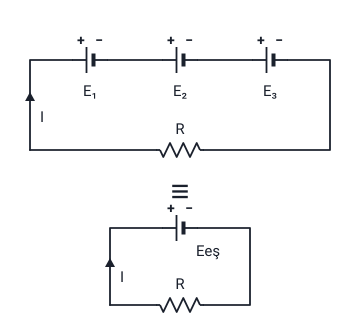

### Pil ve akümülatörde amper-saat oranı

- Piller ve aküler **kimyasal enerjiyi elektrik enerjisine** dönüştürürler.
- Piller ve akülerin kimyasal enerjisi **sınırlı** olduğu için ürettikleri güç ancak **belli bir süre** yüke aktarılabilir.
- Pil ve aküler için **Amper-Saat** ile verilen bir tanım kullanılır.

**Amper-Saat:** Bir pil veya akümülatörün **belirli bir miktardaki akımı**, sistemdeki yüke **kaç saat boyunca** sağlayabileceğini belirler.

Hoca bu bölümü 7. haftada dirençlerin bağlantı şekillerinden sonra anlatır ("Dirençlerin Bağlantı Şekilleri" konusu). Pil ve akümülatör "Elektrik Devresi ve Devre Elemanları" konusunda doğru akım kaynakları arasında sayılır; pil ve akümülatörün çalışma prensibi "Devre Türleri ve Elektrik Akımının Etkileri" konusunda kimyasal etkinin örneğidir.

> **Ek:** Akü, akümülatörün kısaltılmış adıdır. Amper-saatin kısaltması **Ah**'dir (A: amper, h: saat; İngilizce hour). Hocanın örneklerinde akünün kapasitesi Ah, pilin kapasitesi mAh (miliamper-saat) ile verilir.

### Örnek 1: 24 V'luk akü

Hocanın örneği: 24 V'luk bir akünün kapasitesi **80 Ah** ise, bu akü

| Yükün çektiği akım | Besleyebileceği süre |
| --- | --- |
| 1 Amper | 80 saat |
| 4 Amper | 20 saat |
| 8 Amper | 10 saat |

besleyebilir demektir.

Hocanın örneklerinde süre, kapasitenin yükün çektiği akıma bölünmesiyle çıkar: 80 / 1 = 80 saat, 80 / 4 = 20 saat, 80 / 8 = 10 saat.

> **Dikkat:** Yükün çektiği akım arttıkça besleme süresi aynı oranda kısalır: akım 4 katına çıkınca (1 A → 4 A) süre 4'te birine iner (80 saat → 20 saat). Akünün gerilimi (24 V) bu hesaba girmez; hesapta yalnızca kapasite (Ah) ve yükün çektiği akım (A) kullanılır.

> **Ek:** Slaytta formül yazılmaz; örneklerdeki hesap şöyle de yazılabilir: besleme süresi (saat) = kapasite (Ah) / yükün çektiği akım (A). Gerçek pil ve akülerde büyük akım çekildiğinde kullanılabilen kapasite bir miktar azalır; hocanın örnekleri bu ayrıntıya girmez.

### Örnek 2: 1,25 V'luk pil

Hocanın örneği: 1,25 V'luk bir pilin kapasitesi **2500 mAh** ise, bu pil **1 Amper** çeken bir yükü **2,5 saat** besleyebilir.

Hoca bu bölümden sonra bir örnek daha çözer ("PİL VE AKÜMÜLATÖRLER ÖRNEĞİ"); örnek slaytta yoktur.

> **Dikkat:** Bu örnekte kapasite **mAh** (miliamper-saat) ile verilmiştir, Örnek 1'de ise **Ah** ile. Birimi karıştırmayın: 2500 mAh'lik pil 1 A çeken yükü 2500 saat değil, **2,5 saat** besler.

> **Ek:** Mili, binde bir demektir: 1000 mAh = 1 Ah, yani 2500 mAh = 2,5 Ah. Bu yüzden 2,5 / 1 = 2,5 saat çıkar. Aynı pil 0,5 A çeken bir yükü 2,5 / 0,5 = 5 saat besler.

### Doğru gerilim (DC) kaynaklarının seri bağlanması

- Seri bağlantıda amaç daha fazla **gerilim** verebilen bir kaynak elde etmektir.
- Seri bağlantıda kaynaklar; birinin **(−) ucu** diğerinin **(+) ucuna** gelecek şekilde **arka arkaya** bağlanır.

**Eeş = E₁ + E₂ + E₃**

Formülde E₁, E₂, E₃ kaynakların gerilimlerini, Eeş eşdeğer kaynağın gerilimini gösterir. Eşdeğer kaynak, şekildeki "≡" işaretinin sağındaki devrede üç kaynağın yerine konan tek kaynaktır.

> **Dikkat:** Şekilde kaynakların (+) uçları sola bakar ve sol teldeki I oku **yukarı** doğrudur. "Elektrik Yükü, Coulomb Kanunu, Akım ve Gerilim" konusundaki **kabul edilen akım yönüne** ((+) kutuptan (−) kutba) göre akım dış devrede E₁'in (+) ucundan çıkıp sol telden **aşağı** inmelidir; şekildeki ok **elektron akış yönüyle** aynıdır. Şekil slayttaki gibi çizildi. Paralel bağlantı şeklindeki oklar ise kabul edilen akım yönündedir.

> **Ek:** Slayttaki fotoğrafta üzerinde "24V 10A" yazan iki akü, birinin (−) ucu diğerinin (+) ucuna gelecek şekilde bağlanmıştır; boşta kalan (+) ve (−) uçların üstünde "48 V 10A" yazar. Yani iki 24 V'luk akü seri bağlanınca 24 + 24 = 48 V elde edilir. Bu bilgi yalnızca fotoğrafta geçer.

> **Ek:** Dirençlerin seri bağlanmasında dirençler toplanır (Reş = R₁ + R₂ + R₃; "Dirençlerin Bağlantı Şekilleri" konusu); kaynakların seri bağlanmasında gerilimler toplanır. Örneğin 1,5 V'luk üç pil seri bağlanırsa Eeş = 1,5 + 1,5 + 1,5 = 4,5 V olur.

### Seri bağlantıda aynı işaretli uçların birleşmesi

**NOT:** Seri bağlantıda kaynaklar; birinin (−) ucu diğerinin (−) ucuna veya birinin (+) ucu diğerinin (+) ucuna gelecek şekilde arka arkaya bağlanır ise iki güç kaynağının gerilim değerlerinin **farkı** alınır.

> **Dikkat:** Doğru seri bağlantıda (−) uç (+) uca gelir ve gerilimler **toplanır**. Aynı işaretli uçlar ((−) ile (−) ya da (+) ile (+)) birbirine gelirse gerilimlerin **farkı** alınır. Slayttaki cümlenin ikinci yarısı "birinin ucu (+) diğerinin ucu (+) ucuna" diye yazılmıştır; notta "birinin (+) ucu diğerinin (+) ucuna" diye düzeltildi.

> **Ek:** Örneğin 12 V'luk ve 5 V'luk iki kaynak (+) uçları birbirine gelecek şekilde seri bağlanırsa 12 − 5 = 7 V elde edilir. Aynı işaretli ucu birleşen kaynağın gerilimi ötekinin gerilimine karşı yönde etki eder.

### Doğru gerilim (DC) kaynaklarının paralel bağlanması

- Paralel bağlantıda amaç daha fazla **akım** verebilen bir kaynak elde etmektir.
- Paralel bağlantı için gerekli şartlar şunlardır:

1. Tüm kaynakların **elektromotor kuvveti (EMK)** eşit olmalıdır.
2. Tüm kaynakların **iç dirençleri** eşit olmalıdır.

EMK'nın anlamı "Ölçü Aletleri ve Ölçme, EMK" konusundadır.

> **Dikkat:** Slaytta "elektro motor kuvveti (emk)" diye yazılır; notta öteki konularla aynı olsun diye "elektromotor kuvveti (EMK)" yazıldı.

> **Dikkat:** İki bağlantının amacını karıştırmayın: **seri** bağlantıda amaç daha fazla **gerilim**, **paralel** bağlantıda daha fazla **akım** verebilen bir kaynak elde etmektir. Seri bağlantı slaytında hoca kaynakların değerini "gerilim" diye, paralel bağlantı slaytında "elektromotor kuvveti (emk)" diye anar; iki slaytta da kaynaklar E harfiyle gösterilir.

> **Ek:** İç direnç, kaynağın kendi içindeki dirençtir; slaytta tanımı yoktur. "Ölçü Aletleri ve Ölçme, EMK" konusundaki "kaynakta düşen gerilim" bu dirençte düşer. Şartlar sağlanmazsa, örneğin EMK'lar farklıysa, EMK'sı büyük olan kaynaktan küçük olana akım geçer; yani kaynaklar birbirini besler.

### Paralel bağlantının formülleri

Şekilde her kaynağın (E₁, E₂, E₃) iç direnci, kaynağın koluna seri bir direnç olarak çizilmiştir (Ri₁, Ri₂, Ri₃). Kollardan I₁, I₂, I₃ akımları çıkar; yük direncinden (Ryük) I akımı geçer. Eşdeğer devrede tek kaynak (Eeş) ve tek iç direnç (Rieş) vardır.

- **E₁ = E₂ = E₃**
- **Ri₁ = Ri₂ = Ri₃**
- **Eeş = E₁ = E₂ = E₃**
- **Ieş = I₁ + I₂ + I₃**
- **1 / Rieş = 1 / Ri₁ + 1 / Ri₂ + 1 / Ri₃**

Formüllerde Ri₁, Ri₂, Ri₃ kaynakların iç dirençlerini, Rieş eşdeğer iç direnci, Eeş eşdeğer kaynağın EMK'sını, Ieş eşdeğer kaynağın verdiği akımı gösterir.

Hoca bu bölümden sonra bir örnek çözer ("DOĞRU GERİLİM KAYNAKLARININ BAĞLANMASI ÖRNEĞİ"); örnek slaytta yoktur.

> **Dikkat:** Paralel bağlantıda gerilim artmaz: **Eeş = E₁ = E₂ = E₃**; artan akımdır: **Ieş = I₁ + I₂ + I₃**. Formülde toplam akım **Ieş**, şekilde yük direncinden geçen akım **I** diye yazılmıştır. Eşdeğer iç direnç formülü 1 / Rieş'i verir; "Dirençlerin Bağlantı Şekilleri" konusundaki paralel dirençlerde olduğu gibi önce 1 / Ri₁ + 1 / Ri₂ + 1 / Ri₃ toplanır, sonra sonucun tersi alınır.

> **Ek:** İlk iki formül paralel bağlantının iki şartının formülle yazılışıdır. Örneğin EMK'sı 1,5 V, iç direnci 0,3 Ω olan üç pil paralel bağlanırsa Eeş = 1,5 V olur; 1 / Rieş = 1 / 0,3 + 1 / 0,3 + 1 / 0,3 = 10, yani Rieş = 0,1 Ω olur.

### Kaynakların seri ve paralel bağlanmasının karşılaştırması

| | Seri bağlantı | Paralel bağlantı |
| --- | --- | --- |
| Amaç | Daha fazla gerilim verebilen bir kaynak | Daha fazla akım verebilen bir kaynak |
| Nasıl bağlanır | Birinin (−) ucu diğerinin (+) ucuna gelecek şekilde arka arkaya | Slaytta cümleyle yazılmaz; şekilde (+) uçlar bir tarafta, (−) uçlar öbür tarafta birleşir |
| Şart | Slaytta şart yok | EMK'lar eşit, iç dirençler eşit |
| Eşdeğer kaynak | Eeş = E₁ + E₂ + E₃ | Eeş = E₁ = E₂ = E₃ |
| Akım | Slaytta formül yok | Ieş = I₁ + I₂ + I₃ |
| İç direnç | Slaytta formül yok | 1 / Rieş = 1 / Ri₁ + 1 / Ri₂ + 1 / Ri₃ |
| Not | Aynı işaretli uçlar birbirine gelirse gerilimlerin farkı alınır | |
