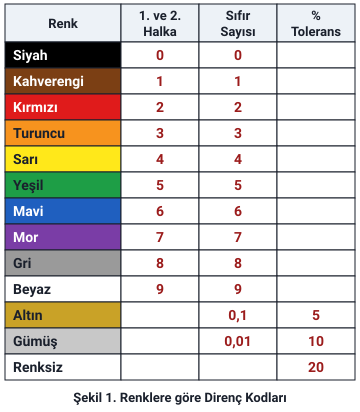
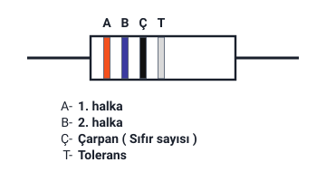
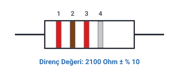
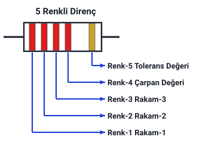
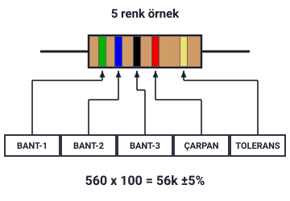

### Renk halkası (band) sayısı

Direnç renk kodlarına bakarak direnç değeri tespit edilirken **öncelikle renk halka (band) sayısına** bakılır. Bazı dirençler **tolerans dahil 4 renk**, bazıları ise **5 renktir**. Hoca önce 4 renkli dirençleri ele alır.

Direnç, gösterimi (R) ve birimi (ohm, Ω) "İş, Güç ve Direnç" konusundadır; direncin ohmmetreyle ölçülmesi "Ölçü Aletleri ve Ölçme, EMK" konusundadır.

> **Ek:** Hoca aynı şey için "halka", "band" ve "bant" sözlerini kullanır; 5 renkli direnç şeklinde "Renk-1, Renk-2 …" yazar. Band, İngilizce şerit anlamındaki sözdür.

### Renklere göre direnç kodları

Hocanın tablosu ("Şekil 1. Renklere göre Direnç Kodları"):

| Renk | 1. ve 2. halka | Sıfır sayısı | % Tolerans |
| --- | --- | --- | --- |
| Siyah | 0 | 0 | — |
| Kahverengi | 1 | 1 | — |
| Kırmızı | 2 | 2 | — |
| Turuncu | 3 | 3 | — |
| Sarı | 4 | 4 | — |
| Yeşil | 5 | 5 | — |
| Mavi | 6 | 6 | — |
| Mor | 7 | 7 | — |
| Gri | 8 | 8 | — |
| Beyaz | 9 | 9 | — |
| Altın | — | 0,1 | 5 |
| Gümüş | — | 0,01 | 10 |
| Renksiz | — | — | 20 |

> **Dikkat:** Altın ve gümüşün "Sıfır Sayısı" sütunundaki değerleri (**0,1** ve **0,01**) eklenecek sıfır sayısı değil, **çarpandır**: ilk halkalardan çıkan sayı 0,1 ya da 0,01 ile çarpılır. Hoca 5 renk örneğindeki tabloda bu iki değeri "ÇARPAN" sütununda verir. Slaytta ondalık ayırıcı noktadır (0.1, 0.01).

> **Dikkat:** Bu tabloda tolerans değeri yalnızca **altın (%5)**, **gümüş (%10)** ve **renksiz (%20)** için yazılıdır. Hocanın 5 renk örneğindeki tablo bunlardan farklıdır (aşağıda "Çarpan ve tolerans renkleri (5 renk örneğindeki tablo)").

> **Ek:** Siyahtan beyaza renklerin sayıları 0'dan 9'a sırayla artar. Slayttaki tabloda kahverengi hücresi koyu kırmızıya yakın bir renkle boyanmıştır; yukarıdaki şekilde kahverengi çizildi.

### 4 renkli dirençlerin okunması

- **A:** 1. halka
- **B:** 2. halka
- **Ç:** Çarpan (sıfır sayısı)
- **T:** Tolerans

Bu durumda önce **1. halkadaki renge karşılık gelen sayı**, daha sonra onun yanına **2. halkadaki renge karşılık gelen sayı**, ikisinin yanına da **3. halkadaki renge karşılık gelen adette sıfır eklenir** ve **ohm** cinsinden direncin değeri bulunmuş olur. **4. halkadaki renk** de bu direncin **± % toleransını** belirtir.

> **Ek:** Tolerans, direncin gerçek değerinin üzerinde yazılı (renklerle gösterilen) değerden en çok yüzde kaç sapabileceğidir. Örneğin 1000 Ω ± %10'luk bir direncin gerçek değeri 900 Ω ile 1100 Ω arasındadır. Şekildeki halka renkleri yalnızca halkaların yerini gösterir; bir değer anlatmaz.

### Örnek: 4 renkli direnç

| Bant | Renk | Karşılığı |
| --- | --- | --- |
| 1. bant | Kırmızı | 2 |
| 2. bant | Kahverengi | 1 |
| 3. bant | Kırmızı | 00 (sıfır sayısı 2) |
| 4. bant | Gümüş | ± %10 (tolerans) |

Direnç değeri: **2100 Ohm ± %10**

> **Dikkat:** 3. bant kırmızıdır ama burada sayı olarak **2** yazılmaz; **2 tane sıfır** eklenir: 21 → 2100. Aynı kırmızı renk 1. bantta 2 sayısını verir.

> **Ek:** 2100 Ω = 2,1 kΩ. ± %10 tolerans, 2100 Ω'un %10'u olan 210 Ω demektir; direncin gerçek değeri 1890 Ω ile 2310 Ω arasındadır.

### 5 renkli dirençlerin okunması

Hocanın "5 Renkli Direnç" şeklindeki adlar:

| Renk | Gösterdiği |
| --- | --- |
| Renk-1 | Rakam-1 |
| Renk-2 | Rakam-2 |
| Renk-3 | Rakam-3 |
| Renk-4 | Çarpan Değeri |
| Renk-5 | Tolerans Değeri |

5 renk örneğindeki şekilde de bantlar aynı sırayla **BANT-1, BANT-2, BANT-3, ÇARPAN, TOLERANS** diye adlandırılır.

> **Dikkat:** 4 renkli dirençte iki rakam vardır ve **çarpan 3.**, tolerans 4. halkadır. 5 renkli dirençte **üç rakam** vardır ve **çarpan 4.**, tolerans 5. renktir.

> **Ek:** 5 renkli dirençlerin okunuşu slaytta cümleyle anlatılmaz; şekillerdeki adlardan ve hocanın iki örneğinden çıkar: ilk üç rengin sayıları yan yana yazılır, yanına 4. renge karşılık gelen adette sıfır eklenir.

### Örnek: 5 renkli direnç, 56 kΩ

Hoca şeklin yanına **560 x 100 = 56k ± 5%** yazar: ilk üç bant 5, 6, 0 (560), çarpan 100, tolerans %5. Şekildeki bantlar ve karşılıkları:

| Bant | Renk | Karşılığı |
| --- | --- | --- |
| BANT-1 | Yeşil | 5 |
| BANT-2 | Mavi | 6 |
| BANT-3 | Siyah | 0 |
| ÇARPAN | Kırmızı | × 100 |
| TOLERANS | Altın | %5 |

560 · 100 = 56000 Ω = **56 kΩ ± %5**

> **Dikkat:** Slaytta sonuç birimsiz "56k" diye yazılmıştır; k (kilo) 1000 demektir: 56k = 56 kΩ = 56000 Ω. BANT-3'teki siyahın değeri 0'dır; bu 0 da sayıya yazılır (5, 6, 0 → 560).

> **Ek:** Bantların renkleri yalnızca şekilde geçer; hoca yazıyla yalnızca hesabı verir.

### Çarpan ve tolerans renkleri (5 renk örneğindeki tablo)

Hoca 5 renk örneğinin altında BANT-1, BANT-2, BANT-3 sütunlarında renk tablosunu (siyah 0 … beyaz 9) tekrarlar; ÇARPAN ve TOLERANS sütunları şöyledir:

| ÇARPAN | Renk |
| --- | --- |
| × 1 | Siyah |
| × 10 | Kahve |
| × 100 | Kırmızı |
| × 1000 | Turuncu |
| × 10000 | Sarı |
| × 100000 | Yeşil |
| × 1000000 | Mavi |
| 0,1 | Altın |
| 0,01 | Gümüş |

| TOLERANS | Renk |
| --- | --- |
| %5 | Altın |
| %10 | Gümüş |
| %1 | Kahve |
| %2 | Kırmızı |

İki tablo karşılaştırılınca görülür: çarpan sütunu, "Renklere göre direnç kodları" tablosundaki sıfır sayısının çarpan olarak yazılışıdır: kırmızı için 2 sıfır = × 100, turuncu için 3 sıfır = × 1000.

> **Dikkat:** İki tablo tolerans renklerinde farklıdır. "Şekil 1. Renklere göre Direnç Kodları" tablosunda tolerans yalnızca **altın %5, gümüş %10, renksiz %20** için yazılıdır; kahverengi ve kırmızının tolerans hücreleri **boştur**. 5 renk örneğindeki tabloda ise **kahve %1** ve **kırmızı %2** tolerans da verilir, renksiz yoktur. Altın ve gümüşün değerleri iki tabloda aynıdır. Notta iki tablo da hocanın yazdığı gibi verildi.

> **Ek:** Uluslararası renk kodu standardında kahverengi ±%1, kırmızı ±%2 tolerans da tanımlıdır; 5 renkli dirençler çoğunlukla bu küçük toleranslarla yapılır. Bu tabloda çarpan sütunu maviyle (× 1000000) biter; mor, gri ve beyazın sıfır sayısı (7, 8, 9) yalnızca "Renklere göre direnç kodları" tablosunda vardır. Slaytta renk adı "kahve" diye kısaltılmıştır.

### Örnek: 5 renkli direnç, 22,2 kΩ

Hocanın örneği, yukarıdaki "5 Renkli Direnç" şeklindeki dirençtir:

| Bant | Renk | Karşılığı |
| --- | --- | --- |
| 1. bant | Kırmızı | 2 |
| 2. bant | Kırmızı | 2 |
| 3. bant | Kırmızı | 2 |
| 4. bant | Kırmızı | 00 (sıfır sayısı 2) |
| 5. bant | Altın | ± %5 (tolerans) |

Direnç değeri: **22200 Ohm ± %5** veya **22,2 kΩ ± %5**

> **Dikkat:** Dört bant da kırmızıdır ama görevleri farklıdır: ilk üç kırmızı **rakam** (2, 2, 2 → 222), dördüncü kırmızı **sıfır sayısı** (iki sıfır → 22200). Slayttaki çizimde dört halka koyu kırmızı, beşinci halka turuncu görünür; hocanın yazısında bunlar kırmızı ve altındır. Şekil yazıdaki renklerle çizildi. Slaytta "22.2 kΩ" diye ondalık nokta ile yazılmıştır.

> **Ek:** 22200 Ω'un %5'i 1110 Ω'dur; direncin gerçek değeri 21090 Ω ile 23310 Ω arasındadır.
