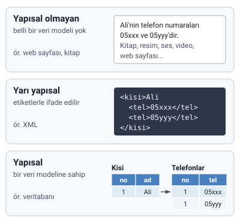

### Ders hakkında

Dersin amacı, veritabanı yönetim sistemlerinin prensipleri hakkında yeterlilik kazandırmak; ilişkisel veritabanı sistemlerinin kullanımını öğretmek ve popüler veritabanı sistemlerinin temel özelliklerini ve işlevlerini anlatmaktır.

Hocanın slaytındaki değerlendirme:

| Değerlendirme | Ağırlık |
| --- | --- |
| Ara sınav | %30 |
| Kısa sınav 1 | %10 |
| Kısa sınav 2 | %10 |
| Dönem sonu sınavı | %50 |

> **Dikkat:** Slaytın kapağında "2025/2026 Bahar Yarıyılı" yazıyor. Ağırlıklar bu dönem değişmişse hocanın duyurusu geçerlidir.

### Veri nedir

Bilgisayarın girdi olarak alabildiği, işleyebildiği, sonuç üretebildiği ve depolayabildiği her şey **veridir**.

### Veri türleri (yapı bakımından)

Veriler, belli bir **veri modeline** (önceden belirlenmiş bir yapıya) uyup uymamalarına göre üçe ayrılır.



#### Yapısal olmayan veri

Önceden belli bir veri modeli olmayan veridir. Örnekler: kitaplar, resim, ses ve video dosyaları, web sayfaları.

Hoca yapısal olmayan veriye şu cümleyi de örnek verir: `<b>Ali'nin telefon numaraları 05xxx ve 05yyy'dir</b>`.

> **Ek:** Cümledeki `<b>` bir HTML etiketidir ve yalnızca yazıyı kalın gösterir. Telefon numaraları cümlenin içinde geçer, onları ayıran bir yapı yoktur. Aşağıdaki XML örneğinde ise her numara `<tel>` etiketiyle ayrı ayrı işaretlenir.

#### Yarı yapısal veri

Bir yapısı vardır ama belli bir veri modeline uymaz; veriler **etiketlerle** ifade edilir. Örnek: **XML**.

```xml
<kisi>Ali
  <tel>05xxx</tel>
  <tel>05yyy</tel>
</kisi>
```

Burada her telefon `<tel>` etiketiyle işaretlenmiştir; yapı etiketlerden anlaşılır.

> **Ek:** Bugün çok kullanılan JSON biçimi de yarı yapısal veridir: `{"kisi": "Ali", "tel": ["05xxx", "05yyy"]}`.

#### Yapısal veri

Bir veri modeline sahip veridir. Örnek: **veritabanları**. Hocanın şekli bunu iki kutuyla gösterir: **Kisi** ve **Telefonlar**. Kişiler ve telefonları ayrı yapılarda tutulur, aralarında tanımlı bir bağ vardır.

> **Dikkat:** "Veri türü" sözü derste iki anlamda geçiyor. Burada verinin **yapısı** anlatılıyor (yapısal / yarı yapısal / yapısal olmayan). Bir tablodaki **alanın türü** (tam sayı, metin gibi) ise "Veritabanı Yapısı: Tablo, Kayıt, Alan" konusunda.

### Veritabanı nedir

Veritabanı:

- birbiriyle ilişkisi olan verilerin tutulduğu,
- kullanım amacına uygun olarak düzenlenmiş veriler topluluğunun,
- mantıksal ve fiziksel olarak tanımlarının bulunduğu

**bilgi depolarıdır**.

### Veritabanı yönetim sistemi (VTYS)

Veritabanı yönetim sistemi (VTYS); yeni bir veritabanı oluşturmak, veritabanını düzenlemek, kullanmak, geliştirmek ve bakımını yapmak için çeşitli karmaşık işlemlerin gerçekleştirildiği bir **yazılım sistemidir**.

> **Dikkat:** Veritabanı verilerin kendisidir (bilgi deposu); VTYS ise o veritabanını oluşturan ve yöneten **yazılımdır**. Örneğin MySQL bir VTYS'dir, onunla kurulan "kütüphane" veritabanı ise bir veritabanıdır.

#### Yaygın VTYS'ler

Hocanın listesindeki VTYS'ler:

- Oracle Database
- IBM DB2
- Adaptive Server Enterprise
- Informix
- Microsoft Access
- Microsoft SQL Server
- Microsoft Visual FoxPro
- MySQL
- PostgreSQL
- Progress
- SQLite
- Teradata
- CSQL
- OpenLink Virtuoso
