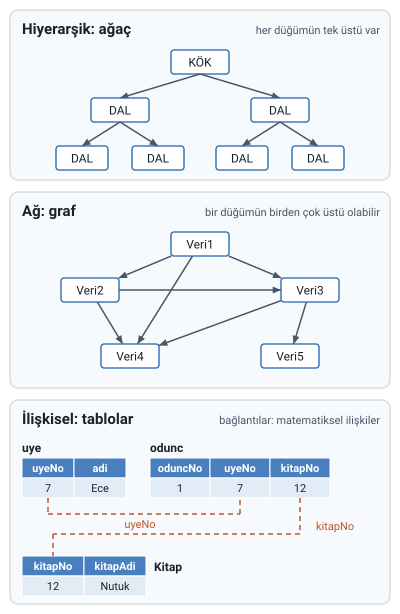

### Sınıflandırma ölçütleri

Veritabanı yönetim sistemleri iki ölçüte göre sınıflandırılır:

| Ölçüt | Türler |
| --- | --- |
| Veri modeline göre | Hiyerarşik, Ağ, İlişkisel, Nesneye yönelik |
| Kullanıcı sayısına göre | Tek kullanıcılı, Çok kullanıcılı |

### Hiyerarşik veritabanları

- Veritabanları için kullanılan **ilk modeldir**.
- Bilgileri bir **ağaç yapısında** saklar: en üstte bir kök, onun altında dallar, dalların altında yine dallar bulunur.

### Ağ veritabanları

Hiyerarşik veritabanları yetersiz kalınca, **1960'ların sonunda**, verilerin ağaçların daha gelişmiş hâli olan **graflar** şeklinde saklandığı yapı ortaya çıkmıştır.

> **Ek:** Ağaçta her düğümün yalnızca bir üstü (ebeveyni) olabilir. Grafta bir düğüm birden çok düğüme bağlanabilir; hocanın şeklinde Veri4'e hem Veri1'den hem Veri2'den hem de Veri3'ten ok gelir. Ağ modelinin ağaçtan daha esnek olması bundandır.

### İlişkisel veritabanları

- **1970'lerin başında** geliştirilmiştir.
- Veriler **tablo** şeklinde saklanır.
- Tablolar arasındaki bağlantılar **matematiksel ilişkilerle** gösterilir.
- Hocaya göre günümüzdeki hemen hemen tüm veritabanı programları bu yapıdadır.

Hocanın örnek şeması bir kütüphane veritabanıdır. Tablolar: `tur`, `kitap_tur`, `kitap_yazar`, `yazar`, `uye`, `odunc` ve `Kitap`. Örneğin `odunc` tablosu hangi üyenin (`uyeNo`) hangi kitabı (`kitapNo`) ne zaman aldığını tutar; kitabın ve üyenin ayrıntıları kendi tablolarındadır, `odunc` onlara numarayla bağlanır.

> **Ek:** İlişkisel model 1970'te E. F. Codd'un yayımladığı makaleye dayanır. Bugün ilişkisel olmayan (NoSQL) veritabanları da yaygın olarak kullanılır; ama bu derste konu ilişkisel veritabanlarıdır.

### Nesneye yönelik veritabanları

- Kelime işlemci ve hesap tablosu programlarında kullanılan **nesneler** artık veritabanlarında da kullanılmaktadır.
- Nesneye yönelik veritabanı, **C++ gibi nesneye yönelik bir dille** oluşturulan ve yine bu tarz bir dille kullanılan veritabanı anlamına gelir.

### Kullanıcı sayısına göre

VTYS'ler kullanıcı sayısına göre **tek kullanıcılı** ve **çok kullanıcılı** olarak ikiye ayrılır.

> **Ek:** Hocanın slaytında bu iki türün yalnızca adı geçiyor. Tek kullanıcılı sistemde veritabanını bir anda bir kişi kullanır (ör. kişisel bilgisayardaki küçük bir Access dosyası). Çok kullanıcılı sistemde birçok kişi aynı veritabanına aynı anda erişir (ör. bir bankanın ya da okulun sistemi).

### Neden veritabanı kullanılır

- Verilerin tutulması, saklanması ve erişilmesinde **geleneksel yaklaşım**, verilerin **ayrı ayrı dosyalarda** gruplanmasıdır.
- Verilerin artması ve verilere **aynı anda erişme ve düzenleme** ihtiyacı karşısında geleneksel yaklaşım yetersiz kalmıştır.

### Veritabanı yaklaşımının avantajları

1. Ortak verilerin tekrarının önlenmesi
2. Verilerin merkezi denetiminin ve tutarlılığının sağlanması
3. Veri paylaşımının sağlanması
4. Fiziksel yapı ve erişim yöntemi karmaşıklıklarının, çok katmanlı mimarilerle kullanıcıdan gizlenmesi
5. Her kullanıcıya yalnız ilgilendiği verilerin, alışık olduğu kolay ve anlaşılır yapılarda sunulması
6. Sunulan çözümleme, tasarım ve geliştirme araçlarıyla uygulama yazılımı geliştirmenin kolaylaşması
7. Veri bütünlüğü için gerekli olanakların sağlanması
8. Güvenlik ve gizliliğin istenilen düzeyde sağlanması
9. Yedekleme, yeniden başlatma, onarma gibi işletim sorunlarına çözüm getirilmesi

> **Ek:** İlk maddeyi bir örnekle düşünün: bir okulda öğrencinin adresi hem kayıt dosyasında hem kütüphane dosyasında ayrı ayrı tutulursa, adres değiştiğinde birini güncelleyip ötekini unutmak kolaydır ve iki dosya birbirini tutmaz. Veritabanında adres bir kez tutulur, her birim onu oradan okur.
