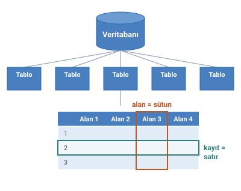

### Veritabanı yapısı

Bir veritabanı birden çok **tablodan** oluşur; her tablo da **alanlardan** (sütunlar) ve **kayıtlardan** (satırlar) oluşur.



### Tablo

- Bir veritabanı, tablolarda saklanan verilerden oluşur.
- Tablo, verilerin **satırlar ve sütunlar** hâlinde düzenlenmesiyle oluşan veri grubudur.
- Örneğin ders içeriği ve öğrenci bilgilerini saklamak için iki tablo oluşturulur: `Ogrenci_bilgileri` ve `icerik`.

### Kayıt ve alan

- Tablo içindeki her bir bilgiye (satıra) **kayıt** denir.
- Sütunlar ise **alan** olarak adlandırılır.

| Terim | Tablodaki yeri |
| --- | --- |
| Kayıt | Satır |
| Alan | Sütun |

> **Ek:** Başka kaynaklarda kayıt yerine satır (İngilizcesi row, tuple), alan yerine sütun (column, field) da denir.

> **Dikkat:** Kayıt = satır, alan = sütun. Bu ikisi kolayca karıştırılır; aşağıdaki örnekte 6 kayıt ve 5 alan var.

### Alanların veri türü

Veritabanında tutulan kayıtların yapısı hakkında bilgi sahibi olmak için alanların bazı özelliklerinin **önceden tanımlanması** gerekir. Örneğin personel sicil numarası mutlaka **tam sayı**, ad soyad ise **harflerden** oluşmalıdır.

> **Ek:** Alanın türü önceden tanımlanınca, o alana yanlış türde veri girilmesi (sicil numarası alanına harf yazılması gibi) VTYS tarafından engellenir.

> **Dikkat:** Buradaki "veri türü" bir **alanın** türüdür (tam sayı, metin, tarih). "Veri, Veritabanı ve VTYS" konusundaki yapısal / yarı yapısal / yapısal olmayan ayrımı ise verinin **yapısıyla** ilgilidir.

### Örnek: öğrenci bilgileri tablosu

Öğrenci bilgileri tablosunda öğrenci numarası, adı soyadı, doğum tarihi, doğum yeri ve e-posta adresi tutulacaksa tablo şöyle olur:

| Ogr_no | Ad_soyad | d_tarih | d_yeri | e-mail |
| --- | --- | --- | --- | --- |
| 1 | Ayşe Öztürk | 01.11.1979 | Konya | ayse@kostü.edu.tr |
| 2 | Sema Özdemir | 24.05.1975 | Ankara | sema@kostü.edu.tr |
| 3 | Serdar Gülpınar | 06.06.1983 | Adana | serdar@kostü.edu.tr |
| 4 | Mehmet Efe | 11.02.1978 | Niğde | mehmet@kostü.edu.tr |
| 5 | Zerrin Polat | 22.08.1980 | Antalya | zerrin@kostü.edu.tr |
| 6 | Ulviye Kubalı | 12.12.1984 | İstanbul | ulviye@kostü.edu.tr |

Başlık satırındaki `Ogr_no`, `Ad_soyad`, `d_tarih`, `d_yeri`, `e-mail` **alanlardır** (5 alan). Altındaki her satır bir öğrencinin **kaydıdır** (6 kayıt). Örneğin 4 numaralı satır, Mehmet Efe'nin kaydıdır.

### SQL ile ilk bakış (Ek)

> **Ek:** Bu bölüm hocanın slaytında yok; SQL ilerideki haftalarda işlenecek. Burada yalnızca alan türlerinin bir VTYS'de nasıl tanımlandığını görmek için var.

Yukarıdaki tablo, VTYS'lerin ortak dili **SQL** ile şöyle oluşturulur. Her alanın adı ve türü tablo kurulurken yazılır:

```sql
CREATE TABLE ogrenci_bilgileri (
  ogr_no    INTEGER PRIMARY KEY,   -- tam sayı; her öğrencide farklı
  ad_soyad  VARCHAR(50) NOT NULL,  -- en çok 50 harflik metin, boş bırakılamaz
  d_tarih   DATE,                  -- tarih
  d_yeri    VARCHAR(30),
  e_mail    VARCHAR(60)
);
```

Bir kayıt eklemek ve kayıtları sorgulamak:

```sql
INSERT INTO ogrenci_bilgileri (ogr_no, ad_soyad, d_tarih, d_yeri, e_mail)
VALUES (4, 'Mehmet Efe', '1978-02-11', 'Niğde', 'mehmet@kostü.edu.tr');

SELECT ad_soyad, d_yeri
FROM ogrenci_bilgileri
WHERE d_yeri = 'Niğde';
```

Son sorgu yalnızca doğum yeri Niğde olan kayıtların ad soyad ve doğum yeri alanlarını getirir.

> **Ek:** Birkaç ayrıntı: SQL'de tarih genellikle yıl-ay-gün sırasıyla (`'1978-02-11'`) yazılır. Tırnak içine alınmamış alan adında tire kullanılamadığı için `e-mail` yerine `e_mail` yazıldı. `PRIMARY KEY` (birincil anahtar), her kaydı diğerlerinden ayıran alandır; "Kavramsal Model: Varlıklar ve Nitelikler" konusunda geçiyor. Türlerin adları VTYS'ye göre küçük farklar gösterebilir.
