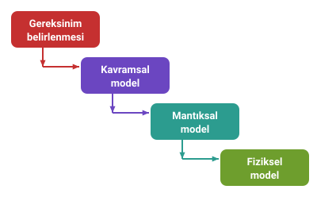
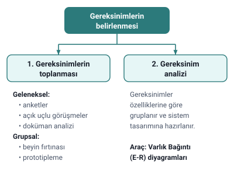

### Amaç: bir bilgi sistemi geliştirmek

Bu bölümden itibaren amaç bir **bilgi sistemi** geliştirmektir; örneğin bir hastane, kütüphane ya da alışveriş merkezi bilgi sistemi. Geliştirilecek şey iki parçadır: **veritabanının içerik ve yapısı** ile **veritabanı üzerinde çalışacak uygulama**.

### Tasarım aşamaları

Veritabanı dört aşamada tasarlanır:

1. Gereksinim belirlenmesi
2. Kavramsal model
3. Mantıksal model
4. Fiziksel model

Bu konu ilk aşamayı anlatır. Kavramsal model "Kavramsal Model: Varlıklar ve Nitelikler" konusundadır.

> **Ek:** Hocanın slaytlarında mantıksal ve fiziksel modelin yalnızca adı geçiyor; ilerideki haftalarda işlenecek.

### İlk aşama: gereksinim belirleme

İlk aşamada, geliştirilmek istenen sistemin **tam ve doğru tanımı** yapılır. Bunun için:

- sistemin **kullanıcı kitlesi** tanımlanır,
- **kullanıcı gereksinimleri** belirlenir.

Gereksinimlerin belirlenmesi iki adımdan oluşur: **gereksinimlerin toplanması** ve **gereksinim analizi**.

### Gereksinim nedir

**Gereksinimler**, bir sistemin beklenen işlevleri yerine getirmesi için sahip olması gereken özelliklerdir.

Beklenen işlevler şunlardan anlaşılır:

- kullanıcıların mevcut sistemde kullandıkları yöntemler,
- sistem yapısı,
- iş kuralları,
- yaşanan sıkıntı ve problemler.

### Gereksinimlerin toplanması

#### Toplama yöntemleri

| Geleneksel yöntemler | Grupsal yöntemler |
| --- | --- |
| Anketler | Beyin fırtınası |
| Açık uçlu görüşmeler | Prototipleme |
| Doküman analizi | |

> **Ek:** Prototipleme, sistemin basit bir ön sürümünü (ör. ekran taslaklarını) hazırlayıp kullanıcılara göstererek ne istediklerini netleştirmektir.

#### Gereksinim analisti

Gereksinimlerin toplanmasında **gereksinim analisti** görev alır. Hocaya göre gereksinim analisti:

- görüştüğü kişileri iyi yönlendirmeli,
- doğru soruları sormalı,
- sorularla saklı ve unutulmuş gereksinimleri ortaya çıkarmalı,
- amaç, içerik ve fonksiyonları ele almalıdır.

#### Yanlış veya eksik gereksinimin sonuçları

Yanlış veya eksik toplanan gereksinimler;

- istenmeyen işleri yapan ya da
- istenen işleri yanlış yapan

sistemlerin geliştirilmesine neden olur.

### Gereksinim analizi

**Gereksinim analizi**, toplanan gereksinimlerin özelliklerine göre gruplanarak sistem tasarımına hazırlanması çalışmalarıdır. Bu aşamada **Varlık Bağıntı Diyagramları** kullanılır.

> **Dikkat:** **Toplama**, bilgiyi kullanıcılardan almaktır (anket, görüşme, beyin fırtınası...). **Analiz**, toplanan bilgiyi gruplayıp tasarıma hazırlamaktır. İkisi birlikte "gereksinimlerin belirlenmesi" adımını oluşturur.

> **Dikkat:** E-R diyagramları iki yerde geçer: burada gereksinim analizinin aracı olarak, sonraki konuda kavramsal modelin kendisi olarak. Hocanın cümlesiyle: kavramsal modellemede, gereksinim analizini temsil eden Varlık Bağıntı (E-R) diyagramları **hazırlanır**. "E-R diyagramları hangi aşamada hazırlanır?" sorusunun cevabı kavramsal modeldir.

### Örnek: e-sınav sistemi

#### Kullanıcı grupları ve yöntem

Bir e-sınav sisteminin kullanıcı grupları: **öğretmenler**, **öğrenciler** ve **sistem yöneticileri**.

Gereksinimleri toplamak için seçilen yöntemler: **beyin fırtınası**, **birebir görüşmeler** ve **mevcut sınav sisteminin incelenmesi**.

> **Dikkat:** Bu örnekteki yöntem adları, "Toplama yöntemleri" tablosundaki adlarla birebir aynı değildir. Genel liste sorulursa tablodaki adları yazın: anketler, açık uçlu görüşmeler, doküman analizi (geleneksel); beyin fırtınası, prototipleme (grupsal).

#### Sorular ve uzlaşma

Kullanıcılara şu gibi sorular hazırlanır:

- Sistemi kimler kullanacak?
- Kaç tip yönetici olacak? Yöneticilerin yetkileri neler olacak?
- Öğretmenlerle ilgili hangi bilgiler tutulacak?
- Öğrencilerle ilgili hangi bilgiler tutulacak?
- Soruların içeriği neler olacak?
- Sınavların uygulanmasında belirli bir zaman sınırlaması olacak mı?

Soruların cevapları toplanır. Hedef kitlenin görüşlerinde **çelişkili ve tutarsız** noktalar varsa bu görüşler üzerinde **uzlaşma** sağlanır.

#### Veri gereksinimleri

Elde edilen verilere göre **veri gereksinimleri** (VG) yazılır:

- **VG1:** Sistemi yönetici, öğretmen ve öğrenci kullanacak.
- **VG2:** İki tür yönetici olacak. Ana yönetici sistemdeki her tür bilgiye erişebilecek; diğer yönetici yalnızca sınavların oluşturulmasıyla ilgili bilgileri görebilecek.
- **VG3:** Öğretmenlerin adı, yaşı, alanı ve e-posta bilgileri tutulacak.

#### Gözden geçirme ve onay

Veritabanı geliştirme ekibi, veri gereksinimleri doğrultusunda elde ettiği bilgileri gözden geçirmeli, ilgili veri gereksinimlerini **gruplamalı** ve **gereksiz olanları çıkarmalıdır**.

Veri gereksinimlerine ilişkin son rapor:

- kullanıcıların ve proje sahibinin **onayına sunulmalı**,
- formlar, raporlar ve menüler için örnekler hazırlanarak kullanıcıların görüşleri alınmalıdır.

### Ödev

Hocanın verdiği ödevin adımları:

1. Bilgi sistemi geliştirilecek bir konu alanı belirleme
2. Bu sistemi kullanacak hedef kitleyi tanımlama
3. Veri toplama yöntemlerini tanımlama
4. Veri toplama aracını geliştirme
5. Veriyi toplama
6. Veri gereksinimlerini sıralama ve gruplama
