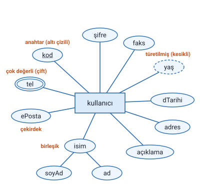
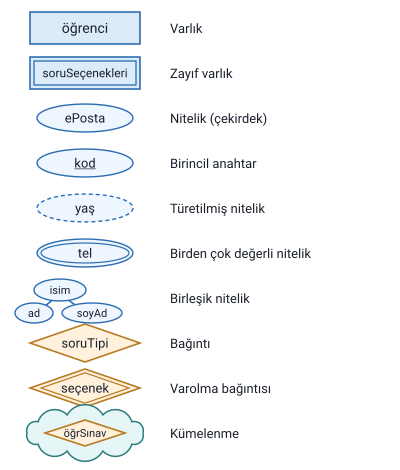

### Kavramsal model

Tasarımın ikinci aşamasıdır. Kullanıcıların ve proje sahibinin anlayabileceği şekilde hazırlanan **gereksinim modeli**, veritabanı uzmanları tarafından veritabanı tasarımında kullanılabilecek bir modele dönüştürülmelidir. Bu modele **kavramsal model** denir.

### Varlık Bağıntı (E-R) diyagramları

Kavramsal modellemede, gereksinim analizini temsil eden **Varlık Bağıntı (E-R) diyagramları** hazırlanır. Bir E-R diyagramı şunları gösterir:

- bilgi sisteminde bulunması gereken **varlıkları**,
- varlıkların **niteliklerini**,
- varlıklar arası **ilişkileri** (bağıntıları).

> **Ek:** E-R, İngilizce Entity-Relationship (varlık-ilişki) sözünün kısaltmasıdır.

> **Dikkat:** E-R diyagramları gereksinim analizinde de anılır (önceki konu), ama **hazırlandıkları** aşama kavramsal modeldir.

### Varlık

**Varlık**, veritabanı sistemi içinde tek başına anlam ifade eden ve diğer varlıklardan ayrıştırılabilir her şeydir. Örnek: **kullanıcı**, **sınavlar**.

E-R diyagramında varlık **dikdörtgen** ile gösterilir.

### Nitelikler ve birincil anahtar

- Varlıklar, kendi özelliklerini belirleyen bir veya birden fazla **nitelik** ile birlikte tanımlanır.
- Nitelikler **elips** ile gösterilir ve varlığa bir çizgiyle bağlanır.
- **Her varlığın bir birincil anahtar niteliği olmalıdır.** Birincil anahtarın adının **altı çizilir**; aşağıdaki şekilde `kod` niteliği.

> **Ek:** Birincil anahtar, her kaydı diğerlerinden ayıran niteliktir: iki kullanıcının kodu aynı olamaz. Adı ya da doğum tarihi aynı olan iki kişi olabilir, bu yüzden onlar anahtar seçilmez.

### Nitelik türleri

Nitelikler dört türdür: **çekirdek**, **birleşik**, **türetilmiş** ve **birden çok değer alabilen**. Hocanın kullandığı "kullanıcı" varlığı dördünü de gösterir:

#### Çekirdek nitelik

Daha alt parçalara **bölünemeyen** niteliklerdir. Örnek: `ePosta`, `dTarihi`, `faks`. Düz elipsle gösterilir.

#### Birleşik nitelik

Birden fazla çekirdek niteliğin **birleşmesiyle** oluşmuş niteliklerdir. Örnek: `isim`; `ad` ve `soyAd` niteliklerinden oluşur. Birleşik niteliğin elipsine, onu oluşturan niteliklerin elipsleri bağlanır.

#### Türetilmiş nitelik

Veritabanında gerçekte bir değer olarak **tutulmayan**, var olan diğer niteliklerin kullanılmasıyla **hesaplanan** niteliklerdir. Örnek: `yaş`. **Kesikli çizgili** elipsle gösterilir.

> **Ek:** Yaş saklanmaz, çünkü her yıl değişir; doğum tarihinden (`dTarihi`) o günün tarihine göre hesaplanır.

#### Birden çok değer alabilen nitelik

Veritabanında **birden fazla değer** alabilecek niteliklerdir. Örnek: `tel` (bir kullanıcının birden çok telefonu olabilir). **Çift çizgili** elipsle gösterilir.

### Zayıf varlıklar

**Zayıf varlıklar**, sistemde tek başına ayakta duramayan, **başka bir varlığa bağlı** varlıklardır. Hocanın örneği `soruSeçenekleri` varlığıdır: bir soru seçeneği (ör. "A şıkkı") ancak ait olduğu soruyla birlikte anlam taşır. Zayıf varlık **çift çizgili dikdörtgen** ile gösterilir.

Zayıf varlığın, onu sistemde var eden varlıkla arasındaki bağıntı (varolma bağıntısı) "Bağıntılar ve Bütünlük Kısıtları" konusunda.

### E-R gösterim özeti

| Şekil | Anlamı |
| --- | --- |
| Dikdörtgen | Varlık |
| Çift çizgili dikdörtgen | Zayıf varlık |
| Elips | Nitelik (çekirdek) |
| Altı çizili ad | Birincil anahtar |
| Alt elipslere bağlanan elips | Birleşik nitelik |
| Kesikli çizgili elips | Türetilmiş nitelik |
| Çift çizgili elips | Birden çok değer alabilen nitelik |
| Baklava dilimi (eşkenar dörtgen) | Bağıntı |
| Çift çizgili baklava dilimi | Varolma bağıntısı |
| Bağıntıyı çevreleyen bulut | Kümelenme |

> **Dikkat:** "Çift çizgi" üç ayrı şekilde geçer ve her birinin anlamı başkadır: çift çizgili **dikdörtgen** zayıf varlık, çift çizgili **elips** birden çok değer alabilen nitelik, çift çizgili **baklava** varolma bağıntısıdır. Kesikli çizgi ise yalnızca türetilmiş nitelikte kullanılır. Bağıntı çizgisinin ucundaki çift kısa çizgi ise bir şekil değil, "bir ve yalnız bir" anlamına gelen bir işarettir ("Bağıntılar ve Bütünlük Kısıtları" konusu).
