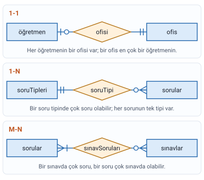
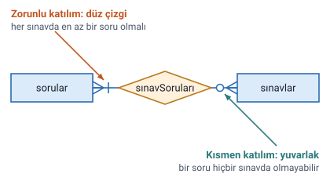
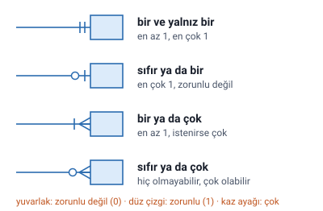
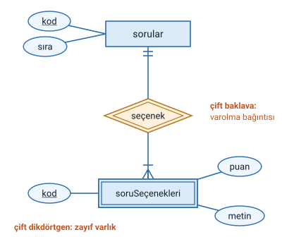

### Varlıklar arası bağıntılar

- Veritabanındaki varlıklar birbirleriyle **bağıntı** içinde olabilir.
- Bağıntılar E-R diyagramlarında **baklava dilimi** (eşkenar dörtgen) ile gösterilir.
- Her bağıntıya **kısa ve anlamlı bir isim** verilir.

Hocanın örneği: `soruTipleri` (nitelikleri: kod, açıklama) ve `sorular` (nitelikleri: kod, sıra, ağırlık, dosyaAdı) varlıkları, `soruTipi` adlı bağıntıyla birbirine bağlanır. Her sorunun bir tipi vardır.

### Veri bütünlüğü

İlişkisel veritabanı modellerinde, yanlış ya da ilişkisiz verilerin çeşitli yollarla veritabanına kaydedilmesi önlenip, farklı tablolara dağıtılan verilerin kendi içinde **tutarlılık** göstermesine **veri bütünlüğü** denir.

### Bütünlük kısıtları

Varlıklar arasında bağıntılar tanımlanırken bağıntının **bütünlük kısıtları** da tanımlanmalıdır. İki tür bütünlük kısıtı vardır:

1. **Eleman sayısı** bütünlük kısıtları: bir varlıktaki bir eleman, diğer varlıkta **kaç** elemanla eşleşebilir?
2. **Katılım** bütünlük kısıtı: varlığın bağıntıya katılması **zorunlu mu**, isteğe bağlı mı?

### Eleman sayısı bütünlük kısıtları

#### Birebir bağıntı (1-1)

- Hocanın tanımı: bir varlıktaki bir eleman, diğer varlıkta **bir** elemana karşılık gelmek zorundadır.
- Örnek: **öğretim elemanı** ve **ofis** varlıkları, `ofisi` bağıntısı. Bir öğretim elemanının yalnızca bir ofisi bulunabilir. (Hocanın şeklinde varlığın adı `öğretmen` olarak geçer.)

> **Dikkat:** Notta tanım hocanın sözüyle verildi. Ama "zorunda" sözü katılımla karıştırılmasın: 1-1'in asıl söylediği, iki tarafta da en çok **bir** eleman eşleşebileceğidir. Eşleşmenin zorunlu olup olmadığını ise aşağıdaki **katılım** kısıtı belirler.

#### Bire çok bağıntı (1-N)

- Bir varlıktaki bir eleman, diğer varlıkta **birden fazla** elemanla eşleşebilir.
- Örnek: **soru tipleri** ve **sorular** varlıkları, `soruTipi` bağıntısı. Bir soru tipi birden fazla soruyla eşleşebilir (ör. "çoktan seçmeli" tipinde birçok soru olur); her sorunun ise tek tipi vardır.

#### Çoğa çok bağıntı (M-N)

- Bir varlıktaki birden çok eleman, diğer varlıkta birden fazla elemanla eşleşebilir.
- Örnek: **sorular** ve **sınavlar** varlıkları, `sınavSoruları` bağıntısı. Bir soru birden fazla sınavda çıkabilir, bir sınav da birden fazla soru içerir.

> **Dikkat:** Slaytın metninde "sorular ve sınav tipleri" yazıyor; şekil ve örnek cümle ise "sınavlar" üzerinden. Doğrusu **sorular ve sınavlar**.

### Katılım bütünlük kısıtları

#### Bütün (zorunlu) katılım

- Bir bağıntıda varlıkların katılımının **zorunlu** olmasıyla ilgili kısıttır.
- Bu zorunluluk, varlık kısmına konulan **düz çizgi** ile ifade edilir.
- Örnek: sınav sisteminde **her sınavda en az bir soru bulunmalı**. Şekilde düz çizgi `sorular` ucundadır.

#### Kısmen katılım

- Bir bağıntı tanımında varlığın katılımı **isteğe bağlı** (opsiyonel) ise oluşturulur.
- Bu durum **yuvarlak** işareti ile ifade edilir.
- Örnek: sınav sisteminde **bir soru hiçbir sınavda kullanılmamış olabilir**. Şekilde yuvarlak `sınavlar` ucundadır.

> **Dikkat:** İşaret, **sayısı sınırlanan** varlığın ucuna konur. "Her sınavda en az bir soru" cümlesi bir sınavdaki soru sayısını sınırlar; bu yüzden düz çizgi `sorular` ucundadır. "Bir soru hiçbir sınavda kullanılmamış olabilir" cümlesi bir sorunun kaç sınavda yer alacağını anlatır; bu yüzden yuvarlak `sınavlar` ucundadır.

> **Dikkat:** Slaytta kısmen katılım için de "Bu zorunluluk, yuvarlak işareti ile ifade edilir" yazıyor; kastedilen isteğe bağlılıktır. Örnek cümle "her soru bir sınavda kullanılmamış olabilir" ise "bir soru hiçbir sınavda kullanılmamış olabilir" anlamındadır.

### İşaretleri okumak

> **Ek:** Slaytlarda yazıyla açıklanan yalnızca iki işarettir: **düz çizgi** (zorunlu katılım) ve **yuvarlak** (isteğe bağlı katılım). Kaz ayağının "çok", çift düz çizginin "bir ve yalnız bir" anlamı, hocanın şekillerindeki kullanımdan ve kaynak kitaptaki gösterimden gelir. Bu başlıktaki okumalar o yüzden ek bilgidir.

Hocanın şekillerinde çizginin ucuna konan işaretler hem **eleman sayısını** hem **katılımı** gösterir:

| İşaret | Okunuşu |
| --- | --- |
| Çift düz çizgi | bir ve yalnız bir (en az 1, en çok 1) |
| Yuvarlak ve düz çizgi | sıfır ya da bir (en çok 1, zorunlu değil) |
| Düz çizgi ve kaz ayağı | bir ya da çok (en az 1) |
| Yuvarlak ve kaz ayağı | sıfır ya da çok (zorunlu değil) |

Bir işaret, **yanında durduğu varlığın** kaç elemanının, karşı varlığın tek bir elemanıyla eşleşebileceğini söyler. Örneğin sınav sisteminde `sorular` yanındaki "düz çizgi ve kaz ayağı", bir sınavda **en az bir, istenirse çok** soru olacağını gösterir.

> **Ek:** Çok tarafı gösteren üç çizgili uca "kaz ayağı" (İngilizcesi crow's foot, karga ayağı) denir. Bu gösterim biçiminin adı da buradan gelir.

### Varolma bağıntısı

- **Zayıf varlık** ile onun sistemde bulunmasını sağlayan varlık (ya da varlıklar) arasında **varolma bağıntısı** olması gerekir.
- Zayıf varlık ile diğer varlık arasındaki bağıntı **çift çizgili baklava dilimi** ile gösterilir.

Hocanın örneği: `soruSeçenekleri` zayıf varlığı, `sorular` varlığına `seçenek` varolma bağıntısıyla bağlıdır. Bir seçenek ancak bir soruya ait olarak var olabilir; soru silinirse seçeneklerinin de anlamı kalmaz.

