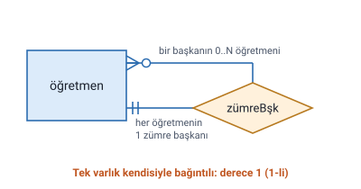
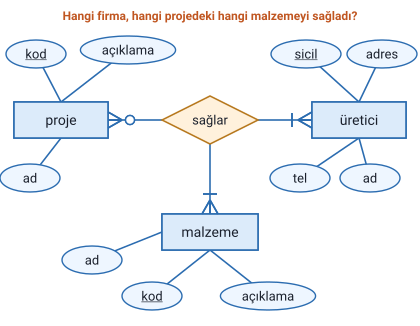
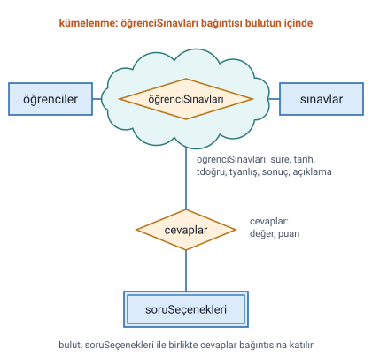

### Özyineli bağıntı

**Özyineli bağıntı**, bir varlığın **kendi içinde** oluşturulan bağıntıdır.

Örnek: `öğretmenler` varlığındaki her öğretmenin bir **zümre başkanı** olması gerekiyorsa ve zümre başkanı da yine bir öğretmense, öğretmen varlığı ile kendisi arasında `zümreBşk` adlı özyineli bağıntı kurulur.

> **Ek:** Şekildeki işaretlerin okunuşu: her öğretmenin **bir ve yalnız bir** zümre başkanı vardır (çift düz çizgi); bir zümre başkanının altında **sıfır ya da çok** öğretmen bulunabilir (yuvarlak ve kaz ayağı).

### Bağıntı derecesi

Bağıntılar ikiden fazla varlık arasında da kurulabilir. Aşağıdaki tablodan görüldüğü gibi **bağıntı derecesi**, bağıntıya katılan varlık sayısıdır.

| Bağıntı tipi | Derecesi |
| --- | --- |
| Özyineli | 1-li |
| İki varlık arasındaki | 2-li |
| Üç varlık arasındaki | 3-lü |
| Üçten fazla varlık arasındaki | N-li |

> **Dikkat:** Özyineli bağıntıda çizgiler iki kez çizilse de bağıntıya katılan **tek bir varlık** vardır; bu yüzden derecesi 1'dir.

### Üçüncü dereceden bağıntı

Üç varlık arasında kurulan bağıntıdır. Hocanın örneği: **projeler**, **malzemeler** ve **üretici firmalar**. Sorulan soru şudur: **hangi firma, hangi projedeki hangi malzemeyi sağladı?**

Bu soruyu cevaplamak için üç varlığı aynı anda bağlayan `sağlar` bağıntısı kurulur.

Şekildeki varlıklar ve nitelikleri:

- `proje`: kod, ad, açıklama
- `malzeme`: kod, ad, açıklama
- `üretici`: sicil, ad, adres, tel

> **Ek:** Neden ikişerli bağıntılar yetmez de üçlü bağıntı kurulur? "Firma A, Proje 1'e malzeme sağlıyor" ve "Firma A çimento sağlıyor" bilgileri ayrı ayrı tutulursa, Firma A'nın Proje 1'e **çimentoyu** mu yoksa başka bir malzemeyi mi verdiği bilinemez. Üçlü bağıntı bu üçünü tek kayıtta birlikte tutar.

### Kümelenme

Hocanın örneği bir **soru bankasıdır**: öğrenciler sınavlara girer; bir öğrencinin bir sınavda **hangi seçeneği işaretlediği**, sınavı aldığı **süre**, **tarih**, **toplam puan** gibi bilgiler tutulmak istenir.

Şekilde, `öğrenciler` ile `sınavlar` arasındaki `öğrenciSınavları` bağıntısı (nitelikleri: süre, tarih, tdoğru, tyanlış, sonuç, açıklama) bir **bulutun** içine alınmıştır. Bulut, `soruSeçenekleri` ile birlikte `cevaplar` adlı başka bir bağıntıya (nitelikleri: değer, puan) bağlanır.

> **Ek:** Kümelenme (İngilizcesi aggregation), bir bağıntının, başka bir bağıntıya katılabilmesi için tek bir varlık gibi ele alınmasıdır. Bu örnekte bulut, `öğrenciSınavları` bağıntısını bir varlık gibi `cevaplar` bağıntısına katar; böylece öğrencinin işaretlediği seçenek, öğrenciye ya da sınava değil, **"o öğrencinin o sınavı"** bilgisine bağlanır. Hocanın slaytında yazılı bir tanım yok, yalnızca örnek ve şekil var; bu tanım ders kitabındaki genel tanımdır.

### Kaynakça

Hocanın kaynak gösterdiği kitap: Tokdemir, G. ve Çağıltay, N. E. (2010). Veritabanı Sistemleri Dersi. Seçkin Yayıncılık, Ankara.
