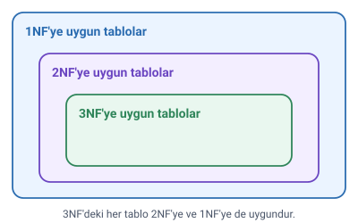

### Normalizasyon nedir

Hoca normalizasyonu iki cümleyle tanımlar:

- Normalizasyon; veritabanı tasarım aşamasında **veri tekrarını**, **veri kaybını** veya **veri yetersizliğini** önlemek için gerçekleştirilen işlemlerdir.
- Tanım olarak ise normalizasyon (**ayrıştırma**); veritabanlarında çok fazla sütun ve satırdan oluşan bir tabloyu tekrarlardan arındırmak için daha az satır ve sütun içeren **alt kümelerine ayrıştırma** işlemidir.

Yani normalizasyonda büyük bir tablo, tekrar eden bilgiler ortadan kalkacak şekilde daha küçük tablolara bölünür. Bunun adım adım nasıl yapıldığı "Birinci, İkinci ve Üçüncü Normal Form" konusunda anlatılır.

### Normal formlar

Normalizasyon yapılırken uyulması gereken kuralların her birine **normal form** adı verilir:

1. Birinci Normal Form (**1NF**)
2. İkinci Normal Form (**2NF**)
3. Üçüncü Normal Form (**3NF**)

Daha yüksek düzey formlar da vardır ama çok fazla kullanılmaz.

> **Ek:** Daha yüksek formlara örnek olarak Boyce-Codd Normal Formu (BCNF), 4NF ve 5NF verilebilir. Bu derste ilk üç form işlenir.

### İlk üç form ihlal edilirse

İlk üç düzey (1NF, 2NF, 3NF) ihlal edilirse şu işlemlerde zorluk çekilir:

- kayıt güncelleme,
- kayıt silme,
- kayıt bulma.

> **Dikkat:** Bu liste, "Birinci, İkinci ve Üçüncü Normal Form" konusundaki "Sorunlar" listesiyle karıştırılmasın. Buradaki üçlü: kayıt **güncelleme**, kayıt **silme**, kayıt **bulma**. "Sorunlar" listesindeki üçlü: veri **ekleme**, veri güncelleme, veri silme.

### Normal formlar arasındaki ilişki

- 3NF'de olan tablolar, 1NF ve 2NF'ye de uygundur.
- 2NF'de olan tablolar da 1NF'ye uygundur.

> **Dikkat:** İlişki tek yönlüdür. 3NF'deki bir tablo kesinlikle 2NF ve 1NF'dedir; ama 1NF'deki bir tablo 2NF'de olmayabilir. Formlar sırayla uygulanır: önce 1NF, sonra 2NF, sonra 3NF.

### Normalizasyonun amaçları

| Amaç | Açıklaması |
| --- | --- |
| Veri bütünlüğünün sağlanması | Gereksiz veri tekrarını önleyerek verilerdeki bozulmaları önlemek |
| Uygulamadan bağımsızlık | Uygulama değişse bile veritabanı tutarlı olarak çalışmalı |
| Performansı artırmak | Veri tekrarı en aza iner ve arama hızlı olur |

> **Ek:** Tekrarın neden bozulmaya yol açtığını bir örnekle düşünün: bir öğrencinin adresi her ders kaydında ayrı ayrı yazılıysa, adres değişince bazı satırlar güncellenip bazıları unutulabilir; aynı öğrencinin iki farklı adresi görünür. Normalizasyonla adres tek bir yerde tutulur.
