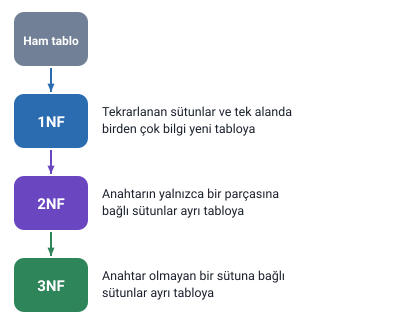
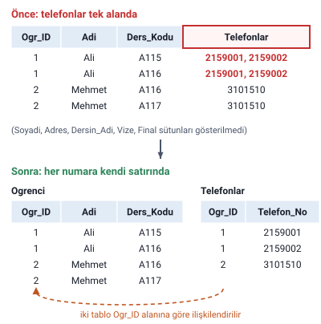
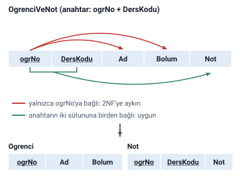
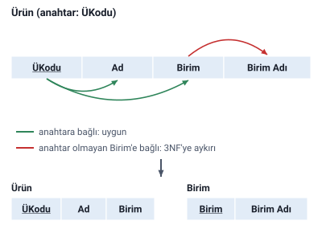
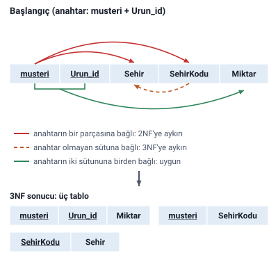

### Normalizasyon kuralları

Normalizasyonun üç kuralı vardır:

- Birinci Normal Form (First Normal Form), **1NF**
- İkinci Normal Form (Second Normal Form), **2NF**
- Üçüncü Normal Form (Third Normal Form), **3NF**

Her adım, bir önceki adımda düzenlenmiş tablolar üzerinde yapılır:

### Birinci normal form (1NF)

#### 1NF kuralları

- Tekrarlanan sütun yapıları olmamalıdır.
- Birden fazla türde bilgi tek bir sütunda olamaz.
- Bir alan içerisindeki bilgi özel karakterlerle ayrılarak tutulmamalıdır.

Örneğin öğrencilerin çeşitli derslerden aldığı notlar için `not1`, `not2`, `not3` diye alanlar tanımlanmamalıdır. Bu tarz bir yaklaşım, daha fazla not girilmesi gerektiğinde **eksikliğe**, daha az not girilmesi gerektiğinde ise **gereksiz alan kullanımına** neden olur.

Birinci normal formda bu tarz veriler **yeni bir tabloya** aktarılır ve ilgili olduğu tabloyla **birincil anahtar – yabancı anahtar** ilişkisi kurulur.

#### 1NF örneği: telefonlar

Hocanın başlangıç tablosu:

| Ogr_ID | Adi | Soyadi | Adres | Telefonlar | Ders_Kodu | Dersin_Adi | Vize | Final |
| --- | --- | --- | --- | --- | --- | --- | --- | --- |
| 1 | Ali | Yılmaz | Ankara | 2159001, 2159002 | A115 | Matematik | 40 | 50 |
| 1 | Ali | Yılmaz | Ankara | 2159001, 2159002 | A116 | Türkçe | 80 | 85 |
| 2 | Mehmet | Can | İstanbul | 3101510 | A116 | Türkçe | 45 | 80 |
| 2 | Mehmet | Can | İstanbul | 3101510 | A117 | İngilizce | 90 | 100 |

Bu tabloda 1NF'ye aykırı olan alan **Telefonlar** alanıdır: birden fazla telefon numarası tek bir alanda, virgülle ayrılarak tutulmaya çalışılmıştır.

Düzeltmek için telefonlar ayrı bir tabloda tutulur. Bu yeni tabloya, telefon numarasının hangi öğrenciye ait olduğunu göstermek için öğrenci numarasını tutan bir alan (`Ogr_ID`) eklenir.

Birinci normal form uygulandığında tablolar şöyle olur:

Ogrenci tablosu:

| Ogr_ID | Adi | Soyadi | Adres | Ders_Kodu | Dersin_Adi | Vize | Final |
| --- | --- | --- | --- | --- | --- | --- | --- |
| 1 | Ali | Yılmaz | Ankara | A115 | Matematik | 40 | 50 |
| 1 | Ali | Yılmaz | Ankara | A116 | Türkçe | 80 | 85 |
| 2 | Mehmet | Can | İstanbul | A116 | Türkçe | 45 | 80 |
| 2 | Mehmet | Can | İstanbul | A117 | İngilizce | 90 | 100 |

Telefonlar tablosu:

| Ogr_ID | Telefon_No |
| --- | --- |
| 1 | 2159001 |
| 1 | 2159002 |
| 2 | 3101510 |

Böylece iki tablo öğrenci numarasına (`Ogr_ID` alanı) göre ilişkilendirilmiş olur. Bu ilişkide **Ogrenci** tablosundaki `Ogr_ID` alanı **birincil anahtar**, **Telefonlar** tablosundaki `Ogr_ID` alanı ise **yabancı anahtardır**.

> **Dikkat:** Hocanın ifadesi: Ogrenci tablosundaki `Ogr_ID` birincil anahtar, Telefonlar tablosundaki `Ogr_ID` yabancı anahtardır. Yalnız şuna dikkat edin: bu aşamadaki Ogrenci tablosunda her öğrenci her dersi için ayrı bir satırda durduğundan `Ogr_ID` tekrar ediyor (1 ve 2 ikişer kez). `Ogr_ID`'nin tek başına birincil anahtar olabilmesi için öğrenci bilgilerinin ders ve not bilgilerinden ayrılması gerekir; bunu 2NF yapar.

#### Sorunlar

Hocanın "Sorunlar" slaytında sayılanlar:

- **Veri ekleme:** eklenen verinin daha önce olup olmadığının kontrolü zordur.
- **Veri güncelleme:** kişiye ait bir telefon numarası güncellenmek istendiğinde hangisinin güncelleneceği belirsizdir.
- **Veri silme:** silinecek verinin hangisi olduğu belirsizdir.

> **Dikkat:** Bu liste, "Normalizasyon: Tanım ve Amaçlar" konusundaki "ilk üç form ihlal edilirse" listesiyle karıştırılmasın. Buradaki üçlü: veri **ekleme**, veri **güncelleme**, veri **silme**. Oradaki üçlü: kayıt güncelleme, kayıt silme, kayıt **bulma**.

> **Ek:** Bu sorunlar, telefonların tek alanda tutulduğu başlangıç tablosunda açıkça görülür. Ali'nin "2159001, 2159002" yazan hücresinde yalnızca birini değiştirmek ya da silmek için hücrenin içindeki metni parçalamak gerekir; üstelik aynı hücre Ali'nin her ders satırında tekrar ettiği için hepsinin aynı biçimde değiştirilmesi gerekir. Telefonlar ayrı tabloya taşınınca her numara kendi satırındadır.

### İkinci normal form (2NF)

#### 2NF kuralları

1. Tabloda bir **birincil anahtar** olmalı ve anahtar olmayan sütunlar birincil anahtara **bağımlı** olmalı.
2. Birincil anahtar birden fazla sütundan oluşuyorsa, tablodaki veriler **her iki sütuna da** bağımlı olmalıdır.

#### 2NF örneği: öğrenci ve notlar

OgrenciVeNot tablosunda birincil anahtar iki sütundan oluşur: **ogrNo** ve **DersKodu** (hocanın tablosunda ikisinin de altı çizili).

| ogrNo | Ad | Bolum | DersKodu | Not |
| --- | --- | --- | --- | --- |
| 759 | Ali | Bilgisayar | c121 | 60 |
| 759 | Ali | Bilgisayar | c122 | 70 |
| 760 | Mehmet | Bilgisayar | c121 | 65 |
| 761 | Kemal | Büro | c134 | 90 |

`Not` hem öğrenciye hem derse bağlıdır: bir notu bulmak için anahtarın iki sütununu da bilmek gerekir. Ama `Ad` ve `Bolum` yalnızca `ogrNo`'ya bağlıdır; dersin kodu değişse de öğrencinin adı ve bölümü değişmez. Bu, ikinci kurala aykırıdır. Hocanın çözümü: **öğrenci bilgileri ve not bilgileri ayrılmalı.**

İkinci normal forma uygun hâli:

Ogrenci tablosu:

| ogrNo | Ad | Bolum |
| --- | --- | --- |
| 759 | Ali | Bilgisayar |
| 760 | Mehmet | Bilgisayar |
| 761 | Kemal | Büro |

Not tablosu:

| ogrNo | DersKodu | Not |
| --- | --- | --- |
| 759 | c121 | 60 |
| 759 | c122 | 70 |
| 760 | c121 | 65 |
| 761 | c134 | 90 |

Ayrıştırmadan sonra Ali'nin adı ve bölümü iki kez değil, bir kez yazılır.

### Üçüncü normal form (3NF)

#### 3NF kuralı

Anahtar olmayan sütunlar anahtar sütuna **tam bağımlı** olmalı; **anahtar olmayan bir sütuna bağımlı olmamalı.**

#### 3NF örneği: ürün ve birim

Ürün tablosunun birincil anahtarı **ÜKodu**'dur:

| ÜKodu | Ad | Birim | Birim Adı |
| --- | --- | --- | --- |
| k001 | Alçı | 1 | Kg |
| k002 | Tel | 2 | Cm |
| k003 | Boya | 3 | Lt |

`Birim Adı`, ürünün koduna değil `Birim` sütununa bağlıdır: birim 1 ise adı her zaman "Kg"dir. `Birim` ise anahtar olmayan bir sütundur. Bu, 3NF kuralına aykırıdır.

Üçüncü normal forma uygun hâli:

Ürün tablosu:

| ÜKodu | Ad | Birim |
| --- | --- | --- |
| k001 | Alçı | 1 |
| k002 | Tel | 2 |
| k003 | Boya | 3 |

Birim tablosu:

| Birim | Birim Adı |
| --- | --- |
| 1 | Kg |
| 2 | Cm |
| 3 | Lt |

> **Dikkat:** 2NF ile 3NF'yi ayıran soru şudur: anahtar olmayan sütun neye bağlı? **Anahtarın bir parçasına** bağlıysa 2NF'ye aykırıdır (Ad'ın yalnızca ogrNo'ya bağlı olması). **Anahtar olmayan başka bir sütuna** bağlıysa 3NF'ye aykırıdır (Birim Adı'nın Birim'e bağlı olması).

### Örnek: adım adım normalizasyon

#### Başlangıç tablosu

Hocanın örneğinde birincil anahtar iki sütundan oluşur: **musteri** ve **Urun_id**.

| musteri | Urun_id | Sehir | SehirKodu | Miktar |
| --- | --- | --- | --- | --- |
| M145 | U1 | Denizli | 1 | 100 |
| M145 | U2 | Denizli | 1 | 150 |
| M151 | U2 | Tokat | 2 | 75 |
| M149 | U3 | Samsun | 3 | 200 |
| M148 | U1 | Tokat | 2 | 140 |

Hocanın değerlendirmesi: **1NF uygun, 2NF değil.**

- 1NF uygundur: tekrarlanan sütun yok, her hücrede tek bir bilgi var.
- 2NF değildir: `Miktar` hem müşteriye hem ürüne bağlıdır, ama `Sehir` ve `SehirKodu` yalnızca `musteri`'ye bağlıdır (M145 hangi ürünü alırsa alsın Denizli'dedir). Anahtarın bir parçasına bağlı sütun var.

#### 2NF'ye geçiş

Müşteriye bağlı bilgiler ayrı tabloya alınır:

Sipariş bilgileri (anahtar: musteri + Urun_id):

| musteri | Urun_id | Miktar |
| --- | --- | --- |
| M145 | U1 | 100 |
| M145 | U2 | 150 |
| M151 | U2 | 75 |
| M149 | U3 | 200 |
| M148 | U1 | 140 |

Müşteri bilgileri (anahtar: musteri):

| musteri | Sehir | SehirKodu |
| --- | --- | --- |
| M145 | Denizli | 1 |
| M151 | Tokat | 2 |
| M149 | Samsun | 3 |
| M148 | Tokat | 2 |

Hocanın değerlendirmesi: **2NF uygun, 3NF uygun değil.** Müşteri tablosunda `Sehir`, anahtar olmayan `SehirKodu` sütununa bağlıdır: şehir kodu 2 olan her satırda şehir Tokat'tır ("Tokat" iki kez yazılmış).

#### 3NF'ye geçiş

Şehir bilgisi kendi tablosuna alınır. Sonuçta üç tablo olur.

Sipariş bilgileri (anahtar: musteri + Urun_id):

| musteri | Urun_id | Miktar |
| --- | --- | --- |
| M145 | U1 | 100 |
| M145 | U2 | 150 |
| M151 | U2 | 75 |
| M149 | U3 | 200 |
| M148 | U1 | 140 |

Müşteri bilgileri (anahtar: musteri):

| musteri | SehirKodu |
| --- | --- |
| M145 | 1 |
| M151 | 2 |
| M149 | 3 |
| M148 | 2 |

Şehir bilgileri (anahtar: SehirKodu):

| SehirKodu | Sehir |
| --- | --- |
| 1 | Denizli |
| 2 | Tokat |
| 3 | Samsun |

> **Ek:** Hocanın slaytlarında tabloların adı yok; "Sipariş bilgileri", "Müşteri bilgileri" ve "Şehir bilgileri" adları burada okumayı kolaylaştırmak için verildi. Şehir tablosunun anahtarı (SehirKodu) slaytta işaretli değildir.
