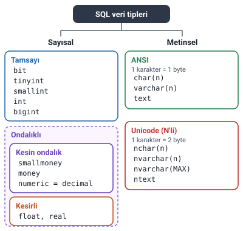
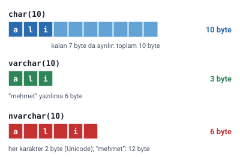

### SQL veri tipleri

Tablolar oluşturulurken alanların saklayacağı verilerin **tiplerinin** belirtilmesi gerekir. Girilecek veri metin, tam sayı, ondalıklı sayı ya da tarih olabilir. Bu yüzden tablo oluşturmaya geçmeden önce SQL'de kullanılan veri tiplerini bilmek gerekir.



> **Ek:** Slaytlarda tarih tipleri ayrıca anlatılmıyor; SQL Server'da tarih için `date`, tarih ve saat için `datetime` gibi tipler vardır.

> **Dikkat:** Hocanın anlattığı tipler ve değerler **SQL Server**'a (T-SQL) aittir; kaynakçadaki kitaplardan biri de SQL Server üzerinedir. MySQL, PostgreSQL gibi başka VTYS'lerde tiplerin adları ve sınırları farklı olabilir.

### Sayısal veri tipleri

Sayısal veri tipleri **tamsayı** ve **ondalıklı sayı** veri tipleri olmak üzere ikiye ayrılır. Tamsayı veri tipinde sayıların ondalık kısımları girilemez.

#### Tamsayı veri tipleri

| Tip | Saklayabildiği değerler | Kapladığı yer |
| --- | --- | --- |
| Bit | 1 ya da 0 | 1 byte |
| Tinyint | 0 ile 255 arası | 1 byte |
| Smallint | -32.768 ile 32.767 arası | 2 byte |
| Int | -2.147.483.648 ile 2.147.483.647 arası | 4 byte |
| Bigint | -9.223.372.036.854.775.808 ile 9.223.372.036.854.775.807 arası | 8 byte |

**Bit**, genellikle Evet/Hayır şeklindeki mantıksal bilgileri tutmak için kullanılır. Örneğin bir öğrencinin burs alıp almadığı bilgisi: burs alıyorsa 1, almıyorsa 0.

> **Dikkat:** Tinyint **negatif sayı tutmaz**: 0 ile 255 arasındadır. Smallint, Int ve Bigint hem negatif hem pozitif sayı tutar. Boyutlar sırayla 1, 2, 4, 8 byte'tır.

> **Ek:** Microsoft belgelerine göre bit alanı 1 ve 0'ın yanında NULL da alabilir. Bir tabloda 8'e kadar bit alanı birlikte 1 byte'ta saklanır.

#### Kesin ondalık sayı veri tipleri

Ondalık sayıların hem tamsayı bölümlerini hem ondalık bölümlerini **tam olarak** saklayan veri tipleridir.

| Tip | Saklayabildiği değerler | Ondalık hane | Kapladığı yer |
| --- | --- | --- | --- |
| Smallmoney | -214.748,3648 ile 214.748,3647 arası | 4 | 4 byte |
| Money | -922.337.203.685.477,5808 ile 922.337.203.685.477,5807 arası | 4 | 8 byte |

> **Dikkat:** Slaytta smallmoney'nin alt sınırı "-214.768,3648" yazılmış; doğrusu **-214.748,3648**'dir (üst sınırla aynı rakamlar). Slaytta ayrıca money ve smallmoney için "para birimi bilgisini de saklayabilir, 10 bin farklı para birimini saklayabilir" deniyor. Microsoft belgelerine göre bu tipler para birimini (TL, $, € gibi) **saklamaz**, yalnızca sayıyı saklar. Belgedeki ifade, değerin para biriminin **on binde biri** doğruluğunda tutulmasıdır; ondalıkta 4 hane bunu anlatır.

**Numeric** veri tipinde saklanacak sayının basamak sayısı tanımlanabilir: sayının tam ve ondalık basamak sayıları belirtilir. Numeric veri tipinin boyutu, belirtilen bu bilgilere göre değişir. Hem negatif hem pozitif, **38 basamağa** kadar sayı saklayabilir.

| Toplam basamak sayısı | Kapladığı alan |
| --- | --- |
| 1 – 9 | 5 byte |
| 10 – 19 | 9 byte |
| 20 – 28 | 13 byte |
| 29 – 38 | 17 byte |

Numeric alan tanımlandığında basamak sayılarının belirtilmesi gerekir.

**Decimal** veri tipi numeric ile eşdeğerdir. Aynı amaçla kullanılırlar, yalnızca isimleri farklıdır.

> **Ek:** `NUMERIC(5,2)` yazımında 5 toplam basamak sayısı, 2 ondalık basamak sayısıdır; en büyük değer 999,99 olur. Basamak sayısı yazılmazsa SQL Server `NUMERIC(18,0)` kabul eder, yani ondalık kısım saklanmaz. Hocanın "belirtilmesi gerekir" demesinin pratik nedeni budur.

#### Float ve real

- **Float:** çok büyük ve çok küçük kesirli sayılar için kullanılan veri tipidir. Boyutu 4 ile 8 byte arasındadır.
- **Real:** float ile aynı özelliklere sahiptir.

> **Dikkat:** Float ve real, decimal/numeric gibi **kesin** değildir; Microsoft belgelerinde **yaklaşık** sayı tipleri diye geçer: sayının kendisini değil ona çok yakın bir değeri saklarlar. Para gibi kuruşu kuruşuna tutulması gereken veriler için decimal, numeric ya da money kullanılır. Belgelere göre real, `float(24)`'ün eşdeğeridir ve 4 byte yer kaplar.

### Metinsel veri tipleri

**ANSI** standartlarına uyan herhangi bir karakter **1 byte** yer kaplar. **Unicode** karakterler ise hafızada **2 byte** yer kaplar. Unicode karakterler farklı dillere özgü karakterlerdir. Hocaya göre Türkçede kullandığımız ç, ğ, ş, ö gibi harfler bizim dilimize özgüdür ve ANSI standartlarında yer almaz.

| Tip | Boyutu | En çok |
| --- | --- | --- |
| Char(n) | 1 ile 8000 arasında | 8000 karakter |
| Nchar(n) | 2 ile 8000 arasında | 4000 karakter |
| Varchar(n) | 1 ile 8000 arasında | 8000 karakter |
| Nvarchar(n) | 2 ile 8000 arasında | 4000 karakter |
| Nvarchar(MAX) | En çok 2 gigabyte | 536.870.912 karakter (slayttaki değer) |
| Text | En çok 2 gigabyte | 1.073.741.824 karakter (slayttaki değer) |
| Ntext | En çok 2 gigabyte | 536.870.912 karakter (slayttaki değer) |

> **Dikkat:** Nchar(n) ve Nvarchar(n) Unicode karakter saklar; her karakter 2 byte'tır. Bu yüzden boyutları 2'den başlar ve karakter sınırları yarıya iner: boyut sınırı yine 8000 byte olduğu hâlde en çok 4000 karakter tutarlar (Char(n) ve Varchar(n) 8000). Nvarchar(MAX) ve Ntext için sınır ise "en çok 2 gigabyte"tır.

> **Dikkat:** Son üç satırdaki karakter sayıları Microsoft belgeleriyle uyuşmuyor. Belgelere göre text en çok 2.147.483.647, ntext en çok 1.073.741.823 karakter tutar; nvarchar(MAX)'ın üst sınırı da yaklaşık 2 GB'tır (her karakter 2 byte olduğundan yaklaşık 1 milyar karakter). Üçünün ortak noktası olan "en çok 2 gigabyte" bilgisi doğrudur.

> **Ek:** Slaytta hangi tipin ANSI, hangisinin Unicode olduğu tek tek yazmaz. Microsoft belgelerine göre adı N ile başlayan bütün tipler (Nchar, Nvarchar, Nvarchar(MAX), Ntext) Unicode; Char, Varchar ve Text ise Unicode olmayan tiplerdir. Konunun başındaki şekildeki gruplama buna göredir.

> **Ek:** "ANSI" burada İngilizce harflerden oluşan temel karakter kümesi anlamında kullanılıyor. Gerçekte veritabanının dil ayarı (harmanlama, collation) Türkçe ise varchar da ç, ğ, ş, ö'yü 1 byte'ta saklayabilir. Farklı dillerdeki metinler birlikte saklanacaksa N'li (Unicode) tipler kullanılır. Microsoft, text ve ntext'in ileride kaldırılacağını, yerine varchar(MAX) ve nvarchar(MAX) kullanılmasını önerir.

#### Char ile varchar farkı

- `char(10)` olarak tanımlanan bir alana "ali" de yazılsa "mehmet" de yazılsa kapladığı alan **10 byte**'tır.
- `varchar(10)` olarak tanımlanan bir alana "ali" yazılırsa **3 byte**, "mehmet" yazılırsa **6 byte** yer kaplar.

Yani char sabit uzunlukludur; varchar'da kaplanan alan veriye göre değişir. Char ile varchar arasındaki fark budur.

> **Ek:** Microsoft belgelerine göre varchar her değerin uzunluğunu tutmak için ayrıca 2 byte kullanır. Hocanın hesabı yalnızca verinin kendisini sayar; notta ve sorularda hocanın hesabı kullanıldı.

#### Nvarchar sorusu

Hocanın sorusu: `nvarchar(10)` olarak tanımlanan bir alana "ali" yazılırsa kaç byte, "mehmet" yazılırsa kaç byte yer kaplar?

Cevap, hocanın kuralıyla bulunur: nvarchar değişken uzunlukludur (varchar gibi) ve Unicode'dur (her karakter 2 byte).

- "ali": 3 karakter × 2 byte = **6 byte**
- "mehmet": 6 karakter × 2 byte = **12 byte**



> **Ek:** Aynı kuralla `nchar(10)` alanı, içine ne yazılırsa yazılsın 10 × 2 = 20 byte yer kaplar.

### NULL ve NOT NULL

Bir alanın **NULL** olarak tanımlanması, bu alana veri girilmeden yeni bir satır oluşturulabileceği anlamına gelir. Örneğin iki isimli insanları düşünerek tabloda "2. isim" diye bir alan açıldı. Her insanın 2. ismi olmak zorunda değildir; bu yüzden 2. isim alanı NULL yapılabilir.

Bazı veriler ise kesinlikle NULL yapılamaz (**NOT NULL**). Örneğin TC kimlik numarası her insanda olmak zorundadır; bu yüzden TC kimlik numarası alanı boş bırakılamaz.

> **Dikkat:** NULL, "0" ya da boş metin ("") demek değildir; o alana **hiç değer girilmediği** anlamına gelir.

### IDENTITY (otomatik artan sayı)

Bir tabloda bir alanın değerlerinin **ardışık sayılardan** oluşması isteniyorsa **identity** özelliği kullanılır. Böylece yeni kayıt eklendiğinde ürünün ya da nesnenin ID numarası **otomatik olarak artar.**

- Identity alanlar **güncellenemez** ve **boş bırakılamaz.**
- Identity alanlar genelde **primary key** (birincil anahtar) olarak kullanılır.

### SQL ile alan tanımı (Ek)

> **Ek:** Bu bölüm hocanın slaytında yok; SQL ilerideki notlarda işlenecek. Buradaki tipler ve özellikler SQL Server'da bir tablo kurulurken şöyle yazılır.

```sql
CREATE TABLE Ogrenci (
  OgrNo     INT IDENTITY(1,1) PRIMARY KEY,  -- 1'den başlar, her kayıtta 1 artar
  TcKimlik  CHAR(11)      NOT NULL,         -- her zaman 11 karakter, boş olamaz
  Ad        NVARCHAR(30)  NOT NULL,         -- Türkçe harfler için N'li tip
  IkinciAd  NVARCHAR(30)  NULL,             -- boş bırakılabilir
  BursVar   BIT           NOT NULL,         -- 1: alıyor, 0: almıyor
  Ortalama  NUMERIC(5,2)  NULL              -- en çok 999,99
);

INSERT INTO Ogrenci (TcKimlik, Ad, BursVar, Ortalama)
VALUES ('12345678901', N'Ayşe', 1, 85.50);
```

`OgrNo` yazılmadığı hâlde ilk kayıt 1 numarasını alır. `IkinciAd` yazılmadığı için NULL kalır. `TcKimlik` yazılmasaydı kayıt eklenmez, hata verirdi. Metnin önündeki `N` (`N'Ayşe'`), metnin Unicode olarak gönderildiğini belirtir.
