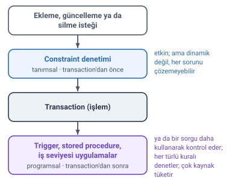
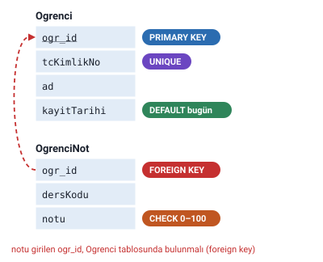

### Veri bütünlüğü

**Veri bütünlüğü**; bir tabloda veri güncelleme, silme veya ekleme gibi işlemler yapılırken diğer tablo ya da tablolardaki verilerin birbirleriyle **uyum** içinde olması, dolayısıyla **veri tutarlılığının** kaybolmamasının garanti altına alınması demektir.

Veri bütünlüğü iki yolla sağlanır: **programsal** veri bütünlüğü ve **tanımsal** veri bütünlüğü.

> **Dikkat:** Veri bütünlüğü "Bağıntılar ve Bütünlük Kısıtları" konusunda başka bir cümleyle tanımlanmıştı (yanlış ya da ilişkisiz verilerin kaydedilmesi önlenip farklı tablolara dağıtılan verilerin tutarlılık göstermesi). İki tanımın ortak noktası **tutarlılıktır**. Hangi tanım sorulursa sorulsun, o konunun cümlesiyle cevap verin. Veri bütünlüğünün sağlanması, normalizasyonun amaçlarından biri olarak da geçer ("Normalizasyon: Tanım ve Amaçlar").

### Programsal ve tanımsal veri bütünlüğü



| | Programsal veri bütünlüğü | Tanımsal veri bütünlüğü |
| --- | --- | --- |
| Araçlar | Trigger'lar, stored procedure'ler, iş seviyesi uygulamalar | Constraint'ler (kısıtlayıcılar) |
| Ne zaman devreye girer | Transaction'dan sonra devreye girer ya da bir sorgu daha kullanarak kontrol eder | Tablo ile birlikte derlenir, transaction'dan önce devreye girer |
| Güçlü yanı | Her türlü kuralı denetleyebilir | Etkindir |
| Zayıf yanı | Çok kaynak tüketir | Dinamik değildir, her sorunu çözemeyebilir |

> **Ek:** Transaction (işlem), veritabanında bir bütün olarak yapılan değişiklik adımıdır (ör. bir kaydın eklenmesi). Trigger (tetikleyici), bir tabloda ekleme, silme ya da güncelleme olduğunda kendiliğinden çalışan koddur; stored procedure (saklı yordam), veritabanında saklanan ve çağrılınca çalışan SQL kodudur.

#### Kısıtlayıcı türleri

Tanımsal veri bütünlüğünü sağlayan kısıtlayıcılar (constraint'ler):

- Primary Key Constraint
- Unique Constraint
- Check Constraint
- Default Constraint
- Foreign Key Constraint

Bunlardan ikisinin tablo dışında tanımlanan nesne karşılıkları da vardır:

- **Rule** = Check Constraint'in tablo dışındaki nesne karşılığı
- **Default** = Default Constraint'in tablo dışındaki nesne karşılığı

> **Ek:** Microsoft, Rule ve Default nesnelerinin ileride kaldırılacağını belirtir ve yerine Check ve Default constraint'lerinin kullanılmasını önerir.

### Primary key constraint

- Daha önce girilmemiş değerler girmeye zorlar; **her satırın tekilliğini** sağlar.
- **NULL kalamaz.**
- Her tabloda **en fazla 1 adet** bulunabilir.
- SQL Server tarafından arka planda **unique indeks** olarak gerçeklenir.

> **Dikkat:** "En fazla 1 birincil anahtar" sözü, anahtarın tek sütun olması gerektiği anlamına gelmez. Birincil anahtar birden fazla sütundan oluşabilir; "Birinci, İkinci ve Üçüncü Normal Form" konusundaki OgrenciVeNot tablosunda anahtar `ogrNo` ve `DersKodu` ikilisidir. Bu da tek bir birincil anahtardır.

### Unique constraint

- Bir tabloda **birden fazla sütunda** tanımlanabilir.
- SQL Server tarafından arka planda unique indeks olarak gerçeklenir.
- **NULL kalabilir**; ama NULL değilse mutlaka daha önce girilmemiş bir değer olmalıdır. Hocanın özetiyle: "Ya NULL kal ya tekrarlama."

Hocanın örneği: kişi kimlik bilgilerinin tutulduğu bir tabloda sicil numarası, TC kimlik numarası, vergi numarası, sosyal güvenlik numarası gibi bilgiler kişiye özeldir. Ama bunlardan **yalnızca biri** primary key olabilir. Diğer kişiye özel bilgilerin tekrarını engellemek için **unique** tanımlanır.

> **Dikkat:** Primary key ile unique en çok karıştırılan ikilidir. Primary key: tabloda en fazla 1 tane, NULL olamaz. Unique: birden fazla sütunda olabilir, NULL kalabilir. İkisi de tekrarı engeller.

> **Ek:** Microsoft belgelerine göre SQL Server'da unique bir sütunda NULL da yalnızca bir satırda bulunabilir; yani ikinci bir NULL da tekrar sayılır. PostgreSQL ve MySQL gibi bazı VTYS'lerde ise unique sütunda birden çok NULL olabilir.

### Check constraint

Check constraint (tablo dışındaki karşılığı Rule) şu durumlarda kullanılır:

- belli bir **formata** uygun veri girişi için,
- aynı tablonun **aynı satırında iki farklı sütun** değerini karşılaştırmak için.

Hocanın örnekleri:

- Doktor bilgilerinin tutulduğu bir tabloda doktorun `iseBaşlamaTarihi` ile `istenAyrılmaTarihi` karşılaştırılmalıdır, çünkü işten ayrılma tarihi başlama tarihinden önce olamaz.
- Öğrenci notlarının tutulduğu bir tabloda bir dersten alınabilecek notun **0 ile 100** arasında olmasının kontrolü.

### Default constraint

Default constraint (tablo dışındaki karşılığı Default):

- bir sütuna değer verilmezse girilecek **standart bir değer** tanımlar,
- **yalnızca INSERT** işleminde devreye girer.

Hocanın örneği: `tbl_ogrenci` tablosuna yeni bir öğrenci eklenirken `ogrenciKayitTarihi`'nin günün tarihi olarak eklenmesi. Bunun için kayıt eklenirken kayıt tarihi alanına değer **verilmemelidir**; değer verilirse varsayılan değer kullanılmaz.

### Foreign key constraint

- Bir tablodaki bir sütuna ait değerlerin, **başka bir tablonun belli sütunundan** gelmesini denetler.
- **CASCADE UPDATE** ve **CASCADE DELETE** özellikleri vardır.

Hocanın örneği: `OgrenciNot` tablosundaki `ogr_id`, `Ogrenci` tablosundaki `ogr_id` ile ilişkilendirilmezse, öğrenci tablosunda bulunmayan bir öğrenciye ait not sisteme kaydedilebilir.

> **Ek:** Cascade "zincirleme" demektir. CASCADE DELETE açıksa bir öğrenci silindiğinde ona ait notlar da kendiliğinden silinir. CASCADE UPDATE açıksa öğrencinin numarası değiştirildiğinde not tablosundaki numaralar da kendiliğinden güncellenir. Kapalıysa, notu bulunan bir öğrencinin silinmesine izin verilmez.

### Tablo seviyeli kısıtlamalar

Hocanın özet tablosu:

| Veri bütünlüğü | Kısıtlayıcı | Kontrol |
| --- | --- | --- |
| Satır bazlı | PRIMARY KEY | Bir satırın bir alanı için NULL alamaz. Girilmiş değerler girilemez, arka planda otomatik indeks tanımlanır. |
| Satır bazlı | UNIQUE | PK'dan başka alanlara girilen değerlerin tekrar girilememesini sağlar. NULL kalabilir. |
| Sütun bazlı | CHECK | Bir sütuna girilen değerler belli kümeden mi geliyor, belli koşullara uygun mu? Büyüklük-küçüklük-format vs. |
| Sütun bazlı | DEFAULT | Bir sütun için, INSERT yapılırken değer yok ise belli bir sabit değer atar. |
| Sütun bazlı | REFERANS (PK-FK) | Bir sütuna girilen değerlerin başka bir tablonun başka bir sütunundan geliyor olması |
| Referans bütünlüğü | CHECK | Bir tablonun bir sütununa girilen değerler, diğer sütunlara girilen değerlerle çelişiyor mu? (Aynı satır için) |
| Referans bütünlüğü | FOREIGN KEY | Bir sütuna girilen değerlerin başka bir tablonun başka bir sütunundan geliyor olması |



> **Dikkat:** Tabloda CHECK iki kez geçer: sütun bazlıda **tek bir sütunun** değerini (ör. not 0–100 arası), referans bütünlüğünde **aynı satırdaki iki sütunu** karşılaştırır (ör. ayrılma tarihi başlama tarihinden önce olamaz). REFERANS (PK-FK) ile FOREIGN KEY'in açıklaması da aynıdır; ikisi de değerin başka bir tablodan gelmesini denetler.

### SQL ile kısıtlayıcılar (Ek)

> **Ek:** Bu bölüm hocanın slaytında yok; SQL ilerideki notlarda işlenecek. Hocanın örnekleri SQL Server'da şöyle yazılır.

```sql
CREATE TABLE Ogrenci (
  ogr_id      INT IDENTITY(1,1) PRIMARY KEY,   -- birincil anahtar
  tcKimlikNo  CHAR(11) NOT NULL UNIQUE,        -- tekrar edemez
  ad          NVARCHAR(30) NOT NULL,
  kayitTarihi DATE NOT NULL DEFAULT GETDATE()  -- verilmezse günün tarihi
);

CREATE TABLE OgrenciNot (
  ogr_id   INT NOT NULL,
  dersKodu VARCHAR(10) NOT NULL,
  notu     TINYINT NOT NULL CHECK (notu BETWEEN 0 AND 100),
  PRIMARY KEY (ogr_id, dersKodu),              -- iki sütunlu tek anahtar
  FOREIGN KEY (ogr_id) REFERENCES Ogrenci (ogr_id)
    ON DELETE CASCADE                          -- öğrenci silinince notları da silinir
);

CREATE TABLE Doktor (
  doktorNo           INT PRIMARY KEY,
  iseBaslamaTarihi   DATE NOT NULL,
  istenAyrilmaTarihi DATE NULL,
  CHECK (istenAyrilmaTarihi >= iseBaslamaTarihi)  -- aynı satırda iki sütun
);
```

Bu tablolarla:

- `INSERT INTO Ogrenci (tcKimlikNo, ad) VALUES ('12345678901', N'Ali');` kaydı eklenir; `ogr_id` 1, `kayitTarihi` günün tarihi olur.
- Aynı TC kimlik numarasıyla ikinci kayıt **UNIQUE** yüzünden reddedilir.
- Notu 120 olan kayıt **CHECK** yüzünden reddedilir.
- `ogr_id` değeri 99 olan (Ogrenci tablosunda bulunmayan) bir öğrencinin notu **FOREIGN KEY** yüzünden reddedilir.
- İşten ayrılma tarihi başlama tarihinden önce olan doktor kaydı **CHECK** yüzünden reddedilir.

### Kaynakça

Hocanın kaynak gösterdiği kitaplar:

- Mistry, R. ve Misner, S. Introducing Microsoft SQL Server 2012.
- Rockoff, L. The Language of SQL: How to Access Data in Relational Databases.
- Özseven, T. Veritabanı Yönetim Sistemleri 1. Ekin Basım Yayın.
